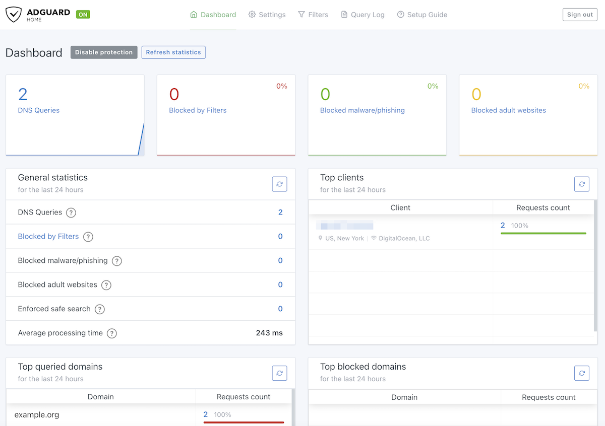

Menjalankan server DNS sinkhole lokal di jaringan rumah atau kantor kecil merupakan salah satu strategi paling efektif untuk memangkas iklan, memblokir pelacak data, dan menangkal domain berbahaya tanpa perlu memasang aplikasi tambahan pada setiap perangkat klien. Dari berbagai opsi perangkat lunak DNS filtering mandiri, AdGuard Home menjadi favorit praktisi jaringan karena performanya yang ringan, tampilan antarmuka yang modern, serta dukungan protokol DNS modern seperti DNS-over-HTTPS (DoH), DNS-over-TLS (DoT), hingga DNS-over-QUIC (DoQ).

Menerapkan **adguard home docker compose** memberikan keunggulan portabilitas tinggi dan siklus hidup aplikasi yang terisolasi rapi. Konfigurasi didefinisikan secara deklaratif dalam satu file YAML, memudahkan pencadangan data, serta memungkinkan proses pembaruan versi dilakukan hanya dengan satu baris perintah. Walaupun demikian, deployment AdGuard Home di atas Docker pada sistem operasi Linux modern sering kali memicu dua kendala teknis spesifik, yaitu konflik perebutan port 53 oleh daemon bawaan sistem serta hilangnya identitas alamat IP asli klien akibat mekanisme Source Network Address Translation (SNAT) pada bridge network Docker.

Panduan ini membahas arsitektur instalasi AdGuard Home berbasis Docker Compose secara mendalam, mulai dari mitigasi bentrok port di level sistem operasi, pemilihan mode jaringan terbaik, penyusunan konfigurasi YAML, hingga langkah pengujian dan optimasi upstream DNS resolver.

## Prasyarat Lingkungan Sistem

Sebelum memulai proses instalasi, pastikan infrastruktur server lokal Anda telah memenuhi beberapa persyaratan teknis berikut:

1. **Sistem Operasi Linux Server**: Menggunakan distribusi Linux modern seperti Ubuntu Server (22.04 LTS atau 24.04 LTS), Debian 12, Arch Linux, maupun Rocky Linux.
2. **Alamat IP Statis**: Server Linux wajib memiliki alamat IP lokal statis (misalnya `192.168.1.10`) agar tidak berubah ketika router melakukan pembaruan lease DHCP.
3. **Docker Engine dan Docker Compose v2**: Pastikan Docker Engine dan plugin Docker Compose versi terbaru telah terpasang dan berjalan normal. Verifikasi instalasi dengan perintah:

```bash
docker --version
docker compose version
```

4. **Akses Root atau Hak Akses Administratif**: Diperlukan izin administratif untuk mengelola konfigurasi resolver sistem dan membuka port jaringan bernomor rendah (port di bawah 1024).

## Mengatasi Konflik Port 53 dengan systemd-resolved

Pada mayoritas distribusi Linux modern berbasis systemd, daemon resolver bawaan sistem secara default menjalankan stub listener DNS lokal yang mendengarkan permintaan pada alamat `127.0.0.53:53`. Keberadaan stub listener ini menyebabkan kegagalan bind port ketika kontainer AdGuard Home mencoba mendengarkan port 53 pada seluruh antarmuka jaringan host (`0.0.0.0:53`), yang biasanya memicu pesan kesalahan alamat port telah digunakan.

Untuk membebaskan port 53 tanpa merusak resolusi DNS internal pada server host, ikuti langkah konfigurasi drop-in resmi berikut.

Pertama, buat direktori konfigurasi drop-in untuk resolver sistem:

```bash
sudo mkdir -p /etc/systemd/resolved.conf.d
```

Kedua, buat file konfigurasi baru bernama `/etc/systemd/resolved.conf.d/adguardhome.conf` menggunakan editor teks:

```bash
sudo nano /etc/systemd/resolved.conf.d/adguardhome.conf
```

Tambahkan baris direktif berikut untuk menonaktifkan stub listener dan mengarahkan DNS sistem host ke loopback lokal:

```ini
[Resolve]
DNS=127.0.0.1
DNSStubListener=no
```

Ketiga, hubungkan file `/etc/resolv.conf` ke file resolver aktual systemd agar sistem tidak lagi merujuk ke stub address `127.0.0.53`:

```bash
sudo mv /etc/resolv.conf /etc/resolv.conf.backup
sudo ln -s /run/systemd/resolve/resolv.conf /etc/resolv.conf
```

Keempat, muat ulang layanan resolver sistem dengan instruksi manajemen layanan Linux:

```bash
sudo systemctl reload-or-restart systemd-resolved
```

Kelima, verifikasi bahwa port UDP dan TCP 53 telah benar-benar bebas dari proses lain menggunakan utilitas socket statistics:

```bash
sudo ss -tulpn | grep :53
```

Jika perintah tersebut tidak menghasilkan baris keluaran apa pun, artinya port 53 kini telah sepenuhnya bersih dan siap dialokasikan untuk kontainer AdGuard Home.

## Menyiapkan Struktur Direktori Proyek

AdGuard Home membutuhkan dua direktori utama untuk persistensi data agar pengaturan filter dan riwayat query tidak hilang saat kontainer diperbarui atau dibuat ulang:

- `/opt/adguardhome/work`: Direktori kerja internal untuk menyimpan basis data statistik, riwayat query, data runtime, dan cache daftar filter.
- `/opt/adguardhome/conf`: Direktori konfigurasi internal tempat file `AdGuardHome.yaml` tersimpan.

Buat struktur folder proyek pada direktori home pengguna atau lokasi server yang Anda kehendaki:

```bash
mkdir -p ~/adguard-home/work ~/adguard-home/conf
cd ~/adguard-home
```

Pastikan pengguna lokal memiliki izin baca dan tulis penuh ke direktori tersebut:

```bash
chmod -R 755 ~/adguard-home
```

## Memilih Arsitektur Jaringan Docker

Dalam ekosistem Docker, terdapat dua pendekatan arsitektur jaringan yang dapat digunakan untuk menjalankan AdGuard Home, masing-masing dengan karakteristik teknis berbeda:

### Mode 1: Host Networking (Sangat Direkomendasikan)

Pada mode ini (`network_mode: host`), kontainer berbagi stack jaringan langsung dengan host Linux.

**Kelebihan utama:**
- **Identifikasi IP Klien Asli**: AdGuard Home dapat melihat alamat IP asli setiap perangkat klien di jaringan lokal (misalnya `192.168.1.15`, `192.168.1.42`), bukan IP bridge gateway Docker (`172.18.0.1`). Ini krusial agar Query Log dan aturan pemblokiran per klien dapat berfungsi akurat.
- **Dukungan DHCP Penuh**: Memungkinkan AdGuard Home bertindak sebagai server DHCP jaringan lokal tanpa kerumitan DHCP relay.
- **Performa Maksimal**: Menghilangkan beban translasi paket Docker userland proxy (NAT overhead).

### Mode 2: Bridge Networking dengan Port Mapping

Pendekatan ini menggunakan jaringan virtual bridge standar Docker dengan pemetaan port individual (`ports:`). Mode ini berguna jika server host Anda juga menjalankan reverse proxy atau aplikasi web lain yang sudah menggunakan port HTTP/HTTPS (port 80 atau 443).

## Membuat File docker-compose.yml

Buat file bernama `docker-compose.yml` di dalam direktori `~/adguard-home`:

```bash
nano docker-compose.yml
```

### Konfigurasi Rekomendasi (Mode Host)

Berikut adalah konfigurasi yang sangat disarankan untuk server DNS mandiri atau lingkungan home lab:

```yaml
services:
  adguardhome:
    image: adguard/adguardhome:latest
    container_name: adguardhome
    restart: unless-stopped
    network_mode: host
    volumes:
      - ./work:/opt/adguardhome/work
      - ./conf:/opt/adguardhome/conf
    environment:
      - TZ=Asia/Jakarta
```

### Konfigurasi Alternatif (Mode Bridge)

Jika server Anda memiliki aplikasi web lain di port 80 dan Anda lebih memilih pemetaan port terisolasi, gunakan susunan konfigurasi berikut:

```yaml
services:
  adguardhome:
    image: adguard/adguardhome:latest
    container_name: adguardhome
    restart: unless-stopped
    ports:
      - "53:53/tcp"
      - "53:53/udp"
      - "80:80/tcp"
      - "3000:3000/tcp"
      - "443:443/tcp"
      - "443:443/udp"
      - "853:853/tcp"
      - "853:853/udp"
    volumes:
      - ./work:/opt/adguardhome/work
      - ./conf:/opt/adguardhome/conf
    environment:
      - TZ=Asia/Jakarta
```

Daftar pemetaan port pada konfigurasi bridge di atas memiliki fungsi sebagai berikut:
- `53:53/tcp` dan `53:53/udp`: Jalur utama protokol DNS standar.
- `3000:3000/tcp`: Port wizard inisialisasi awal AdGuard Home.
- `80:80/tcp`: Antarmuka web dashboard administratif.
- `443:443/tcp` dan `443:443/udp`: Antarmuka dashboard HTTPS dan DNS-over-HTTPS (DoH).
- `853:853/tcp` dan `853:853/udp`: Layanan DNS-over-TLS (DoT) dan DNS-over-QUIC (DoQ).

## Menjalankan Layanan Kontainer

Setelah file konfigurasi tersimpan, jalankan kontainer AdGuard Home di latar belakang dengan perintah:

```bash
docker compose up -d
```

Docker akan mengunduh image resmi `adguard/adguardhome:latest` dari Docker Hub dan segera menjalankan kontainer.

Periksa status operasional kontainer untuk memastikan statusnya berjalan normal (`Up`):

```bash
docker compose ps
```

Pantau log inisialisasi awal untuk memastikan daemon berhasil mengikat port jaringan tanpa kendala:

```bash
docker compose logs -f adguardhome
```

Tekan kombinasi tombol `Ctrl + C` untuk keluar dari tampilan log setelah melihat pesan kesiapan layanan.

## Menyelesaikan Inisialisasi Wizard Awal

Buka peramban web pada komputer yang berada di jaringan lokal yang sama, lalu akses alamat IP server host pada port 3000:

```text
http://192.168.1.10:3000
```

Ganti `192.168.1.10` dengan alamat IP aktual server Linux Anda. Anda akan disambut oleh panduan instalasi selamat datang (Setup Wizard) AdGuard Home:

1. **Klik Get Started**: Wizard akan memandu Anda menentukan antarmuka jaringan.
2. **Pengaturan Antarmuka Web**: Pilih antarmuka jaringan `All interfaces` (atau antarmuka Ethernet utama Anda) dan tentukan port `80` (atau biarkan port default `3000` jika port 80 telah terpakai).
3. **Pengaturan Antarmuka DNS**: Pilih `All interfaces` dengan port default `53`. Sistem akan memeriksa apakah port 53 dapat diikat. Jika langkah pembersihan `systemd-resolved` sebelumnya berhasil, indikator akan berwarna hijau tanpa peringatan konflik.
4. **Pembuatan Kredensial Administrator**: Masukkan username administratif (misalnya `admin`) dan buat kata sandi yang kuat dan aman.
5. **Konfirmasi Selesai**: Klik tombol Next hingga halaman akhir, lalu klik Open Dashboard.


*Sumber: [AdGuard Official Blog](https://adguard.com/en/blog/adguard-home-on-public-server.html)*

Setelah proses inisialisasi rampung, port 3000 wizard akan dinonaktifkan otomatis, dan dashboard administratif kini dapat diakses melalui port web yang telah Anda tentukan (misalnya `http://192.168.1.10`).

## Konfigurasi Upstream DNS dan Filter Blocklist

Agar AdGuard Home dapat meneruskan query yang sah ke internet dengan kecepatan tinggi dan privasi terjamin, lakukan pengaturan upstream resolver berbasis protokol modern:

1. Masuk ke menu **Settings** > **DNS settings** pada dashboard AdGuard Home.
2. Pada bagian **Upstream DNS servers**, masukkan penyedia upstream DNS yang mendukung enkripsi DNS-over-HTTPS (DoH) atau DNS-over-TLS (DoT):

```text
https://cloudflare-dns.com/dns-query
https://dns.quad9.net/dns-query
tls://dns.adguard-dns.com
```

3. Pada bagian **Bootstrap DNS servers**, masukkan alamat IP penyedia DNS publik yang digunakan untuk menyelesaikan domain DoH saat pertama kali booting:

```text
1.1.1.1
9.9.9.9
1.0.0.1
```

4. Ubah mode query upstream menjadi **Parallel requests** untuk mendapatkan respons DNS tercepat dari beberapa server upstream secara simultan.
5. Klik **Apply** untuk menguji dan menyimpan konfigurasi upstream.

Selanjutnya, untuk memperkuat penyaringan iklan dan domain pelacak data:
1. Buka menu **Filters** > **DNS blocklists**.
2. Secara bawaan, filter resmi `AdGuard DNS filter` telah aktif.
3. Anda dapat menambahkan daftar filter populer lain seperti daftar OISD atau AdAway dengan menekan tombol **Add blocklist** > **Add a custom list**, lalu masukkan URL penyedia blocklist terpercaya.

## Verifikasi dan Pengujian Fungsionalitas DNS

Untuk menguji apakah server AdGuard Home telah merespons permintaan DNS dengan benar, jalankan pengujian dari terminal perangkat lain atau server itu sendiri menggunakan perkakas `dig` atau `nslookup`.

Uji resolusi domain normal:

```bash
dig @192.168.1.10 google.com +short
```

Perintah di atas harus mengembalikan alamat IP publik Google secara instan.

Selanjutnya, uji efektivitas pemblokiran dengan melakukan query ke domain pelacak iklan yang dikenal, misalnya `doubleclick.net`:

```bash
dig @192.168.1.10 doubleclick.net +short
```

AdGuard Home akan merespons dengan alamat `0.0.0.0`, yang menandakan bahwa domain pelacak tersebut berhasil diblokir di tingkat jaringan.

Terakhir, buka tab **Query Log** pada dashboard web AdGuard Home. Anda akan melihat catatan aktivitas kedua query di atas secara real-time, lengkap dengan status pemblokiran dan detail alamat IP perangkat pengirim.

## Mengarahkan Router ke Server AdGuard Home

Agar seluruh gawai di rumah (ponsel, smart TV, laptop, dan konsol game) terlindungi secara otomatis tanpa perlu mengubah setelan DNS manual satu per satu:

1. Buka antarmuka web router lokal Anda (biasanya di `192.168.1.1`).
2. Masuk ke menu **DHCP Server / LAN Settings**.
3. Cari kolom **Primary DNS (DNS 1)** dan masukkan alamat IP server AdGuard Home Anda (`192.168.1.10`).
4. Kosongkan kolom **Secondary DNS (DNS 2)** atau arahkan ke instance AdGuard Home kedua jika Anda memiliki setup redundansi (hindari mengisinya dengan DNS publik seperti 8.8.8.8 agar perangkat klien tidak melewati filter AdGuard Home).
5. Simpan pengaturan dan perbarui koneksi WiFi perangkat untuk merefresh konfigurasi DHCP lease.

## Pemecahan Kendala Umum

### 1. Error Port 53 Address Already in Use

Penyebab umum ialah proses resolver sistem atau daemon DNS lama yang masih aktif mendengarkan port 53.
- Jalankan `sudo lsof -i :53` atau `sudo ss -tulpn | grep :53` untuk mengidentifikasi PID dan nama proses yang menduduki port 53.
- Pastikan direktif `DNSStubListener=no` di `/etc/systemd/resolved.conf.d/adguardhome.conf` sudah terpasang dan symlink `/etc/resolv.conf` telah diperbarui.

### 2. Seluruh Klien Tercatat dengan IP 172.18.0.1 di Query Log

Kondisi ini terjadi jika Anda menjalankan AdGuard Home pada Docker dengan mode jaringan bridge standar. Mekanisme bridge Docker menerapkan NAT sehingga alamat IP sumber klien diganti dengan IP gateway virtual Docker.
- Solusi terbaik: Ubah konfigurasi `docker-compose.yml` menjadi `network_mode: host`. Terapkan konfigurasi baru tersebut dengan menjalankan ulang kontainer melalui docker compose down kemudian `docker compose up -d`.

### 3. File AdGuardHome.yaml Tidak Menyimpan Perubahan Manual

Jika Anda mengedit file konfigurasi `~/adguard-home/conf/AdGuardHome.yaml` menggunakan teks editor saat kontainer masih aktif, perubahan Anda akan ditimpa kembali oleh sistem saat AdGuard Home dimatikan.
- Hentikan layanan kontainer terlebih dahulu dengan docker compose stop sebelum menulis konfigurasi manual.
- Lakukan penyuntingan file konfigurasi secara manual.
- Nyalakan kembali kontainer setelah file tersimpan.

> **Baca Juga:**
> - [Panduan Setup Tailscale Exit Node Docker di Linux](/panduan-setup-tailscale-exit-node-docker-di-linux/)
> - [Cara Install AdGuard Home di Ubuntu Server Lengkap](/cara-install-adguard-home-di-ubuntu-server/)

Sumber: [AdGuard DNS Knowledge Base](https://adguard-dns.io/kb/adguard-home/docker/)
