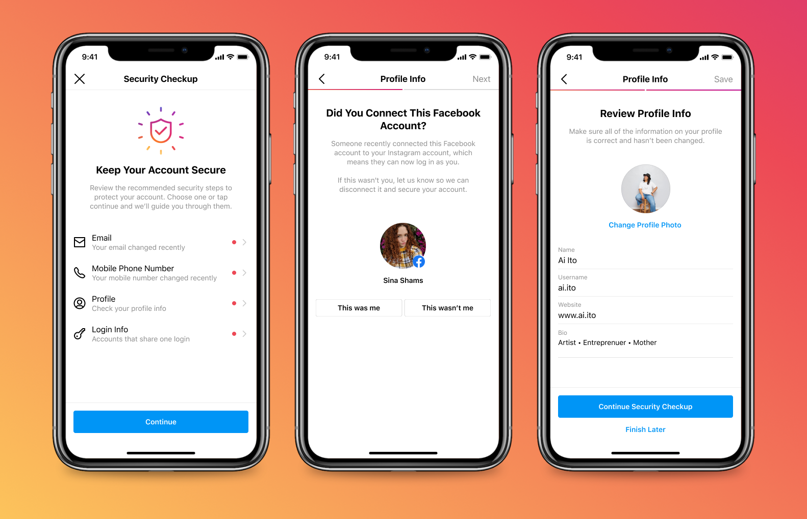

Kehilangan akses ke akun Instagram bukan sekadar urusan hilangnya galeri foto liburan atau koleksi reels favorit. Bagi banyak orang, akun Instagram merupakan etalase portofolio profesional, saluran komunikasi bisnis harian, hingga identitas digital utama di ruang publik. Begitu akun tersebut dibajak peretas, dampaknya bisa menjalar ke mana-mana, mulai dari penipuan modus pinjaman dana kepada teman kontak, pemerasan uang tebusan, hingga pencemaran nama baik.

Kasus pengambilalihan akun Instagram kian hari kian marak dengan metode yang makin canggih. Pelaku tidak lagi hanya menebak kata sandi sederhana, melainkan memakai taktik rekayasa sosial, situs pancingan (phishing) bertema pelanggaran hak cipta palsu, hingga eksploitasi aplikasi pihak ketiga yang pernah kita hubungkan beberapa tahun lalu.

Kabar baiknya, Meta telah memperbarui arsitektur keamanan Instagram secara berkala lewat dasbor Pusat Akun. Anda tidak butuh keahlian teknis tingkat lanjut untuk membangun benteng pertahanan digital yang kokoh. Melalui panduan lengkap amankan akun instagram ini, kita akan menyisir setiap sudut pengaturan penting agar akun Anda kebal dari upaya pembajakan pihak luar.

## Modus Kejahatan Siber yang Sering Mengincar Pengguna Instagram

Sebelum memperketat pengaturan keamanan, kita perlu mengenali pintu masuk yang paling sering dieksploitasi oleh pelaku pembajakan akun:

1. **Pesan Phishing Mengatasnamakan Instagram:** Modus paling populer adalah pesan langsung (DM) atau surel tiruan yang mengklaim akun Anda melanggar hak cipta atau memenuhi syarat untuk lencana centang biru (verified). Korban kemudian diarahkan mengisi nama pengguna dan kata sandi di situs web palsu. Ingat aturan dasarnya: Instagram tidak pernah mengirimkan peringatan resmi melalui DM.
2. **Serangan Credential Stuffing:** Jika Anda menggunakan kombinasi kata sandi dan alamat surel yang sama untuk banyak platform, kebocoran data di situs lain dapat dimanfaatkan peretas untuk mencoba masuk ke akun Instagram Anda secara otomatis.
3. **Penyusupan Lewat Aplikasi Pihak Ketiga:** Aplikasi analitik pengikut, layanan unduh otomatis, atau filter foto yang meminta izin akses login Instagram sering kali menyimpan token autentikasi tanpa enkripsi yang layak, membuka celah penyusupan jarak jauh.
4. **Pembajakan Kartu SIM (SIM Swap):** Jika pengamanan akun hanya bergantung pada kode SMS biasa, pelaku yang berhasil menduplikasi nomor ponsel Anda di gerai operator bisa merebut akun Anda dalam hitungan menit.

Dengan memahami ancaman tersebut, kita dapat menutup seluruh celah keamanan secara terarah.

## Langkah Demi Langkah Mengamankan Akun Instagram Secara Menyeluruh

Berikut urutan tindakan preventif yang harus Anda terapkan langsung di aplikasi Instagram ponsel pintar Anda:

### 1. Masuk ke Menu Kata Sandi dan Keamanan di Pusat Akun Meta

Pusat kendali privasi Instagram kini terintegrasi di dalam ekosistem Meta Accounts Center:

- Buka aplikasi Instagram di ponsel pintar Anda.
- Masuk ke tab **Profil** di pojok kanan bawah layar.
- Ketuk ikon tiga garis horizontal di sudut kanan atas untuk membuka menu utama.
- Pilih opsi **Pusat Akun** (Accounts Center) di bagian paling atas.
- Gulir ke bawah dan ketuk menu **Kata Sandi dan Keamanan** (Password and security).

Di dasbor inilah seluruh pengaturan autentikasi, verifikasi identitas, dan riwayat perangkat berada.

### 2. Aktifkan Autentikasi Dua Faktor (2FA) Berbasis Aplikasi

Autentikasi dua faktor (2FA) adalah lapisan pelindung paling krusial. Ketika fitur ini aktif, siapa pun yang mengetahui kata sandi Anda tetap tidak bisa masuk tanpa kode verifikasi dinamis yang berganti tiap 30 detik:

- Pada menu *Kata Sandi dan Keamanan*, ketuk opsi **Autentikasi Dua Faktor**.
- Pilih akun Instagram yang ingin dilindungi.
- Sistem akan menawarkan beberapa pilihan metode keamanan. Sangat disarankan memilih **Aplikasi Autentikasi** (seperti Google Authenticator, Microsoft Authenticator, atau Bitwarden) daripada metode SMS biasa.
- Salin kode kunci yang diberikan Instagram ke dalam aplikasi autentikator Anda, atau pindai kode QR yang muncul.
- Masukkan 6 digit angka yang muncul di aplikasi autentikator ke Instagram untuk memvalidasi konfigurasi.

Menggunakan aplikasi autentikator jauh lebih aman karena kode dihasilkan secara lokal di perangkat Anda tanpa melewati jaringan seluler, sehingga sepenuhnya kebal dari ancaman pembajakan kartu SIM.

### 3. Simpan Kode Cadangan Pemulihan ke Tempat Aman

Saat mengaktifkan 2FA, Instagram menyediakan serangkaian kode cadangan darurat (backup codes):

- Masuk kembali ke pengaturan 2FA, lalu ketuk menu **Metode Tambahan** > **Kode Cadangan**.
- Salin daftar kode cadangan delapan digit tersebut.
- Simpan catatan kode ini di brankas pengelola kata sandi terenkripsi atau cetak secara fisik dan simpan di tempat rahasia.

Kode cadangan adalah penyelamat tunggal jika suatu hari smartphone Anda hilang, rusak, atau terformat tanpa sempat mencadangkan aplikasi autentikator.

### 4. Manfaatkan Fitur Pemeriksaan Keamanan (Security Checkup)

Meta menyediakan fitur audit terpandu bernama Security Checkup untuk memindai kesehatan data akun Anda:

- Buka kembali menu *Kata Sandi dan Keamanan*, lalu pilih **Pemeriksaan Keamanan** (Security Checkup).
- Fitur ini akan memandu Anda memeriksa empat elemen utama: kekuatan kata sandi, validitas alamat surel pemulihan, keaktifan nomor telepon seluler, dan status autentikasi dua faktor.
- Pastikan alamat surel yang terdaftar adalah akun surel pribadi yang aktif Anda gunakan dan memiliki pengamanan 2FA mandiri. Surel merupakan benteng pertahanan terakhir untuk mengatur ulang kata sandi saat terjadi insiden darurat.

*Sumber: [Pusat Bantuan Instagram](https://help.instagram.com/369001149843369)*

### 5. Audit dan Putus Sesi Perangkat Asing (Tempat Anda Login)

Sering kali kita lupa pernah login di laptop kantor, komputer warnet, atau ponsel rekan kerja:

- Pada menu *Kata Sandi dan Keamanan*, pilih opsi **Tempat Anda Login** (Where you're logged in).
- Ketuk profil Instagram Anda untuk melihat rincian seluruh perangkat yang saat ini memiliki sesi aktif, lengkap dengan nama model ponsel, lokasi kota, dan waktu terakhir aktif.
- Jika menemukan perangkat atau lokasi yang tidak pernah Anda singgahi, centang perangkat tersebut lalu ketuk tombol **Keluar** (Log Out).
- Begitu sesi diputus, perangkat asing tersebut akan langsung tertendang dan membutuhkan login ulang beserta verifikasi 2FA penuh.

### 6. Bersihkan Akses Aplikasi dan Situs Web Pihak Ketiga

Banyak pengguna tanpa sadar memberikan izin akses akun kepada berbagai aplikasi di masa lalu:

- Masuk ke menu **Pengaturan dan Aktivitas** utama di Instagram.
- Gulir ke bagian izin dan ketuk menu **Aplikasi dan Situs Web** (Apps and websites).
- Periksa tab *Aktif* (Active).
- Hapus izin untuk seluruh aplikasi yang sudah tidak Anda kenali atau tidak lagi digunakan secara rutin, terutama aplikasi pelacak unfollower atau penyedia follower instan yang rawan kebocoran data token.

## Cara Mengenali Komunikasi Resmi dari Instagram

Salah satu taktik peretas yang paling banyak memakan korban adalah pemalsuan identitas (spoofing) staf pendukung Instagram. Agar Anda tidak mudah terkecoh:

- **Periksa Tab Surel dari Instagram:** Jangan pernah percaya pada pesan DM yang mengaku dari tim keamanan Meta. Jika Instagram memang perlu menghubungi Anda terkait keamanan atau kebijakan hak cipta, pesan resmi tersebut pasti tercatat di menu **Pengaturan** > **Pusat Akun** > **Kata Sandi dan Keamanan** > **Email dari Instagram**. Jika sebuah surel mengklaim dari Instagram tetapi tidak muncul di daftar tersebut, pesan itu dipastikan 100 persen penipuan phishing.
- **Waspadai Tautan Luar:** Jangan pernah memasukkan nama pengguna dan kata sandi pada formulir peninjauan hak cipta yang dikirim via tautan singkat Bitly, formulir Google Forms, atau domain asing non-instagram.com.

Dengan menerapkan seluruh tahapan pencegahan di atas secara disiplin, akun Instagram Anda akan terlindungi secara optimal dari ancaman siber dan Anda dapat terus berkarya dengan tenang tanpa rasa cemas.

Sumber: [Pusat Bantuan Instagram](https://help.instagram.com/369001149843369)
