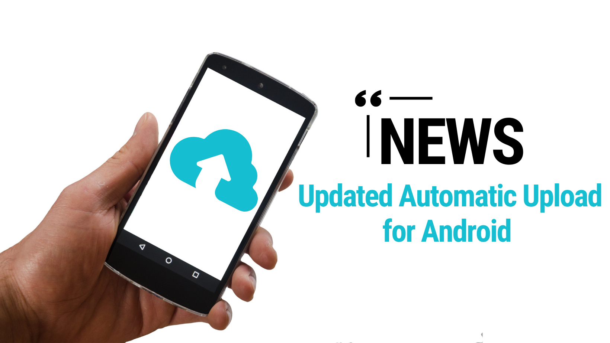

Pernahkah Anda tiba-tiba menerima pemberitahuan di ponsel bahwa ruang penyimpanan Google Drive Anda hampir habis, padahal Anda merasa jarang menyimpan berkas pekerjaan berukuran besar?

Bagi sebagian besar pengguna smartphone Android, kejutan semacam ini semakin sering terjadi dalam beberapa waktu terakhir. Sejak awal 2024, kebijakan Google resmi berubah. Cadangan aplikasi WhatsApp yang sebelumnya mendapatkan kuota tanpa batas kini dihitung langsung memotong jatah ruang penyimpanan gratis akun Google sebesar 15 GB.

Ketika kuota tersebut penuh, dampaknya langsung terasa ke seluruh ekosistem digital harian. Anda tidak bisa lagi menerima email masuk di Gmail, dokumen penting di Google Drive gagal tersimpan, dan pencadangan foto di Google Photos seketika terhenti.

Membeli langganan bulanan Google One memang menjadi jalan keluar paling cepat, tetapi tidak semua orang ingin terikat biaya berlangganan terus-menerus setiap bulan. Di sinilah layanan penyimpanan awan independen seperti pCloud menjadi alternatif yang sangat menarik.

Dengan reputasi keamanan berstandar privasi Swiss, opsi paket penyimpanan fleksibel, serta fitur pencadangan folder media yang cerdas, Anda dapat menerapkan strategi backup whatsapp pcloud secara mandiri tanpa harus mengorbankan kuota akun Google utama Anda.

Mari kita bahas tuntas langkah demi langkah cara mengamankan seluruh foto, video, serta riwayat obrolan WhatsApp Anda ke akun pCloud dengan praktis dan aman.

## Mengapa Memilih pCloud untuk Cadangan Data WhatsApp

Sebelum masuk ke tahap teknis, ada baiknya memahami keunggulan pCloud dibandingkan layanan cloud konvensional lainnya untuk kebutuhan pencadangan gadget harian.

Pertama, perlindungan privasi yang ketat. pCloud berbasis di Swiss dan tunduk pada undang-undang perlindungan data Swiss yang terkenal ketat serta mematuhi regulasi GDPR Uni Eropa. Data pribadi Anda terlindungi dari pemindaian otomatis untuk kebutuhan penargetan iklan.

Kedua, fleksibilitas paket penyimpanan. Selain memberikan kapasitas gratis hingga 10 GB bagi pengguna baru, pCloud menawarkan skema kepemilikan seumur hidup (*lifetime plan*). Anda hanya perlu membayar satu kali untuk kapasitas 500 GB, 2 TB, atau 10 TB tanpa perlu pusing memikirkan tagihan kartu kredit setiap awal bulan.

Ketiga, kemampuan memilah folder penyimpanan di perangkat seluler. Berbeda dengan aplikasi cloud lain yang sering kali memaksa mencadangkan seluruh galeri foto tanpa seleksi, aplikasi Android pCloud memiliki menu pengaturan khusus untuk memilih folder media spesifik di dalam sistem ponsel, termasuk folder khusus WhatsApp.

*Sumber: [pCloud Blog](https://blog.pcloud.com/news-android-update-backing-up-your-memories-its-easier-than-ever/)*

Keempat, pCloud menyediakan opsi perlindungan tambahan bernama pCloud Crypto. Fitur enkripsi sisi klien berstandar *zero-knowledge* ini memastikan bahwa berkas arsip yang Anda kunci hanya dapat dibuka dengan kata sandi rahasia yang Anda pegang sendiri, bahkan staf pengembang pCloud pun tidak memiliki kunci untuk mengintip isinya.

## Cara Mengaktifkan Pencadangan Otomatis Media WhatsApp ke pCloud

Sebagian besar ruang cadangan WhatsApp biasanya dihabiskan oleh tumpukan foto kiriman teman, dokumen kerja, dan video grup keluarga yang ukurannya bisa mencapai puluhan gigabita. Mengalihkan beban pencadangan media ini ke pCloud akan langsung melonggarkan ruang Google Drive Anda secara drastis.

Berikut langkah mudah mengaktifkan fitur pencadangan otomatis folder media WhatsApp di ponsel:

1. **Pasang Aplikasi pCloud Resmi:**
   Buka Google Play Store untuk pengguna Android atau App Store untuk pengguna iOS, cari aplikasi **pCloud: Cloud Storage**, lalu pasang pada perangkat Anda. Masuk menggunakan akun Anda yang sudah terdaftar.

2. **Berikan Izin Akses Penyimpanan:**
   Saat pertama kali dibuka, aplikasi akan meminta izin untuk membaca berkas media di perangkat. Pastikan Anda memilih opsi **Izinkan** agar pCloud dapat mendeteksi folder penyimpanan media di ponsel.

3. **Masuk ke Menu Setelan Aplikasi:**
   Ketuk ikon garis tiga di pojok kiri atas untuk membuka panel navigasi samping. Gulir ke bawah lalu pilih menu **Settings** (*Setelan*).

4. **Buka Opsi Automatic Upload:**
   Pada daftar pengaturan, cari dan pilih menu **Automatic Upload**. Aktifkan tombol sakelar utama untuk menghidupkan fitur ini.

5. **Pilih Folder Media WhatsApp Secara Spesifik:**
   Pilih opsi **Custom Folders** atau **Media Folders**. Pada daftar folder yang terdeteksi di ponsel Anda, beri tanda centang pada folder yang berkaitan dengan WhatsApp, seperti:
   - **WhatsApp Images:** Menampung seluruh foto masuk dan keluar.
   - **WhatsApp Video:** Menampung berkas rekaman video obrolan.
   - **WhatsApp Animated Gifs:** Menampung animasi stiker dan GIF.

6. **Atur Preferensi Jaringan Pengunggahan:**
   Di bagian bawah menu Automatic Upload, aktifkan opsi **Upload only on Wi-Fi**. Pengaturan ini sangat penting agar kuota paket data seluler Anda tidak terkuras habis saat ada kerabat yang mengirimkan video berukuran besar di grup WhatsApp.

Setelah langkah di atas selesai, setiap kali ada foto atau video baru yang masuk ke WhatsApp Anda, aplikasi pCloud akan otomatis membuat salinan cadangannya ke cloud di latar belakang.

## Cara Ekspor Riwayat Percakapan Penting Langsung ke pCloud

Fitur pencadangan media otomatis di atas sangat efektif mengamankan dokumen visual. Namun, bagaimana jika Anda memiliki riwayat obrolan teks penting yang berisi kesepakatan bisnis, bukti transaksi perbankan, atau percakapan keluarga berharga yang ingin disimpan terpisah?

WhatsApp menyediakan fitur resmi **Ekspor Chat** (*Export Chat*) yang dapat langsung Anda integrasikan dengan pCloud dalam hitungan detik.

Langkah mengekspor obrolan langsung ke pCloud:

1. Buka aplikasi WhatsApp di smartphone Anda.
2. Buka ruang obrolan perorangan atau obrolan grup yang hendak Anda amankan riwayatnya.
3. Ketuk ikon titik tiga vertikal di pojok kanan atas layar obrolan.
4. Pilih opsi **Lainnya** (*More*), kemudian klik menu **Ekspor chat** (*Export chat*).
5. Sistem akan menampilkan jendela konfirmasi apakah Anda ingin menyertakan media atau mengekspor teks saja. Pilih **Tanpa media** jika Anda hanya butuh transkrip percakapan agar prosesnya instan dan ukuran berkas kecil, atau pilih **Sertakan media** jika ada lampiran foto khusus yang ingin digabungkan.
6. Pada menu lembar berbagi (*share sheet*) sistem ponsel yang muncul di bagian bawah layar, cari dan pilih ikon aplikasi **pCloud**.
7. Tentukan folder tujuan di akun pCloud Anda, misalnya di folder khusus `WhatsApp/Arsip-Chat/2026/`, lalu ketuk tombol **Upload** atau **Simpan**.

WhatsApp akan mengemas seluruh riwayat obrolan tersebut ke dalam satu berkas teks berekstensi `.txt` lengkap dengan stempel waktu dan nama pengirim, tersimpan aman di server awan pCloud tanpa membebani penyimpanan lokal ponsel.

## Cara Menyimpan Salinan Database Cadangan Lokal ke pCloud

Bagi pengguna Android yang ingin memiliki salinan cadangan sistem utuh untuk keperluan pemulihan (*restore*) di masa mendatang, WhatsApp secara rutin membuat berkas database terenkripsi lokal di penyimpanan internal setiap dini hari sekitar pukul 02:00.

Berkas database ini dinamai dengan format `msgstore.db.crypt14` atau `msgstore.db.crypt15`. Anda bisa mencadangkan berkas penting ini ke pCloud secara manual atau terjadwal.

Berikut cara menemukan dan mengunggah berkas database lokal ke pCloud:

1. Buka aplikasi pengelola berkas (*File Manager* atau *Files by Google*) di smartphone Android Anda.
2. Buka direktori **Penyimpanan Internal** (*Internal Storage*).
3. Arahkan navigasi ke struktur folder berikut:
   `Android > media > com.whatsapp > WhatsApp > Databases`
4. Di dalam folder Databases, Anda akan menemukan berkas bernama `msgstore.db.crypt14` (cadangan database obrolan paling baru) serta beberapa berkas cadangan harian bertanggal sebelumnya.
5. Tekan dan tahan berkas `msgstore.db.crypt14` terbaru tersebut, lalu ketuk tombol **Bagikan** (*Share*).
6. Pilih aplikasi **pCloud**, pilih folder tujuan pencadangan di akun pCloud Anda, lalu ketuk **Upload**.

Jika Anda menyukai otomatisasi berkas cadangan lokal harian, Anda juga dapat menggunakan aplikasi pihak ketiga seperti FolderSync yang mendukung protokol WebDAV pCloud untuk menjadwalkan penyalinan otomatis folder Databases tersebut ke pCloud setiap minggu.

## Tips Mengelola Berkas Cadangan Agar Ruang Penyimpanan Rapi

Agar akun pCloud Anda tetap nyaman digunakan dan berkas cadangan mudah ditemukan kapan saja dibutuhkan, terapkan beberapa kebiasaan baik berikut:

- **Buat Hirarki Folder yang Terstruktur:**
  Sebelum mengunggah banyak berkas, buatlah folder induk di pCloud dengan nama yang jelas, misalnya `Cadangan-Gadget/WhatsApp/`. Di dalamnya, pisahkan subfolder antara `Media-Foto`, `Media-Video`, dan `Arsip-Pesan-Teks`.
- **Manfaatkan Fitur Free Up Space di Ponsel:**
  Setelah pCloud mengonfirmasi bahwa seluruh foto dan video WhatsApp telah berhasil diunggah dengan aman ke cloud, Anda bisa memanfaatkan fitur pembersihan memori internal ponsel. Di aplikasi pCloud, terdapat opsi untuk membebaskan ruang (*Free Up Space*) dengan menghapus salinan media lokal yang sudah sukses tersimpan di cloud.
- **Amankan Dokumen Rahasia ke Crypto Folder:**
  Jika Anda mengekspor berkas obrolan WhatsApp yang berisi dokumen rahasia, nomor identitas, atau informasi keuangan keluarga, pindahkan berkas teks tersebut ke dalam pCloud Crypto Folder untuk mendapatkan lapisan enkripsi ganda tingkat militer.
- **Periksa Koneksi Wi-Fi Sebelum Mengunggah Arsip Besar:**
  Pencadangan awal media WhatsApp biasanya memakan waktu beberapa puluh menit tergantung volume media yang terkumpul selama bertahun-tahun. Hubungkan ponsel ke jaringan Wi-Fi yang stabil dan sambungkan perangkat ke pengisi daya agar proses pengunggahan pertama tidak terhenti di tengah jalan.

Dengan mengombinasikan fitur Automatic Upload pCloud untuk media visual dan pencadangan berkas obrolan penting secara terarah, Anda kini tidak perlu lagi cemas menghadapi kuota Google Drive yang merah maupun risiko kehilangan kenangan berharga di aplikasi percakapan.

Sumber: [pCloud Support](https://pcloud.com/help/android-help-center/what-is-automatic-upload)
