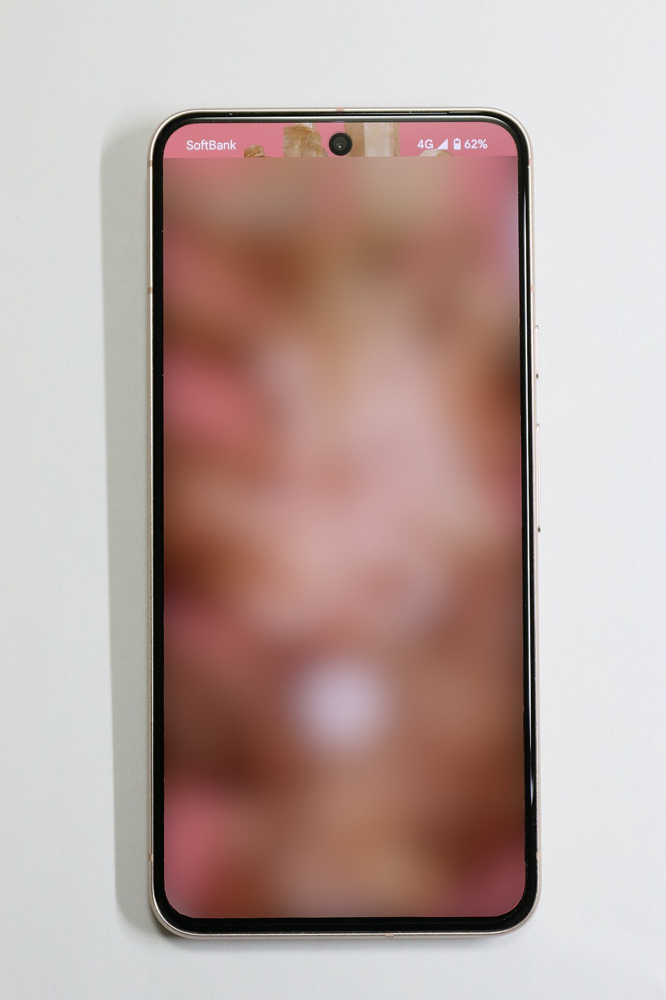

Pernahkah Anda mendapati notifikasi peringatan ruang penyimpanan hampir penuh saat hendak mengunduh aplikasi baru di ponsel? Atau mungkin salah satu aplikasi media sosial favorit mendadak berjalan lambat, fotonya tidak muncul sempurna, dan sering keluar sendiri ke layar utama?

Reaksi spontan yang sering kita jumpai di forum internet adalah saran untuk segera menghapus berkas sementara. Namun, tidak sedikit pengguna yang masih ragu melakukan pembersihan karena khawatir foto di galeri terhapus atau akun penting keluar otomatis.

Sebenarnya, mengelola berkas sementara pada sistem operasi mobile buatan Google bukanlah hal yang rumit jika Anda memahami seluk-beluknya. Memahami konsep dasar *cache android phone*, perbedaan fungsinya dengan berkas data utama, serta mengetahui kapan waktu yang tepat untuk membersihkannya akan menjaga performa perangkat tetap prima dalam penggunaan jangka panjang.

*Sumber: [Wikimedia Commons](https://commons.wikimedia.org/wiki/File:Google_Pixel_8_Rose_front.jpg)*

## Mengenal Cara Kerja Cache Android Phone

Secara sederhana, cache adalah ruang penyimpanan sementara yang digunakan aplikasi untuk menyimpan potongan data penting yang sering diakses berulang kali. Ketika Anda membuka peramban web Chrome, aplikasi belanja daring, atau linimasa Instagram, perangkat keras ponsel tidak hanya menampilkan informasi di layar, tetapi juga mengunduh elemen grafis seperti foto profil, thumbnail video, logo situs, dan skrip halaman web.

Elemen-elemen visual dan kode tersebut kemudian disimpan rapi di dalam partisi memori flash internal sebagai berkas cache. Tujuannya sangat jelas, yaitu mempercepat waktu muat aplikasi ketika Anda membukanya kembali di lain waktu.

Tanpa adanya sistem cache ini, aplikasi ponsel cerdas Anda harus mengunduh ulang seluruh gambar banner, tata letak antarmuka, dan file multimedia dari peladen internet setiap kali aplikasi dibuka. Hal tersebut tidak hanya membuat perangkat terasa lambat, tetapi juga akan menguras kuota internet secara cuma-cuma serta membuat daya baterai cepat habis karena modul modem bekerja tanpa henti.

Mekanisme ini dirancang sangat cerdas oleh para pengembang inti Android. Sistem operasi secara otomatis mengalokasikan ruang direktori khusus bagi setiap aplikasi agar berkas sementara dapat dibaca dengan cepat tanpa saling bertabrakan antarprogram.

## Perbedaan Krusial Antara Hapus Cache dan Hapus Data

Kekeliruan terbesar yang kerap terjadi di kalangan pengguna awam adalah menyamakan antara tombol Hapus Cache (*Clear Cache*) dan Hapus Data (*Clear Storage* / *Clear Data*) pada menu pengaturan ponsel. Memilih opsi yang keliru bisa membuat Anda kehilangan pengaturan penting.

Berikut adalah perbedaan mendasar dari kedua fungsi tersebut:

- **Hapus Cache (Clear Cache):** Tindakan ini murni hanya membuang berkas-berkas sementara seperti pratinjau gambar mini, file unduhan audio streaming sementara, dan potongan data cache peramban. Sesi login akun Anda, riwayat obrolan, preferensi tema, serta pengaturan akun di dalam aplikasi akan tetap aman dan tidak terpengaruh sama sekali.
- **Hapus Data atau Hapus Penyimpanan (Clear Storage):** Opsi ini merupakan tindakan penyetelan ulang menyeluruh. Mengklik tombol ini akan menghapus basis data lokal, berkas konfigurasi, status login, preferensi pengguna, hingga unduhan luring di aplikasi tersebut. Aplikasi akan kembali persis seperti saat pertama kali baru diunduh dari Google Play Store.

Jika Anda hanya mengalami masalah tampilan lambat atau gambar yang gagal dimuat, tombol Hapus Cache adalah pilihan yang paling aman untuk dicoba pertama kali. Hindari menyentuh tombol Hapus Data kecuali Anda benar-benar siap untuk memasukkan kembali nama pengguna dan kata sandi aplikasi bersangkutan.

## Kapan Waktu yang Tepat untuk Menghapus Cache?

Meskipun berkas sementara bermanfaat mempercepat kinerja, tumpukan berkas tersebut dapat menjadi bumerang jika dibiarkan membengkak tanpa kendali. Lantas, kapan kita sebaiknya melakukan pembersihan?

Pada dasarnya, Anda tidak perlu menghapus cache setiap hari apalagi setiap jam. Sistem kernel Linux pada Android sudah memiliki algoritma manajemen memori mandiri yang sangat efisien. Namun, ada beberapa kondisi khusus di mana pembersihan manual sangat dianjurkan:

1. **Aplikasi Mengalami Galat atau Crash Berulang:** Terkadang file sementara yang tersimpan mengalami korupsi data akibat koneksi terputus saat proses pengunduhan berlangsung. Menghapus cache akan memaksa aplikasi mengunduh salinan berkas bersih yang baru dari internet.
2. **Kapasitas Penyimpanan Internal Berada di Batas Kritis:** Jika memori internal ponsel Anda tersisa kurang dari 10 persen atau di bawah 2 GB, sistem operasi Android akan mulai kepayahan menjalankan proses latar belakang. Membersihkan cache aplikasi raksasa dapat memberi napas lega bagi sistem.
3. **Aplikasi Media Sosial dan Streaming yang Membengkak:** Aplikasi seperti TikTok, YouTube, Instagram, dan Spotify dikenal sangat rakus menyimpan berkas cache. Sering kali satu aplikasi saja mampu mengumpulkan berkas sementara hingga lebih dari 3 GB sampai 5 GB setelah digunakan beberapa pekan.
4. **Setelah Pembaruan Sistem atau Versi Aplikasi Besar:** Ketika aplikasi menerima pembaruan antarmuka besar-besaran, berkas cache versi lama terkadang bentrok dengan struktur kode baru, sehingga pembersihan cache membantu menyegarkan tampilan.

## Langkah Praktis Membersihkan Cache Aplikasi di Pengaturan

Setiap pabrikan ponsel seperti Google Pixel, Samsung Galaxy, Xiaomi, maupun Motorola mungkin memiliki penamaan menu yang sedikit berbeda, tetapi alur dasarnya tetap seragam di seluruh ekosistem Android modern:

1. Buka menu **Setelan** (*Settings*) di ponsel Android Anda.
2. Gulir layar ke bawah dan pilih menu **Aplikasi** (*Apps*) atau **Manajemen Aplikasi**.
3. Ketuk opsi **Lihat Semua Aplikasi** untuk membuka daftar lengkap program yang terpasang di perangkat.
4. Pilih salah satu aplikasi yang ingin Anda periksa, misalnya peramban web atau media sosial.
5. Ketuk menu **Penyimpanan & Cache** (*Storage & cache*).
6. Tekan tombol **Hapus Cache** (*Clear cache*) yang biasanya terletak di bagian sudut kanan bawah atau di samping ikon tempat sampah.

Sebagai trik cepat tanpa harus masuk ke menu Setelan, Anda juga dapat menekan dan menahan ikon aplikasi tertentu di layar beranda atau laci aplikasi, lalu mengetuk ikon huruf **i** kecil (*App Info*). Dari halaman tersebut, Anda bisa langsung melompat ke pengaturan penyimpanan dalam hitungan detik.

## Memanfaatkan Fitur Smart Storage dan Pengarsipan Otomatis

Bagi pengguna Android versi modern, Google telah memperkenalkan berbagai fitur otomasi pintar sehingga Anda tidak perlu lagi melakukan pembersihan manual satu per satu secara berulang.

Salah satu fitur unggulan tersebut adalah **Pengarsipan Otomatis** (*Automatically archive apps*) yang terintegrasi langsung di Google Play Store. Ketika penyimpanan ponsel mulai menipis, sistem akan secara otomatis mencopot komponen aplikasi yang jarang digunakan tanpa menghapus data pribadi maupun ikonnya di layar. Saat Anda ingin menggunakannya kembali di masa depan, Anda cukup mengetuk ikon tersebut untuk mengunduh ulang komponen dasarnya saja.

Selain itu, aplikasi manajemen berkas resmi seperti Files by Google juga menyediakan kartu rekomendasi pembersihan yang aman. Fitur ini mampu mendeteksi file sampah yang sudah kedaluwarsa, file unduhan ganda, serta foto buram tanpa merusak konfigurasi sistem ponsel.

## Mitos Aplikasi Pembersih Pihak Ketiga

Banyak pengguna pemula yang tergoda mengunduh aplikasi pihak ketiga berlabel pembersih RAM kilat, pendingin ponsel, atau *RAM Booster* dari toko aplikasi. Perlu diketahui bahwa sebagian besar aplikasi jenis ini justru kontraproduktif bagi kesehatan gadget Anda.

Aplikasi pembersih pihak ketiga biasanya bekerja secara agresif dengan cara mematikan paksa seluruh proses latar belakang. Padahal, sistem Android dirancang untuk membiarkan aplikasi tidur di memori RAM agar saat dibuka kembali ponsel tidak membutuhkan konsumsi daya prosesor yang tinggi.

Ketika aplikasi tersebut dimatikan secara paksa oleh pembersih pihak ketiga, sistem Android akan segera menghidupkannya kembali. Proses tutup-buka yang terjadi secara terus-menerus ini justru menyebabkan konsumsi daya baterai menjadi boros, ponsel terasa hangat, dan performa multitasking menjadi patah-patah. Menghindari pembersih pihak ketiga dan mengandalkan menu bawaan sistem adalah keputusan terbaik bagi keamanan dan keawetan ponsel Anda.

Mengelola *cache android phone* dengan bijak bukan berarti menghapusnya secara obsesif setiap saat. Jadikan pembersihan berkas sementara ini sebagai langkah penanganan masalah yang solutif saat memori menipis atau ketika ada aplikasi yang mogok, sehingga ponsel cerdas Anda dapat selalu beroperasi dengan gesit dan lancar.

Sumber: [Google Android Help](https://support.google.com/android/answer/7431795)
