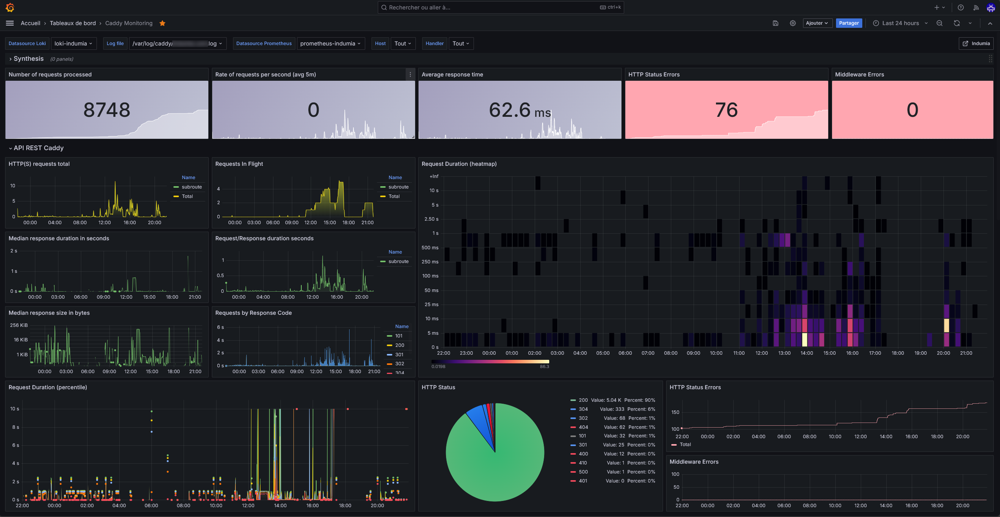

Caddy telah menjadi salah satu pilihan favorit para pengelola server modern dan penghuni homelab saat membutuhkan reverse proxy yang andal dan ringkas. Keunggulan otomatisasi penerbitan sertifikat SSL melalui Let's Encrypt serta struktur berkas Caddyfile yang bersih membuat banyak orang meninggalkan konfigurasi Nginx yang berbelit-belit. Namun, ada satu tantangan klasik yang kerap dihadapi sysadmin setelah mendeploy Caddy di lingkungan produksi: server ini secara default beroperasi dalam mode headless tanpa dasbor visual bawaan.

Ketika trafik melonjak tajam atau aplikasi backend di belakang proxy mengalami degradasi performa, mengandalkan pembacaan log mentah lewat journalctl atau menyisir berkas JSON berukuran ratusan megabita jelas tidak efisien. Di sinilah kebutuhan akan caddy proxy dashboard menjadi sangat krusial. Dengan menghadirkan panel visual real-time, ente bisa langsung mendeteksi lonjakan kode status HTTP 502 Bad Gateway, memantau utilisasi koneksi upstream, serta membaca persentil latensi jaringan tanpa menebak-nebak.

Berikut panduan langkah demi langkah membangun caddy proxy dashboard terintegrasi menggunakan kombinasi endpoint telemetri bawaan Caddy, mesin pengumpul data Prometheus, dan antarmuka analitik Grafana di lingkungan Linux.

## Mengapa Reverse Proxy Caddy Membutuhkan Dashboard Visual?

Pada infrastruktur jaringan berskala menengah hingga besar, reverse proxy berperan sebagai gerbang utama (entry point) yang mendistribusikan paket data ke puluhan container Docker, microservices, atau mesin virtual. Menjalankan gerbang ini tanpa visibilitas visual sama halnya dengan mengemudikan kendaraan di malam hari tanpa lampu dasbor penunjuk kecepatan dan bahan bakar.

Caddy menyediakan subsistem observabilitas kelas industri langsung di dalam basis kodenya. Subsistem ini dirancang untuk diintegrasikan dengan tumpukan monitoring modern:

1. **Pemantauan Kesehatan Upstream Secara Real-Time:** Mengetahui secara presisi apakah backend aplikasi internal sedang menerima beban atau mengalami kegagalan respons (unhealthy).
2. **Pengawasan Latensi Time-to-First-Byte (TTFB):** Membedah durasi respons jaringan ke dalam grafik persentil P50, P90, hingga P99 untuk mendeteksi bottleneck sebelum pengguna komplain.
3. **Analisis Rasio Kode Status HTTP:** Membedakan volume lalu lintas sukses (2xx/3xx) dari lonjakan request mencurigakan (4xx) dan kesalahan server internal (5xx).
4. **Deteksi Serangan dan Lonjakan Beban:** Mengamati laju request per detik (RPS) serta ukuran payload transfer data masuk dan keluar secara berkelanjutan.

| Komponen Metrik | Fungsi dalam Monitoring | Metrik Utama Caddy |
|---|---|---|
| Upstream Health | Status kelayakan server target di belakang proxy | `caddy_reverse_proxy_upstreams_healthy` |
| Request Concurrency | Jumlah permintaan aktif yang sedang diproses | `caddy_http_requests_in_flight` |
| Distribusi Latensi | Histogram waktu bolak-balik pengiriman paket | `caddy_http_request_duration_seconds` |
| Volume Respons | Jumlah total respons berdasarkan kode status | `caddy_http_responses_total` |
| Utilisasi Sistem | Beban memori RAM dan thread runtime Go | `process_resident_memory_bytes`, `go_goroutines` |

## Arsitektur Alur Data Telemetri Caddy

Sebelum melangkah ke tahap teknis, penting untuk memahami bagaimana data metrik mengalir dari reverse proxy hingga tampil rapi pada layar peramban ente:

1. **Caddy Web Server:** Mengumpulkan data runtime jaringan secara internal dan mengeksposnya dalam format eksposisi standar Prometheus melalui Admin API pada port lokal `2019` di endpoint `/metrics`.
2. **Prometheus Server:** Bertindak sebagai penarik data (scraper) yang secara periodik menyambangi endpoint Admin API Caddy setiap beberapa detik, lalu menyimpan catatan deret waktu (time-series database) ke dalam disk.
3. **Grafana:** Mengakses database Prometheus sebagai sumber data utama (data source) dan merendernya ke dalam widget visual interaktif berupa grafik garis, gauge ketersediaan, serta tabel status.

Arsitektur ini sangat efisien karena Caddy tidak perlu membuang sumber daya komputasi untuk merender grafik web yang berat. Tugas visualisasi sepenuhnya didelegasikan ke Grafana.

## Prasyarat Sebelum Konfigurasi

Sebelum mengeksekusi konfigurasi, pastikan sistem server ente telah memenuhi beberapa persyaratan berikut:

- Sistem operasi Linux berbasis Debian atau Ubuntu (misalnya Debian 11/12 atau Ubuntu 22.04/24.04 LTS).
- Caddy Web Server versi 2.6 atau yang lebih baru telah terpasang dan berjalan sebagai layanan sistem.
- Akun pengguna dengan hak akses administratif (`sudo`).
- Port lokal default: port `2019` (Admin API Caddy), port `9090` (Prometheus), dan port `3000` (Grafana).
- Jika server dilindungi firewall UFW, pastikan port akses antarmuka Grafana dibuka sesuai kebutuhan jaringan lokal ente.

## Langkah Konfigurasi Caddy Proxy Dashboard

Ikuti urutan langkah di bawah ini secara disiplin untuk mengaktifkan telemetri Caddy dan menyambungkannya ke dasbor visual.

### 1. Aktifkan Opsi Metrik pada Berkas Caddyfile

Langkah pertama adalah mengaktifkan pencatatan metrik pada tingkat server HTTP. Buka berkas konfigurasi Caddy utama:

```bash
sudo nano /etc/caddy/Caddyfile
```

Tambahkan blok opsi global di baris paling atas berkas. Pastikan parameter `per_host` disertakan agar metrik yang dikumpulkan mencakup label nama domain dari masing-masing upstream reverse proxy:

```caddyfile
{
    admin localhost:2019
    metrics {
        per_host
    }
}

# Contoh konfigurasi reverse proxy yang aktif
app.example.com {
    reverse_proxy 127.0.0.1:8080
}

api.example.com {
    reverse_proxy 127.0.0.1:9000
}
```

Pastikan arahan `admin off` tidak digunakan di dalam Caddyfile, karena metrik telemetri Caddy bergantung penuh pada Admin API REST internal. Simpan perubahan berkas lalu keluar dari editor.

Setelah berkas disimpan, lakukan validasi sintaks sebelum menerapkan perubahan:

```bash
caddy validate --config /etc/caddy/Caddyfile
```

Jika luaran menunjukkan pesan validasi sukses, perintahkan Caddy untuk memuat ulang konfigurasi tanpa memutus koneksi aktif:

```bash
caddy reload --config /etc/caddy/Caddyfile
```

### 2. Verifikasi Endpoint Metrik Admin API Caddy

Sebelum melangkah ke instalasi scraper, uji apakah endpoint metrik Caddy sudah merespons dengan benar pada mesin lokal server. Jalankan perintah curl berikut di terminal:

```bash
curl -s http://localhost:2019/metrics | head -n 25
```

Terminal akan memunculkan daftar variabel metrik berformat teks eksposisi Prometheus, seperti contoh di bawah ini:

```text
# HELP caddy_admin_http_requests_total Counter of requests made to the Admin API's HTTP endpoints.
# TYPE caddy_admin_http_requests_total counter
caddy_admin_http_requests_total{code="200",handler="metrics",method="GET",path="/metrics"} 1
# HELP caddy_http_requests_in_flight A gauge of requests currently being handled by this server.
# TYPE caddy_http_requests_in_flight gauge
caddy_http_requests_in_flight{handler="reverse_proxy",server="srv0"} 0
# HELP caddy_reverse_proxy_upstreams_healthy A gauge of reverse proxy upstreams healthiness.
# TYPE caddy_reverse_proxy_upstreams_healthy gauge
caddy_reverse_proxy_upstreams_healthy{upstream="127.0.0.1:8080"} 1
caddy_reverse_proxy_upstreams_healthy{upstream="127.0.0.1:9000"} 1
```

Perhatikan baris `caddy_reverse_proxy_upstreams_healthy`. Nilai `1` menandakan bahwa backend aplikasi di balik reverse proxy dalam keadaan sehat dan siap melayani permintaan lalu lintas jaringan.

### 3. Pasang dan Konfigurasikan Prometheus Scraper

Selanjutnya pasang Prometheus untuk mengumpulkan data deret waktu dari Caddy secara otomatis. Di sistem Debian dan Ubuntu, paket Prometheus tersedia langsung di repositori resmi:

```bash
sudo apt update
sudo apt install prometheus -y
```

Setelah instalasi selesai, buka berkas konfigurasi Prometheus:

```bash
sudo nano /etc/prometheus/prometheus.yml
```

Gulir ke bagian `scrape_configs` dan tambahkan tugas baru bernama `caddy` di bawahnya:

```yaml
scrape_configs:
  - job_name: 'prometheus'
    static_configs:
      - targets: ['localhost:9090']

  - job_name: 'caddy'
    scrape_interval: 15s
    scrape_timeout: 10s
    static_configs:
      - targets: ['localhost:2019']
```

Interval scrape selama 15 detik merupakan titik seimbang yang ideal antara akurasi pemantauan real-time dan efisiensi konsumsi ruang penyimpanan disk.

Simpan berkas konfigurasi, lalu aktifkan layanan Prometheus agar target baru segera dipantau:

```bash
sudo systemctl enable --now prometheus
sudo promtool check config /etc/prometheus/prometheus.yml
```

### 4. Instalasi dan Pengaturan Layanan Grafana

Untuk menghadirkan antarmuka visual caddy proxy dashboard, pasang Grafana edisi open-source. Pasang paket dependensi dan ambil rilis deb resmi Grafana:

```bash
sudo apt install -y adduser libfontconfig1 musl
wget https://dl.grafana.com/oss/release/grafana_11.2.0_amd64.deb
sudo dpkg -i grafana_11.2.0_amd64.deb
```

Aktifkan layanan Grafana agar menyala secara otomatis saat server dihidupkan:

```bash
sudo systemctl daemon-reload
sudo systemctl enable --now grafana-server
```

Pastikan port 3000 Grafana dapat diakses dari jaringan lokal ente. Jika server menggunakan firewall UFW, buka akses port 3000 untuk subnet lokal terpercaya:

```bash
sudo ufw allow from 192.168.1.0/24 to any port 3000 proto tcp comment 'Grafana Web UI'
```

Buka peramban di komputer lokal dan akses `http://<IP_SERVER>:3000`. Masuk menggunakan kredensial bawaan: nama pengguna `admin` dan kata sandi `admin`, lalu perbarui kata sandi baru sesuai petunjuk di layar.

### 5. Hubungkan Prometheus sebagai Data Source Grafana

Agar Grafana dapat membaca metrik Caddy yang dihimpun oleh Prometheus, ente perlu menambahkan Prometheus sebagai sumber data resmi:

1. Masuk ke dasbor web Grafana.
2. Di bilah menu navigasi sebelah kiri, klik menu **Connections** lalu pilih **Data sources**.
3. Klik tombol **Add data source** dan pilih opsi **Prometheus**.
4. Pada kolom **Prometheus server URL**, masukkan alamat lokal:
   ```text
   http://localhost:9090
   ```
5. Gulir ke bagian bawah halaman lalu klik tombol **Save & test**.
6. Pastikan muncul notifikasi hijau bertuliskan "Successfully queried the Prometheus API".

### 6. Impor Dashboard Caddy Reverse Proxy ke Grafana

Langkah pamungkas adalah memuat template visual dasbor. Komunitas Grafana telah menyediakan dashboard siap pakai yang dirancang khusus untuk memetakan telemetri Caddy.

1. Di menu navigasi samping Grafana, klik ikon **Dashboards**.
2. Klik tombol **New** di sudut kanan atas, lalu pilih opsi **Import**.
3. Pada kolom pencarian dasbor, masukkan ID dashboard komunitas untuk Caddy:
   - Masukkan ID: `20802` (Caddy Monitoring Dashboard) atau ID: `13462`.
4. Klik tombol **Load**.
5. Pada kolom seleksi **Prometheus**, tentukan data source Prometheus yang sudah dihubungkan pada langkah sebelumnya.
6. Klik tombol **Import**.


*Sumber: [Grafana Dashboards](https://grafana.com/grafana/dashboards/20802)*

Seketika antarmuka Grafana akan menampilkan caddy proxy dashboard yang kaya informasi visual, mulai dari grafik laju request per detik, sebaran latensi, hingga status kesehatan masing-masing upstream reverse proxy.

## Panduan Membaca Metrik pada Dashboard

Setelah dasbor aktif, berikut cara sysadmin memanfaatkan data visual tersebut untuk mendiagnosis performa infrastruktur jaringan:

### 1. Panel Request Rate per Upstream

Panel ini menampilkan laju permintaan masuk yang dialirkan ke masing-masing target reverse proxy. Kueri PromQL yang digunakan di balik panel ini umumnya berbentuk:

```promql
sum(rate(caddy_http_requests_total{handler="reverse_proxy"}[5m])) by (server, upstream)
```

Jika grafik menunjukkan lonjakan mendadak pada satu nama domain tertentu, ente bisa segera memeriksa apakah terjadi peningkatan trafik pengunjung organik atau indikasi serangan pemindaian bot otomatis.

### 2. Panel Latensi Jaringan dan TTFB

Distribusi waktu tunggu respons dihitung menggunakan fungsi histogram quantile. Untuk mengetahui waktu respons 95 persen pengguna (P95), kueri berikut diterapkan:

```promql
histogram_quantile(0.95, sum(rate(caddy_http_request_duration_seconds_bucket[5m])) by (le))
```

Nilai latensi di bawah 100 milidetik menandakan jalur koneksi prima. Apabila angka P95 merangkak naik melebihi 1 detik, kemungkinan besar backend database atau alokasi sumber daya CPU pada kontainer upstream mulai mengalami pelambatan (throttling).

### 3. Panel Upstream Health Check

Grafik gauge ketersediaan upstream membaca nilai biner dari metrik `caddy_reverse_proxy_upstreams_healthy`:

- **Nilai 1 (Warna Hijau):** Layanan backend normal dan merespons probe jaringan secara konsisten.
- **Nilai 0 (Warna Merah):** Layanan backend tidak dapat dihubungi atau mengalami kegagalan respons.

## Cara Pengujian dan Verifikasi Dashboard

Untuk memastikan grafik dasbor merespons perubahan kondisi jaringan secara nyata, lakukan dua uji simulasi berikut dari terminal komputer klien:

### 1. Simulasi Beban Trafik Jaringan

Jalankan pengujian beban sederhana menggunakan perkakas ApacheBench (`ab`) atau kueri loop curl untuk mengirimkan ribuan request ke domain Caddy:

```bash
ab -n 3000 -c 20 https://app.example.com/
```

Perhatikan layar dasbor Grafana. Ente akan melihat lonjakan kurva pada panel Active Requests in Flight serta peningkatan angka pada grafik HTTP Requests Total secara langsung.

### 2. Simulasi Kegagalan Upstream (Failover Verification)

Uji apakah panel upstream health check bekerja akurat dengan menonaktifkan sementara salah satu port target aplikasi di balik proxy, misalnya dengan menjeda sementara container Docker backend:

```bash
docker pause backend-app-01
```

Dalam rentang waktu beberapa detik (setelah scraping Prometheus berikutnya selesai), widget status di dasbor Grafana akan berubah warna dari hijau menjadi merah terang, mencerminkan nilai metrik `caddy_reverse_proxy_upstreams_healthy` bernilai 0. Hidupkan kembali container untuk memastikan status pulih ke normal:

```bash
docker unpause backend-app-01
```

## Solusi Kendala Umum (Troubleshooting)

Dalam implementasi telemetri caddy proxy dashboard, beberapa kendala umum berikut kerap ditemui:

### 1. Endpoint /metrics Menghasilkan Kesalahan 404 Not Found

Jika perintah curl ke `http://localhost:2019/metrics` menghasilkan respons 404 atau koneksi ditolak, periksa kembali opsi global di Caddyfile. Pastikan berkas konfigurasi tidak memuat arahan `admin off`. Jika Admin API sengaja dipindahkan ke soket unix atau port kustom, sesuaikan alamat target pada berkas konfigurasi Prometheus.

Jika ingin mengekspos metrik secara terpisah tanpa membuka seluruh Admin API, ente dapat menggunakan direktif `metrics` di dalam blok virtual host khusus:

```caddyfile
:2020 {
    metrics
}
```

### 2. Peringatan Kardinalitas Tinggi (High Cardinality)

Jika server Caddy menangani ribuan domain dinamis atau menerima trafik liar dari bot yang menyerang host acak, penggunaan opsi `observe_catchall_hosts` dapat memicu ledakan jumlah deret waktu di Prometheus.

Untuk mencegah memori RAM server membengkak, gunakan konfigurasi aman yang hanya mencatat domain yang secara eksplisit didefinisikan:

```caddyfile
{
    metrics {
        per_host
    }
}
```

Hindari menyalakan opsi `observe_catchall_hosts` kecuali pada lingkungan tertutup yang terkontrol ketat.

### 3. Masalah Konektivitas Prometheus di Lingkungan Docker

Apabila Prometheus dijalankan di dalam container Docker sementara Caddy terpasang langsung di sistem host Linux (bare-metal), Prometheus tidak dapat menjangkau `localhost:2019` karena kata `localhost` di dalam container merujuk pada jaringan internal container itu sendiri.

Solusinya, arahkan target scrape Prometheus ke alamat gateway Docker atau host internal:

```yaml
static_configs:
  - targets: ['host.docker.internal:2019']
```

Alternatif lainnya adalah menggunakan opsi `--network host` saat menjalankan container Prometheus agar dapat mengakses port lokal sistem host secara transparan.

Dengan arsitektur observabilitas yang tertata rapi, pemantauan reverse proxy kini tidak lagi mengandalkan tebakan log manual, melainkan terpantau jelas melalui dasbor analitik real-time yang presisi dan andal.

Sumber: [Caddy Documentation](https://caddyserver.com/docs/metrics)
