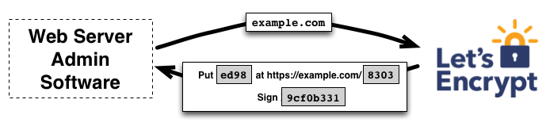

Bagi siapa saja yang mengelola web server di Linux, urusan sertifikat SSL kerap kali menjadi rutinitas yang melelahkan jika masih memakai cara lama. Di masa ketika Apache dan Nginx mendominasi, kita terbiasa memasang Certbot secara terpisah, mengatur cron job pembaruan berkala, mengedit puluhan baris konfigurasi VirtualHost, serta harap-harap cemas setiap tiga bulan sekali kalau-kalau sertifikat Let's Encrypt gagal diperbarui otomatis. Caddy web server hadir membalik paradigma tersebut dengan arsitektur Automatic HTTPS bawaan yang revolusioner.

Pengaturan caddyfile ssl certificate memungkinkan server web secara otomatis meminta, memvalidasi, memasang, dan memperbarui sertifikat TLS dari Let's Encrypt atau ZeroSSL tanpa bantuan dependensi luar. Cukup dengan menuliskan nama domain pada berkas Caddyfile, Caddy langsung menangani seluruh siklus hidup sertifikat, mengalihkan trafik HTTP ke HTTPS, serta menjaga keamanan koneksi jaringan secara mandiri.

Di artikel ini, ane bakal ajak ente mengupas tuntas cara konfigurasi caddyfile ssl certificate di berbagai skenario dunia nyata. Kita akan bedah mulai dari otomatisasi standar ACME publik, pemasangan sertifikat kustom mandiri (*custom certificate*), pemanfaatan Internal CA untuk jaringan privat dan homelab, hingga validasi DNS challenge untuk sertifikat wildcard.

## Memahami Cara Kerja Otomatisasi HTTPS pada Caddyfile

Sebelum mengedit berkas konfigurasi, penting buat kita memahami apa yang sebenarnya terjadi di balik layar saat Caddy membaca sebuah nama domain. Caddy bukan sekadar web server biasa, di dalamnya tersemat pustaka CertMagic yang bertindak sebagai mesin manajemen sertifikat cerdas.

Ketika Caddy dijalankan dengan berkas Caddyfile, ia akan memindai seluruh blok situs yang didefinisikan. Jika suatu blok menggunakan nama domain yang valid (seperti `web.contoh.com`), bukan alamat `http://` eksplisit dan bukan nomor port HTTP semata, Caddy secara otomatis mengaktifkan fitur *Automatic HTTPS*. Fitur ini memicu serangkaian tindakan otomatis:

1. Menghubungi penyedia Certificate Authority (CA) publik melalui protokol ACME (Automated Certificate Management Environment), secara default menggunakan Let's Encrypt dan ZeroSSL sebagai cadangan redundan.
2. Membuka listener sementara untuk menyelesaikan tantangan validasi kepemilikan domain (HTTP-01 challenge pada port 80 atau TLS-ALPN-01 pada port 443).
3. Mengunduh pasangan kunci publik dan privat terenkripsi lalu menyimpannya di direktori penyimpanan lokal yang aman.
4. Membuat rute pengalihan (*HTTP to HTTPS redirect*) otomatis dari port 80 ke port 443 sehingga pengunjung selalu diarahkan ke koneksi aman.
5. Menjalankan proses latar belakang (*background goroutine*) yang memantau sisa masa aktif sertifikat dan memperbaruinya secara otomatis saat masa berlakunya tersisa sekitar 30 hari.


*Sumber: [Let's Encrypt Documentation](https://letsencrypt.org/how-it-works/)*

Mekanisme ini berjalan tanpa perlu sentuhan tangan kita lagi. Bahkan jika satu CA publik sedang mengalami gangguan layanan (*downtime*), Caddy secara pintar langsung beralih ke CA sekunder tanpa memutus layanan web yang sedang melayani pengunjung.

## Prasyarat Sistem dan Kesiapan Port Jaringan

Agar konfigurasi caddyfile ssl certificate berjalan mulus, pastikan server Linux ente telah memenuhi sejumlah kondisi dasar berikut:

1. Server Linux dengan distribusi modern (Ubuntu 22.04 LTS, Ubuntu 24.04 LTS, Debian 12, Arch Linux, atau Rocky Linux) yang sudah terpasang paket Caddy versi 2.8 ke atas.
2. Nama domain publik yang sudah diarahkan DNS A record miliknya ke alamat IP publik server ente. Pastikan masa propagasi DNS sudah selesai sebelum menyalakan Caddy.
3. Akses port 80 (HTTP) dan port 443 (HTTPS) yang terbuka penuh pada firewall lokal maupun firewall penyedia cloud (seperti Security Group di AWS, DigitalOcean, Linode, atau Oracle Cloud). Caddy wajib mendengarkan port 80 dari internet luar untuk meloloskan tantangan validasi ACME HTTP-01.
4. Tidak ada web server lain yang sedang mengikat port 80 dan 443 secara bersamaan di server yang sama.

Untuk memastikan port 80 dan 443 sedang tidak dipakai oleh aplikasi lain di server, jalankan perintah pengecekan soket jaringan berikut:

```bash
sudo ss -tulpn | grep -E ':(80|443)'
```

Jika output kosong, berarti port jaringan server dalam kondisi bersih dan Caddy siap mengambil alih penanganan koneksi TLS.

## Langkah 1 Mengatur Opsi Global Email dan ACME CA

Langkah awal yang sangat direkomendasikan adalah menentukan opsi global pada baris teratas Caddyfile. Opsi global ditempatkan di dalam kurung kurawal pembuka `{ ... }` sebelum blok situs mana pun didefinisikan.

Pada opsi global ini, kita bisa menentukan alamat surel administrator server. Alamat surel ini dipakai saat mendaftarkan akun ke Let's Encrypt, sehingga pihak CA dapat mengirimkan notifikasi penting jika sertifikat mendekati kedaluwarsa akibat masalah teknis.

Buka berkas konfigurasi Caddy menggunakan editor teks favorit ente:

```bash
sudo nano /etc/caddy/Caddyfile
```

Tambahkan blok opsi global di baris paling atas:

```caddyfile
{
    email admin@contoh.com
    # acme_ca https://acme-staging-v02.api.letsencrypt.org/directory
}
```

Perhatikan baris `acme_ca` yang dikomentari di atas. Baris tersebut mengarah ke lingkungan pengujian (*Let's Encrypt staging endpoint*). Jika ente sedang bereksperimen dengan banyak subdomain atau sering melakukan pengujian konfigurasi, sangat disarankan mengaktifkan endpoint staging tersebut terlebih dahulu. Hal ini berguna untuk menghindari pemblokiran batas permintaan (*rate limit*) Let's Encrypt produksi yang membatasi pembuatan sertifikat baru hingga lima kali per domain per minggu. Setelah semuanya terbukti lancar, cukup beri tanda pagar kembali pada baris tersebut agar Caddy beralih ke CA produksi.

## Langkah 2 Konfigurasi Penerbitan Sertifikat Publik Otomatis

Skenario paling umum adalah mengamankan website atau reverse proxy yang dapat diakses publik dari internet. Di Caddy, konfigurasi ini sangat hemat baris kode. Ente hanya perlu menuliskan nama domain lengkap sebagai kepala blok situs.

Sebagai contoh, jika ente ingin mengamankan domain `web.contoh.com` yang meneruskan trafik ke aplikasi lokal di port 3000:

```caddyfile
web.contoh.com {
    reverse_proxy 127.0.0.1:3000
}
```

Hanya dengan dua baris di atas, Caddy secara otomatis melakukan hal berikut:
* Mendeteksi bahwa `web.contoh.com` adalah domain publik.
* Mengontak Let's Encrypt dan meminta sertifikat TLS ECDSA modern (kunci P-256 secara default, jauh lebih cepat dan hemat daya komputasi dibanding RSA).
* Menyelesaikan tantangan ACME HTTP-01 pada port 80.
* Memasang sertifikat dan mengaktifkan protokol TLS 1.2 dan TLS 1.3 secara otomatis.
* Mengalihkan seluruh permintaan `http://web.contoh.com` langsung ke `https://web.contoh.com`.

Jika ente memiliki beberapa subdomain berbeda yang ingin dilayani sekaligus dalam satu server, cukup buat beberapa blok terpisah atau satukan dalam satu berkas:

```caddyfile
app.contoh.com {
    reverse_proxy 127.0.0.1:8080
}

api.contoh.com {
    reverse_proxy 127.0.0.1:9000
}
```

Caddy akan mengelola sertifikat untuk masing-masing subdomain secara independen tanpa saling mengganggu.

## Langkah 3 Memasang Custom SSL Certificate Mandiri

Terkadang ada skenario di mana ente tidak ingin Caddy meminta sertifikat ke Let's Encrypt. Misalnya, organisasi ente sudah membeli sertifikat komersial berbayar (seperti DigiCert, Sectigo, atau GeoTrust), atau ente menggunakan sertifikat *Cloudflare Origin CA* yang masa berlakunya bisa mencapai 15 tahun khusus untuk komunikasi aman antara Cloudflare dan server asal.

Untuk skenario ini, Caddy menyediakan direktif `tls` yang menerima argumen path berkas sertifikat dan private key.

Simpan berkas sertifikat gabungan (*fullchain.pem*) dan berkas kunci privat (*privkey.pem*) pada direktori yang aman di server, misalnya di bawah `/etc/ssl/caddy/`:

```bash
sudo mkdir -p /etc/ssl/caddy
sudo chown -R caddy:caddy /etc/ssl/caddy
sudo chmod 700 /etc/ssl/caddy
```

Pastikan berkas sertifikat dan key sudah disalin ke dalam direktori tersebut dengan izin baca yang sesuai. Buka kembali `/etc/caddy/Caddyfile` lalu gunakan direktif `tls` seperti contoh berikut:

```caddyfile
secure.contoh.com {
    tls /etc/ssl/caddy/fullchain.pem /etc/ssl/caddy/privkey.pem
    reverse_proxy 127.0.0.1:4000
}
```

Saat direktif `tls` didefinisikan dengan dua argumen berupa file sertifikat dan key, Caddy otomatis mematikan penerbitan ACME untuk blok tersebut. Caddy akan memuat sertifikat kustom ente ke dalam cache memori dan menggunakannya untuk melayani jabat tangan (*handshake*) TLS kepada setiap klien yang mengakses `secure.contoh.com`.

## Langkah 4 Mengaktifkan Internal CA untuk Jaringan Homelab

Bagaimana jika ente mengoperasikan server di jaringan lokal (*homelab*), jaringan VPN internal (seperti Tailscale atau WireGuard), atau mengakses server langsung melalui alamat IP lokal tanpa memiliki domain publik yang terdaftar di internet?

Dalam situasi ini, CA publik seperti Let's Encrypt jelas tidak bisa memvalidasi domain lokal karena nama host seperti `server.home.arpa`, `nas.local`, atau IP `192.168.1.50` tidak bisa diakses dari jaringan internet global. Solusi konvensional biasanya memaksa kita membuat sertifikat *self-signed* manual menggunakan perintah OpenSSL yang rumit dan selalu memicu layar merah di browser.

Caddy memberikan solusi elegan lewat fitur *Internal CA*. Dengan menambahkan parameter `tls internal`, Caddy bertindak sebagai otoritas sertifikat lokal mandiri (*local Certificate Authority*) berbasis pustaka Smallstep:

```caddyfile
nas.home.lan {
    tls internal
    reverse_proxy 192.168.1.100:8080
}

192.168.1.50 {
    tls internal
    file_server browse {
        root /var/www/shares
    }
}
```

Saat Caddy pertama kali mendapati konfigurasi `tls internal`, ia akan membuat Root CA dan Intermediate CA lokal sendiri. Sertifikat root ini disimpan pada direktori data Caddy (`/var/lib/caddy/.local/share/caddy/pki/authorities/local/`).

Agar browser atau perangkat klien di jaringan lokal tidak menampilkan peringatan bahaya (*untrusted certificate warning*), ente cukup menyalin berkas root sertifikat Caddy (`root.crt`) ke perangkat klien dan memasukkannya ke daftar sertifikat terpercaya (*trust store*). Pada server Linux lokal, ente bahkan bisa menjalankan perintah berikut untuk memasang sertifikat root Caddy langsung ke sistem:

```bash
sudo caddy trust
```

Perintah di atas akan mendeteksi trust store lokal sistem Linux dan mendaftarkan Caddy Local Authority secara instan.

## Langkah 5 Menggunakan DNS Challenge untuk Sertifikat Wildcard

Tantangan validasi HTTP-01 bawaan memiliki dua batasan penting: server wajib membuka port 80 ke internet publik, dan tidak mendukung penerbitan sertifikat *wildcard* (seperti `*.contoh.com`). Sertifikat wildcard sangat berguna jika ente memiliki puluhan subdomain dinamis dan ingin semuanya terlindungi dengan satu sertifikat yang sama tanpa mengekspos port 80 ke dunia luar.

Untuk mendapatkan sertifikat wildcard, Let's Encrypt mewajibkan metode validasi DNS-01 challenge. Pada metode ini, Caddy akan berkomunikasi langsung dengan API penyedia DNS ente (seperti Cloudflare, DuckDNS, AWS Route53, atau DigitalOcean) untuk membuat rekaman DNS TXT sementara bernama `_acme-challenge.contoh.com`. Setelah CA memverifikasi rekaman tersebut, sertifikat langsung diterbitkan dan rekaman TXT dibersihkan kembali.

Karena modul DNS provider bersifat eksternal, kita memerlukan biner Caddy yang sudah dikompilasi bersama plugin DNS terkait melalui utilitas `xcaddy`:

```bash
xcaddy build --with github.com/caddy-dns/cloudflare
```

Setelah biner hasil kompilasi tersedia, buat token API di dashboard Cloudflare dengan izin *Zone:DNS:Edit*. Simpan token tersebut ke dalam environment variable sistem atau berkas lingkungan Caddy (`/etc/caddy/caddy.env`), lalu panggil pada Caddyfile:

```caddyfile
*.contoh.com {
    tls {
        dns cloudflare {env.CLOUDFLARE_API_TOKEN}
    }

    @sub1 host app1.contoh.com
    handle @sub1 {
        reverse_proxy 127.0.0.1:3001
    }

    @sub2 host app2.contoh.com
    handle @sub2 {
        reverse_proxy 127.0.0.1:3002
    }
}
```

Dengan konfigurasi ini, seluruh subdomain di bawah `contoh.com` mendapatkan proteksi SSL wildcard otomatis tanpa perlu membuka port 80 sama sekali di firewall. Ini adalah konfigurasi idaman bagi mereka yang ingin mengamankan server internal di belakang NAT atau homelab pribadi.

## Langkah 6 Validasi Sintaks Caddyfile dan Pengujian Sertifikat

Sebelum menerapkan konfigurasi baru ke lingkungan produksi, jangan langsung me-reload layanan Caddy. Caddy menyediakan utilitas pemeriksa sintaks bawaan yang sangat teliti.

Jalankan perintah validasi berikut di terminal:

```bash
caddy validate --config /etc/caddy/Caddyfile
```

Jika konfigurasi valid, Caddy akan memberikan pesan sukses:

```text
Valid configuration
```

Setelah dipastikan valid, muat ulang konfigurasi tanpa memutus koneksi aktif (*graceful reload*) menggunakan perintah:

```bash
sudo systemctl reload caddy
```

Atau jika menjalankan Caddy langsung dari baris perintah:

```bash
caddy reload --config /etc/caddy/Caddyfile
```

Untuk menguji apakah sertifikat SSL sudah terpasang dengan rantai validasi yang benar, jalankan cURL dengan opsi verbose di server atau dari komputer lain:

```bash
curl -Iv https://web.contoh.com
```

Perhatikan baris jabat tangan TLS pada output cURL:

```text
* ALPN: server accepted h2
* Server certificate:
*  subject: CN=web.contoh.com
*  start date: Nov 02 11:00:00 2026 GMT
*  expire date: Jan 31 11:00:00 2027 GMT
*  issuer: C=US; O=Let's Encrypt; CN=R10
*  SSL certificate verify ok.
< HTTP/2 200
< server: Caddy
```

Ente juga bisa menggunakan perintah OpenSSL untuk memeriksa masa aktif dan penerbit sertifikat secara rinci:

```bash
openssl s_client -connect web.contoh.com:443 -servername web.contoh.com < /dev/null | openssl x509 -noout -dates -issuer -subject
```

Output di atas membuktikan bahwa jabat tangan TLS berhasil diselesaikan secara sempurna menggunakan sertifikat resmi dari Let's Encrypt.

## Langkah 7 Troubleshooting Kendala Pembaruan dan Validasi ACME

Meskipun sistem otomatisasi Caddy sangat stabil, ada kalanya kendala teknis terjadi di lapangan. Berikut rangkuman masalah paling sering ditemui dan solusinya:

### 1. Validasi ACME HTTP-01 Mengalami Timeout

Masalah ini biasanya ditandai dengan log Caddy yang menyebutkan `failed to obtain certificate: acme: error: 403 :: Timeout during connect`.

Penyebab utamanya adalah port 80 diblokir oleh firewall hosting atau ISP. Let's Encrypt secara protokol wajib mengakses port 80 untuk tantangan HTTP-01. Pastikan port 80 dibuka pada iptables atau firewall ufw:

```bash
sudo ufw allow 80/tcp
sudo ufw allow 443/tcp
sudo ufw reload
```

### 2. Benturan Port dengan Layanan Web Lain

Jika log menampilkan `bind: address already in use`, periksa apakah ada web server lama (seperti Apache atau Nginx) yang masih menduduki port 80 atau 443 di sistem. Pastikan untuk menonaktifkan service web server lama tersebut agar port jaringan terbuka penuh untuk dikelola oleh Caddy.

### 3. Izin Akses Direktori Penyimpanan Sertifikat

Di Linux, Caddy menyimpan sertifikat pada path berikut jika berjalan sebagai systemd service:

```text
/var/lib/caddy/.local/share/caddy/certificates/
```

Jika pengguna `caddy` kehilangan hak tulis (*write permission*) pada direktori tersebut, Caddy tidak akan bisa menyimpan sertifikat baru yang diunduh. Pastikan kepemilikan direktori tetap berada pada user `caddy`:

```bash
sudo chown -R caddy:caddy /var/lib/caddy/.local/share/caddy
sudo chmod 700 /var/lib/caddy/.local/share/caddy
```

### 4. Memantau Log Real-Time Caddy

Jika sertifikat tidak kunjung terbit, cara paling jitu mencari akar masalahnya adalah memantau log sistem secara langsung saat proses penerbitan berlangsung:

```bash
sudo journalctl -u caddy -f --no-tail
```

Log tersebut akan memperlihatkan langkah demi langkah proses penawaran tantangan ACME, jawaban dari server CA, hingga pemasangan sertifikat secara transparan.

## Kesimpulan Praktis Seputar Manajemen Sertifikat Caddy

Mengatur caddyfile ssl certificate membuktikan bahwa urusan enkripsi web modern tidak harus rumit dan memakan waktu. Dengan mengandalkan pustaka CertMagic dan arsitektur Go yang ringkas, Caddy berhasil memangkas seluruh kerumitan setup Certbot dan cron job manual menjadi sekadar penulisan nama domain pada Caddyfile.

Baik untuk website produksi publik dengan Let's Encrypt, pemasangan sertifikat kustom berbayar, sertifikat wildcard via DNS challenge, hingga enkripsi homelab privat via Internal CA, Caddy menyediakan opsi yang fleksibel, aman, dan minim beban pemeliharaan bagi sysadmin maupun pegiat homelab.

Sumber: [Caddy Server Documentation](https://caddyserver.com/docs/caddyfile/directives/tls)
