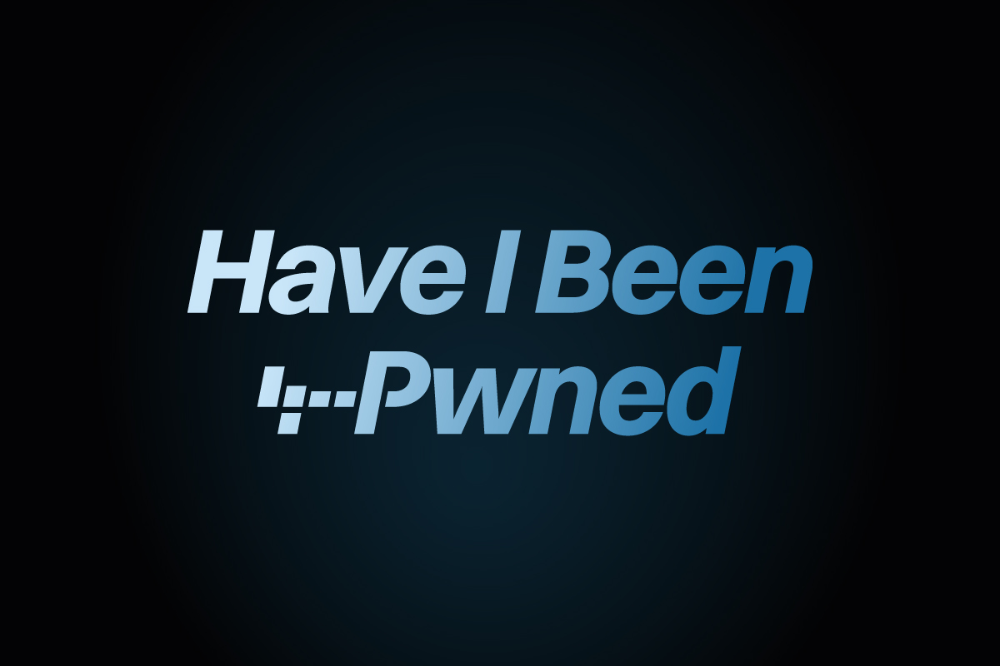

Pernahkah Anda mendadak menerima belasan panggilan telepon dari nomor tidak dikenal dalam sehari? Atau mungkin kotak masuk pesan ponsel Anda kerap dibanjiri tawaran pinjaman online ilegal, penipuan hadiah palsu, hingga pesan WhatsApp aneh dari nomor luar negeri?

Jika situasi tersebut terasa sangat akrab, Anda tidak sendirian. Sebagian besar pengguna ponsel cerdas mengira nomor mereka dipilih secara acak oleh bot telemarketing. Padahal, pada kenyataannya, nomor ponsel tersebut sering kali berasal dari kumpulan basis data curian akibat insiden kebocoran data (data breach) di berbagai platform digital.

Memahami cara melakukan cek kebocoran data nomor hp merupakan langkah awal yang sangat krusial untuk melindungi privasi Anda. Di era digital saat ini, nomor telepon bukan lagi sekadar sarana untuk bertukar kabar, melainkan pintu gerbang utama yang menautkan hampir seluruh identitas digital perbankan dan akun penting Anda.

## Mengapa Nomor Telepon Jadi Incaran Utama Peretas?

Dahulu, alamat email dianggap sebagai target paling bernilai bagi pelaku kejahatan siber. Namun, seiring berjalannya waktu, nomor ponsel kini menjadi incaran yang jauh lebih diminati di pasar gelap internet. Ada beberapa alasan mengapa nomor HP memiliki nilai sangat tinggi:

1. **Identitas Tunggal Lintas Layanan:** Hampir setiap aplikasi modern mewajibkan verifikasi nomor ponsel saat pendaftaran, mulai dari dompet digital, lokapasar, aplikasi ride-hailing, hingga media sosial.
2. **Kelemahan Kode OTP Berbasis SMS:** Protokol jaringan seluler lawas tidak dilengkapi enkripsi sekuat protokol web modern. Jika peretas mengetahui nomor telepon Anda beserta data pribadi lainnya, mereka dapat mencoba teknik rekayasa sosial atau SIM swap untuk mencegat kode verifikasi satu kali (OTP).
3. **Target Serangan Smishing dan Rekayasa Sosial:** Mengetahui nama lengkap dan nomor telepon memudahkan pelaku penipuan melancarkan serangan phishing lewat SMS (smishing) dengan menyamar sebagai kurir paket, pihak bank, atau kerabat dekat.
4. **Kompilasi Data Profil Korban:** Di forum peretas, data nomor telepon kerap digabungkan dengan informasi Nomor Induk Kependudukan (NIK), alamat surel, dan riwayat belanja untuk menciptakan profil korban yang sangat mendetail.

## Bagaimana Layanan Pemantau Kebocoran Data Bekerja?

Mungkin Anda bertanya-tanya, bagaimana kita bisa mengetahui dengan pasti apakah nomor ponsel kita pernah mengalami kebocoran data tanpa harus menjelajahi situs web gelap yang berbahaya?

Jawabannya adalah melalui repositori keamanan siber terverifikasi seperti Have I Been Pwned (HIBP) dan Mozilla Monitor. Layanan independen ini dikelola oleh pakar keamanan terpercaya dunia yang mengumpulkan miliaran catatan data yang beredar bebas akibat kebocoran server perusahaan ternama.

Layanan pemantau tersebut menerapkan prinsip k-anonymity dan teknik hashing satu arah. Artinya, saat Anda memasukkan data untuk dipindai, data tersebut tidak disimpan secara mentah oleh sistem, melainkan dicocokkan dengan sidik jari kriptografi dari basis data kebocoran yang sudah terindeks. Hal ini menjamin bahwa proses pencarian informasi berlangsung sepenuhnya aman tanpa membahayakan data Anda lebih lanjut.

## Langkah Praktis Cek Kebocoran Data Nomor HP

Untuk memeriksa apakah nomor ponsel Anda sudah pernah masuk ke dalam catatan insiden kebocoran data publik, ikuti panduan berikut:

### 1. Gunakan Platform Have I Been Pwned

Platform Have I Been Pwned adalah tolok ukur standar industri keamanan global untuk melacak insiden peretasan data:

- Buka peramban di ponsel atau komputer Anda, lalu kunjungi situs resmi haveibeenpwned.com.
- Masukkan nomor ponsel Anda dengan menyertakan kode negara internasional secara lengkap tanpa spasi maupun tanda hubung (misalnya format +62812xxxxxxxx untuk nomor Indonesia).
- Klik tombol **pwned?** di sebelah kanan kolom pencarian.
- Jika nomor Anda bersih, layar akan menampilkan notifikasi hijau pertanda tidak ditemukan insiden kebocoran yang tercatat. Namun, jika nomor Anda pernah bocor, layar merah akan menampilkan daftar nama insiden kebocoran data beserta rentang tanggal kejadiannya.

### 2. Manfaatkan Pemantauan Terintegrasi Mozilla Monitor

Bagi pengguna yang menginginkan pemantauan berkala secara otomatis, Mozilla Monitor (sebelumnya dikenal sebagai Firefox Monitor) menawarkan dasbor yang sangat intuitif:

- Kunjungi situs monitor.mozilla.org melalui peramban web favorit Anda.
- Masuk menggunakan akun peramban Anda untuk mengaktifkan dasbor pemantauan gratis.
- Masukkan alamat email utama yang tertaut ke ponsel Anda untuk melihat laporan keterpaparan data yang saling berhubungan, termasuk nomor kontak yang ikut bocor dalam satu paket insiden.
- Dasbor akan menampilkan kategori data apa saja yang terekspos, apakah hanya nama dan nomor telepon, ataukah mencakup kata sandi dan rincian lokasi tempat tinggal.

*Sumber: [Have I Been Pwned Branding](https://github.com/HaveIBeenPwned/Branding)*

### 3. Lakukan Audit Melalui Pemeriksaan Keamanan Google

Sebagian besar pengguna Android dan pemakai peramban Chrome menyimpan informasi nomor telepon di dalam Akun Google. Anda dapat memeriksa kesehatan kredensial Anda langsung lewat fitur resmi Google:

- Masuk ke laman myaccount.google.com/security-checkup pada peramban ponsel.
- Periksa status perisai keamanan yang tampil di bagian atas layar.
- Buka menu **Sandi yang Disimpan** untuk melihat apakah ada kata sandi tersimpan yang terindikasi bocor di internet dan berkaitan dengan akun login berbasis nomor HP.
- Tinjau daftar perangkat aktif dan segera cabut akses dari sesi perangkat asing yang tidak Anda kenali.

## Langkah Penyelamatan Jika Nomor HP Terbukti Bocor

Menemukan fakta bahwa nomor ponsel Anda telah tersebar di basis data publik tentu membuat cemas. Kendati data yang sudah beredar tidak bisa ditarik kembali dari peredaran, Anda dapat memutus risiko eksploitasi lebih lanjut dengan menerapkan beberapa benteng pertahanan berikut:

### Alihkan Autentikasi Dua Faktor dari SMS ke Aplikasi Otentikator

Langkah paling krusial adalah berhenti mengandalkan SMS sebagai metode utama penerima kode OTP dua faktor (2FA). SMS sangat rentan terhadap pembajakan sinyal seluler dan pertukaran kartu SIM ilegal.

Buka pengaturan keamanan pada akun penting Anda (seperti Google, perbankan, dan media sosial), lalu pilih opsi Autentikasi Dua Faktor menggunakan aplikasi otentikator mandiri seperti Google Authenticator, 2FAS, atau Aegis Authenticator. Dengan aplikasi ini, kode enam digit dihasilkan langsung di penyimpanan lokal perangkat tanpa melewati jaringan operator seluler.

### Pasang PIN Pengaman pada Kartu SIM Fisik

Banyak orang mengunci layar ponsel mereka dengan sensor sidik jari atau pengenalan wajah yang canggih, namun melupakan keamanan kartu SIM fisik di dalam ponsel. Jika ponsel hilang atau kartu SIM dilepas dan dipindahkan ke perangkat lain oleh pihak yang berniat jahat, mereka dapat langsung menerima panggilan dan SMS verifikasi Anda.

Masuk ke menu **Pengaturan**, cari opsi **Kunci Kartu SIM** (SIM Card Lock), lalu aktifkan PIN kartu SIM Anda. Dengan setelan ini, setiap kali ponsel dinyalakan ulang atau kartu SIM dipindahkan ke perangkat lain, sistem akan meminta PIN 4 digit sebelum kartu dapat terhubung ke jaringan seluler.

### Aktifkan Fitur Verifikasi Dua Langkah di WhatsApp dan Telegram

Aplikasi perpesanan instan merupakan pintu masuk favorit bagi pelaku kejahatan siber untuk meminjam uang atau menipu daftar kontak Anda. Pastikan Anda mengaktifkan fitur Verifikasi Dua Langkah di dalam menu Pengaturan WhatsApp dan Telegram. Fitur ini mewajibkan pemasukan kode PIN statis buatan Anda sendiri setiap kali ada upaya pendaftaran nomor di perangkat baru.

### Manfaatkan Pemfilteran Panggilan dan SMS Bawaan Ponsel

Baik sistem operasi Android maupun iOS telah menyediakan perlindungan bawaan terhadap gangguan panggilan spam:

- **Di Ponsel Android:** Buka aplikasi Telepon Google bawaan, ketuk ikon titik tiga di sudut kanan atas, pilih **Setelan**, lalu aktifkan menu **ID Penelepon dan Spam**. Fitur ini secara cerdas akan mencocokkan nomor pemanggil dengan basis data penipuan dan otomatis membisukan panggilan mencurigakan.
- **Di iPhone:** Masuk ke menu **Pengaturan**, gulir ke bawah ke aplikasi **Telepon**, lalu aktifkan opsi **Heningkan Penelepon Tak Dikenal** (Silence Unknown Callers). Seluruh panggilan dari nomor asing yang belum tersimpan di buku kontak akan langsung dialihkan ke pesan suara tanpa mengganggu konsentrasi Anda.

Menjaga keamanan data di era serba terhubung memang memerlukan kebiasaan proaktif. Dengan rutin melakukan pengecekan kebocoran data dan menerapkan langkah mitigasi yang tepat, Anda dapat menggunakan smartphone kesayangan dengan tenang tanpa dihantui rasa cemas akan ancaman penipuan daring.

Sumber: [Dokumentasi Mozilla Monitor](https://support.mozilla.org/en-US/kb/get-started-firefox-monitor)
