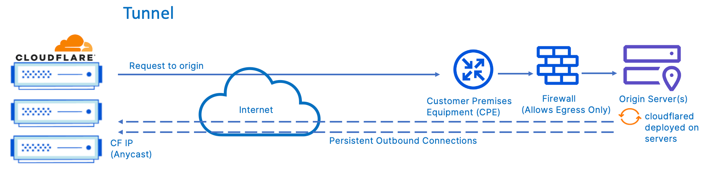

Membuka akses layanan yang berjalan di jaringan lokal (seperti aplikasi homelab, web server pengujian, dashboard monitoring, atau antarmuka API mikroservis) ke jaringan publik internet merupakan tantangan klasik bagi administrator sistem. Pendekatan konvensional yang mengandalkan port forwarding pada router NAT memiliki sejumlah risiko keamanan serius. Membuka port inbound publik seperti 80 atau 443 langsung ke server lokal mengekspos alamat IP publik asli stasiun kerja Anda ke publik, mengundang pemindaian port otomatis dari botnet, serta meningkatkan kerentanan terhadap serangan Distributed Denial of Service (DDoS). Masalah menjadi semakin rumit ketika penyedia layanan internet (ISP) menerapkan Carrier-Grade NAT (CGNAT), di mana mesin lokal sama sekali tidak memiliki IP publik yang dapat di-routing secara langsung dari internet luar.

Penerapan **cloudflared tunnel linux** menghadirkan solusi arsitektur jaringan yang jauh lebih elegan, aman, dan modern. Berbeda dari arsitektur reverse proxy tradisional yang mewajibkan port terbuka ke arah dalam (inbound), daemon `cloudflared` bekerja dengan membuat terowongan komunikasi terenkripsi yang hanya berorientasi ke luar (outbound-only). Daemon ini secara proaktif membuka beberapa koneksi simultan menuju data center edge Cloudflare terdekat menggunakan protokol QUIC atau HTTP/2. Seluruh lalu lintas pengunjung internet dialihkan melalui jaringan proteksi Cloudflare (lengkap dengan mitigasi DDoS, WAF, dan manajemen sertifikat SSL otomatis), lalu diteruskan secara aman ke server lokal melalui terowongan yang sudah terbentuk.

Dengan pendekatan ini, firewall server lokal dapat dikonfigurasi dengan kebijakan blokir total terhadap seluruh koneksi masuk (*drop all incoming traffic*). Panduan teknis ini mengupas tuntas langkah implementasi `cloudflared` pada sistem operasi Linux, mulai dari pemasangan paket repositori resmi, mekanisme otentikasi Zero Trust, penyusunan berkas ingress rules berbasis YAML, pembuatan rute DNS deklaratif, hingga integrasi daemon otomatis dengan systemd.

## Prasyarat Sistem dan Kebutuhan Domain

Sebelum memulai langkah konfigurasi di terminal, pastikan stasiun kerja atau server Linux Anda memenuhi beberapa persyaratan teknis berikut:

1. Sistem operasi Linux dengan arsitektur x86_64 atau ARM64 (Debian 11/12, Ubuntu 22.04/24.04 LTS, Fedora, CentOS/Rocky Linux, atau Arch Linux).
2. Akun Cloudflare aktif dengan minimal satu nama domain yang status nameserver-nya telah diarahkan ke Cloudflare DNS.
3. Hak akses administratif `sudo` atau hak akses `root` untuk memasang paket sistem dan mendaftarkan service daemon.
4. Setidaknya satu layanan aplikasi yang sudah berjalan dan mendengarkan port lokal di localhost (misalnya web server Nginx pada port 8080 atau aplikasi Node.js pada port 3000).

## Diagram Arsitektur Jaringan Cloudflare Tunnel

Untuk memahami jalur perpindahan paket data antara pengguna publik, jaringan edge Cloudflare, dan origin server lokal Anda, perhatikan diagram arsitektur resmi di bawah ini:


*Sumber: [Cloudflare Reference Architecture](https://developers.cloudflare.com/reference-architecture/design-guides/secure-application-delivery/)*

Pada skema di atas, daemon `cloudflared` yang berjalan di origin server lokal membangun 4 koneksi outbound persisten menuju minimal dua lokasi data center edge Cloudflare yang terpisah secara geografis. Ketika pengguna internet mengakses domain Anda, permintaan ditangani oleh proxy edge Anycast Cloudflare, lalu disalurkan melalui terowongan privat menuju daemon lokal tanpa memerlukan alamat IP publik yang terbuka pada router origin.

## Langkah 1: Instalasi Paket Cloudflared pada Distro Linux

Cloudflare menyediakan repositori paket resmi yang terawat untuk berbagai varian distribusi Linux utama. Pemasangan melalui manajer paket distro memastikan pembaruan keamanan dapat diperbarui secara otomatis bersama pembaruan sistem operasi.

### Pada Debian dan Ubuntu

Unduh kunci GPG resmi Cloudflare dan daftarkan repositori apt ke dalam sistem:

```bash
# Buat direktori keyring jika belum tersedia
sudo mkdir -p --mode=0755 /usr/share/keyrings

# Unduh kunci verifikasi GPG Cloudflare
curl -fsSL https://pkg.cloudflare.com/cloudflare-main.gpg | sudo tee /usr/share/keyrings/cloudflare-main.gpg >/dev/null

# Daftarkan repositori resmi cloudflared
echo "deb [signed-by=/usr/share/keyrings/cloudflare-main.gpg] https://pkg.cloudflare.com/cloudflared bullseye main" | sudo tee /etc/apt/sources.list.d/cloudflared.list

# Perbarui indeks paket dan pasang cloudflared
sudo apt update
sudo apt install -y cloudflared
```

### Pada RHEL, Rocky Linux, dan Fedora

Untuk distro turunan Red Hat, Anda dapat langsung mengunduh dan memasang paket RPM resmi:

```bash
# Instalasi langsung paket RPM rilis stabil terbaru
sudo dnf install -y https://github.com/cloudflare/cloudflared/releases/latest/download/cloudflared-linux-x86_64.rpm
```

### Pada Arch Linux

Paket `cloudflared` telah tersedia secara resmi pada repositori core Arch Linux:

```bash
sudo pacman -Syu --noconfirm cloudflared
```

Setelah proses instalasi selesai, verifikasi integritas binary dan nomor versi yang terpasang di sistem Anda:

```bash
cloudflared --version
```

Perintah di atas akan menampilkan rilis versi kompilasi serta versi runtime Go yang digunakan.

## Langkah 2: Otentikasi Origin Server dengan Akun Cloudflare

Origin server lokal perlu diotentikasi ke akun Cloudflare Anda agar memiliki wewenang mengelola tunnel dan memanipulasi DNS record domain. Jalankan perintah login berikut:

```bash
cloudflared tunnel login
```

Saat perintah ini dieksekusi pada terminal tanpa desktop grafis, terminal akan mencetak sebuah URL unik ke layar:

```text
Please open the following URL and log in with your Cloudflare account:

https://dash.cloudflare.com/argotunnel?callback=https%3A%2F%2Flogin.cloudflareaccess.com%2F...

Leave cloudflared running to download the cert.pem automatically.
```

Salin URL tersebut ke peramban web di komputer Anda, masuk ke akun Cloudflare, dan pilih nama zona domain yang ingin Anda hubungkan dengan tunnel ini. Setelah Anda mengonfirmasi otorisasi pada antarmuka web, daemon `cloudflared` di terminal akan secara otomatis menerima token dan mengunduh berkas sertifikat origin ke direktori pengguna lokal:

```text
You have successfully logged in.
If you wish to copy your credentials to a server, they have been saved to:
/home/huda/.cloudflared/cert.pem
```

Berkas `cert.pem` ini berisi kunci privat akun yang berfungsi memberikan otorisasi pembuatan tunnel baru pada zona domain terkait. Pastikan izin akses berkas ini terlindungi dengan aman.

## Langkah 3: Pembuatan Entitas Tunnel Baru dan Kredensial

Setelah proses otentikasi berhasil, buat entitas tunnel baru dengan menentukan nama pengenal yang deskriptif (misalnya `homelab-tunnel`):

```bash
cloudflared tunnel create homelab-tunnel
```

Perintah ini akan berkomunikasi dengan API Cloudflare untuk mendaftarkan objek tunnel dan menghasilkan output seperti berikut:

```text
Tunnel credentials written to /home/huda/.cloudflared/8f2c3d10-4e7a-4c22-b9e1-e5d0a1b890f1.json.
cloudflared has given you a tunnel id: 8f2c3d10-4e7a-4c22-b9e1-e5d0a1b890f1
```

Catat rangkaian UUID tersebut (pada contoh di atas: `8f2c3d10-4e7a-4c22-b9e1-e5d0a1b890f1`). Berkas JSON yang tercipta memuat rahasia kriptografi otentikasi tunnel yang nantinya akan dibaca oleh service latar belakang.

Untuk melihat daftar seluruh tunnel yang terdaftar di akun Anda beserta statusnya, jalankan:

```bash
cloudflared tunnel list
```

## Langkah 4: Penyusunan File Konfigurasi Ingress Rules

Agar `cloudflared` mengetahui ke mana lalu lintas jaringan publik harus diarahkan saat tiba di server lokal, Anda perlu menyusun berkas konfigurasi ingress rules berbasis format YAML.

Untuk implementasi level server produksi yang dijalankan oleh systemd, tempatkan konfigurasi di direktori sistem `/etc/cloudflared/`. Pertama, salin berkas kredensial JSON ke direktori sistem tersebut:

```bash
# Buat folder konfigurasi sistem
sudo mkdir -p /etc/cloudflared

# Salin kredensial JSON ke folder sistem (ganti UUID sesuai milik Anda)
sudo cp ~/.cloudflared/8f2c3d10-4e7a-4c22-b9e1-e5d0a1b890f1.json /etc/cloudflared/

# Amankan izin baca berkas kredensial
sudo chmod 600 /etc/cloudflared/*.json
```

Selanjutnya, buat berkas konfigurasi `/etc/cloudflared/config.yml`:

```bash
sudo nano /etc/cloudflared/config.yml
```

Masukkan struktur konfigurasi berikut, sesuaikan UUID dan nama domain Anda:

```yaml
tunnel: 8f2c3d10-4e7a-4c22-b9e1-e5d0a1b890f1
credentials-file: /etc/cloudflared/8f2c3d10-4e7a-4c22-b9e1-e5d0a1b890f1.json

# Optimasi protokol koneksi edge (QUIC via UDP)
protocol: quic

ingress:
  # Rute 1: Akses layanan web dashboard utama
  - hostname: app.domainanda.com
    service: http://localhost:8080
    originRequest:
      connectTimeout: 30s
      noTLSVerify: false

  # Rute 2: Akses endpoint API lokal
  - hostname: api.domainanda.com
    service: http://localhost:3000

  # Rute Fallback (WAJIB): Menangani permintaan tanpa hostname yang cocok
  - service: http_status:404
```

Perhatikan baris terakhir pada blok `ingress`. Cloudflare Tunnel mewajibkan aturan penutup (*catch-all rule*) tanpa penanda hostname, yang biasanya dikonfigurasikan mengembalikan kode status HTTP 404. Jika aturan penutup ini dihilangkan, daemon `cloudflared` akan menolak berkas konfigurasi saat proses validasi sintaks.

Uji keabsahan sintaks berkas konfigurasi sebelum menjalankannya:

```bash
cloudflared tunnel ingress validate
```

Jika tidak ada pesan kesalahan yang muncul, struktur konfigurasi YAML Anda telah memenuhi standar.

## Langkah 5: Routing DNS Record ke Tunnel Identifier

Kini Anda perlu menghubungkan subdomain publik (misalnya `app.domainanda.com`) ke identifier tunnel UUID yang baru dibuat. Alih-alih membuat record DNS secara manual pada dasbor web, Anda dapat melakukannya secara otomatis melalui CLI:

```bash
cloudflared tunnel route dns homelab-tunnel app.domainanda.com
```

Perintah di atas secara otomatis membuat record DNS bertipe `CNAME` di zona Cloudflare Anda, mengarahkan hostname `app.domainanda.com` ke target `<TUNNEL-UUID>.cfargotunnel.com`.

Jika Anda mengonfigurasi beberapa hostname seperti pada contoh ingress rule di atas, daftarkan pula subdomain kedua:

```bash
cloudflared tunnel route dns homelab-tunnel api.domainanda.com
```

Verifikasi pembuatan record dengan utilitas `dig` atau `nslookup`:

```bash
dig CNAME app.domainanda.com +short
```

Output akan mengembalikan nama target terowongan yang berakhiran `.cfargotunnel.com`.

## Langkah 6: Pendaftaran dan Aktivasi Daemon Systemd

Menjalankan tunnel secara manual pada terminal aktif tidak ideal untuk lingkungan server. `cloudflared` memiliki kemampuan built-in untuk mendaftarkan dirinya sebagai service systemd secara otomatis.

Jalankan perintah instalasi service dengan menyertakan path berkas konfigurasi sistem:

```bash
sudo cloudflared --config /etc/cloudflared/config.yml service install
```

Perintah ini akan menyusun unit service systemd di `/etc/systemd/system/cloudflared.service`. Selanjutnya, aktifkan dan jalankan service tersebut:

```bash
# Muat ulang konfigurasi daemon systemd
sudo systemctl daemon-reload

# Nyalakan service dan jadwalkan autostart saat boot
sudo systemctl enable --now cloudflared
```

Pastikan status service berjalan dalam status aktif (`active running`):

```bash
sudo systemctl status cloudflared
```

Output terminal akan mengonfirmasi bahwa service berjalan tanpa kegagalan:

```text
● cloudflared.service - Cloudflare Tunnel
     Loaded: loaded (/etc/systemd/system/cloudflared.service; enabled; preset: enabled)
     Active: active (running) since Tue 2026-11-10 18:08:00 WIB; 15s ago
   Main PID: 45210 (cloudflared)
      Tasks: 12 (limit: 4614)
     Memory: 28.4M
        CPU: 180ms
     CGroup: /system.slice/cloudflared.service
             └─45210 /usr/bin/cloudflared --config /etc/cloudflared/config.yml --origincert /etc/cloudflared/cert.pem --no-autoupdate tunnel run
```

## Langkah 7: Verifikasi Kesehatan Terowongan dan Uji Akses

Setelah daemon systemd aktif, periksa metrik koneksi edge langsung dari command line menggunakan perintah info:

```bash
cloudflared tunnel info homelab-tunnel
```

Output perintah ini akan merinci status keempat koneksi outbound persisten yang terhubung ke edge data center Cloudflare:

```text
NAME:         homelab-tunnel
ID:           8f2c3d10-4e7a-4c22-b9e1-e5d0a1b890f1
CREATED:      2026-11-10T11:04:12Z
CONNECTIONS:  4 active edge routes
  1. sin01    protocol=quic status=healthy
  2. sin02    protocol=quic status=healthy
  3. cgp01    protocol=quic status=healthy
  4. cgp02    protocol=quic status=healthy
```

Selanjutnya, lakukan uji cURL dari jaringan internet eksternal atau stasiun kerja lain untuk memastikan respons HTTP diteruskan dengan sempurna:

```bash
curl -I https://app.domainanda.com
```

Respons header akan menunjukkan bahwa paket data dilayani secara terenkripsi melalui infrastruktur Cloudflare:

```http
HTTP/2 200 OK
date: Tue, 10 Nov 2026 11:08:15 GMT
content-type: text/html; charset=UTF-8
server: cloudflare
cf-ray: 8e142b98ca1209ac-SIN
alt-svc: h3=":443"; ma=86400
```

Layanan lokal Anda kini telah dapat diakses dari seluruh dunia melalui alamat HTTPS berperingkat SSL valid, tanpa membuka satu pun port pada router lokal Anda.

## Troubleshooting dan Penanganan Masalah Umum

Saat mengimplementasikan Cloudflare Tunnel pada lingkungan jaringan tertentu, Anda mungkin menemui beberapa kendala umum. Berikut analisis akar masalah dan langkah penanganannya:

### 1. Kegagalan Koneksi Edge Akibat Blokir UDP Port 7844

Secara default, `cloudflared` menggunakan protokol QUIC yang berjalan di atas protokol transport UDP pada port 7844 untuk berkomunikasi dengan data center edge. Beberapa penyedia jaringan internet seluler, router kantor, atau firewall ISP memberlakukan pembatasan ketat pada lalu lintas UDP outbound tidak lazim.

Jika log journalctl (`journalctl -u cloudflared -e`) menampilkan pesan timeout saat inisialisasi koneksi QUIC, ubah mode protokol koneksi ke HTTP/2 (yang berjalan melalui TCP):

Tambahkan baris berikut pada berkas `/etc/cloudflared/config.yml`:

```yaml
protocol: http2
```

Atau jalankan daemon dengan opsi `--protocol http2`. Muat ulang service melalui `sudo systemctl restart cloudflared`. HTTP/2 menggunakan koneksi TCP standar yang umumnya tidak pernah diblokir oleh firewall perimeter.

### 2. Error 502 Bad Gateway saat Mengakses Subdomain

Munculnya kode status HTTP 502 pada peramban web menandakan bahwa edge Cloudflare dan daemon `cloudflared` berhasil berkomunikasi, namun daemon lokal gagal menghubungi server aplikasi tujuan di localhost.

Lakukan pemeriksaan berurutan pada origin server:

1. Periksa apakah aplikasi lokal benar-benar sedang mendengarkan port yang dimaksud dengan utilitas socket statistics:
   ```bash
   ss -tulpn | grep -E "8080|3000"
   ```
2. Pastikan binding aplikasi lokal tidak hanya mendengarkan alamat loopback yang tidak kompatibel. Jika aplikasi hanya mendengarkan `127.0.0.1`, hindari menggunakan penulisan `localhost` jika resolusi IPv6 `::1` diaktifkan di sistem. Anda dapat secara eksplisit menuliskan IP:
   ```yaml
   service: http://127.0.0.1:8080
   ```
3. Jika aplikasi lokal Anda menggunakan protokol HTTPS mandiri dengan sertifikat self-signed, tambahkan opsi `noTLSVerify: true` di bawah blok `originRequest` pada berkas konfigurasi agar `cloudflared` tidak memutus koneksi TLS lokal.

### 3. Service Systemd Gagal Membaca File Kredensial

Jika service systemd mengalami status `failed` atau `crash loop` saat booting, periksa izin berkas pada direktori `/etc/cloudflared`. Ketika service dijalankan di bawah user sistem tertentu, user tersebut harus memiliki hak baca terhadap file kredensial JSON dan berkas konfigurasi YAML.

Pastikan hak akses berkas diatur secara benar:

```bash
sudo chmod 755 /etc/cloudflared
sudo chmod 644 /etc/cloudflared/config.yml
sudo chmod 600 /etc/cloudflared/*.json
```

Melalui arsitektur outbound yang kokoh ini, Anda memperoleh kemudahan publikasi layanan tanpa perlu mengorbankan postur keamanan perimeter jaringan lokal Anda.

> **Baca Juga:**
> - [Cara Setup Caddy Reverse Proxy dengan SSL Otomatis](/cara-setup-caddy-reverse-proxy-ssl-otomatis/)
> - [Panduan Lengkap WireGuard Linux Client Setup](/panduan-lengkap-wireguard-linux-client-setup/)

Sumber: [Cloudflare Zero Trust Documentation](https://developers.cloudflare.com/cloudflare-one/networks/connectors/cloudflare-tunnel/)
