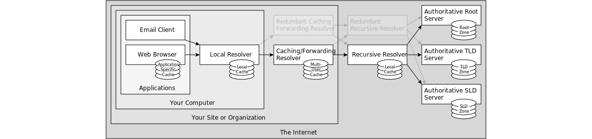

Setiap kali sistem operasi Linux mengakses repositori paket, menghubungi API server, atau membuka halaman web di peramban, tumpukan jaringan mengeksekusi proses resolusi Domain Name System (DNS). Secara bawaan, protokol DNS standar mentransmisikan kueri dalam format teks polos (plaintext) melalui port UDP 53. Kelemahan arsitektur warisan ini membuka celah keamanan serius di mana Internet Service Provider (ISP), operator jaringan publik, hingga pihak ketiga di jalur perutean dapat mengintip domain yang dikunjungi, menyuntikkan respons palsu (DNS spoofing), atau memblokir akses secara sepihak.

Solusi paling tangguh untuk mengatasi kerentanan ini pada tingkat sistem operasi adalah mengonfigurasi **dns over https client linux**. Protokol DNS over HTTPS (DoH) membungkus kueri DNS standar ke dalam sesi HTTP/2 atau HTTP/3 terenkripsi TLS melalui port TCP 443. Dari sudut pandang pemantau jaringan di luar mesin, lalu lintas resolusi nama domain identik dengan lalu lintas penjelajahan web HTTPS biasa, sehingga tidak dapat dibedakan, disaring, atau dimanipulasi.

Panduan teknis ini mengupas langkah demi langkah konfigurasi klien DoH di Linux menggunakan daemon DNSCrypt-Proxy, menangani perebutan port 53 oleh `systemd-resolved`, menyusun konfigurasi multi-upstream, hingga melakukan audit paket jaringan menggunakan `tcpdump` untuk memastikan nol kebocoran data.


*Sumber: [Wikimedia Commons - DNS Architecture](https://commons.wikimedia.org/wiki/File:DNS_Architecture.svg)*

## Mengapa Klien DoH Sistem Lebih Unggul Dibanding Pengaturan Browser

Sebagian besar pengguna mengaktifkan DNS over HTTPS hanya pada peramban web seperti Mozilla Firefox atau Google Chrome. Meskipun efektif untuk aktivitas browsing, metode peramban menyisakan lubang besar pada sistem operasi:

1. **Aplikasi Non-Browser Tetap Bocor:** Perintah CLI seperti `curl`, `wget`, `git clone`, pembaruan paket sistem, container Docker, hingga skrip automasi latar belakang tetap menggunakan resolver lokal bawaan sistem yang tidak terenkripsi.
2. **Ketergantungan Isolasi Aplikasi:** Pengaturan di tingkat aplikasi mengharuskan administrator mengonfigurasi setiap perangkat lunak satu per satu, meningkatkan risiko miskonfigurasi.
3. **Penyatuan Cache Lokal:** Dengan memasang klien DoH tingkat sistem di loopback (`127.0.0.1:53`), seluruh aplikasi di mesin Linux menikmati proteksi privasi seragam sekaligus pemanfaatan memori cache lokal yang menurunkan latensi kueri berulang.

Dalam ekosistem Linux modern, DNSCrypt-Proxy merupakan implementasi klien DoH dan DNSCrypt yang paling fleksibel, stabil, serta mendukung failover otomatis, DNSSEC, dan pemfilteran domain tingkat lanjut.

## Prasyarat Sistem

Sebelum memulai konfigurasi, pastikan sistem memenuhi kriteria berikut:

- Hak akses administratif sistem atau pengguna dengan privilege eksekusi.
- Distribusi Linux modern (Ubuntu 24.04/22.04 LTS, Debian 12 Bookworm, Fedora 40/41, atau Arch Linux).
- Port 443 keluar (outbound TCP/UDP) terbuka pada firewall mesin dan router lokal.
- Paket utilitas jaringan `curl`, `dig` (dari paket `dnsutils` atau `bind-utils`), `lsof`, dan `tcpdump`.
Pasang dependensi pengujian dasar terlebih dahulu:

```bash
# Untuk Ubuntu dan Debian
sudo apt update && sudo apt install -y curl dnsutils lsof tcpdump

# Untuk Fedora dan RHEL
sudo dnf install -y curl bind-utils lsof tcpdump

# Untuk Arch Linux
sudo pacman -S --noconfirm bind lsof tcpdump curl
```

## Langkah 1: Nonaktifkan DNS Stub Listener di systemd-resolved

Pada mayoritas distribusi Linux modern berbasis systemd, daemon `systemd-resolved` mendengarkan kueri DNS lokal pada alamat IP `127.0.0.53:53`. Klien DoH lokal kita (`dnscrypt-proxy`) perlu mendengarkan port 53 pada antarmuka loopback umum (`127.0.0.1:53`).

Jika `DNSStubListener` tidak dinonaktifkan, beberapa aplikasi yang mencoba menghubungi `127.0.0.1` atau `localhost` akan berbenturan port dengan stub resolver bawaan.

Buka berkas konfigurasi `/etc/systemd/resolved.conf`:

```bash
sudo nano /etc/systemd/resolved.conf
```

Tambahkan atau ubah parameter berikut di bawah blok `[Resolve]`:

```ini
[Resolve]
DNS=127.0.0.1
DNSStubListener=no
```

Simpan berkas tersebut, lalu terapkan perubahan service resolver:

```bash
sudo systemctl restart systemd-resolved
```

Periksa apakah port 53 kini telah bebas dari pendudukan antarmuka loopback:

```bash
sudo lsof -i :53
```

Jika tidak ada output yang mengindikasikan program berjalan di port 53, sistem siap menerima instalasi klien DoH.

## Langkah 2: Instalasi DNSCrypt-Proxy

DNSCrypt-Proxy tersedia langsung di repositori resmi berbagai distribusi Linux.

### Instalasi di Ubuntu dan Debian

```bash
sudo apt update
sudo apt install -y dnscrypt-proxy
```

### Instalasi di Arch Linux

```bash
sudo pacman -S --noconfirm dnscrypt-proxy
```

### Instalasi di Fedora

```bash
sudo dnf install -y dnscrypt-proxy
```

### Opsi Alternatif: Instalasi Biner Mandiri Terbaru

Jika repositori distribusi Anda memuat versi usang, unduh biner kompilasi resmi terbaru langsung dari rilis GitHub:

```bash
DOH_VER=$(curl -s https://api.github.com/repos/DNSCrypt/dnscrypt-proxy/releases/latest | grep -oP '"tag_name": "\K(.*)(?=")')
curl -L -o /tmp/dnscrypt-proxy.tar.gz "https://github.com/DNSCrypt/dnscrypt-proxy/releases/download/${DOH_VER}/dnscrypt-proxy-linux_x86_64-${DOH_VER}.tar.gz"
tar -xzf /tmp/dnscrypt-proxy.tar.gz -C /tmp/
sudo cp /tmp/linux-x86_64/dnscrypt-proxy /usr/local/bin/
sudo mkdir -p /etc/dnscrypt-proxy
sudo cp /tmp/linux-x86_64/example-dnscrypt-proxy.toml /etc/dnscrypt-proxy/dnscrypt-proxy.toml
```

## Langkah 3: Konfigurasi Berkas dnscrypt-proxy.toml

Konfigurasi utama terletak di `/etc/dnscrypt-proxy/dnscrypt-proxy.toml`. Berkas ini mengatur protokol upstream, server DoH yang dipilih, alamat pendengar lokal, hingga proteksi DNSSEC.

Buka berkas konfigurasi:

```bash
sudo nano /etc/dnscrypt-proxy/dnscrypt-proxy.toml
```

Sesuaikan parameter krusial berikut:

### 1. Tentukan Server Resolver Upstream (DoH)

DNSCrypt-Proxy menyediakan daftar resolver publik global yang diperbarui secara otomatis. Kita dapat menentukan upstream terpercaya yang mendukung DoH, seperti Cloudflare dan Quad9:

```toml
# Tentukan server resolver yang digunakan
server_names = ['cloudflare', 'quad9-doh-ip4-filter-pri']
```

Resolver `cloudflare` merutekan kueri ke infrastruktur 1.1.1.1 dengan latensi ultra rendah, sedangkan `quad9-doh-ip4-filter-pri` memfilter domain berbahaya, malware, dan situs phishing secara otomatis.

### 2. Atur Alamat Antarmuka Pendengar Lokal

Pastikan daemon mendengarkan kueri lokal pada antarmuka IPv4 dan IPv6 loopback:

```toml
listen_addresses = ['127.0.0.1:53', '[::1]:53']
```

### 3. Terapkan Filter Protokol Enkripsi

Aktifkan filter agar daemon hanya menggunakan server yang mendukung enkripsi HTTPS dan memvalidasi rekaman DNSSEC:

```toml
# Hanya gunakan server DoH
doh_servers = true

# Nonaktifkan protokol DNSCrypt non-HTTPS jika hanya ingin kueri murni DoH
dnscrypt_servers = true

# Wajibkan validasi integritas DNSSEC
require_dnssec = true

# Pastikan tidak ada pencatatan log kueri di sisi penyedia
require_nolog = true

# Hindari penyedia yang memfilter konten jika memerlukan akses internet terbuka murni
require_nofilter = false
```

### 4. Aktifkan Cache DNS Lokal

Pengaktifan cache lokal memangkas waktu kueri dari puluhan milidetik menjadi kurang dari 1 milidetik untuk domain yang telah dipanggil sebelumnya:

```toml
cache = true
cache_size = 4096
cache_min_ttl = 300
cache_max_ttl = 86400
```

Simpan perubahan dan tutup teks editor.
## Langkah 4: Uji Konfigurasi dan Jalankan Daemon Service

Sebelum mengaktifkan service di latar belakang, jalankan uji konfigurasi mandiri untuk memvalidasi sintaks TOML dan konektivitas resolver:

```bash
sudo dnscrypt-proxy -config /etc/dnscrypt-proxy/dnscrypt-proxy.toml -check
```

Jika pesan verifikasi menunjukkan sintaks valid, jalankan pengujian resolusi interaktif:

```bash
sudo dnscrypt-proxy -config /etc/dnscrypt-proxy/dnscrypt-proxy.toml -resolve cloudflare.com
```

Output CLI akan menampilkan status sukses, alamat IP hasil resolusi, serta nama resolver DoH yang merespons kueri tersebut.

Setelah pengujian berhasil, aktifkan service systemd agar berjalan otomatis saat sistem booting:

```bash
sudo systemctl enable dnscrypt-proxy
sudo systemctl restart dnscrypt-proxy
```

Periksa status operasional daemon:

```bash
sudo systemctl status dnscrypt-proxy --no-pager
```

Pastikan status berada dalam kondisi `active (running)`.

## Langkah 5: Arahkan Konfigurasi Resolver Sistem ke Localhost

Langkah penentu berikutnya adalah menginstruksikan sistem operasi Linux agar menggunakan klien lokal pada `127.0.0.1` sebagai resolver utama.

Periksa dan perbarui berkas `/etc/resolv.conf`:

```bash
# Cadangkan konfigurasi lama
sudo cp /etc/resolv.conf /etc/resolv.conf.backup

# Tulis alamat loopback lokal ke file konfigurasi
echo -e 'nameserver 127.0.0.1\noptions edns0' | sudo tee /etc/resolv.conf
```

### Pengaturan Khusus NetworkManager

Jika sistem Anda menggunakan desktop environment atau server dengan NetworkManager aktif, NetworkManager secara berkala menimpa berkas `/etc/resolv.conf`. Cegah hal ini dengan mengonfigurasi berkas pengaturan:

```bash
sudo nano /etc/NetworkManager/conf.d/dns.conf
```

Tambahkan baris berikut:

```ini
[main]
dns=none
```

Muat ulang konfigurasi NetworkManager:

```bash
sudo systemctl reload NetworkManager
```

## Langkah 6: Verifikasi Resolusi dan Audit Kebocoran Paket Port 53

Sebagai network administrator atau praktisi sistem Linux, Anda dilarang mempercayai status konfigurasi hanya dari teks indikator. Pembuktian empiris pada antarmuka jaringan wajib dilakukan.

### 1. Uji Resolusi Domain Menggunakan dig

Jalankan kueri pencarian domain ke resolver lokal:

```bash
dig @127.0.0.1 north7.biz.id
```

Perhatikan bagian footer output terminal:

```txt
;; Query time: 1 msec
;; SERVER: 127.0.0.1#53(127.0.0.1) (UDP)
;; WHEN: Sat Nov 14 18:06:29 WIB 2026
;; MSG SIZE  rcvd: 56
```

Kueri dijawab langsung oleh `127.0.0.1` dengan latensi minimal.

### 2. Audit Lalu Lintas Jaringan Fisik Menggunakan tcpdump

Ini adalah pengujian paling krusial. Buka dua jendela terminal.

Pada terminal pertama, jalankan penangkapan paket pada kartu jaringan fisik (misalnya `eth0` atau antarmuka nirkabel `wlan0`) untuk memantau apakah ada kueri port 53 keluar yang bocor:

```bash
sudo tcpdump -n -i any port 53 and not host 127.0.0.1
```

Pada terminal kedua, buat lalu lintas DNS dengan membuka berbagai domain publik:

```bash
curl -I https://www.kernel.org
curl -I https://archlinux.org
curl -I https://debian.org
```

**Hasil Audit yang Benar:** Terminal pertama yang menjalankan `tcpdump` harus tetap **kosong melompong** tanpa menangkap satu pun paket DNS teks polos pada antarmuka jaringan fisik.

Selanjutnya, pantau kueri terenkripsi DoH yang menuju port 443 pada antarmuka publik:

```bash
sudo tcpdump -n -i any host 1.1.1.1 and port 443
```

Jalankan kueri DNS baru, dan Anda akan melihat aliran paket TLS terenkripsi bertukar data dengan aman melalui port 443. Seluruh nama domain yang Anda tuju terlindungi di dalam payload terenkripsi.

## Pemecahan Masalah dan Penanganan Kendala

Berikut panduan mitigasi saat menghadapi anomali operasional di lapangan:

### 1. Pesan Kesalahan "bind: address already in use"

Penyebab: Ada proses lain yang menduduki port 53 pada alamat `127.0.0.1`.

Solusi:
Identifikasi PID proses penyebab konflik:

```bash
sudo lsof -i :53 -sTCP:LISTEN -P -n
sudo netstat -tulpn | grep :53
```

Jika `dnsmasq` atau stub `systemd-resolved` terdeteksi, matikan service terkait atau ubah parameter pendengarannya agar tidak mengikat seluruh antarmuka loopback.

### 2. Berkas resolv.conf Tertimpa Kembali Pasca Reboot

Penyebab: Script DHCP client seperti `dhclient`, `resolved`, atau `resolvconf` menulis ulang berkas secara otomatis saat kartu jaringan mendapatkan lease IP baru.

Solusi:
Terapkan atribut `immutable` menggunakan perintah Linux `chattr`:

```bash
sudo chattr +i /etc/resolv.conf
```

Dengan bendera atribut `+i`, tidak ada proses pengguna maupun daemon root yang diizinkan memodifikasi, mengganti nama, atau menghapus file tersebut hingga atribut dilepas kembali dengan `sudo chattr -i /etc/resolv.conf`.

### 3. DNS Timeout Saat Terkoneksi ke Jaringan WiFi Publik (Captive Portal)

Penyebab: Jaringan hotel atau kafe mengharuskan login web sebelum mengizinkan koneksi internet ke luar, sementara kueri DoH ke IP publik Cloudflare/Quad9 terblokir oleh captive portal.

Solusi:
Sediakan skrip alih darurat atau buat berkas fallback di `/etc/dnscrypt-proxy/` dengan mengaktifkan fitur `fallback_resolvers`:

```toml
fallback_resolvers = ['9.9.9.9:53', '1.1.1.1:53']
```

Fitur ini memungkinkan sistem melakukan bootstrap inisial hingga otentikasi captive portal selesai, kemudian secara otomatis beralih penuh kembali ke terowongan DoH terenkripsi.

Konfigurasi klien DNS over HTTPS di Linux memberikan benteng pertahanan fundamental dari pengintaian ISP, serangan keracunan cache DNS, serta manipulasi lalu lintas data. Dengan kombinasi DNSCrypt-Proxy, sistem penguncian resolvconf, dan validasi berkala via tcpdump, infrastruktur Linux Anda beroperasi dengan privasi dan integritas jaringan tingkat tinggi.

> **Baca Juga:**
> - [Panduan Lengkap Tcpdump Linux Ubuntu](/panduan-lengkap-tcpdump-linux-ubuntu/)
> - [Cara Setting Fail2ban di Linux untuk Amankan Server SSH](/cara-setting-fail2ban/)

Sumber: [DNSCrypt-Proxy Documentation](https://github.com/DNSCrypt/dnscrypt-proxy/wiki)
