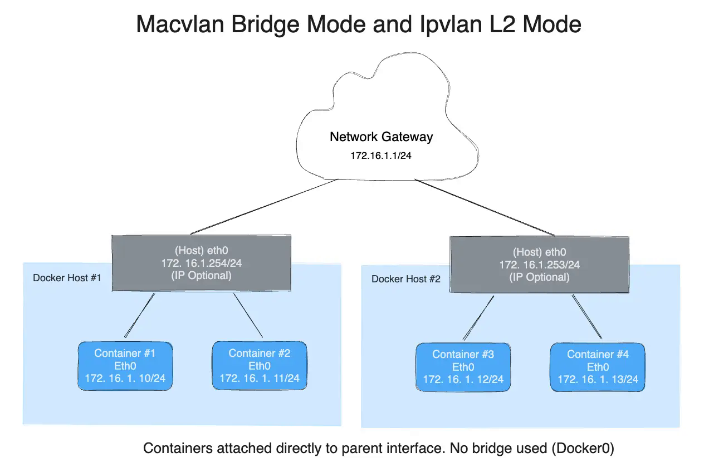

Bagi sebagian besar pengembang dan sysadmin, interaksi awal dengan jaringan Docker umumnya hanya sebatas menambahkan opsi `-p 8080:80` saat mengeksekusi perintah `docker run`. Perintah tersebut memang praktis karena Docker Engine secara otomatis menangani aturan firewall dan port forwarding di latar belakang. Namun, ketika beban kerja di server mulai bertumbuh kompleks, kebutuhan isolasi multi-tenant meningkat, atau performa throughput jaringan menjadi prioritas utama, pendekatan asal jalan tersebut bakal memicu hambatan serius.

Pemahaman mendalam mengenai berbagai **docker networking modes** adalah fondasi penting yang membedakan implementasi amatir dengan arsitektur server produksi yang tangguh. Setiap driver jaringan yang disediakan oleh Docker memiliki karakteristik internal, mekanisme penanganan paket di kernel Linux, serta trade-off performa yang sangat berbeda. Salah memilih driver bisa berujung pada overhead NAT yang menguras CPU, bentrok port layanan, atau bahkan celah keamanan di mana kontainer privat terpapar ke jaringan luar tanpa disengaja.

Kali ini ane ingin membedah secara menyeluruh setiap mode jaringan yang tersedia di Docker Engine Linux. Kita akan mengulas cara kerja di level kernel, skenario penggunaan yang tepat, konfigurasi praktis lewat CLI dan Docker Compose, hingga langkah penyelesaian kendala umum yang sering membingungkan sysadmin di lapangan.

## Memahami Kebutuhan Arsitektur dan Pilihan Docker Networking Modes

Pada sistem operasi Linux, isolasi jaringan kontainer dibangun di atas fitur kernel bernama Network Namespaces (`netns`). Saat sebuah kontainer baru dijalankan, Docker Engine membuat namespace jaringan mandiri yang memiliki tabel rute, antarmuka jaringan (*network interface*), aturan penyaringan paket, dan soket sendiri.

Namun, bagaimana namespace terisolasi ini dihubungkan ke dunia luar atau ke kontainer lainnya ditentukan sepenuhnya oleh driver yang ente pilih. Memahami arsitektur **docker networking modes** memungkinkan ente menentukan keseimbangan yang presisi antara tiga pilar utama:

1. **Keamanan dan Isolasi:** Mencegah kontainer mengakses data dari stack aplikasi lain pada host yang sama.
2. **Efisiensi dan Throughput Jaringan:** Mengurangi pemrosesan translasi alamat jaringan (NAT) dan traversal Netfilter pada beban kerja yang menuntut latensi ultra rendah.
3. **Visibilitas dan Integrasi Topologi Fisik:** Menjadikan kontainer terlihat sebagai entitas independen dengan alamat IP sendiri di jaringan lokal fisik (LAN) tanpa perantara proxy.

Docker menyediakan beberapa driver jaringan bawaan (*built-in network drivers*) yang dirancang untuk menjawab skenario operasional yang berbeda.

## Bedah Arsitektur dan Karakteristik Masing-Masing Mode

Mari kita telaah satu per satu mekanisme kerja dari setiap driver jaringan yang didukung oleh Docker di platform Linux.

### 1. Mode Bridge (Jaringan Standar dan Terisolasi)

Mode `bridge` adalah driver default yang digunakan Docker ketika ente tidak menyertakan parameter jaringan secara eksplisit. Pada mode ini, Docker membuat sakelar virtual perangkat lunak di dalam kernel Linux yang menjembatani komunikasi antar kontainer.

Secara teknis, terdapat perbedaan krusial antara *Default Bridge* bawaan sistem dan *User-Defined Bridge* yang dibuat manual:

* **Default Bridge (`docker0`):** Docker daemon membuat antarmuka bridge virtual bernama `docker0` dengan subnet bawaan (biasanya `172.17.0.0/16`). Setiap kontainer yang tersambung ke `docker0` mendapatkan sepasang kabel virtual (*veth pair*). Satu ujung veth berada di dalam namespace kontainer sebagai `eth0`, sedangkan ujung lainnya tertancap pada bridge `docker0` di host. Kelemahan fatal dari default bridge adalah tidak adanya fitur *Automatic Service Discovery*. Kontainer tidak bisa saling memanggil menggunakan nama kontainer dan harus bergantung pada alamat IP dinamis atau mekanisme lawas `--link` yang sudah usang.
* **User-Defined Bridge:** Jaringan bridge kustom yang dibuat pengguna menggunakan perintah `docker network create`. Mode ini sangat disarankan untuk lingkungan produksi karena membawa embedded DNS server bawaan Docker. Kontainer yang berada di dalam bridge kustom yang sama dapat langsung saling berkomunikasi menggunakan nama kontainer atau nama layanan sebagai hostname tanpa perlu konfigurasi DNS manual. Selain itu, bridge kustom memberikan isolasi menyeluruh dari kontainer lain yang tidak berkepentingan.

Kelemahan mode bridge terletak pada kebutuhan port mapping (`-p`). Trafik masuk dari luar harus melewati aturan translasi alamat *Destination NAT* (DNAT) di iptables/nftables, yang menimbulkan sedikit overhead CPU pada koneksi masif.

### 2. Mode Host (Performa Maksimal Tanpa Lapisan Isolasi)

Jika performa pemrosesan paket dan latensi jaringan adalah prioritas mutlak, mode `host` menjadi opsi yang paling bertenaga. Ketika kontainer dijalankan dengan opsi `--network host`, Docker tidak membuatkan Network Namespace terpisah untuk kontainer tersebut.

Kontainer akan langsung berbagi tumpukan jaringan (*network stack*) dengan sistem operasi host. Kontainer melihat interface fisik server (`eth0`, `enp3s0`), antarmuka loopback `lo`, serta tabel perutean host secara langsung.

* **Keuntungan:** Nol overhead translasi alamat jaringan (NAT). Paket data dari antarmuka fisik langsung diterima soket aplikasi di kontainer dengan performa mendekati *bare-metal*.
* **Konsekuensi:** Tidak ada isolasi jaringan sama sekali. Jika aplikasi di dalam kontainer mendengarkan (*listen*) di port 80, maka port 80 pada server host akan langsung terpakai. Ente tidak bisa menjalankan dua kontainer web server pada port yang sama di mode host. Opsi publikasi port `-p` atau `-P` otomatis diabaikan oleh Docker daemon.

Mode host sangat ideal untuk aplikasi penyiaran media streaming, voice over IP (VoIP), beban kerja benchmark jaringan seperti iPerf3, atau agen monitoring infrastruktur seperti Prometheus Node Exporter.

### 3. Mode None (Isolasi Mutlak untuk Tugas Sensitif)

Sesuai namanya, mode `none` (`--network none`) menonaktifkan seluruh tumpukan jaringan eksternal pada kontainer. Di dalam namespace kontainer, Docker hanya mengaktifkan antarmuka loopback lokal (`127.0.0.1`).

Kontainer tidak memiliki alamat IP publik maupun privat, tidak memiliki gerbang rute (*default gateway*), dan secara fisik terputus total dari dunia luar maupun kontainer lain pada server.

Skenario penerapan mode none:
* Proses komputasi batch yang mengolah berkas kredensial rahasia atau sertifikat enkripsi.
* Pemindaian berkas tidak tepercaya (*sandbox malware analysis*) yang tidak boleh melakukan koneksi keluar (*outbound command-and-control*).
* Pekerjaan kompilasi kode sumber statis atau ekspor dokumen laporan keuangan.

### 4. Mode Macvlan (Kontainer Sebagai Perangkat Fisik di LAN)

Mode `macvlan` adalah salah satu fitur jaringan tingkat lanjut yang memungkinkan kontainer memiliki alamat MAC perangkat keras uniknya sendiri. Bagi sakelar (*switch*) dan router jaringan fisik di kantor atau homelab ente, kontainer tersebut tampak layaknya komputer fisik mandiri yang terhubung ke kabel LAN.

Kontainer yang menggunakan driver macvlan langsung menerima alamat IP dari subnet LAN lokal ente (misalnya `192.168.1.50/24`) dan dapat berbicara langsung dengan router utama tanpa melalui proses port forwarding host.

Macvlan mendukung dua mode operasi utama:
1. **Bridge Mode (Bawaan Macvlan):** Seluruh antarmuka virtual kontainer dihubungkan ke satu antarmuka fisik induk (*parent interface*) di host, misalnya `eth0`.
2. **802.1Q Trunk Bridge Mode:** Docker menghubungkan kontainer ke sub-interface VLAN spesifik (contohnya `eth0.50`). Dengan skema ini, kontainer dapat langsung ditempatkan pada segmen VLAN tertentu untuk mematuhi regulasi segmentasi jaringan korporat.


*Sumber: [Docker Documentation](https://docs.docker.com/engine/network/drivers/macvlan/)*

### 5. Mode Ipvlan (Solusi Efisien untuk Pembatasan Alamat MAC)

Meskipun bertenaga, mode macvlan memiliki batasan signifikan ketika dijalankan di atas infrastruktur tertentu. Beberapa sakelar jaringan enterprise menerapkan fitur keamanan *Port Security* yang membatasi jumlah alamat MAC per port fisik. Selain itu, lingkungan virtualisasi seperti VMware ESXi atau cloud publik sering mematikan fitur *Promiscuous Mode*, sehingga paket dengan MAC baru milik kontainer macvlan akan langsung didrop.

Untuk mengatasi kendala ini, Linux kernel dan Docker menghadirkan driver `ipvlan`. Berbeda dengan macvlan, seluruh kontainer yang berada di bawah driver ipvlan akan **berbagi alamat MAC yang sama** dengan antarmuka fisik induk host. Yang membedakan antar kontainer hanyalah alamat IP-nya.

Driver ipvlan memiliki dua sub-mode:
* **IPvlan L2 (Layer 2):** Bekerja mirip switch jaringan. Paket data diarahkan berdasarkan pencocokan alamat IP tujuan, tetapi komunikasi broadcast dan protokol ARP tetap ditangani secara lokal.
* **IPvlan L3 (Layer 3):** Bekerja layaknya router internal. Seluruh proses switching L2 dan broadcast ditiadakan. Paket langsung dirutekan di level IP, menawarkan skalabilitas yang sangat masif dan efisiensi memori yang tinggi.

### 6. Mode Overlay (Komunikasi Multi-Host Antar Server)

Jika aplikasi mikroservis ente tersebar di beberapa server fisik yang berbeda, mode `overlay` menjadi tulang punggung penghubungnya. Driver ini umumnya digunakan pada lingkungan Docker Swarm atau kluster terdistribusi.

Mode overlay memanfaatkan teknologi enkapsulasi Virtual Extensible LAN (VXLAN) yang berjalan di atas protokol UDP port 4789. Trafik antar kontainer dibungkus (*encapsulated*) sehingga kontainer di Node A dan kontainer di Node B merasa berada di dalam satu segmen jaringan lokal privat yang sama, meskipun server fisik mereka terpisah jarak atau berada di subnet berbeda. Mode ini juga mendukung enkripsi lalu lintas data otomatis menggunakan protokol IPsec ESP.

---

## Ringkasan Perbandingan Karakteristik Driver

Untuk mempermudah pemilihan driver yang tepat sesuai kebutuhan aplikasi, tabel komparasi berikut merangkum perbedaan mendasar dari setiap mode:

* **Bridge:** Isolasi namespace tinggi, menggunakan NAT, mendukung port mapping, resolusi DNS otomatis pada user-defined bridge. Cocok untuk aplikasi web standar dan database mikroservis.
* **Host:** Tanpa isolasi namespace, tanpa NAT, performa native maksimal, port terikat ke host. Cocok untuk proxy jaringan performa tinggi dan monitoring server.
* **None:** Isolasi total tanpa antarmuka eksternal, hanya loopback lokal. Cocok untuk pengolahan data privat dan sandbox keamanan.
* **Macvlan:** MAC unik per kontainer, terhubung langsung ke LAN fisik tanpa NAT, memerlukan dukungan promiscuous mode. Cocok untuk integrasi homelab, server DHCP/DNS LAN, dan migrasi aplikasi legacy.
* **Ipvlan:** Berbagi MAC induk host, aman dari blokir port security, mendukung perutean L2/L3 murni. Cocok untuk jaringan dengan batasan MAC dan topologi enterprise.
* **Overlay:** Jaringan virtual multi-host berbasis enkapsulasi VXLAN, mendukung enkripsi paket. Cocok untuk arsitektur kontainer multi-server dan Docker Swarm.

---

## Panduan Praktis Konfigurasi Melalui CLI dan Docker Compose

Setelah memahami teori arsitekturnya, sekarang saatnya kita mengimplementasikan konfigurasi jaringan tersebut langsung di terminal server Linux.

### 1. Membuat dan Menggunakan User-Defined Bridge

Untuk membangun arsitektur aplikasi yang bersih dan aman, hindari menggunakan default bridge bawaan. Buat bridge kustom dengan alokasi subnet yang jelas:

```bash
# Membuat bridge network kustom dengan subnet terisolasi
docker network create \
  --driver bridge \
  --subnet 172.28.0.0/16 \
  --gateway 172.28.0.1 \
  app-isolated-net
```

Jalankan dua kontainer uji di dalam jaringan tersebut untuk membuktikan fitur DNS service discovery otomatis:

```bash
# Menjalankan kontainer database backend
docker run -d --name db-backend \
  --network app-isolated-net \
  alpine sleep 3600

# Menjalankan kontainer aplikasi dan uji resolusi nama DNS
docker run --rm -it \
  --network app-isolated-net \
  alpine ping -c 3 db-backend
```

Kontainer kedua akan langsung berhasil melakukan ping ke `db-backend` menggunakan nama kontainer tanpa perlu mengetahui alamat IP internalnya terlebih dahulu.

### 2. Menerapkan Mode Macvlan di Subnet Jaringan Fisik

Untuk memberikan alamat IP LAN langsung ke kontainer dari interface fisik server (misalnya `eth0`), gunakan perintah berikut:

```bash
# Periksa nama interface fisik yang terhubung ke jaringan
ip route show default

# Membuat jaringan macvlan dengan reservasi IP tertentu
docker network create -d macvlan \
  --subnet=192.168.1.0/24 \
  --gateway=192.168.1.1 \
  --ip-range=192.168.1.200/28 \
  -o parent=eth0 \
  lan-direct-net
```

Parameter `--ip-range=192.168.1.200/28` membatasi agar Docker hanya membagikan IP dari `192.168.1.200` sampai `192.168.1.214`. Hal ini krusial untuk mencegah bentrok dengan pembagian DHCP router lokal ente.

Jalankan kontainer dengan IP statis dari range tersebut:

```bash
docker run -d --name pihole-server \
  --network lan-direct-net \
  --ip 192.168.1.205 \
  --restart unless-stopped \
  alpine sleep 3600
```

Kini kontainer `pihole-server` dapat dijangkau langsung oleh laptop, smartphone, atau perangkat lain di jaringan Wi-Fi/LAN lokal ente pada alamat `192.168.1.205`.

### 3. Mengatur Isolasi Jaringan Multi-Tier pada Docker Compose

Pada aplikasi web modern, praktik keamanan terbaik adalah memisahkan antara tier publik (reverse proxy) dan tier privat (database dan cache). Berikut contoh berkas `compose.yaml` yang menerapkan pemisahan bridge jaringan:

```yaml
services:
  web-proxy:
    image: nginx:alpine
    ports:
      - "80:80"
    networks:
      - frontend-net

  api-service:
    image: python:3.12-alpine
    command: python -m http.server 8000
    networks:
      - frontend-net
      - backend-net

  db-storage:
    image: redis:alpine
    networks:
      - backend-net

networks:
  frontend-net:
    driver: bridge
  backend-net:
    driver: bridge
    internal: true
```

Perhatikan opsi `internal: true` pada `backend-net`. Parameter tersebut menginstruksikan Docker untuk memutus total rute keluar internet pada jaringan backend. Kontainer `db-storage` dapat diakses oleh `api-service`, namun tidak memiliki rute keluar ke internet dan tidak dapat diakses langsung oleh `web-proxy`.

---

## Verifikasi dan Pengujian Jaringan dari Terminal Linux

Untuk memastikan paket data mengalir sesuai rancangan dan tidak ada aturan yang terhambat, ente dapat menggunakan beberapa utilitas diagnostik bawaan Linux:

### 1. Inspeksi Metadata Jaringan Docker

Gunakan perintah `docker network inspect` untuk melihat rincian subnet, gateway, serta daftar kontainer yang sedang terhubung:

```bash
docker network inspect app-isolated-net --format '{json .Containers}'
```

### 2. Memeriksa Antarmuka Virtual dan Jembatan di Level Host

Di level kernel Linux, setiap jaringan bridge Docker diwakili oleh sebuah antarmuka bridge dengan prefiks `br-`. Ente dapat memverifikasi statusnya menggunakan perintah `ip` dan `bridge`:

```bash
# Menampilkan semua antarmuka bridge aktif di server
ip link show type bridge

# Melihat pasangan veth kontainer yang tertancap pada bridge tertentu
bridge link
```

### 3. Memeriksa Aturan NAT pada Netfilter

Untuk memastikan bagaimana port diteruskan ke kontainer, periksa rantai PREROUTING dan POSTROUTING di iptables:

```bash
sudo iptables -t nat -L DOCKER -n -v
```

Ente akan melihat aturan DNAT yang mengarahkan port publik host ke alamat IP privat kontainer di subnet bridge.

---

## Solusi Kendala Umum pada Jaringan Docker

Saat mengelola arsitektur jaringan kontainer, ada beberapa kendala klasik yang sering ditemui teknisi di lingkungan produksi:

### 1. Host Tidak Bisa Berkomunikasi dengan Kontainer Macvlan

Ini adalah masalah nomor satu yang paling sering dilaporkan. Pengguna mendapati bahwa perangkat lain di LAN bisa melakukan ping ke kontainer macvlan, namun server host tempat kontainer itu berjalan justru mengalami waktu habis (*request timed out*).

* **Penyebab:** Demi alasan keamanan isolasi, kernel Linux secara sengaja memblokir komunikasi langsung antara antarmuka fisik induk (`eth0`) dan antarmuka anak macvlan yang bertumpu pada antarmuka fisik yang sama.
* **Solusi:** Buat antarmuka macvlan perantara (*macvlan shim interface*) di server host agar host memiliki jalur virtual khusus menuju kontainer:

```bash
# Membuat interface shim di host
sudo ip link add macvlan-shim link eth0 type macvlan mode bridge

# Menetapkan alamat IP cadangan di subnet LAN yang sama
sudo ip addr add 192.168.1.250/32 dev macvlan-shim
sudo ip link set dev macvlan-shim up

# Menambahkan rute spesifik menuju range kontainer macvlan
sudo ip route add 192.168.1.200/28 dev macvlan-shim
```

Dengan penambahan rute perantara ini, komunikasi dua arah antara host dan kontainer macvlan akan langsung berjalan lancar.

### 2. Konflik Firewall UFW Memblokir Trafik Antar Kontainer

Pada distribusi Linux berbasis Debian dan Ubuntu yang menggunakan UFW, paket data yang melintasi bridge Docker sering kali dibuang (*dropped*) karena kebijakan default UFW menolak forward paket (`DEFAULT_FORWARD_POLICY="DROP"`).

* **Solusi:** Buka berkas `/etc/default/ufw` dan ubah kebijakan forward menjadi accept:

```ini
DEFAULT_FORWARD_POLICY="ACCEPT"
```

Kemudian muat ulang aturan firewall dengan perintah `sudo ufw reload`. Docker akan tetap menjaga aturan isolasi antar subnet melalui rantai internalnya.

### 3. Masalah Port Collision pada Mode Host

Jika layanan di dalam kontainer yang memakai mode host gagal memulai (*crash on startup*) dengan pesan galat `address already in use`, periksa proses yang sedang mendengarkan port tersebut di server menggunakan utilitas `ss`:

```bash
sudo ss -tulpn | grep :80
```

Ubah konfigurasi port aplikasi di dalam kontainer atau matikan layanan lokal di host yang menyebabkan konflik tersebut.

---

Menguasai fleksibilitas **docker networking modes** memberikan kendali penuh terhadap keamanan, isolasi, dan efisiensi lalu lintas data di server Linux ente. Dengan memilih driver yang tepat sesuai beban kerja, baik itu isolasi terpadu dengan user-defined bridge, kecepatan tanpa batas lewat mode host, maupun integrasi subnet langsung via macvlan dan ipvlan, sistem kontainer yang ente kelola akan berdiri di atas fondasi jaringan yang kokoh dan siap menghadapi skala produksi.

Sumber: [Docker Documentation](https://docs.docker.com/engine/network/)
