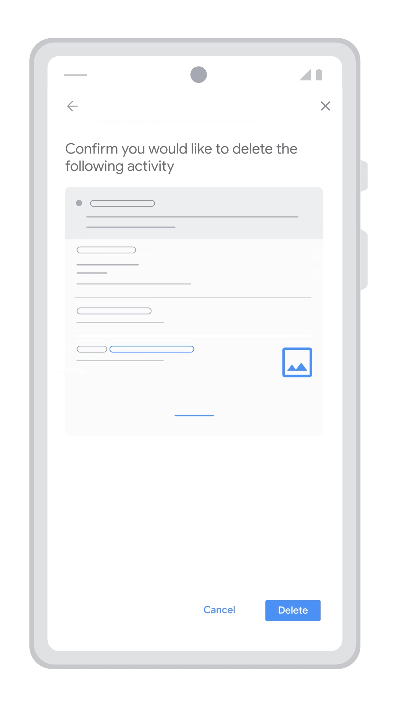

Pernahkah Anda meminjamkan ponsel kepada teman atau anggota keluarga, lalu mendadak merasa waswas saat mereka mulai mengetik sesuatu di kolom pencarian Google? Rekomendasi pencarian otomatis (autocomplete) tiba-tiba memunculkan topik sensitif yang pernah Anda cari beberapa hari lalu, mulai dari pencarian masalah kesehatan pribadi, perbandingan harga kado kejutan, hingga urusan perbankan.

Rasa khawatir semacam itu sangat wajar terjadi. Di era serba digital saat ini, smartphone telah menjadi buku harian paling intim yang merekam setiap pertanyaan, minat, dan kekhawatiran kita sepanjang hari. Google mencatat hampir setiap kata kunci yang kita ketikkan di bilah pencarian, situs web yang kita jelajahi lewat peramban Chrome, hingga tautan yang kita klik dari hasil penelusuran.

Banyak pengguna mengira bahwa menghapus riwayat dari aplikasi browser bawaan sudah cukup untuk menghilangkan seluruh rekam jejak tersebut. Padahal, ada perbedaan mendasar antara histori lokal di aplikasi peramban dengan rekaman aktivitas yang tersimpan rapi di server Akun Google. Memahami panduan lengkap hapus riwayat google di hp secara menyeluruh akan membantu Anda mengembalikan kendali penuh atas privasi digital Anda tanpa menyisakan celah data tersembunyi.

## Dua Lapisan Riwayat Google yang Wajib Anda Pahami

Sebelum melangkah ke panduan teknis, penting untuk membedakan dua jenis riwayat yang tersimpan di smartphone Anda:

1. **Histori Peramban Lokal (Google Chrome / Browser HP):** Ini adalah catatan daftar tautan web yang pernah Anda buka, berkas gambar penjelajahan sementara (cache), dan cookie login yang tersimpan di memori internal ponsel. Jika Anda menghapus histori ini, peramban Anda menjadi bersih, namun server Google masih menyimpan daftar pencarian Anda jika saat itu Anda dalam kondisi login ke akun Google.
2. **Aktivitas Web dan Aplikasi Akun Google (Google My Activity):** Ini adalah basis data pencarian berbasis awan (cloud) yang ditautkan langsung ke alamat email Gmail Anda. Rekaman ini mencakup penelusuran Google Search, video YouTube yang ditonton, lokasi penelusuran Google Maps, hingga interaksi perintah suara. Selama Anda masuk ke akun Google yang sama di laptop, tablet, atau komputer lain, rekam jejak ini akan terus tersinkronisasi.

Agar smartphone Anda benar-benar bersih dari riwayat masa lalu, kedua lapisan tersebut harus dibersihkan secara sistematis.

## Cara Menghapus Histori Penjelajahan di Google Chrome HP

Langkah awal yang paling mudah dan sering dilakukan adalah membersihkan data penjelajahan langsung dari aplikasi Google Chrome di ponsel cerdas Anda, baik di Android maupun iPhone:

1. **Buka Aplikasi Chrome:** Buka aplikasi Google Chrome di smartphone Anda.
2. **Buka Menu Pengaturan:** Ketuk ikon titik tiga di sudut kanan atas layar (atau sudut kanan bawah untuk pengguna iPhone).
3. **Pilih Hapus Data Penjelajahan:** Masuk ke menu **Histori**, kemudian ketuk opsi **Hapus data penjelajahan** (Clear browsing data) yang berada di bagian atas daftar.
4. **Tentukan Rentang Waktu:** Pada menu tarik-turun *Rentang waktu*, ubah pilihannya dari "1 jam terakhir" menjadi **Semua** (All time) agar seluruh rekam jejak lama terhapus tuntas.
5. **Centang Data yang Ingin Dihapus:** Pastikan mencentang kotak **Histori penjelajahan**, **Cookie dan data situs**, serta **Gambar dan file dalam cache**.
6. **Ketuk Tombol Hapus Data:** Tekan tombol biru bertuliskan **Hapus data** di sudut kanan bawah untuk mengonfirmasi proses pembersihan.

Langkah ini akan langsung mengosongkan riwayat kunjungan situs web lokal di peramban Chrome Anda, sekaligus melegakan ruang penyimpanan internal ponsel dari tumpukan cache yang menumpuk.

## Panduan Menghapus Aktivitas Google Secara Permanen via Dasbor Resmi

Setelah membersihkan riwayat browser di ponsel, kini saatnya menghapus rekam jejak yang tersimpan di server awan akun Google Anda melalui portal resmi Google My Activity (Aktivitas Saya):

1. **Kunjungi Dasbor Aktivitas:** Buka peramban di ponsel Anda, lalu akses alamat situs `myactivity.google.com`. Anda juga bisa membukanya melalui menu **Pengaturan** di Android > **Google** > **Kelola Akun Google Anda** > tab **Data & privasi** > gulir ke **Aktivitas Saya**.
2. **Pilih Opsi Hapus Aktivitas:** Di bagian atas linimasa aktivitas, temukan tombol bertuliskan **Hapus** (dengan ikon tong sampah).
3. **Pilih Rentang Waktu Semua:** Pada jendela sembulan yang muncul, pilih opsi **Semua waktu** (All time).
4. **Pilih Layanan Google yang Ingin Dihapus:** Google akan menampilkan daftar layanan yang menyimpan aktivitas Anda, seperti Google Search, Penelusuran Gambar, Google News, dan Google Play Store. Biarkan seluruh kotak tetap tercentang untuk pembersihan total, lalu ketuk tombol **Berikutnya**.
5. **Konfirmasi Penghapusan Permanen:** Layar akan menampilkan pratinjau aktivitas yang akan dihapus. Ketuk tombol **Hapus** sekali lagi untuk mengonfirmasi. Sistem akan langsung memusnahkan riwayat pencarian tersebut dari basis data server Google.

*Sumber: [Bantuan Akun Google](https://support.google.com/accounts/answer/465?hl=id)*

Setelah langkah ini selesai, Google tidak akan lagi menggunakan riwayat lama tersebut untuk memberikan rekomendasi konten atau iklan bertarget di akun Anda.

## Mengaktifkan Fitur Hapus Otomatis Agar Privasi Tetap Terjaga

Menghapus riwayat penelusuran secara manual setiap minggu tentu cukup merepotkan. Untungnya, Google telah menyediakan fitur otomatisasi cerdas yang dapat menghapus rekam jejak Anda secara berkala tanpa perlu campur tangan manual lagi:

1. Di halaman `myactivity.google.com`, gulir ke bagian atas dan ketuk menu **Aktivitas Web & Aplikasi**.
2. Cari bagian berlabel **Penghapusan otomatis** (Auto-delete).
3. Jika statusnya masih nonaktif, ketuk tombol **Pilih opsi hapus otomatis**.
4. Pilih rentang waktu retensi data yang Anda inginkan:
   - **3 bulan:** Pilihan paling ideal bagi pengguna yang memprioritaskan privasi tinggi.
   - **18 bulan:** Standar bawaan Google untuk keseimbangan antara personalisasi dan privasi.
   - **36 bulan:** Bagi pengguna yang masih membutuhkan rekomendasi jangka panjang.
5. Ketuk tombol **Berikutnya**, lalu tekan **Konfirmasi**.

Mulai saat itu, setiap data penelusuran yang usianya telah melampaui batas waktu yang Anda tentukan akan otomatis dimusnahkan oleh sistem di latar belakang.

## Trik Cepat Hapus Riwayat 15 Menit Terakhir di Aplikasi Google

Bagaimana jika Anda baru saja melakukan penelusuran darurat atau mencari kado rahasia dan ingin segera menghilangkan jejaknya tanpa harus menghapus riwayat berbulan-bulan yang lalu?

Google memiliki fitur praktis bernama **Hapus Cepat 15 Menit Terakhir** (Quick Delete) yang tersedia langsung di aplikasi Google (Google Search app) pada smartphone Android dan iOS:

1. Buka aplikasi **Google** bawaan ponsel Anda.
2. Ketuk foto profil akun Anda di sudut kanan atas layar.
3. Di bawah nama akun, Anda akan menemukan tombol opsi bertuliskan **Hapus 15 menit terakhir**.
4. Ketuk tombol tersebut, dan dalam sekejap seluruh penelusuran yang Anda lakukan dalam 15 menit ke belakang akan langsung lenyap dari akun Anda tanpa meninggalkan jejak.

Pintasan ini sangat berguna saat Anda sedang meminjam ponsel rekan kerja atau ingin menjaga kejutan keluarga tetap aman tanpa repot masuk ke menu pengaturan yang rumit.

## Menjaga Privasi Harian dengan Mode Samaran

Langkah preventif selalu lebih baik daripada pembersihan berulang. Jika Anda hendak menelusuri informasi yang bersifat pribadi atau rahasia, biasakan menggunakan fitur **Tab Samaran** (Incognito Mode) di Google Chrome:

- Di aplikasi Chrome HP, ketuk ikon titik tiga di sudut kanan atas, lalu pilih **Tab Samaran baru**.
- Dalam mode samaran, peramban tidak akan mencatat riwayat penjelajahan, tidak menyimpan cookie login setelah tab ditutup, dan tidak menyimpan data formulir ke ponsel Anda.
- Setelah selesai browsing, cukup tutup seluruh tab samaran untuk mengakhiri sesi penjelajahan tanpa meninggalkan jejak sedikit pun di memori internal perangkat.

Menerapkan langkah-langkah di atas akan menjaga smartphone Anda tetap bersih, performa browser terasa lebih responsif, dan privasi penelusuran Anda terlindungi secara optimal setiap hari.

Sumber: [Bantuan Akun Google](https://support.google.com/accounts/answer/465?hl=id)
