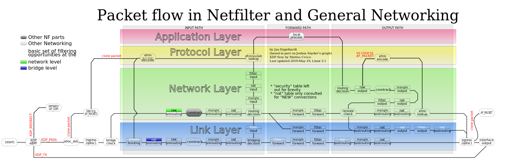

Dalam pengelolaan server dan infrastruktur jaringan Linux, mengarahkan lalu lintas data ke pintu gerbang yang tepat adalah tugas paling mendasar bagi seorang sysadmin. Selama bertahun-tahun, banyak teknisi mengandalkan perintah `route` atau `netstat -r` dari paket `net-tools`. Namun, perkakas lawas tersebut sudah dinyatakan usang (*deprecated*) selama lebih dari satu dekade karena tidak mampu mengimbangi kompleksitas tumpukan jaringan Linux modern.

Pengganti resminya adalah paket `iproute2`, dengan subperintah intinya yaitu `ip route`. Perintah **ip route linux** berinteraksi langsung dengan subsistem jaringan kernel Linux melalui antarmuka Netlink. Perkakas ini memberikan kendali penuh terhadap Forwarding Information Base (FIB), tabel routing multipath, aturan perutean berbasis kebijakan (*policy routing*), hingga manipulasi metrik antarmuka berkecepatan tinggi.

Menguasai perintah `ip route` bukan sekadar menghafal cara menyetel default gateway. Pemahaman ini sangat krusial saat server ente memiliki banyak antarmuka jaringan (*multihomed*), terhubung ke beberapa ISP sekaligus, menjalankan antarmuka virtual untuk kontainer Docker, maupun mengalirkan trafik terenkripsi lewat WireGuard dan OpenVPN.

Kali ini ane ajak ente membedah tuntas penggunaan perintah **ip route linux**, mulai dari anatomi tabel routing kernel, manajemen default gateway, pembuatan rute statis, optimasi metrik, investigasi rute via simulasi kernel, hingga konfigurasi multi-table dan persistensi rute di berbagai distribusi Linux.

## Arsitektur dan Cara Kerja Perutean Kernel Linux

Ketika paket data tiba di kartu jaringan (*network interface card*) atau dihasilkan secara lokal oleh aplikasi di server, kernel Linux harus mengambil keputusan perutean (*routing decision*). Keputusan ini menentukan apakah paket harus diproses oleh aplikasi lokal di server tersebut, diteruskan (*forwarded*) ke antarmuka lain, atau dibuang.

Kernel Linux mengelola beberapa tabel rute secara hierarkis. Secara default, terdapat tiga tabel utama yang selalu aktif:

1. **Tabel local (ID 255):** Dikelola secara otomatis oleh kernel untuk menangani alamat broadcast, loopback lokal (`127.0.0.1`), dan alamat IP lokal yang terpasang pada antarmuka jaringan fisik. Rute di tabel ini memiliki prioritas tertinggi dan tidak boleh diubah sembarangan.
2. **Tabel main (ID 254):** Tabel rute standar tempat seluruh perintah `ip route` beroperasi jika ente tidak menentukan nama tabel secara spesifik. Di sinilah rute statis, rute antarmuka lokal, dan default gateway disimpan.
3. **Tabel default (ID 253):** Tabel kosong yang disediakan kernel untuk aturan pasca-pemrosesan umum jika rute tidak ditemukan di tabel main.


*Sumber: [Linux Kernel Networking Documentation](https://commons.wikimedia.org/wiki/File:Netfilter-packet-flow.svg)*

Berdasarkan arsitektur pemrosesan paket di atas, pencarian rute pada Forwarding Information Base (FIB) kernel Linux menggunakan prinsip pencocokan terpanjang (*Longest Prefix Match*). Jika terdapat dua rute yang sama-sama cocok dengan alamat IP tujuan, kernel akan selalu memilih rute dengan subnet mask paling spesifik (misalnya `/32` akan menang melawan `/24`, dan `/24` akan selalu mengalahkan rute default `/0`).

## Prasyarat Sebelum Konfigurasi

Sebelum mulai mengeksekusi perintah manajemen rute, pastikan sistem ente telah memenuhi persyaratan teknis berikut:

1. Akses terminal dengan hak `root` atau pengguna yang memiliki privilese `sudo`. Operasi modifikasi tabel rute kernel membutuhkan kapabilitas `CAP_NET_ADMIN`.
2. Paket `iproute2` sudah terpasang. Paket ini merupakan komponen inti sistem operasi dan terpasang secara default pada Debian, Ubuntu, Red Hat Enterprise Linux, Rocky Linux, AlmaLinux, Fedora, openSUSE, dan Arch Linux.
3. Mengetahui nama antarmuka jaringan yang aktif di server ente (misalnya `eth0`, `enp3s0`, atau antarmuka virtual VPN). Ente bisa memeriksanya kapan saja menggunakan perintah `ip link show` atau `ip addr show`.

## Langkah 1: Menampilkan dan Menganalisis Tabel Routing Aktif

Langkah pertama dalam mengelola jaringan adalah memeriksa rute yang saat ini aktif di dalam memori kernel Linux.

Jalankan perintah berikut:

```bash
root@server:~# ip route show
```

Ente juga bisa menggunakan bentuk singkatan yang lazim dipakai sysadmin di terminal, yaitu `ip r` atau `ip route list`.

Contoh output tipikal pada server Linux:

```text
default via 192.168.1.1 dev eth0 proto dhcp metric 100 
10.10.0.0/16 via 192.168.1.254 dev eth0 proto static 
172.17.0.0/16 dev docker0 proto kernel scope link src 172.17.0.1 
192.168.1.0/24 dev eth0 proto kernel scope link src 192.168.1.50 metric 100 
```

Mari kita bedah setiap komponen penting pada output baris rute di atas:

- **default:** Menunjukkan rute cadangan (*catch-all*) dengan prefix `0.0.0.0/0`. Semua paket yang tujuannya tidak cocok dengan subnet lain di tabel rute akan dilemparkan ke sini.
- **via 192.168.1.1:** Alamat IP hop berikutnya (*next-hop gateway*), yaitu router fisik yang bertugas meneruskan paket ke jaringan luar atau internet.
- **dev eth0:** Antarmuka jaringan lokal yang digunakan kernel untuk mengirimkan paket data tersebut.
- **proto:** Protokol atau mekanisme yang menciptakan rute tersebut. Nilai `proto kernel` dibuat langsung oleh kernel saat IP ditetapkan pada interface, `proto dhcp` berasal dari konfigurasi otomatis DHCP client, sedangkan `proto static` dibuat manual oleh administrator atau berkas jaringan.
- **scope link:** Menandakan bahwa alamat tujuan berada langsung di segmen jaringan fisik lokal yang terhubung dengan antarmuka tersebut tanpa perlu melewati gateway perantara.
- **src 192.168.1.50:** Alamat IP lokal pilihan (*preferred source IP*) yang akan disematkan kernel pada header paket keluar jika aplikasi lokal tidak mengikat (*bind*) IP tertentu secara eksplisit.
- **metric 100:** Nilai bobot biaya rute. Jika ada beberapa rute menuju tujuan yang sama, rute dengan nilai metrik terendah yang akan diprioritaskan.

Jika ente ingin melihat rute lokal internal kernel yang menangani broadcast dan IP mesin sendiri, sertakan opsi `table local`:

```bash
root@server:~# ip route show table local
```

## Langkah 2: Mengatur dan Mengganti Default Gateway Sistem

Default gateway adalah rute paling vital. Tanpa rute default, server tidak akan bisa mengakses repositori internet, melakukan resolusi DNS eksternal, atau merespons pengguna di luar jaringan lokal.

### Menambahkan Default Gateway Baru

Jika server ente belum memiliki rute default (misalnya setelah inisialisasi antarmuka baru secara manual), tambahkan dengan perintah:

```bash
root@server:~# ip route add default via 192.168.1.1 dev eth0
```

### Mengganti Default Gateway yang Sedang Aktif

Ketika berpindah koneksi jaringan atau melakukan pengalihan gateway darurat, menjalankan `ip route add` akan menghasilkan error `RTNETLINK answers: File exists` karena rute default sudah ada.

Gunakan subperintah `replace` untuk mengganti rute secara langsung tanpa perlu menghapusnya terlebih dahulu:

```bash
root@server:~# ip route replace default via 192.168.1.254 dev eth0
```

Perintah `replace` bekerja secara atomik di memori kernel, sehingga koneksi aktif tidak akan terputus akibat jeda penghapusan rute manual.

### Menghapus Default Gateway

Jika ente ingin mencopot gerbang keluar pada antarmuka tertentu:

```bash
root@server:~# ip route del default via 192.168.1.1 dev eth0
```

## Langkah 3: Menambahkan dan Menghapus Rute Statis Subnet

Rute statis (*static route*) diperlukan ketika server harus berkomunikasi dengan subnet privat lain yang tidak bisa dijangkau lewat default gateway reguler. Contoh umumnya adalah jaringan kantor cabang, subnet database di VLAN terpisah, atau segmen VPC di cloud.

### Menambahkan Rute ke Subnet Jaringan

Misalkan server ente berada di subnet `192.168.1.0/24`, dan ente ingin menghubungkan server ke subnet kantor cabang `10.50.0.0/16` melalui router internal dengan IP `192.168.1.200`:

```bash
root@server:~# ip route add 10.50.0.0/16 via 192.168.1.200 dev eth0
```

Setiap paket yang ditujukan ke IP mana pun di rentang `10.50.0.1` sampai `10.50.255.254` kini akan langsung dikirimkan ke router `192.168.1.200`.

### Menambahkan Rute Khusus Host Tunggal (/32)

Jika ente hanya ingin mengarahkan trafik menuju satu server spesifik (misalnya server backup penyimpanan off-site di IP `203.0.113.88`) lewat antarmuka VPN `wg0`:

```bash
root@server:~# ip route add 203.0.113.88/32 via 10.8.0.1 dev wg0
```

Karena prefix `/32` adalah tingkat spesifikasi tertinggi, paket menuju IP tersebut akan selalu dilewatkan melalui `wg0`, meskipun rute default internet ente mengarah ke kartu fisik `eth0`.

### Menghapus Rute Statis

Untuk membuang rute statis yang sudah tidak dipakai, cukup panggil perintah `del` diikuti subnet tujuannya:

```bash
root@server:~# ip route del 10.50.0.0/16 via 192.168.1.200 dev eth0
```

Ente juga bisa menyingkatnya dengan hanya menyebutkan network target jika rute tersebut unik di tabel:

```bash
root@server:~# ip route del 10.50.0.0/16
```

## Langkah 4: Mengatur Prioritas Jalur Jaringan Menggunakan Nilai Metrik

Skenario server atau komputer Linux dengan dua antarmuka jaringan aktif sangat sering dijumpai di lapangan. Misalnya laptop yang terhubung ke kabel LAN (`eth0`) dan Wi-Fi (`wlan0`) sekaligus, atau server edge dengan dua tautan internet (ISP Utama serat optik dan ISP Cadangan modem 4G/5G).

Ketika kedua antarmuka mendapatkan rute default dari DHCP, kernel Linux memerlukan parameter penentu untuk memilih rute mana yang harus dipakai. Parameter tersebut adalah **metric**.

Aturan metrik di kernel Linux: **Semakin kecil nilai metrik, semakin tinggi prioritas rute tersebut.**

Mari kita buat konfigurasi dua jalur default dengan prioritas bertingkat:

```bash
# Rute Utama via eth0 dengan bobot prioritas tinggi (metric 100)
root@server:~# ip route add default via 192.168.1.1 dev eth0 metric 100

# Rute Cadangan via eth1 dengan bobot prioritas rendah (metric 200)
root@server:~# ip route add default via 10.0.0.1 dev eth1 metric 200
```

Periksa hasil evaluasi tabel:

```bash
root@server:~# ip route show | grep default
default via 192.168.1.1 dev eth0 metric 100 
default via 10.0.0.1 dev eth1 metric 200 
```

Dalam kondisi normal, seluruh koneksi keluar akan melintasi `eth0` karena nilai metriknya lebih rendah (100 < 200). Jika kabel antarmuka `eth0` terputus atau dinonaktifkan (`ip link set eth0 down`), kernel secara otomatis mengalihkan aliran paket ke jalur `eth1` (metric 200) tanpa jeda downtime manual.

## Langkah 5: Menyelidiki Penentuan Jalur Paket dengan ip route get

Salah satu fitur paling praktis namun sering dilupakan sysadmin adalah subperintah `ip route get`.

Membaca puluhan baris tabel rute secara manual rawan menimbulkan salah tafsir, terutama jika server memiliki antarmuka bridge kontainer, rute VPN, dan beberapa subnet VLAN. Perintah `ip route get` meminta kernel Linux melakukan simulasi penentuan jalur secara instan untuk alamat IP tujuan tertentu.

Uji rute menuju IP publik DNS Cloudflare:

```bash
root@server:~# ip route get 1.1.1.1
```

Contoh output yang dikembalikan oleh kernel:

```text
1.1.1.1 via 192.168.1.1 dev eth0 src 192.168.1.50 uid 0 
    cache 
```

Dari hasil satu baris di atas, ente langsung memperoleh kepastian teknis yang jelas:
1. Paket akan dikirim ke gateway `192.168.1.1`.
2. Keluar melalui antarmuka fisik `eth0`.
3. Menggunakan alamat pengirim lokal `src 192.168.1.50`.

Ente juga bisa menguji simulasi rute dengan mendefinisikan antarmuka masuk (*incoming interface*), yang sangat bermanfaat saat mendiagnosis server yang difungsikan sebagai router:

```bash
root@server:~# ip route get 10.50.1.10 from 192.168.1.80 iif eth0
```

## Langkah 6: Menerapkan Policy Routing Berbasis Multi-Table dan ip rule

Secara tradisional, perutean IP standar bersifat *Destination-Based Routing*, di mana keputusan hanya dibuat berdasarkan alamat IP yang dituju. Namun, ada kalanya ente membutuhkan perutean berdasarkan alamat IP asal (*Source-Based Routing*), penanda firewall (*fwmark*), atau port layanan.

Fitur ini disebut **Policy-Based Routing (PBR)**, yang dibangun menggunakan kombinasi `ip route` dan `ip rule`.

Contoh kasus nyata: Server ente memiliki dua kartu jaringan dengan dua alamat IP publik berbeda dari ISP A (`eth0` - 198.51.100.10) dan ISP B (`eth1` - 203.0.113.20). Jika ada pengguna internet menghubungi IP ISP B, balasan paket server sering kali nyasar keluar lewat ISP A karena default gateway utama server mengarah ke ISP A. Hal ini memicu masalah perutean asimetris (*asymmetric routing*) dan koneksi gagal terjalin.

Berikut langkah penyelesaiannya menggunakan tabel rute terpisah:

### 1. Buat Nama Tabel Rute Kustom

Buka berkas konfigurasi tabel rute Linux `/etc/iproute2/rt_tables`:

```bash
root@server:~# nano /etc/iproute2/rt_tables
```

Tambahkan baris identitas tabel baru di bagian paling bawah:

```text
200 isp2
```

Simpan berkas tersebut. Kini kernel mengenali tabel bernama `isp2` dengan nomor ID 200.

### 2. Isi Tabel isp2 dengan Rute Khusus

Tambahkan default gateway khusus ISP B ke dalam tabel `isp2`:

```bash
root@server:~# ip route add default via 203.0.113.1 dev eth1 table isp2
root@server:~# ip route add 203.0.113.0/24 dev eth1 proto kernel scope link src 203.0.113.20 table isp2
```

### 3. Tambahkan Aturan Seleksi Kebijakan (ip rule)

Beri tahu kernel Linux: jika ada paket keluar yang memiliki IP sumber milik ISP B (`203.0.113.20`), gunakan tabel rute `isp2`:

```bash
root@server:~# ip rule add from 203.0.113.20/32 table isp2
```

Periksa daftar aturan kebijakan yang aktif:

```bash
root@server:~# ip rule show
0:      from all lookup local 
32765:  from 203.0.113.20 lookup isp2 
32766:  from all lookup main 
32767:  from all lookup default 
```

Dengan konfigurasi policy routing ini, setiap permintaan yang masuk ke antarmuka `eth1` akan dijamin membalas keluar lewat gerbang ISP B secara sempurna tanpa terpengaruh oleh default gateway di tabel utama.

## Langkah 7: Menyimpan Konfigurasi Routing agar Persisten Saat Reboot

Perintah CLI `ip route` yang dieksekusi langsung di terminal memodifikasi tabel rute secara langsung di memori kernel (*runtime configuration*). Konfigurasi ini bersifat sementara (*ephemeral*) dan akan hilang seketika saat server direboot atau kartu jaringan dimuat ulang.

Agar aturan rute tetap bertahan permanen, ente harus mendokumentasikannya ke dalam subsistem manajemen jaringan yang digunakan distribusi Linux ente.

### 1. Ubuntu dan Debian Modern (Netplan)

Pada Ubuntu 20.04/22.04/24.04 dan Debian terkini yang memanfaatkan Netplan, berkas konfigurasi berada di direktori `/etc/netplan/*.yaml`.

Buka berkas konfigurasi Netplan (misal `/etc/netplan/50-cloud-init.yaml`):

```yaml
network:
  version: 2
  ethernets:
    eth0:
      dhcp4: true
      routes:
        - to: 10.50.0.0/16
          via: 192.168.1.200
          metric: 100
        - to: 203.0.113.88/32
          via: 10.8.0.1
```

Terapkan perubahan konfigurasi dengan perintah:

```bash
root@server:~# sudo netplan apply
```

### 2. RHEL, Rocky Linux, AlmaLinux, dan Fedora (NetworkManager)

Distribusi keluarga Enterprise Linux mengandalkan NetworkManager. Cara paling bersih untuk menambahkan rute statis persisten adalah melalui perkakas CLI `nmcli`:

```bash
# Menambahkan rute statis ke koneksi NetworkManager 'eth0'
root@server:~# nmcli connection modify eth0 +ipv4.routes "10.50.0.0/16 192.168.1.200"

# Muat ulang koneksi agar rute langsung aktif
root@server:~# nmcli connection up eth0
```

NetworkManager akan menyimpan deklarasi tersebut ke dalam berkas `/etc/NetworkManager/system-connections/eth0.nmconnection`.

### 3. Distribusi Berbasis systemd-networkd (Arch Linux / Minimal Server)

Bagi instalasi minimal yang menggunakan `systemd-networkd`, tambahkan blok `[Route]` pada berkas antarmuka di `/etc/systemd/network/10-eth0.network`:

```ini
[Match]
Name=eth0

[Network]
DHCP=yes

[Route]
Destination=10.50.0.0/16
Gateway=192.168.1.200
Metric=100
```

Muat ulang konfigurasi jaringan dengan utilitas `networkctl reload`.

## Solusi Kendala Umum (Troubleshooting)

Saat mengelola rute jaringan di lingkungan produksi, berikut beberapa kendala yang kerap dijumpai beserta solusinya:

### 1. Galat "RTNETLINK answers: Network is unreachable"

Pesan galat ini muncul saat ente mencoba menambahkan rute statis atau gateway default dengan alamat `via <IP_Gateway>`, tetapi alamat IP gateway tersebut tidak berada dalam segmen subnet lokal antarmuka yang bersangkutan.

* **Penyebab:** Kernel tidak tahu cara menjangkau IP gateway tersebut karena tidak ada rute langsung (*link-local route*) ke IP gateway yang dimaksud.
* **Solusi:** Pastikan antarmuka jaringan ente sudah memiliki alamat IP yang satu subnet dengan gateway. Jika gateway berada di segmen antarmuka point-to-point (misalnya pada koneksi VPS tertentu), tambahkan rute *scope link* terlebih dahulu sebelum rute default:

```bash
root@server:~# ip route add 192.168.1.1 dev eth0 scope link
root@server:~# ip route add default via 192.168.1.1 dev eth0
```

### 2. Galat "RTNETLINK answers: File exists"

Pesan galat ini terjadi saat ente mencoba mengeksekusi `ip route add` untuk subnet atau prefix tujuan yang sudah tercatat sebelumnya di tabel rute.

* **Solusi:** Jangan gunakan `add`. Gunakan `ip route replace` jika berniat mengganti rute yang ada, atau hapus rute lama terlebih dahulu menggunakan `ip route del`.

### 3. Masalah Reverse Path Filtering (rp_filter)

Pada server multi-homed atau yang menjalankan routing lanjutan, sering terjadi situasi di mana paket data masuk ke server tetapi tidak pernah ada balasan yang kembali ke client.

* **Penyebab:** Mekanisme keamanan kernel Linux bernama Reverse Path Filtering (`rp_filter`) memverifikasi apakah paket balasan akan dikirimkan keluar melalui antarmuka yang sama dengan antarmuka tempat paket tersebut masuk. Jika rute balasan tidak simetris (*asymmetric*), kernel secara otomatis membuang (*drop*) paket tersebut demi mencegah IP spoofing.
* **Solusi:** Ubah mode `rp_filter` dari strict (1) menjadi loose (2) pada berkas `/etc/sysctl.d/99-networking.conf`:

```ini
net.ipv4.conf.all.rp_filter = 2
net.ipv4.conf.default.rp_filter = 2
net.ipv4.conf.eth0.rp_filter = 2
net.ipv4.conf.eth1.rp_filter = 2
```

Terapkan aturan baru tersebut ke kernel dengan menjalankan `sudo sysctl -p /etc/sysctl.d/99-networking.conf`.

---

Menguasai perintah **ip route linux** memberikan fondasi kokoh dalam mengendalikan aliran data di sistem operasi Linux. Mulai dari sekadar membaca tabel routing, mengelola prioritas gateway dengan metrik, memecah lalu lintas subnet kantor, hingga membangun policy routing multi-table yang canggih, seluruh kapabilitas ini memastikan server dan layanan yang ente kelola memiliki konektivitas jaringan yang andal, aman, dan siap menghadapi kebutuhan skala produksi.

> **Baca Juga:**
> - [Cara Mengatasi ss Command Not Found di Linux](/cara-mengatasi-ss-command-not-found-di-linux/)
> - [Panduan Lengkap ss tulpn Command in Linux](/panduan-lengkap-ss-tulpn-command-in-linux/)

Sumber: [Linux iproute2 Documentation](https://wiki.linuxfoundation.org/networking/iproute2)
