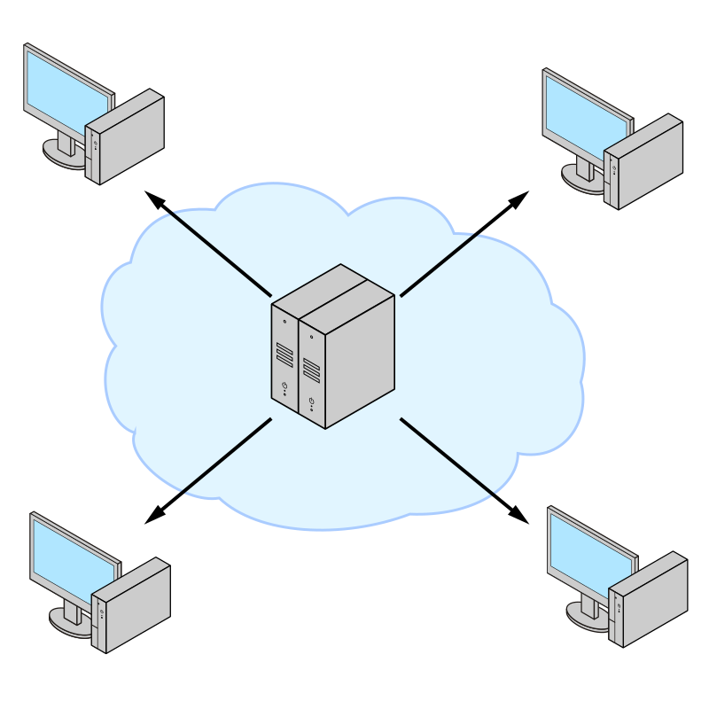

Mengukur performa throughput aktual pada infrastruktur jaringan lokal (LAN), antarkantor cabang (WAN), maupun kluster virtualisasi sering kali menimbulkan kebingungan bagi administrator jaringan. Pengujian bandwidth berbasis peramban web seperti Ookla Speedtest atau Fast.com sangat tidak memadai untuk diagnosis internal. Layanan pihak ketiga tersebut dipengaruhi oleh latensi server eksternal, limitasi browser, beban kompresi HTTP, enkripsi TLS, hingga bottleneck I/O penyimpanan lokal.

Ketika workstation teknis atau server homelab ente terasa lambat saat melakukan replikasi basis data, sinkronisasi storage NFS, atau transfer file besar melalui SSH, ente membutuhkan alat ukur point-to-point murni yang beroperasi langsung di layer transport (L4). Alat tersebut harus mengecualikan overhead sistem berkas dan aplikasi. Standar de facto industri jaringan untuk tugas ini adalah iPerf3.

iPerf3 dikembangkan oleh Energy Sciences Network (ESnet) dan Lawrence Berkeley National Laboratory sebagai penulisan ulang lengkap dari proyek iPerf lawas. Perangkat lunak ini dirancang dengan basis kode C yang jauh lebih ringkas, menyediakan library modular, dan sejak pembaruan arsitektur modern (mulai iPerf 3.16 hingga iPerf 3.22) telah mendukung eksekusi multi-threading penuh untuk mengimbangi kartu jaringan berkecepatan 25 Gbps, 40 Gbps, hingga 100 Gbps.

Artikel ini menyajikan panduan mendalam seputar penggunaan iperf3 test command di Linux. Ente akan mempelajari arsitektur pengujian, eksekusi benchmark TCP dasar, pengujian reverse download, penanganan multi-stream paralel, diagnostik jitter serta packet loss UDP, hingga tips tuning kernel untuk throughput maksimal.

## Arsitektur Kerja dan Model Komunikasi iPerf3

iPerf3 beroperasi menggunakan arsitektur client-server aktif. Untuk menjalankan pengujian, ente wajib memiliki dua perangkat independen di dalam jaringan: satu mesin berperan sebagai server penerima pasif (*listener*), dan mesin lainnya bertindak sebagai client pengirim aktif (*initiator*).


*Sumber: [Wikimedia Commons](https://commons.wikimedia.org/wiki/File:Traditional_client-server_diagram.svg)*

Secara default, alur komunikasi iPerf3 terbagi menjadi dua saluran utama:

1. **Control Connection (Koneksi Kendali)**: Dibangun melalui soket TCP pada port 5201. Saluran ini bertugas melakukan negosiasi parameter uji (durasi, protokol transport, ukuran blok data, dan arah pengujian), melakukan sinkronisasi waktu mulai, serta bertukar statistik ringkasan pengujian sebelum koneksi ditutup.
2. **Data Streams (Aliran Data Pengujian)**: Jalur pengiriman payload sintetis berkekuatan penuh. Pada mode TCP bawaan, client bertindak sebagai pengirim (*sender*) yang memompa paket ke server (*receiver*). Jika mode UDP diaktifkan, data payload dikirim tanpa mekanisme handshake konfirmasi, memungkinkan pengukuran packet loss secara objektif.

Perlu dicatat bahwa satu proses server iPerf3 hanya dapat melayani satu sesi pengujian client pada satu waktu (*single client per instance*). Jika beberapa engineer perlu menguji secara bersamaan, beberapa instance server harus dijalankan pada port berbeda.

## Prasyarat Sistem

Sebelum menjalankan pengujian, pastikan lingkungan lab atau server produksi ente memenuhi kriteria berikut:

- Dua mesin Linux yang saling terhubung melalui protokol IP (bisa berupa bare-metal, VM KVM/Proxmox, atau container LXC).
- Akses root atau hak administratif sudo pada kedua mesin untuk memasang paket dan membuka port firewall.
- Port TCP dan UDP 5201 terbuka pada firewall perantara (UFW, nftables, firewalld, atau security group cloud).
- Pengetahuan dasar alamat IP lokal kedua perangkat (misalnya Server: `192.168.1.10` dan Client: `192.168.1.50`).

## Langkah 1: Pasang Paket iPerf3 pada Kedua Node

Paket iPerf3 telah tersedia secara resmi di repositori utama hampir seluruh distribusi Linux populer. Jalankan perintah instalasi berikut sesuai sistem operasi yang digunakan.

Pada Debian, Ubuntu, dan Linux Mint:

```bash
sudo apt update
sudo apt install -y iperf3
```

Pada RHEL, Rocky Linux, AlmaLinux, dan Fedora:

```bash
sudo dnf install -y iperf3
```

Pada Arch Linux:

```bash
sudo pacman -S --noconfirm iperf3
```

Setelah instalasi selesai, verifikasi versi yang terpasang menggunakan perintah:

```bash
iperf3 -v
```

Perintah ini akan menampilkan nomor versi serta informasi pustaka cJSON dan OpenSSL yang digunakan.

## Langkah 2: Jalankan iPerf3 dalam Mode Server

Langkah awal pengujian adalah menyalakan iPerf3 pada mesin target penerima (Server). Mesin ini akan mendengarkan request masuk pada port 5201.

Jalankan perintah berikut di mesin server:

```bash
iperf3 -s
```

Terminal akan menampilkan pesan konfirmasi:

```text
-----------------------------------------------------------
Server listening on 5201 (test #1)
-----------------------------------------------------------
```

Jika server berada di belakang firewall UFW (seperti Ubuntu Server), buka port 5201 untuk protokol TCP dan UDP:

```bash
sudo ufw allow 5201/tcp comment 'iPerf3 TCP Test'
sudo ufw allow 5201/udp comment 'iPerf3 UDP Test'
sudo ufw reload
```

Bagi pengguna nftables, pastikan rantai input mengizinkan port 5201:

```bash
sudo nft add rule inet filter input tcp dport 5201 accept
sudo nft add rule inet filter input udp dport 5201 accept
```

Jika server berada di mesin headless remote dan ingin dijalankan di latar belakang (*daemon mode*), gunakan opsi `-D`:

```bash
iperf3 -s -D
```

## Langkah 3: Eksekusi iperf3 Test Command Dasar untuk Throughput TCP

Setelah server siap, beralihlah ke mesin client untuk memulai pengujian throughput. Sintaks dasar iperf3 test command membutuhkan argumen `-c` diikuti alamat IP server.

Jalankan perintah berikut di mesin client:

```bash
iperf3 -c 192.168.1.10
```

Secara bawaan, iPerf3 akan:
- Menghubungkan client ke server `192.168.1.10` pada port `5201`.
- Menggunakan protokol TCP.
- Menjalankan transfer payload sintetis selama 10 detik.
- Melaporkan statistik throughput setiap interval 1 detik.

Contoh keluaran pada terminal client:

```text
Connecting to host 192.168.1.10, port 5201
[  5] local 192.168.1.50 port 49152 connected to 192.168.1.10 port 5201
[ ID] Interval           Transfer     Bitrate         Retr  Cwnd
[  5]   0.00-1.00   sec   114 MBytes   954 Mbits/sec    0    414 KBytes       
[  5]   1.00-2.00   sec   112 MBytes   941 Mbits/sec    0    414 KBytes       
[  5]   2.00-3.00   sec   112 MBytes   941 Mbits/sec    0    414 KBytes       
[  5]   3.00-4.00   sec   112 MBytes   942 Mbits/sec    0    414 KBytes       
[  5]   4.00-5.00   sec   112 MBytes   941 Mbits/sec    0    414 KBytes       
[  5]   5.00-6.00   sec   112 MBytes   942 Mbits/sec    0    414 KBytes       
[  5]   6.00-7.00   sec   112 MBytes   941 Mbits/sec    0    414 KBytes       
[  5]   7.00-8.00   sec   112 MBytes   941 Mbits/sec    0    414 KBytes       
[  5]   8.00-9.00   sec   112 MBytes   942 Mbits/sec    0    414 KBytes       
[  5]   9.00-10.00  sec   112 MBytes   941 Mbits/sec    0    414 KBytes       
- - - - - - - - - - - - - - - - - - - - - - - - -
[ ID] Interval           Transfer     Bitrate         Retr
[  5]   0.00-10.00  sec  1.10 GBytes   942 Mbits/sec    0             sender
[  5]   0.00-10.04  sec  1.10 GBytes   939 Mbits/sec                  receiver

iperf Done.
```

Pada koneksi Gigabit Ethernet (1 Gbps) yang sehat, nilai bitrate rata-rata berada pada kisaran 940 hingga 948 Mbits/sec. Selisih sekitar 50 sampai 60 Mbps dari batas teoritis 1.000 Mbps adalah wajar karena teralokasi untuk overhead header Ethernet frame, IP packet header, dan TCP segment header.

Jika pengujian membutuhkan durasi lebih panjang untuk menguji kestabilan kabel atau suhu switch, tambahkan parameter `-t` (waktu dalam detik) dan `-i` (interval laporan):

```bash
iperf3 -c 192.168.1.10 -t 30 -i 2
```

Perintah di atas menjalankan benchmark selama 30 detik dengan cetak laporan berkala setiap 2 detik.

## Langkah 4: Uji Throughput Arah Balik dan Komunikasi Dua Arah

Pengujian standar pada Langkah 3 hanya mengukur kecepatan unggah (*upload*), yakni aliran data dari client menuju server. Dalam skenario operasional nyata, perangkat jaringan seperti router WiFi, switch managed, atau firewall kerap kali memiliki asimetri performa antara jalur transmit (TX) dan receive (RX).

Untuk menguji kecepatan unduh (*download*), di mana server bertindak sebagai pengirim dan client sebagai penerima tanpa perlu menukar konfigurasi fisik, gunakan parameter Reverse Mode (`-R`):

```bash
iperf3 -c 192.168.1.10 -R
```

Pada mode ini, koneksi kendali tetap diinisiasi oleh client, namun aliran data payload utama dipompa dari arah server ke client.

Apabila ente ingin membebani tautan jaringan pada kedua arah secara simultan guna mensimulasikan beban kerja puncak (full duplex saturation), gunakan opsi `--bidir`:

```bash
iperf3 -c 192.168.1.10 --bidir
```

Output akan menyajikan dua deret tabel bersamaan, memperlihatkan kapasitas throughput unggah dan unduh yang berjalan serentak.

## Langkah 5: Optimalkan Aliran Data Paralel dan Pengaturan Ukuran Buffer

Pada jaringan berkecepatan sangat tinggi (10 Gbps ke atas) atau jaringan berlatensi tinggi (seperti tautan WAN antarpulau atau koneksi VPN antarnegara), satu aliran TCP (*single stream*) tunggal sering kali gagal memaksimalkan kapasitas pipa tautan. Fenomena ini disebabkan oleh batasan algoritma TCP congestion control dan produk delay-bandwidth (*Bandwidth-Delay Product* atau BDP).

Untuk mengatasi kendala tersebut, gunakan parameter `-P` untuk menjalankan beberapa aliran data secara paralel:

```bash
iperf3 -c 192.168.1.10 -P 4
```

Perintah di atas menginstruksikan client untuk membuka 4 koneksi TCP independen secara serentak. Pada bagian akhir keluaran, iPerf3 akan menampilkan baris `[SUM]` yang merangkum akumulasi total throughput dari keempat stream tersebut.

Selain multi-stream, ukuran jendela soket TCP (*TCP window size*) dapat disesuaikan menggunakan parameter `-w`:

```bash
iperf3 -c 192.168.1.10 -w 4M -P 4
```

Opsi `-w 4M` menetapkan ukuran buffer pengiriman dan penerimaan soket sebesar 4 Megabyte. Penyesuaian ini sangat krusial pada tautan jarak jauh dengan Round-Trip Time (RTT) tinggi agar pengirim tidak perlu menunggu paket acknowledgement (ACK) terlalu sering.

Untuk sistem dengan kartu jaringan 40G atau 100G, aktifkan mode Zero Copy (`-Z`) guna memanfaatkan system call kernel `sendfile()` yang menghindari penyalinan data berulang antara user space dan kernel space:

```bash
iperf3 -c 192.168.1.10 -Z -P 8
```

## Langkah 6: Ukur Jitter dan Packet Loss Jaringan Menggunakan Mode UDP

Protokol TCP menyembunyikan masalah fisik jaringan karena mekanisme internalnya otomatis melakukan retransmisi paket yang hilang (*packet loss*) dan membatasi laju kirim (*window throttling*). Akibatnya, masalah jaringan hanya terlihat sebagai penurunan kecepatan, bukan paket rusak.

Untuk menguji kualitas fisik media transmisi (kabel serat optik, tembaga Cat6, atau interferensi gelombang Wi-Fi), pengujian harus menggunakan protokol UDP via opsi `-u`. Protokol UDP sangat vital bagi layanan real-time seperti VoIP, streaming video, dan video conference.

Secara default, opsi `-u` hanya mengirimkan trafik sebesar 1 Mbits/sec. Ente wajib menyertakan parameter target bandwidth `-b` agar iPerf3 memompa trafik sesuai kapasitas target.

Sebagai contoh, untuk menguji jalur UDP sebesar 500 Mbps:

```bash
iperf3 -c 192.168.1.10 -u -b 500M
```

Contoh keluaran pengujian UDP:

```text
Connecting to host 192.168.1.10, port 5201
[  5] local 192.168.1.50 port 54321 connected to 192.168.1.10 port 5201
[ ID] Interval           Transfer     Bitrate         Jitter    Lost/Total Datagrams
[  5]   0.00-1.00   sec  59.5 MBytes   499 Mbits/sec  0.024 ms  0/43080 (0%)  
[  5]   1.00-2.00   sec  59.6 MBytes   500 Mbits/sec  0.018 ms  0/43150 (0%)  
[  5]   2.00-3.00   sec  59.6 MBytes   500 Mbits/sec  0.021 ms  0/43152 (0%)  
...
- - - - - - - - - - - - - - - - - - - - - - - - -
[ ID] Interval           Transfer     Bitrate         Jitter    Lost/Total Datagrams
[  5]   0.00-10.00  sec   596 MBytes   500 Mbits/sec  0.022 ms  2/431420 (0.00046%)  receiver
```

Dua metrik paling berharga pada pengujian UDP adalah:
- **Jitter (ms)**: Variasi fluktuasi waktu kedatangan antarpaket data. Pada jaringan kabel LAN yang stabil, jitter normalnya berada di bawah 0.1 ms (100 mikrodetik). Nilai jitter di atas 5-10 ms mengindikasikan antrean buffer perangkat jaringan (*bufferbloat*) atau gangguan sinyal radio.
- **Lost/Total Datagrams (%)**: Persentase paket yang gagal tiba di tujuan. Pada jaringan lokal yang sehat, nilainya harus 0%. Jika muncul packet loss di atas 0.1%, periksa kemungkinan kabel cacat, konektor longgar, atau switch port mengalami oversubscription.

Untuk memompa trafik UDP tanpa pembatasan bandwidth (*unlimited rate*), gunakan `-b 0`:

```bash
iperf3 -c 192.168.1.10 -u -b 0
```

## Langkah 7: Ekspor Hasil Uji ke Format JSON untuk Otomasi Pemantauan

Bagi administrator sistem yang membangun pipa observabilitas atau skrip audit otomatis, keluaran teks iPerf3 dapat diekspor langsung ke format JSON terstruktur dengan menambahkan opsi `-J`:

```bash
iperf3 -c 192.168.1.10 -J > hasil_test_lan.json
```

Ente dapat memfilter data metrik spesifik secara instan menggunakan utilitas CLI `jq`. Sebagai contoh, untuk mengekstrak throughput pengirim dalam satuan Mbps:

```bash
iperf3 -c 192.168.1.10 -J | jq '.end.sum_sent.bits_per_second / 1000000'
```

Atau untuk mengambil jumlah retransmisi TCP:

```bash
iperf3 -c 192.168.1.10 -J | jq '.end.sum_sent.retransmits'
```

Struktur data JSON ini sangat praktis untuk diintegrasikan ke dalam cron job harian, dashboard Grafana via Telegraf, atau webhook pemberitahuan bot alert internal.

## Cara Verifikasi dan Analisis Hasil Uji

Agar diagnosis jaringan ente tepat sasaran, pahami interpretasi kolom laporan iPerf3 berikut:

1. **Retr (Retransmissions)**: Jumlah segmen TCP yang terpaksa dikirim ulang oleh kartu jaringan pengirim akibat paket acknowledgement (ACK) tidak kunjung diterima. Pada tautan kabel LAN, angka ini wajib bernilai 0. Jika angka `Retr` melonjak, itu menandakan adanya kemacetan jalur (*congestion*), tabrakan paket, atau kesalahan CRC pada kartu antarmuka fisik.
2. **Cwnd (Congestion Window)**: Ukuran jendela kemacetan TCP yang diizinkan kernel pada saat itu. Jika nilai `Cwnd` terus bertambah dan stabil di nilai tinggi, kernel berhasil memanfaatkan kapasitas tautan secara optimal. Sebaliknya jika `Cwnd` tiba-tiba mengecil secara drastis, stack TCP baru saja mendeteksi packet drop dan menurunkan laju kirim.
3. **CPU Affinity Binding (`-A`)**: Pada pengujian tautan berkecepatan 10G/40G/100G, proses iPerf3 dan interupsi kartu jaringan (NIC IRQ) dapat membebani inti CPU tertentu. Gunakan opsi `-A [core_client],[core_server]` (misalnya `-A 2,2`) untuk mengunci proses pada core CPU tertentu agar tidak terjadi latensi akibat pergantian konteks (*context switching*).

## Solusi Kendala Umum (Troubleshooting)

Berikut panduan mitigasi saat menghadapi kendala teknis saat menjalankan iperf3 test command:

### 1. Error: "unable to connect to server: Connection refused"

Pesan ini menandakan bahwa proses server belum aktif atau tidak mendengarkan port yang dituju.
- Pastikan proses server telah berjalan di mesin target dengan memeriksa:
  ```bash
  ss -tuln | grep 5201
  ```
- Jika server berjalan pada port kustom (misalnya port 5002 dengan perintah `iperf3 -s -p 5002`), pastikan client menyertakan flag yang sama:
  ```bash
  iperf3 -c 192.168.1.10 -p 5002
  ```

### 2. Error: "unable to connect to server: Connection timed out"

Pesan timeout terjadi ketika paket TCP SYN dari client terbuang di tengah jalan tanpa balasan.
- Penyebab paling umum adalah firewall aktif yang memblokir port 5201.
- Uji keterjangkauan port dari client menggunakan netcat atau curl:
  ```bash
  nc -zv 192.168.1.10 5201
  ```
- Periksa tabel routing dan pastikan kedua IP berada di subnet yang sama atau gateway telah memiliki rute kembali (*return route*).

### 3. Throughput Tertahan di 100 Mbps pada Port Gigabit

Jika hasil pengujian berkisar antara 90 hingga 94 Mbps padahal kedua perangkat memiliki NIC Gigabit dan terhubung ke switch Gigabit:
- Periksa status negosiasi link fisik menggunakan utilitas `ethtool`:
  ```bash
  sudo ethtool eth0 | grep -E "Speed|Duplex"
  ```
- Jika tertera `Speed: 100Mb/s` atau `Duplex: Half`, periksa fisik kabel UTP. Kabel 8-pin Cat5e/Cat6 yang salah satu jalurnya putus atau konektor RJ45 tidak terpresisi dengan baik akan otomatis mengalami *auto-negotiation fallback* ke mode 100 Mbps (Fast Ethernet). Ganti kabel dengan kabel patch baru bertaraf Cat6.

### 4. Throughput UDP Anjlok Akibat Buffer Socket Kernel Terlalu Kecil

Ketika menguji UDP berkecepatan tinggi, iPerf3 mungkin menampilkan peringatan bahwa socket buffer drop terjadi di level OS.
- Tambahkan alokasi buffer maksimum pada sysctl kernel di kedua node:
  ```bash
  sudo sysctl -w net.core.rmem_max=67108864
  sudo sysctl -w net.core.wmem_max=67108864
  sudo sysctl -w net.core.rmem_default=33554432
  sudo sysctl -w net.core.wmem_default=33554432
  ```
- Simpan konfigurasi ke dalam berkas `/etc/sysctl.d/99-network-tuning.conf` agar tetap persisten setelah reboot.

> **Baca Juga:**
> - [Panduan Lengkap WireGuard Linux Client Setup](/panduan-lengkap-wireguard-linux-client-setup/)
> - [Cara Mengatasi ss Command Not Found di Linux](/cara-mengatasi-ss-command-not-found-di-linux/)

Sumber: [ESnet iPerf3 Documentation](https://software.es.net/iperf/)
