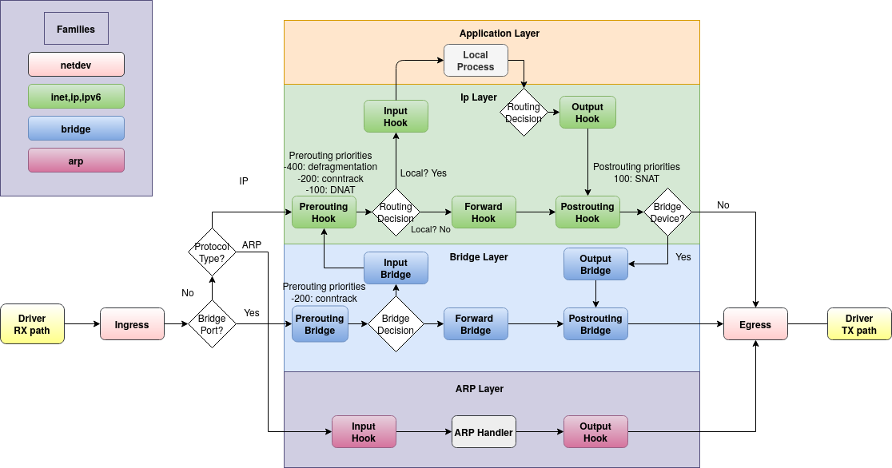

Bagi para pengelola server dan pegiat homelab, mengamankan lalu lintas jaringan adalah fondasi wajib yang tidak boleh ditawar. Selama lebih dari dua dekade, nama iptables menjadi sinonim bagi firewall di ekosistem Linux. Hampir setiap panduan lawas selalu menyuguhkan sintaks panjang rantai INPUT, FORWARD, dan OUTPUT. Namun, teknologi terus berkembang, dan arsitektur iptables yang sudah menua mulai memperlihatkan keterbatasannya dalam menangani tuntutan throughput jaringan modern berkecepatan tinggi.

Pengembang kernel Linux telah merancang pengganti resminya, yaitu nftables. Sejak kernel Linux 3.13, subsistem nf_tables diperkenalkan untuk menyatukan tumpukan filter paket yang sebelumnya terpecah-pecah ke dalam perkakas berbeda seperti iptables (IPv4), ip6tables (IPv6), arptables (ARP), dan ebtables (Ethernet bridge). Proyek distribusi besar seperti Debian, Ubuntu, Fedora, Red Hat Enterprise Linux, hingga Arch Linux kini sudah menetapkan nftables sebagai mesin pemrosesan paket default di balik layar.

Meskipun nftables menawarkan efisiensi tinggi dan sintaksis yang jauh lebih bersih, banyak sysadmin masih ragu beralih karena terbiasa dengan sintaks iptables atau frontend pembungkus seperti UFW. Padahal, begitu ente memahami cara kerja mesin virtual netfilter di balik nftables, menyusun aturan firewall yang kokoh, cepat, dan rapi justru terasa jauh lebih masuk akal.

Kali ini ane ajak ente membedah panduan lengkap konfigurasi Linux nftables firewall, mulai dari filosofi arsitekturnya, penyusunan konfigurasi stateful firewall siap produksi, pengelolaan port layanan web dan remote, penerapan rate limiting anti brute-force, hingga manajemen otomatis via systemd.

## Mengapa Harus Beralih ke Nftables?

Sebelum melangkah ke baris perintah teknis, penting untuk memahami masalah mendasar yang diselesaikan oleh nftables jika dibandingkan dengan iptables konvensional:

1. **Sintaks Terpadu Dual-Stack IPv4 dan IPv6:** Pada iptables lawas, ente harus menulis dua berkas aturan terpisah menggunakan dua utilitas berbeda (iptables dan ip6tables). Jika ente membuka port 443 di IPv4 tetapi lupa menyetelnya di IPv6, server ente berisiko mengalami kebocoran keamanan. Nftables menyediakan keluarga alamat (*address family*) `inet` yang secara otomatis memfilter paket IPv4 dan IPv6 dalam satu baris aturan yang sama.
2. **Pembaruan Aturan Bersifat Atomik (*Atomic Transactions*):** Setiap kali ente menambah atau mengubah aturan di iptables lawas, seluruh tabel aturan harus diunduh dari memori kernel, dimodifikasi di ruang pengguna (*userspace*), lalu diunggah kembali secara utuh. Proses ini memakan waktu dan berisiko mengalami kondisi balapan (*race condition*). Nftables menggunakan API Netlink transaksional, sehingga penambahan atau penghapusan aturan dilakukan secara atomik tanpa mengganggu lalu lintas koneksi yang sedang berlangsung.
3. **Penyusunan Kumpulan Data (*Native Sets dan Maps*):** Di iptables, jika ente ingin membuka 10 port berbeda, ente harus membuat 10 baris aturan terpisah, atau memasang utilitas tambahan seperti ipset. Nftables memiliki dukungan bawaan untuk struktur data set, dictionary, dan interval. Ente bisa menggabungkan banyak port, alamat IP, atau subnet ke dalam satu baris evaluasi berkecepatan tinggi dengan kompleksitas pencarian O(1).
4. **Ukuran Basis Kode Kernel Lebih Ramping:** Nftables tidak menanamkan logika pencocokan protokol secara kaku di dalam kernel. Kernel hanya menjalankan mesin virtual sederhana yang mengeksekusi instruksi bytecode terkompilasi, sedangkan kecerdasan parser dan compiler berada di perkakas CLI `nft`.

## Memahami Alur Hooks Netfilter

Di dalam kernel Linux, setiap paket data yang melintasi antarmuka jaringan akan melewati serangkaian titik inspeksi yang disebut hooks. Nftables mengaitkan rantai (*chains*) yang kita buat ke hook ini untuk memutuskan apakah sebuah paket diizinkan lewat (*accept*), ditolak (*drop* atau *reject*), atau diubah alamatnya (*NAT*).


*Sumber: [Netfilter Hooks Documentation](https://wiki.nftables.org/wiki-nftables/index.php/Netfilter_hooks)*

Berdasarkan diagram alur netfilter di atas, terdapat lima hook utama dalam siklus hidup paket jaringan:

- **Prerouting:** Titik pertama saat paket tiba dari antarmuka fisik sebelum keputusan perutean (*routing decision*) dibuat. Hook ini umumnya digunakan untuk Network Address Translation tujuan (DNAT).
- **Input:** Titik inspeksi untuk paket yang ditujukan khusus bagi proses lokal yang berjalan di dalam server ente (seperti paket koneksi web server atau daemon SSH).
- **Forward:** Titik inspeksi untuk paket yang hanya transit melewati server ente menuju jaringan lain (skenario server bertindak sebagai router atau gateway VPN).
- **Output:** Titik awal bagi paket data yang dibuat langsung oleh proses lokal server dan hendak dikirim keluar ke jaringan.
- **Postrouting:** Titik terakhir sebelum paket benar-benar meninggalkan antarmuka fisik server, biasanya digunakan untuk Source NAT (SNAT) atau Masquerading.

Pada nftables, tidak ada tabel atau rantai bawaan yang dibuat secara otomatis oleh kernel seperti halnya iptables. Kanvas nftables benar-benar kosong sejak awal. Ente memiliki kebebasan penuh untuk menentukan nama tabel, rantai mana saja yang ingin dipasang, serta hook dan prioritas yang relevan dengan kebutuhan sistem ente.

## Prasyarat Sebelum Konfigurasi

Sebelum menerapkan aturan firewall, pastikan lingkungan server ente memenuhi beberapa hal berikut:

1. Akses pengguna dengan hak sudo atau akses root penuh pada server berbasis Linux (Debian 11/12, Ubuntu 22.04/24.04, AlmaLinux/Rocky Linux 9, atau Arch Linux).
2. Sesi koneksi konsol darurat (seperti Web VNC di panel VPS ente) sebagai antisipasi jika terjadi kesalahan penulisan aturan yang berpotensi memutus sesi remote SSH.
3. Pastikan tidak ada firewall frontend lain yang aktif secara bersamaan seperti UFW atau Firewalld agar tidak terjadi bentrokan aturan di kernel.

Jika UFW sebelumnya terpasang di server Ubuntu atau Debian ente, nonaktifkan terlebih dahulu:

```bash
root@server:~# ufw disable
```

## Langkah 1: Instalasi Paket Nftables

Sebagian besar distribusi Linux modern sudah menyertakan paket nftables di repositori resminya. Jalankan perintah berikut sesuai dengan distribusi yang ente gunakan.

Untuk keluarga Debian dan Ubuntu:

```bash
root@server:~# apt update && apt install nftables
```

Untuk keluarga RHEL, AlmaLinux, Rocky Linux, atau Fedora:

```bash
root@server:~# dnf install nftables
```

Untuk Arch Linux:

```bash
root@server:~# pacman -S nftables
```

Setelah terpasang, periksa versi paket nftables untuk memastikan biner CLI siap digunakan:

```bash
root@server:~# nft --version
```

Output akan menampilkan versi rilis nftables, misalnya `nftables v1.0.9` atau versi yang lebih baru.

## Langkah 2: Memahami Struktur Hierarki Nftables

Struktur konfigurasi nftables tersusun secara berjenjang dan logis dari Tabel ke Rantai hingga Aturan:

- **Tables:** Wadah penampung (*container*) tingkat teratas. Setiap tabel terikat pada keluarga protokol tertentu. Keluarga paling serbaguna adalah `inet` karena menangani paket IPv4 dan IPv6 secara simultan. Keluarga lain yang tersedia adalah `ip` (khusus IPv4), `ip6` (khusus IPv6), `arp`, `bridge`, dan `netdev`.
- **Chains:** Rantai yang menampung daftar aturan. Rantai dasar (*base chain*) harus mengindikasikan jenis rantai (`type filter`), hook yang dituju (`hook input`), prioritas eksekusi (`priority 0`), serta kebijakan standar (*policy drop* atau *policy accept*).
- **Rules:** Kumpulan ekspresi dan pernyataan tindakan (*verdicts*) yang dievaluasi secara linier dari atas ke bawah. Jika suatu paket cocok dengan kriteria ekspresi, tindakan seperti `accept`, `drop`, `reject`, atau `log` akan langsung dieksekusi.

## Langkah 3: Menyusun Aturan Dasar Stateful Firewall

Praktek terbaik dalam mengamankan server yang terhubung ke internet adalah menerapkan prinsip Default Deny (tolak semua paket masuk asing) dan memelihara pelacakan status koneksi (*Stateful Inspection*).

Berkas konfigurasi utama nftables secara konvensional terletak di direktori konfigurasi sistem, tepatnya berkas /etc/nftables.conf. Buka berkas tersebut menggunakan editor teks favorit ente:

```bash
root@server:~# nano /etc/nftables.conf
```

Hapus seluruh isi bawaannya, lalu susun konfigurasi firewall yang kokoh dan terstruktur seperti di bawah ini:

```nft
#!/usr/sbin/nft -f

# 1. Bersihkan semua aturan lama sebelum memuat aturan baru
flush ruleset

# 2. Definisikan tabel filter terpadu untuk IPv4 dan IPv6
table inet filter {

    # Rantai Input: Mengontrol lalu lintas yang masuk ke server lokal
    chain input {
        type filter hook input priority 0; policy drop;

        # Izinkan paket dari loopback interface (localhost)
        iif "lo" accept

        # Buang paket dengan status invalid demi keamanan jaringan
        ct state invalid drop

        # Izinkan paket yang berstatus established dan related
        ct state { established, related } accept

        # Izinkan protokol ICMP (Ping) terkontrol untuk diagnostik
        ip protocol icmp icmp type { echo-request, echo-reply, destination-unreachable, time-exceeded } limit rate 5/second accept
        ip6 nexthdr icmpv6 icmpv6 type { echo-request, echo-reply, destination-unreachable, time-exceeded, packet-too-big, nd-router-solicit, nd-router-advert, nd-neighbor-solicit, nd-neighbor-advert } limit rate 5/second accept

        # Izinkan port layanan aplikasi publik dan remote
        tcp dport { 22, 80, 443 } accept

        # Catat (logging) paket liar yang dibuang (opsional, dibatasi agar log tidak banjir)
        limit rate 3/minute burst 5 packets log prefix "[NFTABLES-DROP]: " level flags all
    }

    # Rantai Forward: Tolak semua paket lintas jaringan jika server bukan router
    chain forward {
        type filter hook forward priority 0; policy drop;
    }

    # Rantai Output: Bebaskan lalu lintas keluar yang diinisiasi oleh server lokal
    chain output {
        type filter hook output priority 0; policy accept;
    }
}
```

Mari kita bedah baris konfigurasi penting di atas:

- `flush ruleset`: Memastikan seluruh aturan yang sebelumnya aktif di memori kernel dibersihkan terlebih dahulu sehingga konfigurasi baru diterapkan dari kondisi bersih tanpa duplikasi.
- `type filter hook input priority 0; policy drop;`: Menetapkan bahwa rantai input bertipe penyaring paket pada hook input dengan prioritas standar (0), serta menerapkan kebijakan dasar penolakan (*drop*). Paket apa pun yang tidak lolos aturan di bawahnya akan langsung dibuang senyap.
- `iif "lo" accept`: Memberikan izin penuh bagi antarmuka loopback lokal (127.0.0.1 dan ::1). Hal ini krusial agar aplikasi internal seperti database MySQL, Redis, atau socket lokal tetap dapat berkomunikasi dengan lancar.
- `ct state { established, related } accept`: Inti dari stateful firewall. Aturan ini memberi tahu kernel untuk langsung meloloskan paket balasan dari koneksi keluar yang diinisiasi oleh server ente sendiri (misalnya saat server menjalankan pembaruan repositori paket atau mengunduh dependensi dari internet).
- `ip protocol icmp ... limit rate 5/second accept`: Mengizinkan ping dan pesan kendali jaringan yang sangat dibutuhkan untuk mekanisme Path MTU Discovery, namun dibatasi frekuensinya agar server kebal dari serangan ICMP flood.

## Langkah 4: Mengelola Port Layanan Menggunakan Set Nftables

Salah satu keunggulan terbesar sintaks nftables dibanding iptables adalah kemampuannya mendefinisikan himpunan (*set*) langsung di dalam aturan.

Pada contoh di atas, kita menggunakan sintaks anonim:

```nft
tcp dport { 22, 80, 443 } accept
```

Jika server ente menjalankan port SSH kustom (misalnya port 2222) atau layanan monitoring Prometheus (9100) yang hanya boleh diakses dari IP tertentu, ente bisa memanfaatkan *named set* atau pencocokan alamat IP sumber (*saddr*).

Berikut contoh jika ente ingin mengisolasi port SSH agar hanya bisa diakses oleh subnet kantor atau IP statis rumah ente:

```nft
# Buat named set untuk IP terpercaya di dalam tabel inet filter
set admin_ips {
    type ipv4_addr
    elements = { 192.168.1.50, 203.0.113.15 }
}

# Izinkan SSH hanya jika paket berasal dari daftar admin_ips
ip saddr @admin_ips tcp dport 22 accept
```

Dengan struktur set ini, jika di kemudian hari ada penambahan alamat IP admin baru, ente cukup memperbarui elemen di dalam set tanpa perlu merombak baris logika filter pada rantai input.

## Langkah 5: Mencegah Serangan Brute Force dengan Dynamic Set

Bagi server publik yang mengekspos port 22 ke internet terbuka, serangan brute force berbasis kamus (*dictionary attack*) adalah pemandangan sehari-hari di log otentikasi. Nftables menyediakan fitur canggih bernama *dynamic sets* yang mampu melacak dan memblokir IP penyerang secara otomatis menggunakan meteran frekuensi (*meter*) dan batas waktu kedaluwarsa (*timeout*).

Ente bisa menambahkan blok mitigasi brute force tepat di atas aturan SSH pada rantai input:

```nft
    # Definisikan dynamic set penampung penyerang SSH
    set ssh_flooders {
        type ipv4_addr
        flags dynamic, timeout
        timeout 10m
    }

    # Jika sebuah IP mencoba membuat koneksi SSH lebih dari 4 kali dalam 1 menit,
    # masukkan IP tersebut ke dalam set ssh_flooders selama 10 menit
    tcp dport 22 ct state new meter ssh_meter { ip saddr limit rate over 4/minute } add @ssh_flooders { ip saddr } drop

    # Tolak langsung jika IP pengirim masih tercatat di dalam daftar blacklist
    ip saddr @ssh_flooders drop

    # Loloskan koneksi SSH reguler yang berada di bawah ambang batas
    tcp dport 22 accept
```

Mekanisme di atas bekerja secara instan di level kernel tanpa memerlukan dependensi pihak ketiga seperti Fail2ban. Jika bot otomatis mencoba membombardir port SSH ente, pada percobaan kelima dalam kurun waktu satu menit, alamat IP bot akan otomatis dimasukkan ke blacklist memory dan seluruh paketnya dibuang selama 10 menit ke depan.

## Langkah 6: Validasi Konfigurasi dan Aktivasi Layanan Systemd

Sebelum menerapkan berkas konfigurasi ke server langsung, langkah paling kritis adalah memvalidasi sintaks berkas. Nftables menyediakan flag check (-c) untuk menguji apakah ada kesalahan tanda kurung, penamaan hook, atau tipe data yang tidak valid.

Jalankan perintah pengujian:

```bash
root@server:~# nft -c -f /etc/nftables.conf
```

Jika perintah tersebut kembali ke prompt tanpa memunculkan pesan error, konfigurasi berkas nftables ente 100% valid dan bebas dari kesalahan sintaks.

Sekarang, muat aturan baru tersebut ke kernel Linux:

```bash
root@server:~# nft -f /etc/nftables.conf
```

Agar aturan ini selalu dimuat otomatis setiap kali server melakukan booting, aktifkan unit layanan systemd untuk nftables:

```bash
root@server:~# systemctl enable nftables
root@server:~# systemctl reload nftables
```

Periksa status layanan untuk memastikan daemon berjalan sempurna:

```bash
root@server:~# systemctl status nftables
```

Pastikan status layanan aktif yang menandakan bahwa skrip konfigurasi berhasil dieksekusi oleh systemd saat inisialisasi sistem.

## Langkah 7: Pengujian, Verifikasi, dan Monitoring

Setelah aturan aktif, verifikasi konfigurasi yang sedang berjalan langsung di memori kernel menggunakan perintah berikut:

```bash
root@server:~# nft list ruleset
```

Terminal akan menampilkan representasi bersih dari seluruh tabel, rantai, dan aturan yang sedang aktif menjaga server ente.

Untuk memantau statistik berapa banyak paket dan byte data yang telah diproses oleh setiap aturan, ente bisa menyematkan kata kunci `counter` pada aturan tertentu, lalu memeriksanya kembali:

```bash
root@server:~# nft list ruleset -a
```

Opsi `-a` (*handle*) juga sangat berguna karena menyertakan nomor handle unik di setiap baris aturan. Nomor handle ini digunakan jika ente ingin menghapus satu aturan spesifik secara langsung tanpa mengubah berkas konfigurasi, misalnya:

```bash
# Menghapus aturan dengan handle bernomor 5 pada rantai input
root@server:~# nft delete rule inet filter input handle 5
```

Lakukan pula uji koneksi dari perangkat remote di luar server:

1. **Uji Port Terbuka:** Lakukan pengetesan akses SSH atau web browser ke alamat IP publik server ente (`http://ip-server` atau `https://ip-server`).
2. **Uji Port Tertutup:** Coba akses port yang tidak diizinkan, misalnya port MySQL 3306 atau database PostgreSQL 5432 dari luar. Koneksi harus mengalami time out atau ditolak secara senyap tanpa respons balik (*stealth mode*).
3. **Uji Ping ICMP:** Jalankan `ping <ip-server>`. Pastikan ping mendapatkan balasan secara teratur dan tidak mengalami packet loss abnormal.

## Solusi Kendala Umum (Troubleshooting)

Dalam implementasi nftables di lapangan, ada beberapa skenario kendala yang kerap dihadapi oleh administrator sistem:

### 1. Terkunci di Luar Server (SSH Lockout Mitigation)

Terkunci dari sesi remote adalah mimpi buruk klasik saat menyetel firewall. Jika ente baru pertama kali bereksperimen dengan nftables pada server produksi dan cemas aturan yang dibuat salah memblokir akses SSH, gunakan trik timer darurat di terminal latar belakang sebelum memuat aturan baru:

```bash
( sleep 300 && nft flush ruleset ) &
```

Perintah di atas akan berjalan di latar belakang, menunggu selama 5 menit (300 detik) lalu membersihkan seluruh aturan firewall secara otomatis. Jika dalam waktu 5 menit ente mendapati koneksi SSH masih lancar dan aman, matikan timer tersebut. Namun jika koneksi terputus dan terkunci, ente cukup menunggu 5 menit hingga proses otomatis mereset firewall kembali ke kondisi terbuka.

### 2. Integrasi Nftables dengan Docker

Kontainer Docker terkenal agresif dalam memanipulasi aturan firewall host. Secara default, Docker daemon menyuntikkan aturan NAT dan routing langsung melalui lapisan kompatibilitas iptables-nft.

Jika ente menjalankan kontainer Docker dan mendapati port kontainer tidak bisa diakses dari luar, pastikan rantai forward pada tabel nftables ente tidak secara buta memblokir antarmuka virtual Docker. Ente bisa meloloskan lalu lintas bridge Docker dengan menambahkan aturan berikut pada rantai forward:

```nft
chain forward {
    type filter hook forward priority 0; policy drop;

    # Izinkan paket dari dan menuju antarmuka bridge Docker
    iifname "docker0" accept
    oifname "docker0" accept

    # Izinkan koneksi established pada kontainer
    ct state { established, related } accept
}
```

### 3. Paket IPv6 Mengalami Kebocoran Data

Kesalahan yang sering terjadi pada pemula adalah mendeklarasikan tabel dengan keluarga ip alih-alih inet:

```nft
# KELIRU: Hanya memfilter IPv4, lalu lintas IPv6 tetap terbuka tanpa proteksi!
table ip filter { ... }

# BENAR: Memfilter IPv4 dan IPv6 secara menyeluruh dalam satu kesatuan
table inet filter { ... }
```

Selalu gunakan `table inet filter` kecuali jika server ente benar-benar menonaktifkan protokol IPv6 secara total di tingkat sysctl kernel.

Mengadopsi nftables pada infrastruktur server modern bukan sekadar mengikuti tren, melainkan langkah strategis untuk memperoleh efisiensi pemrosesan paket, konsistensi sintaks dual-stack, serta keandalan pembaruan aturan tanpa jeda waktu henti. Dengan arsitektur stateful firewall yang tertata rapi, sistem Linux ente memiliki benteng pertahanan lapis pertama yang tangguh terhadap ancaman pemindaian port maupun serangan bot di internet.

Sumber: [Netfilter Nftables Documentation](https://wiki.nftables.org/)
