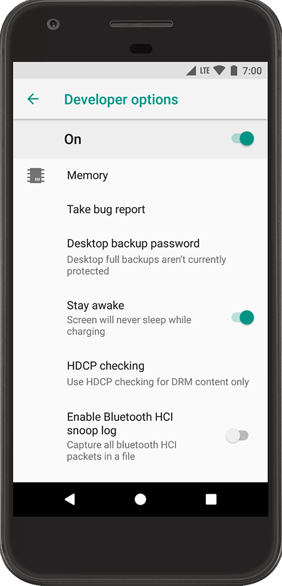

Pembaruan Android 15 membawa banyak peningkatan visual, efisiensi daya baterai, dan sistem keamanan yang jauh lebih ketat. Namun, tahukah Anda bahwa di balik tampilan antarmuka yang ramah pengguna, Google sengaja menyembunyikan panel kendali rahasia bernama Opsi Pengembang (*Developer Options*)?

Banyak orang mengira menu ini hanya ditujukan untuk para programmer atau teknisi perangkat lunak. Padahal, bagi pengguna ponsel harian, mode pengembang android 15 menyimpan segudang fitur praktis yang bisa membuat perangkat terasa dua kali lebih cepat, menghemat konsumsi memori RAM, hingga memberi kendali penuh saat memindahkan file ke komputer melalui USB debugging.

Jika Anda baru saja memperbarui smartphone ke Android 15 dan ingin membuka menu sakral ini, ikuti langkah mudah beserta rekomendasi setelan terbaik yang aman untuk digunakan setiap hari berikut ini.

## Mengapa Google Menyembunyikan Opsi Pengembang

Secara baku, Google memang menyembunyikan menu Opsi Pengembang di semua versi Android sejak era Android 4.2 Jelly Bean. Keputusan ini diambil bukan tanpa alasan. Di dalam panel pengembang, terdapat ratusan sakelar konfigurasi tingkat rendah (*low-level system settings*) yang terhubung langsung ke mesin grafis, jaringan seluler, dan runtime aplikasi.

Bila pengguna yang belum paham memencet sakelar sembarangan, ponsel bisa mengalami gejala aneh seperti layar berkedip, aplikasi mendadak menutup sendiri, atau baterai terkuras sangat cepat. Oleh sebab itu, sistem sengaja memberi proteksi berupa kombinasi ketukan khusus agar hanya mereka yang memang membutuhkannya yang dapat membuka menu ini.

Kabar baiknya, selama Anda mengikuti panduan yang tepat dan tidak mengubah parameter teknis yang tidak dipahami, mengaktifkan menu ini sepenuhnya aman dan tidak membatalkan garansi resmi perangkat.

## Cara Mengaktifkan Mode Pengembang Android 15

Proses membuka kunci menu pengembang di Android 15 sangat sederhana dan hanya butuh waktu kurang dari satu menit. Anda tidak perlu komputer atau aplikasi tambahan apa pun.

*Sumber: [Android Developers](https://developer.android.com/studio/debug/dev-options)*

Berikut tahapan lengkapnya yang berlaku untuk smartphone Google Pixel, Motorola, Sony, serta perangkat Android murni lainnya:

### 1. Buka Pengaturan dan Masuk ke Tentang Ponsel

Buka aplikasi **Setelan** (*Settings*) di smartphone Anda. Gulirkan layar ke baris paling bawah lalu pilih menu **Tentang Ponsel** (*About Phone*).

Bagi pengguna antarmuka pabrikan seperti Samsung One UI, menu ini biasanya berada di dalam *Tentang Ponsel* lalu masuk lagi ke sub-menu *Informasi Perangkat Lunak*. Sementara pada Xiaomi atau Poco dengan HyperOS, posisinya berada di baris paling atas pada *Tentang Ponsel* lalu perhatikan kolom *Versi OS*.

### 2. Temukan Baris Nomor Versi Build

Di dalam menu informasi perangkat, cari baris bertuliskan **Nomor Versi** (*Build number*). Baris ini memuat deretan kode alfanumerik panjang yang menandakan versi kompilasi sistem operasi yang sedang berjalan di ponsel Anda.

### 3. Ketuk Nomor Build Sebanyak 7 Kali

Ketuk baris Nomor Versi tersebut secara cepat sebanyak 7 kali berturut-turut. Pada ketukan ketiga atau keempat, sistem akan memunculkan pesan mengambang (*toast notification*) bertuliskan hitungan mundur, misalnya: *"Anda tinggal 3 langkah lagi untuk menjadi seorang pengembang"*.

Lanjutkan ketukan sampai layar ponsel meminta konfirmasi keamanan.

### 4. Masukkan PIN atau Kunci Layar

Jika smartphone Anda diproteksi dengan pola, PIN, atau kata sandi, sistem akan meminta Anda memasukkannya sekarang. Langkah verifikasi ini merupakan mekanisme keamanan Android 15 agar orang asing tidak bisa mengutak-atik sistem saat ponsel sedang dipinjam.

Setelah sandi terverifikasi, layar akan menampilkan pemberitahuan hangat: *"Sekarang Anda adalah seorang pengembang!"* (*You are now a developer!*).

### 5. Akses Menu Opsi Pengembang

Kini menu rahasia tersebut sudah terbuka. Untuk membukanya di Android 15 murni atau Pixel:

1. Kembali ke halaman utama aplikasi **Setelan**.
2. Pilih menu **Sistem** (*System*).
3. Gulir ke bawah, kini Anda akan melihat menu baru bernama **Opsi Pengembang** (*Developer Options*).

## Setelan Terbaik Mode Pengembang yang Wajib Dicoba

Setelah menu terbuka, Anda akan disambut ratusan opsi baru. Jangan panik atau merasa kewalahan. Berikut adalah lima setelan paling bermanfaat yang terbukti aman dan sangat berguna untuk memaksimalkan performa ponsel Anda sehari-hari:

### 1. Mengurangi Skala Animasi Agar Ponsel Terasa Gesit

Ini adalah trik favorit para antusias gawai sejak lama. Sistem operasi Android memiliki animasi bawaan saat Anda membuka aplikasi, berpindah jendela, dan menutup menu. Secara baku kecepatannya diatur pada skala 1x.

Di Opsi Pengembang, gulir ke bagian **Gambar** (*Drawing*) lalu cari tiga opsi berikut:
- Skala animasi jendela (*Window animation scale*)
- Skala animasi transisi (*Transition animation scale*)
- Skala durasi animator (*Animator duration scale*)

Ubah ketiganya dari **1x** menjadi **0.5x**. Begitu diubah, ponsel Anda seketika akan terasa jauh lebih lincah dan responsif karena efek animasi berjalan dua kali lebih cepat tanpa jeda visual yang lambat. Jika Anda tipe orang yang mementingkan kecepatan mutlak, Anda bahkan bisa memilih opsi animasi nonaktif (*Animation off*).

### 2. Mengaktifkan USB Debugging dan Debugging Nirkabel

Di bagian **Proses debug** (*Debugging*), Anda akan menemukan opsi **Proses debug USB** (*USB debugging*). Fitur ini sangat krusial jika Anda sering menghubungkan ponsel ke komputer untuk:
- Mengoperasikan perintah ADB (*Android Debug Bridge*)
- Mencadangkan data sistem secara menyeluruh lewat PC
- Menghapus aplikasi bawaan pabrik (*bloatware*) tanpa harus melakukan rooting

Selain lewat kabel data, Android 15 juga menghadirkan fitur **Debugging Nirkabel** (*Wireless debugging*) yang makin matang. Anda bisa menghubungkan perangkat ke komputer dalam satu jaringan Wi-Fi tanpa repot mencari kabel USB lagi.

### 3. Memaksa Refresh Rate Tertinggi

Layar smartphone modern umumnya sudah mendukung refresh rate dinamis hingga 120Hz. Namun, demi menghemat baterai, sistem sering kali menurunkan kecepatan refresh secara agresif ke 60Hz saat menampilkan konten tertentu, yang terkadang membuat guliran layar terasa sedikit patah-patah.

Jika Anda mengutamakan kenyamanan visual yang mulus setiap saat, cari menu **Paksa kecepatan refresh puncak** (*Force peak refresh rate*). Dengan mengaktifkan sakelar ini, layar akan selalu dipertahankan pada tingkat refresh maksimal perangkat Anda.

### 4. Batasi Proses Latar Belakang untuk RAM Lega

Bagi smartphone dengan kapasitas RAM terbatas (misalnya 4 GB atau 6 GB), membuka banyak aplikasi berat dalam satu sesi sering kali memicu kelambatan. 

Di bagian **Aplikasi** (*Apps*), cari opsi **Batas proses latar belakang** (*Background process limit*). Mengubahnya dari *Batas standar* ke opsi *Maksimal 3 proses* atau *Maksimal 4 proses* akan memaksa Android menutup aplikasi yang tidak sedang digunakan, sehingga memori RAM dan daya baterai tetap optimal untuk tugas utama.

### 5. Fitur Eksklusif Pengembang Android 15

Pada pembaruan Android 15, Google menambahkan beberapa parameter baru yang sangat menarik untuk disimak:
- **Proteksi Berbagi Layar (*Screen Share Protections*):** Android 15 memperkenalkan opsi untuk mematikan atau menguji proteksi perekaman layar, di mana sistem secara cerdas menyembunyikan kredensial login atau konten privat saat Anda sedang melakukan panggilan konferensi atau berbagi layar ponsel.
- **Dukungan Halaman Memori 16 KB (*Boot with 16KB Page Size*):** Opsi lanjutan bagi pengembang untuk menguji aplikasi dengan arsitektur memori generasi baru yang mampu meningkatkan kecepatan peluncuran aplikasi hingga 10 persen.

## Cara Mematikan dan Menyembunyikan Kembali Opsi Pengembang

Bagaimana jika suatu saat Anda ingin mengembalikan kondisi ponsel seperti semula, misalnya saat hendak menjual perangkat atau ketika aplikasi perbankan tertentu memunculkan notifikasi peringatan keamanan?

Menutup kembali menu pengembang di Android 15 justru jauh lebih mudah daripada saat membukanya:

1. Buka **Setelan** > **Sistem** > **Opsi Pengembang**.
2. Pada bagian paling atas layar, Anda akan melihat tombol sakelar utama **Gunakan opsi pengembang** (*Use developer options*).
3. Geser tombol sakelar tersebut ke posisi **Nonaktif** (*Off*).
4. Keluar dari menu pengaturan atau lakukan *restart* perangkat.

Seketika itu juga, menu Opsi Pengembang akan lenyap kembali dari daftar pengaturan sistem. Jika sewaktu-waktu Anda membutuhkannya lagi, Anda cukup mengulangi ketukan tujuh kali pada nomor build seperti langkah awal.

Mengeksplorasi fitur-fitur tersembunyi seperti mode pengembang di Android 15 membuktikan bahwa kita selalu bisa mendapatkan kendali lebih besar atas gawai yang kita gunakan setiap hari tanpa perlu mengorbankan keamanan sistem.

Sumber: [Android Developers](https://developer.android.com/studio/debug/dev-options)
