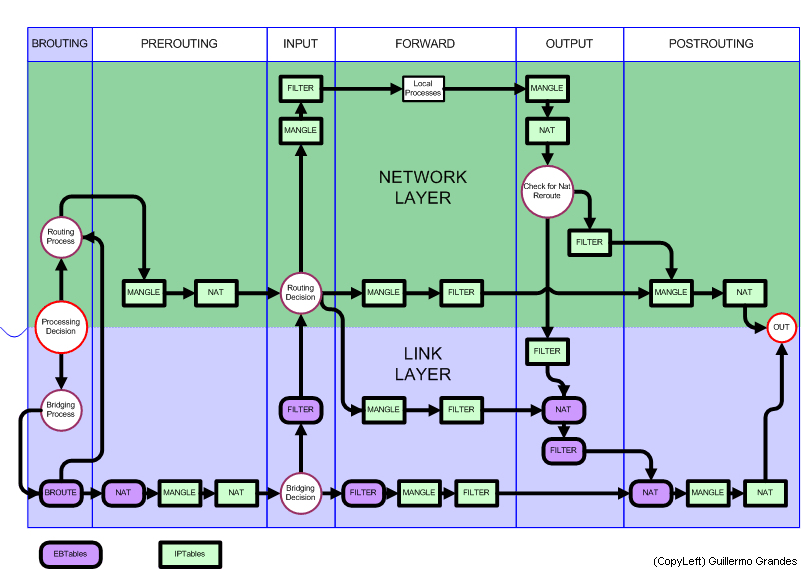

Dalam ekosistem Enterprise Linux modern, Rocky Linux hadir sebagai salah satu distribusi server paling solid dan kompatibel penuh dengan Red Hat Enterprise Linux (RHEL). Secara bawaan, instalasi standar Rocky Linux menyertakan `firewalld` sebagai antarmuka default untuk mengelola lalu lintas jaringan. Meskipun `firewalld` saat ini sudah menggunakan backend nftables di lapisan bawahnya, banyak administrator sistem, arsitek infrastruktur, dan praktisi homelab yang lebih menyukai kontrol langsung tanpa lapisan abstraksi tambahan.

Abstraksi `firewalld` kerap memunculkan kendala ketika kita ingin menerapkan konfigurasi tingkat lanjut, seperti struktur set dinamis berkecepatan tinggi, pencatatan log dengan prefix kustom, pemisahan tabel granular, atau integrasi skrip otomatisasi CI/CD. Di sinilah penerapan **nftables rocky linux** secara murni (native) menjadi pilihan paling rasional. Melalui nftables native, aturan dieksekusi secara atomik langsung di kernel space, memangkas beban pemrosesan paket data, dan memberikan sintaks konfigurasi deklaratif yang sangat rapi untuk pemeliharaan jangka panjang.

Bagi ente yang ingin membangun benteng keamanan server yang tangguh, panduan teknis ini mengulas langkah demi langkah implementasi **nftables rocky linux** mulai dari persiapan migrasi, penyusunan konfigurasi stateful, validasi sintaks bebas risiko, hingga teknik pemecahan masalah saat terjadi kendala jaringan.

## Mengapa Memilih Nftables Native di Rocky Linux

Sebelum melangkah ke terminal, penting memahami mengapa banyak sysadmin senior memutuskan beralih ke nftables murni:

1. **Efisiensi Eksekusi Kernel**: Berbeda dengan iptables lawas yang mengevaluasi rantai aturan secara berurutan dan lambat saat aturan membengkak, nftables mengompilasi ruleset ke dalam bytecode yang dieksekusi oleh mesin virtual ringan di kernel Linux.
2. **Kompilasi Atomik**: Pembaruan aturan di nftables bersifat transaksional. Artinya, seluruh berkas konfigurasi diuji validitasnya secara menyeluruh sebelum dimuat ke kernel. Jika ada satu kesalahan ketik, pemuatan dibatalkan seketika tanpa merusak aturan yang sedang berjalan.
3. **Penyatuan IPv4 dan IPv6**: Melalui address family `inet`, ente tidak perlu lagi menulis dua berkas aturan terpisah untuk tumpukan IPv4 dan IPv6. Satu tabel `inet` mampu menangani kedua protokol sekaligus secara elegan.
4. **Manajemen Set Terpadu**: nftables mendukung native set dan dictionary lookup. Ente dapat mengelompokkan ribuan alamat IP atau daftar port ke dalam satu baris ekspresi dengan performa pencarian hash yang sangat kencang.


*Sumber: [Wikimedia Commons](https://commons.wikimedia.org/wiki/File:Diagrama_linux_netfilter_iptables.png)*

## Prasyarat Lingkungan Server

Sebelum memulai proses konfigurasi, pastikan lingkungan server ente telah memenuhi beberapa prasyarat berikut:

- Server menjalankan sistem operasi Rocky Linux 8 atau Rocky Linux 9 (arsitektur x86_64 atau aarch64).
- Hak akses administratif penuh (`root` atau pengguna dengan privilese `sudo`).
- Akses terminal alternatif seperti web console, VNC, atau IPMI/KVM jika konfigurasi dilakukan pada server produksi jarak jauh untuk mengantisipasi kesalahan aturan port SSH.

## Langkah 1 Menonaktifkan dan Mematikan Layanan Firewalld

Langkah pertama yang wajib dilakukan adalah menonaktifkan `firewalld`. Menjalankan `firewalld` bersamaan dengan layanan `nftables` mandiri akan memicu konflik serius di Netfilter karena kedua daemon akan saling menimpa rantai aturan (*chain*) di memori kernel.

Hentikan layanan `firewalld` dan nonaktifkan agar tidak berjalan otomatis saat server booting ulang:

```bash
sudo systemctl stop firewalld
sudo systemctl disable firewalld
```

Untuk menjamin bahwa layanan `firewalld` tidak dapat dipicu atau diaktifkan kembali secara tidak sengaja oleh skrip dependensi lain, lakukan *masking* pada unit systemd tersebut:

```bash
sudo systemctl mask firewalld
```

Verifikasi status unit systemd untuk memastikan `firewalld` telah terkunci sepenuhnya:

```bash
systemctl status firewalld
```

Output terminal harus menampilkan status `Loaded: masked` dan `Active: inactive (dead)`.

## Langkah 2 Memasang Paket dan Memeriksa Utilitas Nftables

Sebagian besar instalasi minimal Rocky Linux sudah menyertakan paket `nftables`. Namun, untuk memastikan keberadaan paket dan binari pendukungnya, lakukan instalasi atau pembaruan melalui manajer paket DNF:

```bash
sudo dnf install -y nftables
```

Setelah proses instalasi selesai, periksa versi binari `nft` yang terpasang di sistem:

```bash
nft --version
```

Pastikan modul kernel Netfilter yang dibutuhkan telah tersedia dan dapat dimuat oleh kernel Linux. Ente dapat memverifikasi modul `nf_tables` dengan perintah:

```bash
lsmod | grep nf_tables
```

Jika modul belum muncul di daftar, kernel Rocky Linux akan memuat modul tersebut secara otomatis saat binari `nft` pertama kali dipanggil atau saat layanan systemd diaktifkan.

## Langkah 3 Menyusun Berkas Konfigurasi Ruleset Terpadu

Di keluarga Enterprise Linux termasuk Rocky Linux, berkas konfigurasi utama untuk daemon nftables berada di jalur `/etc/sysconfig/nftables.conf`. Berkas ini dibaca langsung oleh unit layanan `nftables.service` saat sistem dinyalakan.

Sebelum menyunting berkas tersebut, cadangkan berkas bawaan sebagai langkah pengamanan:

```bash
sudo cp /etc/sysconfig/nftables.conf /etc/sysconfig/nftables.conf.bak
```

Buka berkas konfigurasi menggunakan editor teks favorit:

```bash
sudo nano /etc/sysconfig/nftables.conf
```

Ganti seluruh isi berkas dengan konfigurasi firewall stateful yang kokoh, terstruktur, dan siap pakai berikut:

```nftables
#!/usr/sbin/nft -f

# Bersihkan seluruh aturan sebelumnya di memori kernel
flush ruleset

# Definisikan tabel inet terpadu (IPv4 dan IPv6)
table inet filter {

    # Rantai Input: Menangani paket yang ditujukan langsung ke server
    chain input {
        type filter hook input priority filter; policy drop;

        # 1. Izinkan koneksi yang sudah terbentuk (established) dan terkait (related)
        ct state established,related accept

        # 2. Buang paket dengan status tidak valid secara langsung
        ct state invalid drop

        # 3. Izinkan seluruh trafik pada antarmuka loopback lokal (lo)
        iifname "lo" accept

        # 4. Izinkan paket ICMP (Ping) untuk keperluan diagnostik jaringan
        ip protocol icmp icmp type { echo-request, echo-reply, destination-unreachable, time-exceeded } accept
        ip6 nexthdr ipv6-icmp icmpv6 type { echo-request, echo-reply, destination-unreachable, packet-too-big, time-exceeded } accept

        # 5. Akses SSH (Port 22) dengan pembatasan laju koneksi (Rate Limiting)
        # Melindungi server dari serangan brute-force otomatis
        tcp dport 22 ct state new limit rate 15/minute burst 5 packets accept

        # 6. Akses Layanan Web Server Publik (HTTP dan HTTPS)
        tcp dport { 80, 443 } ct state new accept

        # 7. Pencatatan log untuk paket yang ditolak sebelum dibuang
        limit rate 5/minute burst 5 packets log prefix "nftables-input-dropped: " level info flags all
    }

    # Rantai Forward: Menangani paket yang sekadar transit melewati server
    chain forward {
        type filter hook forward priority filter; policy drop;
    }

    # Rantai Output: Menangani paket keluar yang diinisiasi oleh server lokal
    chain output {
        type filter hook output priority filter; policy accept;
    }
}
```

Mari kita bedah beberapa baris krusial dari konfigurasi di atas:

- **Kebijakan Default Drop**: Pada rantai `input` dan `forward`, nilai `policy drop;` memastikan bahwa seluruh trafik yang tidak secara eksplisit diizinkan akan ditolak secara mutlak.
- **Connection Tracking (Conntrack)**: Ekspresi `ct state established,related accept` adalah kunci dari firewall stateful. Baris ini mengizinkan paket balasan dari koneksi sah yang telah diinisiasi oleh server (misalnya saat server menjalankan pembaruan paket DNF ke repositori internet).
- **Rate Limiting SSH**: Penggunaan `limit rate 15/minute burst 5 packets` membatasi inisiasi koneksi baru ke port 22. Jika bot internet mencoba melakukan ribuan percobaan login dalam semenit, paket berlebih akan langsung terabaikan.
- **Logging Terukur**: Baris log dibatasi dengan `limit rate 5/minute` agar sistem logging server (`journald` atau `rsyslog`) tidak terbebani serangan denial-of-service berbasis log flooding.

## Langkah 4 Melakukan Validasi Sintaks dan Atomic Reload

Salah satu keunggulan terbesar saat mengonfigurasi **nftables rocky linux** adalah fitur verifikasi sintaks atomik. Kesalahan kecil tanda kurung kurawal atau penamaan hook pada firewall tradisional bisa membuat server kehilangan koneksi jarak jauh seketika.

Sebelum menerapkan aturan ke kernel aktif, jalankan pengujian sintaks menggunakan flag `-c` (*check*):

```bash
sudo nft -c -f /etc/sysconfig/nftables.conf
```

Jika perintah tersebut kembali ke prompt tanpa memunculkan pesan galat apa pun, berarti sintaks konfigurasi ente 100% valid dan aman diterapkan.

Sekarang, muat konfigurasi tersebut ke kernel yang sedang berjalan tanpa perlu memulai ulang server:

```bash
sudo nft -f /etc/sysconfig/nftables.conf
```

Proses ini berlangsung secara atomik dalam fraksi milidetik, tanpa memutuskan sesi SSH yang sedang aktif karena aturan conntrack langsung menjaga koneksi lama.

## Langkah 5 Mengaktifkan Layanan Systemd Nftables Permanen

Setelah aturan terbukti berhasil dimuat tanpa kendala, langkah berikutnya adalah mengaktifkan layanan `nftables.service` agar berjalan secara permanen setiap kali sistem menyala:

```bash
sudo systemctl enable --now nftables
```

Periksa status layanan untuk memastikan daemon berjalan normal di latar belakang:

```bash
sudo systemctl status nftables
```

Ente akan melihat status `Active: active (exited)` berwarna hijau. Status *exited* pada unit layanan nftables merupakan perilaku normal karena nftables berfungsi memuat ruleset ke kernel saat booting lalu menyerahkan seluruh pemrosesan paket ke Netfilter kernel tanpa perlu proses daemon yang memakan memori di userspace.

## Langkah 6 Melakukan Verifikasi Ruleset dan Monitoring Log

Untuk memastikan seluruh aturan telah terdaftar dengan benar di dalam kernel Linux, cetak seluruh ruleset aktif menggunakan perintah berikut:

```bash
sudo nft list ruleset
```

Terminal akan menampilkan struktur tabel `filter` lengkap beserta seluruh rantai dan kebijakan yang telah dikonfigurasi. Jika ente ingin melihat jumlah paket dan volume bita yang melewati masing-masing aturan, tambahkan parameter `-a` (menampilkan handle internal) atau manfaatkan counter:

```bash
sudo nft list table inet filter
```

Untuk memantau apakah ada paket ilegal yang ditolak oleh firewall, periksa log kernel melalui `journalctl`:

```bash
sudo journalctl -k -g "nftables-input-dropped" --no-pager -n 20
```

Jika ada pemindaian port (*port scanning*) dari alamat IP asing di internet, detail paket mencakup alamat IP sumber, antarmuka masuk, dan nomor port tujuan akan tercatat rapi di log tersebut.

## Solusi Kendala Umum dan Troubleshooting

Dalam pengelolaan firewall tingkat lanjut, berikut beberapa kendala yang kerap dijumpai di lapangan beserta solusi praktisnya:

### 1. Mengantisipasi Terkunci dari Akses SSH Jarak Jauh

Bagi administrator yang mengonfigurasi server jarak jauh via SSH, risiko salah menulis nomor port atau lupa mengizinkan `established` state sangat fatal. Untuk menghindari situasi terkunci (*locked out*), gunakan trik timer pemulihan otomatis saat menguji aturan baru:

```bash
sudo systemd-run --on-active=3m systemctl reload-or-restart nftables
```

Perintah di atas dapat dikombinasikan dengan mengembalikan konfigurasi cadangan secara otomatis dalam 3 menit jika sesi SSH ente terputus. Jika konfigurasi baru terbukti aman dan ente masih terhubung, cukup batalkan unit timer systemd tersebut.

### 2. Membuka Port Tambahan untuk Layanan Spesifik

Jika di masa mendatang ente menginstal aplikasi baru (misalnya basis data PostgreSQL di port 5432 atau VPN WireGuard di port UDP 51820), ente cukup menambahkan port tersebut pada blok input di konfigurasi nftables:

```nftables
# Membuka port database untuk segmen subnet internal tertentu
ip saddr 192.168.10.0/24 tcp dport 5432 accept

# Membuka port WireGuard UDP
udp dport 51820 accept
```

Setelah berkas disimpan, jalankan selalu pengujian sintaks dengan parameter `-c` sebelum memuat ulang aturan ke kernel.

### 3. Sinkronisasi Modul Kernel Pasca Pembaruan Sistem

Apabila sistem baru saja menjalankan pembaruan kernel Rocky Linux (`dnf upgrade kernel`) dan modul Netfilter belum termuat sempurna pada kernel yang aktif, pastikan untuk memuat modul secara eksplisit atau menjadwalkan restart sistem yang aman agar versi kernel dan modul jaringan berjalan selaras:

```bash
sudo modprobe nf_tables
```

Dengan beralih dari abstraksi firewalld ke konfigurasi terstruktur **nftables rocky linux**, infrastruktur server ente kini terlindungi oleh mekanisme penyaringan paket Netfilter modern yang efisien, berkinerja tinggi, dan mudah diaudit.

Sumber: [Rocky Linux Documentation](https://docs.rockylinux.org)
