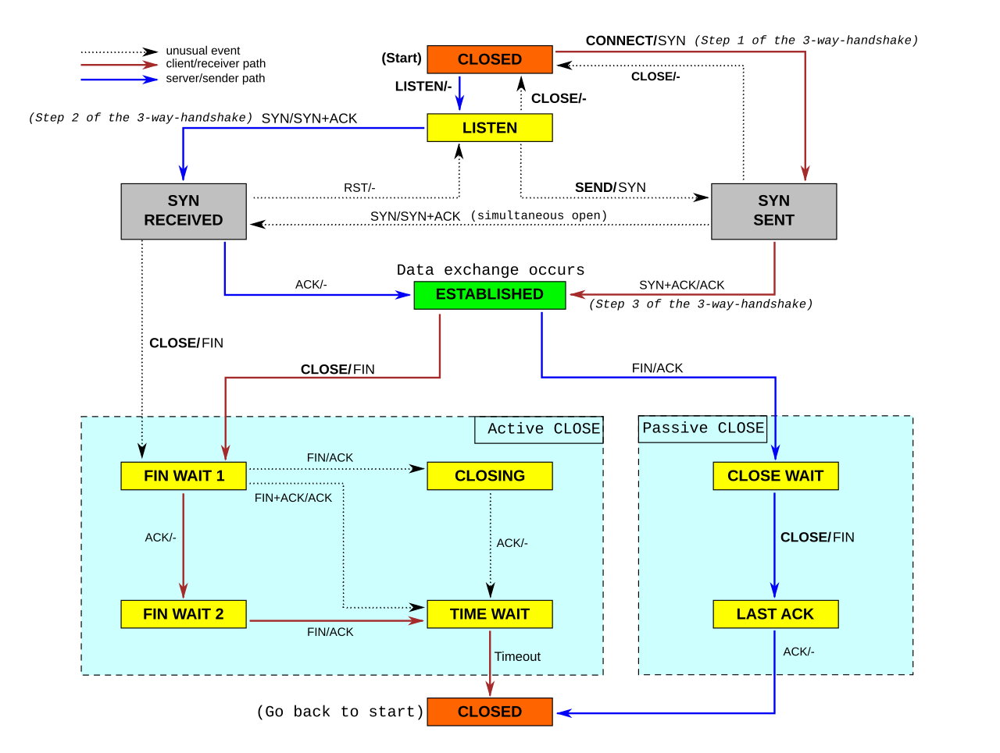

Ketika sebuah layanan web server gagal melakukan booting dengan pesan galat *Address already in use*, atau saat server Linux terasa lambat merespons permintaan masuk dari klien luar, langkah refleks pertama seorang sysadmin adalah mencari tahu siapa yang sedang menguasai port jaringan tersebut. Selama bertahun-tahun, mayoritas buku panduan lama mengajarkan eksekusi perintah `netstat -tulpn`. Namun, di era tumpukan jaringan Linux modern, perkakas lawas dari paket `net-tools` tersebut sudah lama dinyatakan usang (*deprecated*).

Sebagai gantinya, subsistem jaringan Linux modern menyediakan perkakas yang jauh lebih cepat, akurat, dan kaya informasi, yaitu perintah `ss` (*Socket Statistics*) dari paket `iproute2`. Salah satu kombinasi parameter yang paling sering diandalkan dalam investigasi operasional harian adalah eksekusi **ss tulpn command in linux**. Melalui kombinasi ini, ente dapat melihat daftar lengkap seluruh socket TCP dan UDP yang sedang membuka port pendengar (*listening*), lengkap dengan nomor port numerik serta nama proses beserta Process ID (PID) yang bertanggung jawab di belakangnya.

Pada artikel ini, ane ajak ente membedah tuntas penggunaan perintah **ss tulpn command in linux**. Kita akan mengupas arti setiap opsi di balik kombinasinya, membaca informasi antrean *backlog* pada kolom `Recv-Q` dan `Send-Q`, melakukan filter native tanpa *grep*, melacak proses nakal yang memicu konflik port, hingga melakukan audit keamanan untuk mencegah kebocoran layanan privat ke internet publik.

## Mengapa ss Menggantikan netstat di Linux Modern

Sebelum melangkah ke contoh perintah praktis, sangat penting memahami mengapa ente wajib meninggalkan `netstat` dan beralih penuh ke `ss`. Perbedaan mendasar antara keduanya terletak pada arsitektur cara perkakas tersebut mengambil data socket dari ruang kernel Linux.

Perintah lawas `netstat` bekerja dengan cara membuka dan membaca berkas teks virtual pada direktori `/proc/net/tcp`, `/proc/net/udp`, dan `/proc/net/raw`. Pendekatan ini memiliki kelemahan performa yang fatal. Pada server produksi berskala besar yang menangani puluhan ribu koneksi konkuren (seperti reverse proxy Nginx atau kluster Kubernetes), kernel Linux terpaksa melakukan serialisasi data ribuan baris teks ASCII ke antarmuka VFS `/proc`. Pembacaan teks raksasa ini membutuhkan alokasi memori tinggi, memicu lonjakan konsumsi CPU, dan sering kali menghasilkan keluaran yang lambat atau terpotong saat terjadi perubahan status socket secara cepat.

Sebaliknya, utilitas `ss` berkomunikasi langsung dengan subsistem kernel melalui protokol antarmuka Netlink, khususnya modul kernel `sock_diag` (seperti `inet_diag` dan `unix_diag`). Netlink mentransfer data struktur socket dalam format biner murni secara instan langsung dari tabel hash socket kernel ke *user-space*. Hasilnya, perintah `ss` mampu menyajikan ribuan status koneksi dalam hitungan milidetik tanpa membebani subsistem VFS maupun mengunci tabel koneksi kernel.

| Parameter Evaluasi | netstat (net-tools) | ss (iproute2) |
| :--- | :--- | :--- |
| **Status Pemeliharaan** | Usang (*Deprecated*) | Aktif dan Standar Default Linux |
| **Mekanisme Ambil Data** | Parsing berkas teks `/proc/net/*` | Antarmuka Netlink biner (`sock_diag`) |
| **Kecepatan di Server Sibuk** | Lambat, konsumsi CPU tinggi | Instan, konsumsi memori minimal |
| **Informasi State TCP** | Terbatas pada status dasar | Mendalam (RTT, Congestion Window, Backlog) |
| **Filter Native** | Membutuhkan pipa `grep` atau `awk` | Sintaks ekspresi internal langsung |

## Anatomi dan Makna Kombinasi Opsi ss -tulpn

Kombinasi parameter `ss -tulpn` (atau sering ditulis tanpa tanda minus menjadi `ss tulpn`) sebenarnya merupakan rangkaian lima flag mandiri yang digabungkan menjadi satu kesatuan argumen:

1. **`-t` (`--tcp`):** Menginstruksikan utilitas untuk menyaring dan menampilkan socket yang menggunakan protokol TCP (*Transmission Control Protocol*).
2. **`-u` (`--udp`):** Menginstruksikan utilitas untuk menyaring dan menampilkan socket yang menggunakan protokol UDP (*User Datagram Protocol*).
3. **`-l` (`--listening`):** Menampilkan socket yang berada dalam kondisi mendengarkan koneksi masuk (*listening state*). Secara default, jika flag `-l` tidak disertakan, perintah `ss` hanya akan menampilkan koneksi aktif yang sudah terhubung (*established*). Flag ini krusial jika tujuan ente adalah melihat port layanan yang sedang terbuka di server.
4. **`-p` (`--processes`):** Menampilkan nama proses dan nomor PID dari program yang memiliki file descriptor socket tersebut. Opsi ini membutuhkan hak akses *root* atau *sudo* agar kernel mengizinkan pembacaan atribut proses milik pengguna lain.
5. **`-n` (`--numeric`):** Memaksa `ss` menampilkan alamat IP dan nomor port dalam bentuk angka mentah (*numeric*). Tanpa flag ini, `ss` akan mencoba mencocokkan nomor port dengan nama layanan standar dari berkas `/etc/services` (misalnya port 80 diubah menjadi `http`, port 443 menjadi `https`, atau port 22 menjadi `ssh`). Pemakaian flag `-n` sangat dianjurkan karena menghindari kelambatan akibat resolusi DNS balik serta mencegah kekeliruan interpretasi nama layanan kustom.


*Sumber: [Wikimedia Commons / RFC 793 TCP Specification](https://commons.wikimedia.org/wiki/File:Tcp_state_diagram_fixed_new.svg)*

## Membedah Struktur Baris Output ss -tulpn

Mari kita jalankan perintah ini pada terminal Linux dengan hak akses superuser:

```bash
sudo ss -tulpn
```

Contoh keluaran yang dihasilkan pada server produksi umumnya tampak seperti berikut:

```text
Netid  State   Recv-Q Send-Q  Local Address:Port   Peer Address:Port  Process
udp    UNCONN  0      0       127.0.0.53%lo:53     0.0.0.0:*          users:(("systemd-resolve",pid=652,fd=13))
udp    UNCONN  0      0       0.0.0.0:68           0.0.0.0:*          users:(("dhclient",pid=789,fd=6))
tcp    LISTEN  0      128     0.0.0.0:22           0.0.0.0:*          users:(("sshd",pid=842,fd=3))
tcp    LISTEN  0      511     0.0.0.0:80           0.0.0.0:*          users:(("nginx",pid=1024,fd=6),("nginx",pid=1025,fd=6))
tcp    LISTEN  0      511     0.0.0.0:443          0.0.0.0:*          users:(("nginx",pid=1024,fd=7),("nginx",pid=1025,fd=7))
tcp    LISTEN  0      70      127.0.0.1:3306       0.0.0.0:*          users:(("mariadbd",pid=1120,fd=19))
tcp    LISTEN  0      128     [::]:22              [::]:*             users:(("sshd",pid=842,fd=4))
tcp    LISTEN  0      4096    *:8080               *:*                users:(("node",pid=2340,fd=18))
```

Agar tidak salah membaca data, berikut rincian teknis dari setiap kolom yang tersaji di atas:

### 1. Kolom Netid

Menunjukkan tipe protokol transport yang digunakan oleh socket. Pada hasil di atas, kita melihat nilai `tcp` atau `udp`. Jika tumpukan IPv6 aktif, beberapa distribusi mungkin menampilkannya sebagai `tcp` atau `udp` dengan alamat berformat IPv6 pada kolom berikutnya.

### 2. Kolom State

Mengindikasikan status siklus hidup socket pada saat inspeksi dilakukan:
* **`LISTEN`:** Khusus untuk socket TCP. Artinya socket tersebut telah menjalankan pemanggilan sistem `listen()` dan siap menerima jabat tangan tiga arah (*three-way handshake*) dari klien luar.
* **`UNCONN`:** Khusus untuk socket UDP. Karena UDP adalah protokol tanpa koneksi (*connectionless*), tidak ada status `LISTEN` formal dalam standar RFC protokol UDP. Kernel Linux menandai socket UDP yang terikat (*bound*) ke suatu port lokal dengan status `UNCONN` (*Unconnected*), yang bermakna socket siap menerima datagram dari klien mana pun.

### 3. Rahasia Kolom Recv-Q dan Send-Q pada Socket LISTEN

Banyak sysadmin pemula mengira bahwa `Recv-Q` dan `Send-Q` selalu menunjukkan jumlah byte data yang tertahan di buffer transmisi jaringan. Pemahaman tersebut hanya benar pada socket yang sudah berada dalam status `ESTABLISHED`. 

Pada socket TCP yang berstatus **`LISTEN`**, arti kedua kolom ini berubah total:
* **`Send-Q`:** Menunjukkan kapasitas maksimum antrean koneksi penuh (*Accept Queue*) yang dialokasikan oleh aplikasi saat memanggil fungsi `listen(sockfd, backlog)`. Pada baris Nginx di atas, nilai `Send-Q` adalah `511`, sedangkan pada MariaDB bernilai `70`. Nilai ini dibatasi oleh parameter kernel `net.core.somaxconn`.
* **`Recv-Q`:** Menunjukkan jumlah koneksi klien yang saat ini sudah menyelesaikan proses TCP three-way handshake (berada di antrean accept), tetapi **belum diambil** oleh aplikasi via fungsi `accept()`.

Jika pada server ente nilai `Recv-Q` mendekati atau sama dengan nilai `Send-Q`, itu merupakan tanda bahaya (*red flag*). Kondisi ini menandakan bahwa aplikasi (seperti Node.js atau Nginx) sedang mengalami hambatan kinerja (*bottleneck*), kehabisan thread pekerja (*worker threads*), atau mengalami kelambatan, sehingga koneksi baru dari klien terpaksa ditolak (*dropped*) oleh kernel Linux.

### 4. Local Address:Port

Menunjukkan alamat IP dan nomor port tempat layanan terikat (*socket binding*):
* `0.0.0.0:80` atau `*:80`: Layanan mendengarkan trafik pada seluruh antarmuka jaringan IPv4 yang terpasang di mesin tersebut.
* `127.0.0.1:3306`: Layanan hanya mendengarkan trafik dari antarmuka loopback lokal. Klien dari luar server tidak akan bisa mengakses port ini secara langsung.
* `[::]:22` atau `*:22`: Layanan mendengarkan koneksi pada seluruh antarmuka jaringan IPv6 (dan sering kali juga mencakup IPv4 jika parameter dual-stack `ipv6only=0` aktif).
* `192.168.1.50:8080`: Layanan secara spesifik hanya mendengarkan koneksi yang masuk melalui IP antarmuka privat tertentu.

### 5. Process

Menampilkan pasangan nama biner aplikasi, Process ID (`pid`), serta nomor deskriptor berkas (`fd`). Informasi ini sangat penting untuk membuktikan secara pasti proses mana yang memegang kendali atas port tersebut.

## Panduan Langkah Demi Langkah Penggunaan ss -tulpn di Lapangan

Berikut adalah skenario penerapan praktis perintah **ss tulpn command in linux** dalam operasional pengelolaan server harian.

### Langkah 1: Menjalankan Perintah dengan Hak Akses Penuh

Langkah mendasar adalah menjalankan `ss -tulpn` dengan menggunakan `sudo`. Jika ente menjalankannya sebagai pengguna biasa non-root, kolom `Process` akan kosong karena kernel menerapkan pembatasan hak akses terhadap pembacaan direktori `/proc/<pid>/fd/` milik pengguna lain.

```bash
sudo ss -tulpn
```

Gunakan opsi tambahan `-H` (*no header*) jika ente berniat mengolah hasil keluaran ke dalam skrip otomatisasi Bash:

```bash
sudo ss -tulpnH
```

### Langkah 2: Menyaring Port Tertentu Menggunakan Sintaks Filter Native ss

Salah satu keunggulan terbesar `ss` dibandingkan `netstat` adalah kemampuannya menyaring port secara langsung menggunakan ekspresi internal tanpa perlu menyalurkan keluaran (*piping*) ke perkakas `grep`.

Untuk mencari tahu apakah ada layanan yang mendengarkan port 80 (HTTP) atau port 443 (HTTPS), gunakan filter `sport` (*source port*):

```bash
sudo ss -tulpn '( sport = :80 or sport = :443 )'
```

Atau jika ingin mencari layanan pada rentang port tertentu (misalnya port 8000 sampai 9000):

```bash
sudo ss -tulpn '( sport >= :8000 and sport <= :9000 )'
```

Sintaks filter native ini dieksekusi langsung di level pengolahan Netlink, sehingga jauh lebih cepat dan akurat dibandingkan perintah `grep :80` yang sering kali memicu kesalahan tangkap (*false positive*) terhadap nomor PID atau nomor port lain yang kebetulan mengandung angka 80.

### Langkah 3: Melacak Penyebab Masalah Port Conflict (Address Already in Use)

Skenario yang sangat lazim terjadi adalah ketika ente mencoba menyalakan web server (misalnya Nginx atau Apache), tetapi layanan menolak berjalan dengan pesan:

```text
nginx: [emerg] bind() to 0.0.0.0:80 failed (98: Address already in use)
```

Untuk melacak proses yang menduduki port 80 tersebut, eksekusi perintah:

```bash
sudo ss -tulpn '( sport = :80 )'
```

Keluaran akan menunjukkan identitas proses yang mengunci port 80:

```text
Netid  State   Recv-Q Send-Q  Local Address:Port  Peer Address:Port  Process
tcp    LISTEN  0      128     0.0.0.0:80          0.0.0.0:*          users:(("caddy",pid=4512,fd=7))
```

Dari hasil di atas, terlihat jelas bahwa port 80 sedang dikuasai oleh biner `caddy` dengan PID `4512`. Ente dapat menghentikan proses pengunci port tersebut secara spesifik:

```bash
kill 4512
```

Setelah itu, verifikasi kembali ketersediaan port dengan `sudo ss -tulpn '( sport = :80 )'`. Jika baris keluaran kosong, artinya port 80 sudah bersih dan siap digunakan oleh Nginx.

### Langkah 4: Memeriksa Eksposur Port untuk Hardening Keamanan Server

Salah satu tugas vital dalam audit keamanan server Linux adalah memastikan tidak ada layanan sensitif yang terbuka secara tidak sengaja ke internet publik. 

Perhatikan contoh hasil berikut:

```text
tcp    LISTEN  0      70      0.0.0.0:3306        0.0.0.0:*          users:(("mariadbd",pid=1120,fd=19))
tcp    LISTEN  0      128     0.0.0.0:6379        0.0.0.0:*          users:(("redis-server",pid=1450,fd=6))
```

Pada baris di atas, basis data MariaDB (port 3306) dan Redis (port 6379) mengikat alamat `0.0.0.0`. Ini berarti kedua layanan privat tersebut dapat diakses oleh siapa pun dari jaringan luar jika firewall lokal lupa diaktifkan.

Tindakan perbaikan (*hardening*) yang tepat adalah mengubah konfigurasi *bind-address* pada berkas konfigurasi masing-masing layanan (misalnya `/etc/mysql/mariadb.conf.d/50-server.cnf` atau `/etc/redis/redis.conf`) menjadi:

```ini
bind-address = 127.0.0.1
```

Setelah layanan dimuat ulang, jalankan kembali perintah audit:

```bash
sudo ss -tulpn '( sport = :3306 or sport = :6379 )'
```

Pastikan kolom `Local Address:Port` kini berubah menjadi `127.0.0.1:3306` dan `127.0.0.1:6379`. Dengan demikian, akses jaringan hanya dimungkinkan dari mesin lokal (*localhost*).

### Langkah 5: Memantau Kondisi Antrean Backlog Saat Lonjakan Beban

Saat server mengalami lonjakan lalu lintas yang ekstrem, periksa kolom `Recv-Q` dan `Send-Q` secara berkala menggunakan perintah pengulangan:

```bash
watch -n 1 "sudo ss -tulpn '( sport = :80 or sport = :443 )'"
```

Jika ente melihat angka `Recv-Q` mulai meningkat dan mendekati angka `Send-Q` (misalnya 511 dari 511), ini menandakan antrean koneksi TCP kernel telah penuh. Untuk mengatasi kondisi darurat ini pada tumpukan jaringan Linux, ente perlu menaikkan nilai batas antrean kernel pada `/etc/sysctl.d/99-networking.conf`:

```ini
net.core.somaxconn = 65535
net.ipv4.tcp_max_syn_backlog = 65535
```

Terapkan parameter baru tersebut ke kernel yang sedang berjalan:

```bash
sudo sysctl -p /etc/sysctl.d/99-networking.conf
```

Kemudian sesuaikan pula arahan parameter `backlog` pada konfigurasi aplikasi (seperti direktif `listen 80 default_server backlog=65535;` pada Nginx) lalu muat ulang layanan terkait.

## Pemecahan Masalah dan Kendala Umum (Troubleshooting)

Dalam penggunaan perintah `ss -tulpn`, berikut beberapa kendala teknis yang kerap membingungkan para teknisi:

### 1. Kolom Process Tidak Menampilkan Nama Aplikasi dan PID

* **Penyebab:** Perintah dieksekusi tanpa hak akses superuser (*root*). Sistem keamanan Linux mencegah pengguna reguler melihat deskriptor berkas proses milik pengguna lain.
* **Solusi:** Selalu tambahkan awalan `sudo` saat menjalankan perintah: `sudo ss -tulpn`.

### 2. Status UDP Selalu Tertulis UNCONN Bukan LISTEN

* **Penyebab:** Karakteristik protokol UDP yang *connectionless* dan tidak memiliki mekanisme jabat tangan status koneksi seperti TCP.
* **Solusi:** Hal ini normal dan bukan merupakan galat. Status `UNCONN` dengan nomor port lokal menandakan bahwa socket UDP tersebut aktif mendengarkan datagram yang masuk pada port bersangkutan.

### 3. Port Hanya Terlihat di Format IPv6 ([::]:Port) Tetapi Bisa Diakses via IPv4

* **Penyebab:** Fitur dual-stack IPv6 pada kernel Linux. Secara default, jika opsi kernel `net.ipv6.bindv6only` bernilai `0`, socket yang mengikat antarmuka IPv6 `[::]` secara otomatis akan melayani paket data yang datang dari jaringan IPv4.
* **Solusi:** Tidak perlu bingung jika tidak melihat baris `0.0.0.0` terpisah untuk port tersebut, karena socket IPv6 tersebut sudah menangani kedua versi protokol secara simultan.

### 4. Perintah ss Berjalan Lambat Saat Menggunakan Flag Tertentu

* **Penyebab:** Lupa menyertakan flag `-n`. Jika flag `-n` tertinggal, `ss` akan mencoba menghubungi server DNS lokal untuk melakukan *reverse lookup* alamat IP menjadi nama domain atau mencari padanan port di `/etc/services`. Jika koneksi DNS bermasalah, perintah akan mengalami kelambatan beberapa detik.
* **Solusi:** Pastikan huruf `n` selalu ada dalam opsi perintah ente: `sudo ss -tulpn`.

---

Menguasai perintah **ss tulpn command in linux** adalah keterampilan fundamental yang wajib dimiliki oleh setiap sysadmin, DevOps engineer, dan praktisi jaringan Linux. Dengan beralih dari perkakas usang `netstat` menuju `ss`, ente tidak hanya memperoleh kecepatan pembacaan soket berbasis Netlink berkinerja tinggi, tetapi juga mendapatkan data akurat mengenai metrik antrean backlog, proses penguasa port, serta visibilitas penuh dalam mengaudit keamanan tumpukan jaringan server produksi.

Sumber: [Linux Manual Page ss(8)](https://man7.org/linux/man-pages/man8/ss.8.html)
