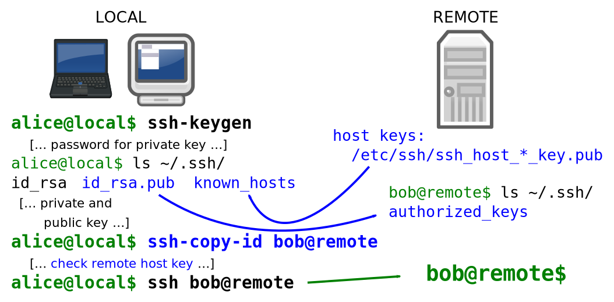

Instalasi standar Ubuntu 24.04 LTS (Noble Numbat) menyediakan layanan OpenSSH yang langsung siap pakai, namun setelan bawaan ini belum dirancang untuk menghadapi paparan internet publik secara aman. Setiap server Linux dengan alamat IP publik yang membuka port 22 akan menjadi sasaran pemindaian otomatis, serangan kamus (dictionary attack), dan brute force ribuan kali setiap harinya. Tanpa pengerasan (hardening) yang ketat, celah keamanan seperti kata sandi lemah atau kredensial pengguna yang bocor dapat dimanfaatkan penyerang untuk mengambil alih hak akses sistem secara permanen.

Ubuntu 24.04 LTS membawa perubahan arsitektur fundamental pada manajemen layanan OpenSSH. Berbeda dengan rilis LTS terdahulu yang menjalankan daemon OpenSSH secara terus-menerus melalui unit konvensional `ssh.service`, Ubuntu 24.04 menerapkan *socket-based activation* melalui unit `ssh.socket` secara default. Perubahan ini kerap membingungkan administrator sistem karena modifikasi nilai `Port` pada `/etc/ssh/sshd_config` sering kali tampak tidak berpengaruh jika tidak diiringi pembaruan generator systemd. Panduan teknis ini mengupas tuntas langkah-langkah pengerasan SSH modern berbasis kunci kurva eliptis Ed25519, konfigurasi modular drop-in, penyesuaian socket activation systemd, proteksi firewall UFW, hingga audit verifikasi menyeluruh.

## Skenario Kebutuhan dan Prasyarat

Pengerasan SSH mutlak diperlukan pada server produksi, VPS publik (seperti Hetzner, DigitalOcean, atau AWS), maupun peladen *homelab* yang diekspos melalui port forwarding atau Cloudflare Tunnel. Sebelum memulai proses konfigurasi, pastikan kebutuhan teknis berikut telah terpenuhi:

1. Server target menjalankan sistem operasi Ubuntu 24.04 LTS dengan paket `openssh-server` terpasang.
2. Akses ke akun pengguna non-root dengan hak istimewa `sudo` penuh.
3. Mesin klien (laptop atau workstation pengelola) yang menjalankan Linux, macOS, atau Windows Terminal dengan OpenSSH Client aktif.
4. Terminal klien yang sedang terhubung ke server **dilarang keras ditutup** sepanjang proses berlangsung. Selalu sediakan satu sesi aktif sebagai jalur penyelamat (*failsafe session*) jika terjadi kesalahan konfigurasi.

## Langkah 1: Pembuatan Kunci Kriptografi Ed25519 pada Mesin Klien

Autentikasi berbasis kata sandi memiliki kelemahan inheren terhadap intersepsi jaringan dan serangan brute force. Standar modern pengerasan server mewajibkan autentikasi berbasis kunci publik (public key authentication). Algoritma Ed25519 (Edwards-curve Digital Signature Algorithm) menjadi standar industri karena menawarkan keamanan tinggi dengan panjang kunci ringkas (256-bit) serta performa verifikasi tanda tangan digital yang sangat cepat dibanding RSA 4096-bit.

Jalankan perintah berikut pada terminal mesin lokal (klien Anda, bukan di dalam server):

```bash
ssh-keygen -t ed25519 -a 100 -C "admin-huda@north7-workstation"
```

Opsi `-a 100` menginstruksikan modul KDF (Key Derivation Function) berbasis bcrypt untuk melakukan 100 putaran derivasi, mempersulit serangan offline brute force jika berkas kunci privat Anda sempat disalin pihak tidak berwenang. Anda akan diminta menentukan lokasi penyimpanan berkas (tekan Enter untuk menggunakan lokasi default `~/.ssh/id_ed25519`) dan memasukkan passphrase pengaman. Sangat disarankan menyetel passphrase yang kuat untuk melindungi kunci privat di sisi klien.

## Langkah 2: Distribusi Kunci Publik ke Server Target

Setelah pasangan kunci terbentuk di klien, transfer kunci publik (`id_ed25519.pub`) ke server Ubuntu 24.04 menggunakan perintah `ssh-copy-id`:

```bash
ssh-copy-id -i ~/.ssh/id_ed25519.pub huda@192.168.1.150
```

Sesuaikan nama pengguna dan alamat IP server Anda. Masukkan kata sandi akun pengguna server untuk terakhir kalinya saat proses transfer berlangsung.

Masuklah ke server untuk memastikan hak akses direktori dan berkas kunci telah sesuai dengan standar POSIX yang ketat. OpenSSH akan menolak koneksi secara otomatis jika izin berkas terlalu longgar:

```bash
ssh huda@192.168.1.150
chmod 700 ~/.ssh
chmod 600 ~/.ssh/authorized_keys
```


*Sumber: [Wikimedia Commons / OpenBSD](https://commons.wikimedia.org/wiki/File:Pubkey_Secure_Shell_login.svg)*

Diagram di atas mengilustrasikan alur pertukaran tanda tangan kriptografi antara klien dan server tanpa pernah mentransmisikan kunci privat melalui kabel jaringan.

## Langkah 3: Konfigurasi Drop-in Pengerasan SSH di Server

Ubuntu 24.04 mendukung direktori drop-in `/etc/ssh/sshd_config.d/`. Praktik terbaik administrasi sistem adalah menghindari modifikasi langsung berkas induk `/etc/ssh/sshd_config` agar tidak menimbulkan konflik saat pembaruan paket sistem berlangsung.

Buat berkas konfigurasi baru dengan penomoran tinggi agar nilainya menimpa setelan bawaan sistem:

```bash
sudo nano /etc/ssh/sshd_config.d/99-hardening.conf
```

Masukkan parameter keamanan teruji berikut ke dalam berkas tersebut:

```text
# Port kustom untuk menghindari automated scanner
Port 2222

# Nonaktifkan autentikasi password dan interaktif
PasswordAuthentication no
KbdInteractiveAuthentication no
PermitEmptyPasswords no

# Wajibkan public key authentication
PubkeyAuthentication yes

# Matikan akses langsung untuk user root
PermitRootLogin no

# Batasi jumlah percobaan autentikasi
MaxAuthTries 3
MaxSessions 5

# Waktu tunggu proses login dalam detik
LoginGraceTime 30

# Matikan fitur pengalihan yang tidak diperlukan pada server murni
X11Forwarding no
AllowTcpForwarding yes
AllowAgentForwarding no

# Batasi pengguna yang diizinkan mengakses SSH
AllowUsers huda
```

Sesuaikan parameter `AllowUsers` dengan daftar nama akun pengguna yang sah di server Anda, dan ubah nilai `Port 2222` ke nomor port pilihan Anda (disarankan memilih rentang port privat antara 1024 hingga 65535).

## Langkah 4: Penanganan Socket Activation systemd di Ubuntu 24.04

Ini merupakan bagian paling krusial pada Ubuntu 24.04 LTS. OpenSSH diatur berjalan di bawah kendali `ssh.socket`. Saat sistem melakukan proses booting, systemd akan menjalankan utilitas internal bernama `sshd-socket-generator`. Generator ini membaca direktori `/etc/ssh/sshd_config.d/` dan menghasilkan unit socket dinamis di `/run/systemd/generator/ssh.socket.d/addresses.conf`.

Jika Anda hanya menjalankan perintah reload biasa pada layanan induk, generator systemd tidak akan dieksekusi ulang sehingga server tetap mendengarkan port 22 lama.

Untuk memastikan port kustom baru (misalnya port 2222) diterapkan dengan sempurna, jalankan perintah reload manager systemd terlebih dahulu sebelum memuat ulang socket:

```bash
sudo systemctl daemon-reload
sudo systemctl restart ssh.socket
```

Jika Anda ingin memeriksa apakah unit socket berhasil membaca port kustom tersebut, periksa menggunakan utilitas `systemctl`:

```bash
systemctl cat ssh.socket
```

Keluaran terminal akan menampilkan konfigurasi induk beserta berkas *drop-in override* dari generator yang memuat baris `ListenStream=0.0.0.0:2222` dan `ListenStream=[::]:2222`.

## Langkah 5: Penerapan Aturan Firewall UFW dengan Rate Limiting

Sebelum memutus koneksi saat ini, pastikan port baru telah dibuka pada firewall bawaan Ubuntu (Uncomplicated Firewall / UFW). Mengaktifkan aturan tanpa membuka port baru adalah penyebab utama administrator terkunci keluar (*lockout*).

Gunakan fitur `limit` pada UFW untuk port SSH. Fitur ini secara otomatis memblokir alamat IP yang mencoba melakukan koneksi lebih dari 6 kali dalam jendela waktu 30 detik:

```bash
sudo ufw limit 2222/tcp comment 'SSH Hardened Port'
sudo ufw delete allow 22/tcp 2>/dev/null
sudo ufw enable
sudo ufw status verbose
```

Periksa keluaran status UFW. Pastikan port 2222 berstatus `LIMIT IN` dan port 22 sudah tidak lagi memiliki aturan masuk yang aktif.

## Langkah 6: Validasi Sintaks Konfigurasi dan Muat Ulang Layanan

Sebelum menerapkan perubahan secara permanen, selalu lakukan audit sintaks konfigurasi OpenSSH menggunakan opsi `-t` (test mode). Perintah ini akan memvalidasi apakah terdapat kesalahan penulisan (*typo*) atau direktif usang pada seluruh berkas konfigurasi:

```bash
sudo sshd -t
```

Jika perintah tersebut kembali ke baris perintah tanpa mengeluarkan pesan error apa pun, artinya struktur berkas konfigurasi Anda valid 100%. Setelah itu, sinkronkan seluruh unit systemd:

```bash
sudo systemctl daemon-reload
sudo systemctl restart ssh.socket
```

## Langkah 7: Pengujian Login Sesi Baru dari Mesin Klien

Biarkan jendela terminal yang sedang aktif tetap terbuka. Buka **jendela terminal baru** pada mesin lokal klien Anda dan lakukan pengujian koneksi ke port kustom:

```bash
ssh -p 2222 -i ~/.ssh/id_ed25519 huda@192.168.1.150
```

Jika konfigurasi berhasil, Anda akan langsung disambut oleh prompt shell server tanpa permintaan kata sandi sistem (hanya passphrase kunci lokal jika Anda mengaturnya).

Lakukan pula pengujian penolakan password untuk membuktikan bahwa autentikasi kata sandi telah dimatikan secara absolut:

```bash
ssh -p 2222 -o PubkeyAuthentication=no huda@192.168.1.150
```

Server dalam sekejap akan mengembalikan pesan penolakan instan:

```text
huda@192.168.1.150: Permission denied (publickey).
```

Keluaran di atas mengonfirmasi bahwa metode login menggunakan password telah dinonaktifkan sepenuhnya.

## Verifikasi dan Audit Runtime Port

Untuk memastikan bahwa sistem hanya mendengarkan pada port yang ditentukan dan berada di bawah kendali proses yang tepat, jalankan pemeriksaan socket pada server:

```bash
sudo ss -tulpn | grep ssh
```

Pada Ubuntu 24.04 dengan socket activation, keluaran perintah akan menampilkan bahwa proses pengawas (*listener*) adalah PID 1 (`systemd`):

```text
tcp   LISTEN 0      128          0.0.0.0:2222      0.0.0.0:*    users:(("systemd",pid=1,fd=54))
tcp   LISTEN 0      128             [::]:2222         [::]:*    users:(("systemd",pid=1,fd=55))
```

Saat ada koneksi masuk pada port 2222, systemd secara transparan akan memicu daemon `sshd` untuk menangani sesi tersebut lalu melepaskan sumber daya memori setelah koneksi berakhir.

Untuk melihat ringkasan konfigurasi efektif yang sedang aktif di memori server tanpa harus membaca berkas konfigurasi satu per satu, jalankan:

```bash
sudo sshd -T | grep -E 'port|permitrootlogin|passwordauthentication|pubkeyauthentication|maxauthtries'
```

Keluaran yang diharapkan:

```text
port 2222
permitrootlogin no
passwordauthentication no
pubkeyauthentication yes
maxauthtries 3
```

## Solusi Kendala Umum dan Troubleshooting

### 1. Port SSH Tidak Berubah dan Masih Mendengarkan Port 22

Penyebab umum: Mengubah nilai `Port` di berkas `/etc/ssh/sshd_config.d/` tetapi hanya menjalankan reload standar tanpa memicu socket generator systemd.

Solusi: Ubuntu 24.04 membutuhkan evaluasi ulang socket generator. Eksekusi rangkaian perintah berikut secara berurutan:

```bash
sudo systemctl daemon-reload
sudo systemctl restart ssh.socket
```

Jika Anda lebih memilih arsitektur daemon OpenSSH konvensional yang berjalan mandiri tanpa socket activation, Anda dapat menonaktifkan `ssh.socket` dan beralih ke `ssh.service`:

```bash
sudo systemctl stop ssh.socket
sudo systemctl disable ssh.socket
sudo systemctl enable --now ssh.service
```

Dengan konfigurasi ini, `ssh.service` akan berjalan terus-menerus seperti pada Ubuntu 22.04 LTS.

### 2. Kesalahan Permission Denied (Publickey) Meskipun Kunci Sudah Disalin

Penyebab: Izin akses (*file permissions*) pada direktori `~/.ssh` atau berkas `authorized_keys` terlalu terbuka di mata OpenSSH. Modul keamanan `StrictModes` (aktif secara default) akan menolak otentikasi jika direktori dapat dimodifikasi oleh pengguna lain atau grup.

Solusi: Perbaiki izin berkas di server dengan perintah:

```bash
chmod 700 ~/.ssh
chmod 600 ~/.ssh/authorized_keys
chown -R $USER:$USER ~/.ssh
```

### 3. Terkunci dari Server Setelah Menutup Terminal

Jika Anda mengalami situasi darurat di mana port ditutup oleh firewall atau konfigurasi salah sebelum sesi pengujian berhasil, gunakan salah satu jalur pemulihan berikut:

1. Akses konsol web atau VNC out-of-band yang disediakan oleh penyedia VPS atau hosting (seperti Web Console di Hetzner atau Droplet Console di DigitalOcean). Konsol ini tidak bergantung pada protokol SSH.
2. Melalui konsol tersebut, login sebagai root atau pengguna lokal, periksa status firewall (`sudo ufw status`), lalu koreksi konfigurasi di `/etc/ssh/sshd_config.d/99-hardening.conf`.
3. Jalankan `sudo systemctl daemon-reload && sudo systemctl restart ssh.socket` untuk memulihkan akses jaringan.

Penerapan kombinasi kunci Ed25519, penutupan akses root langsung, isolasi konfigurasi modular drop-in, serta penyelarasan socket activation systemd di Ubuntu 24.04 LTS membentuk fondasi pertahanan jaringan yang solid dan tahan terhadap pemindaian otomatis di internet.

> **Baca Juga:**
> - [Cara Setting Fail2ban di Linux untuk Amankan Server SSH](/cara-setting-fail2ban/)
> - [Panduan Lengkap Nftables Rocky Linux](/panduan-lengkap-nftables-rocky-linux/)

Sumber: [Ubuntu Server Documentation](https://ubuntu.com/server/docs/openssh-server)
