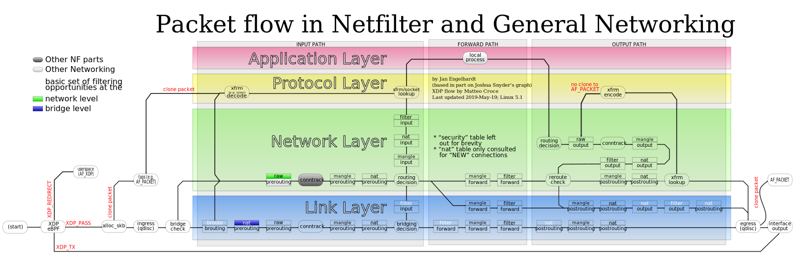

Menghadapi anomali jaringan pada server Ubuntu seperti koneksi yang putus-nyambung secara sporadis, latensi tinggi tanpa sebab yang jelas, serangan penolakan layanan (Denial of Service), atau kegagalan negosiasi TLS membutuhkan visibilitas langsung hingga ke tingkat paket data. Log aplikasi pada tingkat pengguna (*user-space*) sering kali hanya menyajikan gejala akhir, bukan penyebab dasar (*root cause*) dari gangguan komunikasi jaringan. Ketika log web server Nginx mencatat *gateway timeout* atau sesi SSH mendadak terputus, administrator sistem membutuhkan instrumen diagnostik yang mampu mengintip langsung apa yang sebenarnya terjadi di atas kabel jaringan dan antarmuka virtual peladen.

Dalam ekosistem Linux, **tcpdump linux ubuntu** merupakan standar de facto alat diagnostik paket jaringan berbasis baris perintah (*command-line interface*). Dibangun di atas fondasi pustaka `libpcap` dan mekanisme kernel Berkeley Packet Filter (BPF), utilitas ini bekerja dengan sangat efisien pada server tanpa antarmuka grafis (GUI). Utilitas ini mampu membedah paket data pada lapisan tautan (*data-link layer*), lapisan internet (IPv4 dan IPv6), lapisan transpor (TCP, UDP, ICMP), hingga lapisan aplikasi tanpa membebani memori sistem peladen secara berlebihan.

Panduan teknis ini mengupas tuntas cara menggunakan tcpdump di Ubuntu secara sistematis. Pembahasan mencakup arsitektur penangkapan paket di kernel Linux, sintaks ekspresi filter BPF yang presisi, teknik isolasi aliran data berbahaya, penyimpanan berkas format PCAP untuk audit Wireshark lanjutan, hingga strategi pemecahan masalah kendala umum pada lingkungan server produksi.

## Skenario Kebutuhan dan Arsitektur Kernel BPF

Setiap kali paket data masuk melalui Network Interface Card (NIC), modul kernel Linux menangani interupsi perangkat keras dan menempatkan paket ke dalam struktur data memori `sk_buff` (*socket buffer*). Sebelum paket tersebut diproses oleh subsistem Netfilter (seperti tabel iptables atau aturan nftables) dan dialihkan ke soket aplikasi TCP/UDP standar, pustaka `libpcap` yang digunakan oleh tcpdump mengaitkan diri ke antarmuka jaringan melalui soket khusus bertipe `AF_PACKET`.

Soket `AF_PACKET` memungkinkan aplikasi ruang pengguna menyalin salinan paket mentah langsung dari lapisan tautan jaringan. Jika server menerima puluhan ribu paket per detik, menyalin seluruh paket ke ruang pengguna (*user space*) akan menimbulkan overhead komputasi yang masif dan menyebabkan lonjakan beban CPU. Di sinilah peran krusial Berkeley Packet Filter (BPF). Ekspresi penyaringan yang Anda tuliskan pada perintah tcpdump akan dikompilasi menjadi *bytecode* mesin virtual kecil yang dieksekusi langsung di dalam kernel. Paket yang tidak memenuhi kriteria filter akan langsung diabaikan di kernel tanpa pernah disalin ke ruang pengguna, menjaga performa server tetap stabil selama pemantauan berlangsung.


*Sumber: [Wikimedia Commons / Netfilter Project](https://commons.wikimedia.org/wiki/File:Netfilter-packet-flow.svg)*

## Prasyarat Sistem dan Hak Akses Pengguna

Sebelum menjalankan penyadapan paket di lingkungan server Ubuntu Anda, pastikan sistem memenuhi beberapa persyaratan teknis berikut:

1. Server atau komputer kerja menjalankan Ubuntu Linux (Ubuntu 20.04, 22.04, atau 24.04 LTS).
2. Memiliki hak akses istimewa administratif ` + sd + ` atau hak pengguna `root`, karena membuka soket `AF_PACKET` dan menempatkan kartu jaringan ke dalam mode promiskus (*promiscuous mode*) memerlukan kapabilitas kernel `CAP_NET_RAW` dan `CAP_NET_ADMIN`.
3. Ruang penyimpanan disk yang memadai pada partisi penyimpanan jika Anda berencana merekam lalu lintas jaringan dalam volume besar ke dalam berkas biner `.pcap`.

## Langkah 1: Instalasi Paket Tcpdump Melalui APT di Ubuntu

Pada sebagian besar instalasi minimalis Ubuntu Server atau container cloud image, paket `tcpdump` mungkin belum terpasang secara bawaan. Anda dapat memasang paket resmi langsung dari repositori utama Ubuntu.

Perbarui indeks repositori sistem terlebih dahulu untuk memastikan Anda memperoleh versi biner terbaru:

```bash
sudo apt update
```

Pasang paket `tcpdump` beserta pustaka dependensinya:

```bash
sudo apt install -y tcpdump
```

Setelah instalasi selesai, verifikasi keberadaan biner dan pastikan pustaka `libpcap` tertaut dengan benar menggunakan flag `-V` (*uppercase*):

```bash
tcpdump -V
```

Output terminal akan menampilkan nomor versi tcpdump, versi pustaka libpcap, serta fitur akselerasi kriptografi OpenSSL yang didukung oleh sistem Anda.

## Langkah 2: Identifikasi Antarmuka Jaringan Aktif dengan Opsi -D

Server modern umumnya memiliki lebih dari satu antarmuka jaringan fisik maupun virtual, seperti antarmuka Ethernet fisik (`eth0` atau `enp3s0`), antarmuka loopback (`lo`), bridge container Docker (`docker0`), antarmuka VPN (`wg0` atau `tailscale0`), hingga antarmuka veth virtual.

Gunakan parameter `-D` untuk menampilkan seluruh antarmuka jaringan yang dapat didengarkan oleh tcpdump:

```bash
sudo tcpdump -D
```

Contoh output yang dihasilkan:

```text
1.eth0 [Up, Running, Connected]
2.docker0 [Up, Running]
3.wg0 [Up, Running]
4.any (Pseudo-device that captures on all interfaces) [Up, Running]
5.lo [Up, Running, Loopback]
```

Perhatikan entri khusus bernama `any`. Entri nomor 4 ini merupakan *pseudo-device* Linux yang memungkinkan penyadapan simultan di seluruh antarmuka yang ada pada mesin. Namun, untuk investigasi masalah yang presisi, selalu utamakan memilih nama antarmuka spesifik (misalnya `eth0`).

## Langkah 3: Menangkap Lalu Lintas Paket Dasar pada Antarmuka Tertentu

Untuk mulai mendengarkan lalu lintas pada antarmuka target, gunakan parameter `-i` diikuti nama antarmuka.

Aturan emas dalam menjalankan tcpdump di lingkungan server adalah **selalu menyertakan flag `-nn`**:
- Flag `-n` pertama menginstruksikan tcpdump agar tidak mengubah alamat IP menjadi nama host domain melalui reverse DNS query.
- Flag `-n` kedua menginstruksikan tcpdump agar menampilkan nomor port secara numerik dan tidak mengubahnya menjadi nama protokol layanan (misalnya menampilkan port `22` alih-alih `ssh`, atau port `80` alih-alih `http`).

Jika Anda tidak menyertakan `-nn`, setiap paket yang lewat akan memicu kueri DNS balik dari server Anda sendiri. Hal ini tidak hanya membebani server DNS lokal tetapi juga menciptakan rekursi lalu lintas palsu yang mencemari hasil tangkapan.

Jalankan penangkapan dasar dengan pembatasan jumlah paket menggunakan parameter `-c` (count):

```bash
sudo tcpdump -i eth0 -nn -c 10
```

Jika Anda ingin melihat rincian header paket yang lebih mendalam seperti nilai Time to Live (TTL), ID identifikasi paket, dan opsi TCP, tambahkan tingkat verbositas dengan parameter `-v` atau `-vv`:

```bash
sudo tcpdump -i eth0 -nn -vv -c 5
```

## Langkah 4: Penyaringan Paket Berdasarkan Alamat IP Sumber dan Tujuan

Pada server dengan aktivitas jaringan tinggi, menjalankan tcpdump tanpa filter akan menghasilkan banjir teks (*text flooding*) yang mustahil dianalisis dengan mata telanjang. Sintaks BPF menyediakan kata kunci `host`, `src`, dan `dst` untuk mengisolasi alamat IP tertentu.

Menangkap paket yang melibatkan alamat IP target (baik sebagai pengirim maupun penerima):

```bash
sudo tcpdump -i eth0 -nn host 192.168.1.150
```

Jika Anda hanya tertarik pada lalu lintas yang **keluar** menuju alamat IP target, gunakan kata kunci `dst host`:

```bash
sudo tcpdump -i eth0 -nn dst host 192.168.1.150
```

Sebaliknya, jika Anda ingin menyelidiki lalu lintas yang **masuk** dari host atau server klien tertentu, gunakan kata kunci `src host`:

```bash
sudo tcpdump -i eth0 -nn src host 203.0.113.45
```

Untuk menganalisis lalu lintas dari seluruh subnet jaringan lokal tertentu, Anda dapat memanfaatkan kata kunci `net` dengan notasi CIDR:

```bash
sudo tcpdump -i eth0 -nn net 192.168.1.0/24
```

## Langkah 5: Filtering Lalu Lintas Berdasarkan Port dan Protokol Jaringan

Selain alamat IP, lapisan transpor (Layer 4) merupakan filter yang paling sering digunakan dalam investigasi operasional harian. Anda dapat menyaring lalu lintas berdasarkan protokol (`tcp`, `udp`, atau `icmp`) dan nomor port layanan.

Menangkap seluruh komunikasi pada port web HTTPS (port 443):

```bash
sudo tcpdump -i eth0 -nn port 443
```

Mengisolasi paket DNS (UDP port 53) untuk mendiagnosis masalah resolusi nama domain:

```bash
sudo tcpdump -i eth0 -nn udp port 53
```

Memantau paket diagnostik ICMP untuk memverifikasi apakah server sedang menerima serangan ping flood atau permintaan *echo request*:

```bash
sudo tcpdump -i eth0 -nn icmp
```

Anda juga dapat mendefinisikan rentang port (*port range*) menggunakan tanda hubung, sangat berguna untuk memeriksa protokol yang memakai alokasi port dinamis:

```bash
sudo tcpdump -i eth0 -nn portrange 8000-8080
```

## Langkah 6: Menyimpan Hasil Penyadapan Paket ke Berkas PCAP

Membaca ribuan baris paket langsung pada layar terminal saat insiden keamanan berlangsung sangat tidak praktis. Praktik terbaik administrator sistem adalah mengarahkan tangkapan paket mentah ke dalam berkas standar PCAP (*Packet Capture*) menggunakan parameter `-w` (*write*).

Berkas hasil ekspor `-w` menyimpan bit dan bita data jaringan asli tanpa kehilangan informasi sedikit pun. Berkas ini nantinya dapat diunduh ke komputer analis untuk dibedah menggunakan perangkat lunak penganalisis grafis seperti Wireshark.

Simpan rekaman paket ke berkas `analisis_jaringan.pcap`:

```bash
sudo tcpdump -i eth0 -nn -w /var/log/analisis_jaringan.pcap
```

Saat menggunakan parameter `-w`, tcpdump tidak akan menampilkan baris paket di terminal. Terminal hanya akan menampilkan penghitung jumlah paket yang telah berhasil ditangkap. Untuk menghentikan proses perekaman, tekan kombinasi tombol `Ctrl + C`.

Jika server memiliki bandwidth gigabit dengan throughput data masif, Anda dapat membatasi ukuran snapshot data tiap paket menggunakan parameter `-s` (*snapshot length*). Menangkap hanya 96 bita pertama dari tiap paket sudah cukup untuk menyimpan seluruh header Ethernet, IP, dan TCP tanpa merekam isi muatan (*payload*) data pengguna yang sensitif:

```bash
sudo tcpdump -i eth0 -nn -s 96 -w /var/log/headers_only.pcap
```

## Langkah 7: Membaca dan Menganalisis Berkas PCAP Melalui Terminal

Setelah berkas PCAP tersimpan, Anda dapat membaca dan membedah isinya kapan saja secara luring (*offline*) di server tanpa perlu menyadap antarmuka jaringan fisik lagi. Gunakan parameter `-r` (*read*).

Membaca isi berkas PCAP hasil rekaman:

```bash
sudo tcpdump -nn -r /var/log/analisis_jaringan.pcap
```

Keunggulan utama pembacaan luring dengan `-r` adalah Anda dapat menerapkan seluruh filter BPF secara dinamis untuk menelusuri data historis. Misalnya, dari ribuan paket yang tersimpan di dalam berkas PCAP, Anda hanya ingin mengekstrak paket yang berasal dari alamat IP tertentu pada port 80:

```bash
sudo tcpdump -nn -r /var/log/analisis_jaringan.pcap src host 192.168.1.50 and port 80
```

Jika Anda ingin memeriksa isi muatan data teks di dalam paket (misalnya memeriksa header HTTP plain-text atau respons query DNS), kombinasikan parameter pembacaan dengan flag `-A` (ASCII) atau `-X` (Hexadecimal dan ASCII):

```bash
sudo tcpdump -nn -A -r /var/log/analisis_jaringan.pcap port 80 -c 5
```

## Langkah 8: Penerapan Ekspresi Logika Boolean BPF Tingkat Lanjut

Kekuatan sejati tcpdump terletak pada fleksibilitas operator logika BPF, yaitu `and` (atau `&&`), `or` (atau `||`), dan `not` (atau `!`). Operator ini memungkinkan Anda membangun aturan seleksi yang sangat spesifik untuk menyaring anomali mikroskopis.

Sebagai contoh umum, ketika Anda terhubung ke server melalui sesi SSH pada port 22, menjalankan tcpdump akan membuat terminal menampilkan paket sesi SSH Anda sendiri secara terus-menerus. Untuk mengecualikan sesi SSH Anda dari hasil tangkapan, gunakan operator `not`:

```bash
sudo tcpdump -i eth0 -nn not port 22
```

Menangkap lalu lintas web (port 80 atau port 443) yang melibatkan subnet tertentu namun mengecualikan satu alamat IP khusus:

```bash
sudo tcpdump -i eth0 -nn net 192.168.1.0/24 and \( port 80 or port 443 \) and not host 192.168.1.1
```

*Catatan penting:* Karakter tanda kurung `(` dan `)` harus di-*escape* menggunakan garis miring terbalik `\(` dan `\)` atau dibungkus dalam tanda petik tunggal agar tidak diinterpretasikan sebagai subshell oleh shell Bash.

Penyelidikan mendalam terhadap serangan SYN Flood atau kegagalan koneksi TCP dapat dilakukan dengan memeriksa flag status TCP langsung melalui sintaks BPF. Contoh perintah berikut hanya menyaring paket TCP yang memiliki flag `SYN` aktif (memulai *three-way handshake*) tanpa flag `ACK`:

```bash
sudo tcpdump -i eth0 -nn "tcp[tcpflags] & (tcp-syn) != 0 and tcp[tcpflags] & (tcp-ack) == 0"
```

Perintah di atas sangat ampuh untuk mendeteksi upaya port scanning atau serangan banjir SYN yang diarahkan ke server Ubuntu Anda.

## Prosedur Verifikasi dan Pengujian Penyadapan Paket

Untuk memastikan konfigurasi penyadapan paket berjalan sesuai harapan dan tidak mengganggu stabilitas sistem, lakukan pengujian bertahap berikut:

1. **Uji Penerimaan Paket Aktif:** Buka dua jendela terminal terpisah. Pada terminal pertama, jalankan tcpdump untuk mendengarkan paket ICMP pada antarmuka target:
   ```bash
   sudo tcpdump -i eth0 -nn icmp
   ```
2. **Kirimkan Paket Pemicu (*Trigger*):** Pada terminal kedua (atau dari mesin lain), kirimkan 3 paket ping ke server Ubuntu Anda:
   ```bash
   ping -c 3 127.0.0.1
   ```
   Pastikan terminal pertama menampilkan 3 baris `ICMP echo request` dan 3 baris `ICMP echo reply` secara instan dengan timestamp presisi.
3. **Verifikasi Integritas File PCAP:** Jika Anda merekam lalu lintas ke berkas biner, periksa validitas berkas menggunakan utilitas `capinfos` (dari paket `wireshark-common`) atau cukup uji pembacaan awal:
   ```bash
   sudo tcpdump -nn -r /var/log/analisis_jaringan.pcap -c 1
   ```
   Jika satu paket terbaca dengan format tanggal dan rincian header yang benar, berkas PCAP dinyatakan valid dan siap dianalisis di Wireshark.

## Solusi Kendala Umum dan Troubleshooting di Ubuntu

Dalam pengoperasian tcpdump di lingkungan server Ubuntu, Anda mungkin menemui beberapa kendala operasional berikut. Terapkan solusi teknis yang telah teruji:

### 1. Error Izin Akses Pengguna Biasa (Permission Denied)
Menjalankan tcpdump tanpa hak istimewa akan memunculkan pesan kesalahan:
`tcpdump: eth0: You do not have permission to capture on that device`

*Solusi:* Jika Anda ingin mengizinkan pengguna non-root tertentu menjalankan tcpdump untuk keperluan pemantauan rutin tanpa memberikan akses root penuh, buat grup khusus dan berikan kapabilitas Linux (*Linux capabilities*):

```bash
sudo groupadd pcap
sudo usermod -aG pcap $USER
sudo chgrp pcap /usr/bin/tcpdump
sudo chmod 750 /usr/bin/tcpdump
sudo setcap cap_net_raw,cap_net_admin=eip /usr/bin/tcpdump
```

Setelah logout dan login kembali, pengguna di dalam grup `pcap` dapat menyadap antarmuka jaringan secara aman tanpa hak istimewa tambahan.

### 2. Peringatan Packets Dropped by Kernel
Ketika menghentikan sesi tcpdump, Anda mungkin melihat statistik seperti:
`15200 packets captured, 18500 packets received by filter, 3300 packets dropped by kernel`

*Solusi:* Penurunan paket oleh kernel terjadi karena buffer soket ruang pengguna terisi penuh sebelum tcpdump sempat memproses dan menulis paket ke disk. Solusinya adalah memperbesar ukuran buffer tangkapan menggunakan parameter `-B` (*buffer size* dalam satuan kilobita):

```bash
sudo tcpdump -i eth0 -nn -B 4096 -w /var/log/traffic.pcap
```

Selain itu, kurangi beban penulisan disk dengan membatasi panjang cuplikan paket via flag `-s 96` serta menyaring hanya paket yang benar-benar relevan dengan filter BPF yang ketat.

### 3. Ruang Disk Penuh Akibat Perekaman Jangka Panjang
Merekam lalu lintas jaringan secara terus-menerus tanpa pembatasan akan menghabiskan kapasitas partisi disk server dalam hitungan jam.

*Solusi:* Gunakan fitur rotasi berkas otomatis bawaan tcpdump dengan kombinasi parameter `-C` (ukuran maksimum berkas dalam megabita) dan `-W` (jumlah berkas rotasi maksimum):

```bash
sudo tcpdump -i eth0 -nn -s 96 -C 100 -W 10 -w /var/log/capture_ring.pcap
```

Perintah di atas akan membuat berkas berputar (*ring buffer*) sebanyak 10 berkas (`capture_ring.pcap0` hingga `capture_ring.pcap9`), masing-masing berukuran maksimal 100 MB. Ketika berkas kesepuluh penuh, tcpdump akan secara otomatis menimpa berkas tertua, memastikan penggunaan disk tidak akan pernah melebihi 1 GB.

> **Baca Juga:**
> - [Cara Mengatasi ss Command Not Found di Linux](/cara-mengatasi-ss-command-not-found-di-linux/)
> - [Panduan Lengkap SSH Hardening Ubuntu 24.04](/panduan-lengkap-ssh-hardening-ubuntu-2404/)

Sumber: [TCPDUMP & LIBPCAP Official Documentation](https://www.tcpdump.org)
