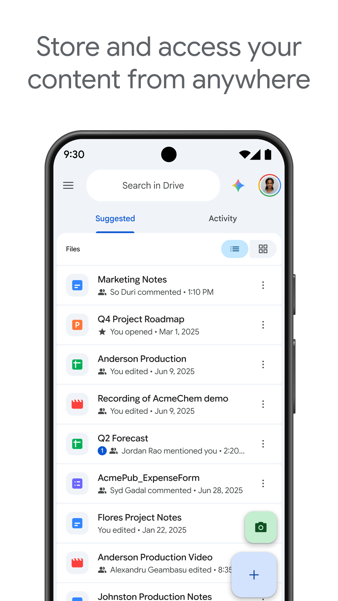

Pernahkah Anda berada dalam situasi mendesak saat harus memindahkan berkas penting dari ponsel ke komputer, namun kabel data USB tertinggal di rumah? Atau mungkin perangkat PC kantor Anda berada jauh di meja kerja, sementara Anda sedang berada di luar ruangan dan perlu mengirimkan lampiran laporan ke laptop tersebut sekarang juga?

Kendala semacam ini sangat lumrah terjadi. Selama ini kita terbiasa mengandalkan colokan kabel fisik untuk memindahkan data antar-perangkat. Namun, kabel rentan mengalami kerusakan konektor, sering kali hanya mengisi daya tanpa mendeteksi transfer data, atau bahkan berisiko membawa ancaman keamanan jika ditancapkan sembarangan ke port komputer publik.

Di era konektivitas modern, Anda tidak lagi bergantung pada kabel fisik. Mengetahui cara melakukan transfer file Android to PC online memberi Anda keleluasaan tak terbatas. Anda dapat mengirimkan dokumen kerja, folder terkompresi, rekaman video resolusi tinggi, hingga ratusan foto liburan ke komputer kapan saja dan dari mana saja, bahkan ketika kedua perangkat berada di belahan kota yang berbeda.

## Mengapa Memilih Transfer File Android ke PC Secara Online?

Banyak orang bertanya, apa keunggulan transfer daring dibanding fitur nirkabel lokal seperti Quick Share atau Bluetooth?

Jawabannya terletak pada fleksibilitas jarak dan kompatibilitas:

1. **Bebas Batasan Jarak Fisik:** Berbagi nirkabel lokal mengharuskan kedua perangkat berada dalam jarak beberapa meter dan sering kali harus terhubung ke satu router Wi-Fi yang sama. Sebaliknya, metode online memungkinkan Anda mengirim data dari ponsel di jalan raya menuju PC rumah yang menyala di meja belajar.
2. **Kualitas Asli Terjaga 100 Persen:** Mengirim file melalui aplikasi perpesanan instan seperti WhatsApp Web sering memotong ketajaman gambar dan mengompresi video hingga buram. Melalui penyimpanan online atau cloud drive, integritas file tetap utuh tanpa kompresi sedikit pun.
3. **Kompatibel Lintas Platform:** Anda tidak perlu pusing memikirkan sistem operasi komputer penerima. Baik menggunakan Windows 10, Windows 11, macOS, hingga distribusi Linux seperti Ubuntu atau Fedora, Anda cukup membuka peramban web untuk mengunduh berkas.
4. **Berfungsi Sebagai Cadangan Data:** Berkas yang Anda unggah secara daring tidak hanya berpindah ke komputer, tetapi juga tersimpan aman di cloud sebagai cadangan darurat jika ponsel mengalami kerusakan fisik.

## Panduan Langkah Demi Langkah Transfer File via Google Drive

Bagi pengguna Android, Google Drive adalah solusi transfer daring paling stabil, resmi, dan terintegrasi secara bawaan di hampir setiap perangkat tanpa perlu menginstal aplikasi pihak ketiga tambahan.

Setiap akun Google gratis mendapatkan kuota penyimpanan awan sebesar 15 GB yang dapat dimanfaatkan secara leluasa.

Berikut langkah terperinci untuk mengirimkan berkas dari HP Android ke komputer:

1. **Buka Aplikasi Google Drive di Ponsel:** Masuk ke menu aplikasi ponsel Android Anda dan buka Google Drive. Pastikan Anda sudah login ke akun Google yang biasa Anda gunakan.
2. **Pilih Berkas yang Akan Diunggah:** Di sudut kanan bawah layar, ketuk tombol mengambang bertanda plus (**+**) atau menu **Baru**, kemudian pilih menu **Upload**.
3. **Tandai File dari Penyimpanan Internal:** Telusuri galeri, folder unduhan, atau pengelola berkas internal ponsel Anda. Anda dapat memilih satu dokumen atau menahan beberapa file sekaligus untuk mengunggah secara massal.
4. **Tunggu Proses Unggah Selesai:** Sistem Android akan mulai mengunggah data ke server awan. Anda bisa melihat progres unggahan melalui bilah notifikasi di atas layar.
5. **Buka Komputer dan Akses Google Drive Web:** Di komputer atau laptop, buka peramban web andalan Anda (seperti Google Chrome, Firefox, atau Edge), lalu arahkan ke alamat `drive.google.com`.
6. **Masuk ke Akun yang Sama:** Masuk menggunakan alamat email dan kata sandi Google yang identik dengan yang terpasang di smartphone.
7. **Unduh Berkas ke Komputer:** Buka tab **Drive Saya** atau tab **Terbaru**. Klik kanan pada file yang baru saja Anda unggah dari ponsel, lalu klik opsi **Download**. File akan langsung tersimpan di folder *Downloads* komputer Anda.

*Sumber: [Bantuan Google Drive](https://support.google.com/drive/answer/2424368?hl=id)*

Metode ini sangat andal karena mendukung format berkas apa pun, mulai dari dokumen PDF, berkas spreadsheet, file presentasi PPT, hingga file arsip ZIP berukuran gigabita.

## Memanfaatkan Google Drive for Desktop untuk Sinkronisasi Otomatis

Jika Anda sering bekerja dengan alur bolak-balik antara ponsel Android dan laptop, mengunduh file secara manual lewat peramban web setiap hari mungkin terasa menyita waktu. 

Google menyediakan aplikasi resmi bernama **Google Drive for Desktop** yang dapat dipasang di Windows maupun macOS.

Dengan memasang aplikasi ini di komputer:
- Sebuah drive virtual Google Drive akan muncul langsung di dalam File Explorer Windows (layaknya flashdisk fisik).
- Kapan pun Anda mengunggah file dari HP ke folder tertentu di Google Drive, file tersebut akan otomatis tersinkronisasi ke folder komputer Anda dalam hitungan detik.
- Anda cukup membuka folder tersebut di File Explorer tanpa perlu repot membuka peramban web dan mengeklik tombol download satu per satu.

## Alternatif Cepat Transfer Online via Web Relay Tanpa Akun

Bagaimana jika Anda sedang menggunakan laptop pinjaman atau komputer kantor di mana Anda enggan memasukkan akun email pribadi karena alasan privasi?

Anda dapat memanfaatkan layanan web relay peer-to-peer berbasis peramban seperti PairDrop atau Snapdrop. Layanan berbasis web ini menggunakan teknologi WebRTC yang dapat bekerja secara online melalui ruang publik daring:

1. Buka peramban di HP Android dan buka situs penyedia web relay.
2. Buka situs yang sama di peramban komputer penerima.
3. Kedua perangkat akan saling mengenali nama panggilan unik di layar.
4. Ketuk nama komputer di layar HP Anda, pilih berkas yang ingin dikirimkan, lalu konfirmasi penerimaan di layar laptop.
5. Berkas langsung terkirim secara terenkripsi langsung antar-peramban tanpa perlu membuat akun, tanpa login kata sandi, dan tanpa meninggalkan jejak data di cloud.

## Tips Menghemat Kuota dan Menjaga Keamanan Saat Transfer Online

Melakukan transfer file Android ke PC melalui internet tentu mengonsumsi kuota data. Agar proses berjalan hemat, lancar, dan data pribadi Anda tetap aman, perhatikan beberapa tips praktis berikut:

- **Aktifkan Opsi Transfer Hanya Lewat Wi-Fi:** Di aplikasi Google Drive ponsel, masuk ke menu **Setelan**, lalu gulir ke bawah ke bagian **Penggunaan data**. Pastikan opsi **Transfer file hanya melalui Wi-Fi** diaktifkan jika Anda tidak ingin paket data seluler tersedot saat mengunggah video berukuran besar.
- **Kompres Berkas Banyak Menjadi Format ZIP:** Jika Anda ingin mengirim puluhan foto atau dokumen terpisah, manfaatkan fitur kompresi bawaan File Manager Android untuk menyatukannya ke dalam satu file ZIP sebelum diunggah. Selain membuat proses transfer lebih rapi, ukuran berkas biasanya menjadi lebih padat.
- **Bersihkan File Sementara dari Cloud:** Setelah berkas selesai diunduh dan tersimpan aman di komputer PC, biasakan menghapus salinan file yang sudah tidak terpakai dari Google Drive Anda. Langkah sederhana ini menjaga agar kuota gratis 15 GB tetap lega untuk keperluan pencadangan lainnya.
- **Waspadai Jaringan Wi-Fi Publik:** Jika Anda mentransfer dokumen sensitif atau berkas pekerjaan rahasia di jaringan Wi-Fi umum (seperti di kafe atau bandara), pastikan situs peramban yang diakses menggunakan protokol HTTPS dengan ikon gembok terkunci.

Memanfaatkan metode transfer file daring memberi Anda kebebasan bekerja yang sesungguhnya. Tanpa kabel yang kusut dan tanpa batasan jarak fisik, alur pemindahan berkas antara smartphone Android dan komputer menjadi jauh lebih ringkas, aman, dan fleksibel.

Sumber: [Bantuan Google Drive](https://support.google.com/drive/answer/2424368?hl=id)
