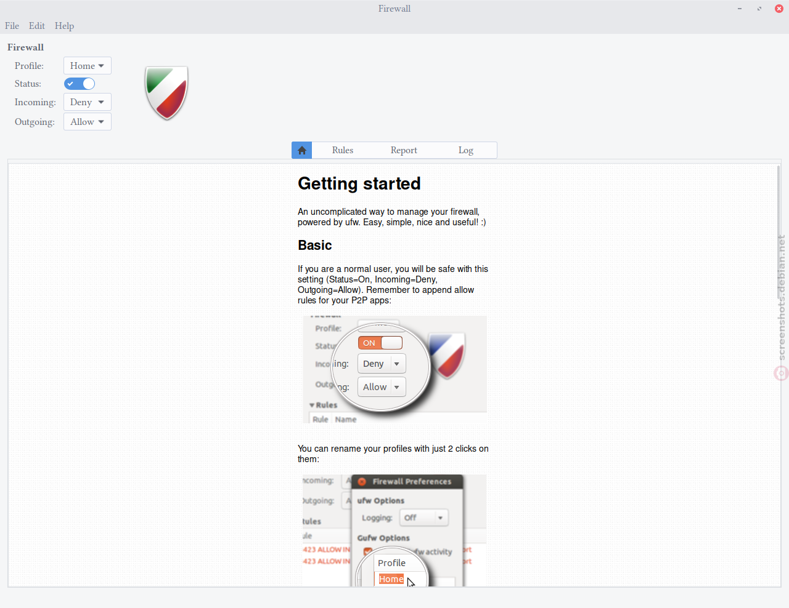

Bagi para pengguna Linux yang baru bermigrasi ke Debian dari distro turunan seperti Ubuntu, ada satu perbedaan mencolok yang sering kali terlewat saat baru selesai instalasi server: ketiadaan frontend firewall bawaan yang langsung aktif. Jika di Ubuntu Server perkakas UFW (Uncomplicated Firewall) biasanya sudah siap pakai sejak awal, Debian minimal (netinst) sengaja membiarkan sistemnya sangat bersih tanpa banyak paket pra-instalasi.

Ketiadaan firewall aktif di server yang langsung terhubung ke internet publik tentu menyimpan risiko tinggi. Bot scanner otomatis di jagat maya terus menerus menyisir port terbuka untuk mencari celah masuk, mulai dari layanan database, Redis, hingga port remote SSH.

Mengonfigurasi aturan filter paket langsung menggunakan tabel nftables atau sintaks iptables murni sering kali terasa rumit bagi sebagian sysadmin maupun penghuni homelab. Di sinilah UFW hadir sebagai penyelamat. UFW bertindak sebagai frontend ramah manusia yang membungkus netfilter Linux, sehingga ente bisa mengontrol keamanan lalu lintas jaringan hanya dengan beberapa baris perintah ringkas dan mudah dipahami.

Berikut panduan langkah demi langkah menyetel ufw firewall debian secara aman, mulai dari instalasi, pembuatan aturan whitelist, hingga penanganan kendala yang kerap bikin panik.

## Mengapa Server Debian Butuh UFW?

Secara default, kernel Debian modern memanfaatkan kerangka kerja netfilter melalui subsistem nftables. Meskipun nftables sangat fleksibel dan berkinerja tinggi, struktur sintaksisnya menuntut pemahaman mendalam tentang rantai paket (chains), tabel (tables), serta prioritas hook.

UFW menyederhanakannya ke dalam konsep berorientasi aturan (rule-based). Karakteristik utama UFW meliputi:

1. **Prinsip Whitelist Sederhana:** Menolak semua paket masuk asing dan hanya membuka pintu untuk layanan yang secara eksplisit ente izinkan.
2. **Dukungan Ganda IPv4 dan IPv6:** Aturan yang ente buat langsung diterapkan serentak ke protokol IPv4 dan IPv6 tanpa perlu menuliskan konfigurasi terpisah.
3. **Manajemen Profil Aplikasi:** Menyediakan definisi bawaan untuk aplikasi populer seperti OpenSSH, Apache, Nginx, dan CUPS.
4. **Ringan dan Terintegrasi:** Berjalan di atas lapisan sistem Debian tanpa membebani konsumsi memori RAM server.

| Karakteristik | Raw nftables/iptables | UFW (Uncomplicated Firewall) |
|---|---|---|
| Kompleksitas Sintaks | Tinggi, butuh skrip rantai tabel | Rendah, perintah bahasa manusia |
| Penanganan IPv6 | Butuh tabel terpisah pada iptables | Otomatis sinkron via berkas konfigurasi |
| Kurva Pembelajaran | Butuh waktu mempelajari manual | Siap digunakan dalam hitungan menit |
| Konsumsi Sumber Daya | Sangat minim di level kernel | Sangat ringan, hanya skrip manajemen |

## Prasyarat Sebelum Konfigurasi

Sebelum mengeksekusi perintah konfigurasi, pastikan server ente memenuhi beberapa hal dasar berikut:

- Sistem operasi Debian 11 (Bullseye), Debian 12 (Bookworm), atau Debian 13 (Trixie).
- Akun pengguna dengan hak akses administratif (`sudo`) atau akses langsung sebagai pengguna `root`.
- Akses terminal lokal atau koneksi SSH yang stabil.
- Catatan nomor port layanan yang sedang berjalan di server (misalnya port SSH custom jika tidak memakai port 22 standar).

Satu aturan paling mendasar yang wajib diingat: **jangan pernah menyalakan UFW sebelum aturan izin akses port SSH terpasang**. Jika ente menyalakan UFW dalam keadaan kebijakan default menolak semua koneksi masuk tanpa membuka SSH, sesi terminal jarak jauh ente akan seketika terputus dan server terkunci total.

## Langkah Konfigurasi UFW di Debian

Ikuti urutan langkah di bawah ini secara disiplin agar proses pengamanan berjalan lancar tanpa risiko terkunci dari remote shell.

### 1. Instal Paket UFW Melalui APT

Di Debian, paket UFW tersedia langsung pada repositori resmi `main`. Lakukan pembaruan indeks repositori lalu pasang paketnya:

```bash
sudo apt update
sudo apt install ufw -y
```

Setelah proses instalasi selesai, UFW berada dalam status belum aktif (inactive) dan layanannya belum memblokir port apa pun.

### 2. Periksa Konfigurasi Dukungan IPv6

Sebelum menetapkan aturan, pastikan UFW disetel untuk mengamankan lalu lintas IPv6 bersamaan dengan IPv4. Hal ini penting karena server di era sekarang kerap mendapatkan alokasi alamat publik IPv6 dari penyedia VPS atau ISP.

Buka berkas konfigurasi default UFW:

```bash
sudo nano /etc/default/ufw
```

Cari baris yang mengatur opsi `IPV6` dan pastikan nilainya adalah `yes`:

```ini
IPV6=yes
DEFAULT_INPUT_POLICY="DROP"
DEFAULT_OUTPUT_POLICY="ACCEPT"
DEFAULT_APPLICATION_POLICY="SKIP"
MANAGE_BUILTINS="no"
```

Jika nilainya sudah `yes`, simpan dan tutup editor berkas. Dengan setelan ini, setiap kali ente membuka suatu port, UFW akan membuatkan aturan filter kembar untuk IPv4 dan IPv6.

### 3. Amankan Akses Port SSH (Langkah Paling Krusial)

Ini adalah langkah pencegahan paling vital. Ente harus mendaftarkan port SSH ke dalam daftar izin sebelum mengaktifkan firewall.

Jika server ente menggunakan port SSH standar (port 22), jalankan perintah:

```bash
sudo ufw allow 22/tcp comment 'Akses SSH Administrasi'
```

Atau jika ente ingin memanfaatkan fitur proteksi brute-force bawaan UFW, gunakan opsi `limit`:

```bash
sudo ufw limit 22/tcp comment 'Limit brute force SSH'
```

Perintah `limit` akan menolak koneksi dari alamat IP yang mencoba melakukan percobaan login lebih dari 6 kali dalam kurun waktu 30 detik. Ini sangat ampuh menepis serangan pembobolan kata sandi otomatis.

Apabila server ente menggunakan port SSH non-standar, misalnya port `2222`, buka port tersebut secara spesifik:

```bash
sudo ufw allow 2222/tcp comment 'Akses SSH Custom'
```

### 4. Terapkan Kebijakan Default Deny dan Allow Outgoing

Pendekatan keamanan terbaik pada firewall server adalah menutup semua pintu masuk secara total, lalu hanya membuka celah yang benar-benar dibutuhkan oleh aplikasi yang sedang aktif.

Terapkan dua kebijakan default berikut:

```bash
sudo ufw default deny incoming
sudo ufw default allow outgoing
```

Penjelasan dari kedua kebijakan di atas:
- **`default deny incoming`**: Semua paket data yang berasal dari luar menuju ke server akan otomatis ditolak dan dibuang (drop).
- **`default allow outgoing`**: Semua paket data yang diinisiasi oleh server ke arah luar (seperti update sistem via apt, kueri DNS, atau pemanggilan API eksternal) tetap diizinkan tanpa hambatan.

### 5. Buka Port Layanan Penting Lainnya

Jika server Debian ente difungsikan sebagai web server, peladen aplikasi, atau database, buka port pendukungnya sebelum menyalakan proteksi utama.

#### Membuka Port Web Server (HTTP dan HTTPS)

Untuk layanan situs web, buka port 80 dan port 443:

```bash
sudo ufw allow 80/tcp comment 'Web HTTP'
sudo ufw allow 443/tcp comment 'Web HTTPS'
```

Ente juga bisa membuka rentang port sekaligus menggunakan format rentang:

```bash
sudo ufw allow 8000:8080/tcp comment 'Port Layanan Aplikasi'
```

#### Membatasi Akses Hanya untuk IP Tertentu

Untuk layanan sensitif seperti database MySQL (port 3306) atau PostgreSQL (port 5432), jangan pernah membukanya untuk umum (`anywhere`). Batasi akses agar hanya alamat IP kantor atau subnet lokal homelab ente yang diizinkan:

```bash
sudo ufw allow from 192.168.1.50 to any port 3306 proto tcp comment 'MySQL dev lokal'
```

Atau untuk satu segmen subnet IP:

```bash
sudo ufw allow from 192.168.1.0/24 to any port 5432 proto tcp comment 'PostgreSQL LAN'
```

### 6. Aktifkan UFW dan Pastikan Service Systemd Berjalan

Setelah seluruh aturan dasar dan port SSH dipastikan terdaftar, saatnya menyalakan firewall:

```bash
sudo ufw enable
```

Sistem akan memunculkan peringatan konfirmasi:

```text
Command may disrupt existing ssh connections. Proceed with operation (y|n)? y
Firewall is active and enabled on system startup
```

Ketik `y` lalu tekan Enter. Karena ente sudah mendaftarkan port SSH pada langkah sebelumnya, koneksi terminal ente akan tetap aman dan tidak terputus.

Di Debian, pastikan pula unit layanan systemd UFW telah diaktifkan agar aturan langsung dimuat saat server mengalami restart:

```bash
sudo systemctl enable ufw
sudo systemctl status ufw
```

## Memeriksa Status dan Mengelola Aturan

Untuk memastikan aturan yang terpasang sudah sesuai dengan perencanaan, jalankan perintah pengecekan status:

```bash
sudo ufw status verbose
```

Luaran terminal akan menampilkan ringkasan kebijakan default, status pencatatan log, serta rincian port yang terbuka untuk protokol IPv4 maupun IPv6.

Jika suatu saat ente ingin menghapus aturan lama yang sudah tidak terpakai, tampilkan daftar aturan beserta nomor indeksnya:

```bash
sudo ufw status numbered
```

Terminal akan menampilkan daftar bernomor seperti contoh berikut:

```text
Status: active

     To                         Action      From
     --                         ------      ----
[ 1] 22/tcp                     LIMIT IN    Anywhere                   # Limit brute force SSH
[ 2] 80/tcp                     ALLOW IN    Anywhere                   # Web HTTP
[ 3] 443/tcp                    ALLOW IN    Anywhere                   # Web HTTPS
[ 4] 22/tcp (v6)                LIMIT IN    Anywhere (v6)              # Limit brute force SSH
[ 5] 80/tcp (v6)                ALLOW IN    Anywhere (v6)              # Web HTTP
[ 6] 443/tcp (v6)               ALLOW IN    Anywhere (v6)              # Web HTTPS
```

Untuk menghapus aturan web HTTP pada nomor urut 2, jalankan:

```bash
sudo ufw delete 2
```

Setelah menghapus atau memodifikasi aturan, muat ulang konfigurasi tanpa perlu me-restart server:

```bash
sudo ufw reload
```

## Pilihan Antarmuka Grafis Menggunakan Gufw

Bagi pengguna Debian Desktop atau workstation yang lebih menyukai antarmuka visual dibandingkan baris perintah, Debian menyediakan paket `gufw`. Paket ini merupakan antarmuka grafis resmi berbasis GTK yang berjalan di atas UFW.

```bash
sudo apt install gufw -y
```

Setelah terpasang, aplikasi dapat dijalankan dari menu sistem dengan nama Firewall Configuration atau melalui terminal dengan mengetikkan `gufw`.


*Sumber: [Debian Screenshots](https://screenshots.debian.net/package/gufw)*

Melalui antarmuka Gufw, ente bisa melihat status aktif firewall, mengganti profil aturan (Home, Office, Public), serta memantau log lalu lintas paket secara visual.

## Cara Verifikasi dan Uji Coba

Jangan berasumsi bahwa firewall sudah bekerja sempurna hanya karena statusnya menunjukkan tulisan `active`. Lakukan pengujian langsung dari komputer lain yang berada di luar server.

### 1. Uji Port Terbuka Menggunakan Netcat

Dari komputer klien atau laptop ente, jalankan pengujian konektivitas port:

```bash
nc -zv <alamat_ip_server_debian> 22
nc -zv <alamat_ip_server_debian> 80
```

Jika port memang dibuka, netcat akan mengeluarkan pesan konfirmasi koneksi berhasil.

### 2. Uji Port yang Seharusnya Tertutup

Coba uji port acak yang tidak pernah ente izinkan, misalnya port 8080 atau 3306:

```bash
nc -zv -w 3 <alamat_ip_server_debian> 8080
```

Jika aturan firewall bekerja sesuai rancangan, perintah tersebut akan mengalami timeout atau penolakan koneksi tanpa respons balik.

### 3. Pemindaian Port Menggunakan Nmap

Ente juga bisa memanfaatkan nmap dari mesin klien untuk melihat profil port server secara menyeluruh:

```bash
nmap -Pn -p 22,80,443,3306 <alamat_ip_server_debian>
```

Port yang diblokir oleh UFW akan berstatus `filtered`, yang menandakan bahwa paket probe dibuang tanpa memberikan informasi apa pun kepada pihak luar.

## Solusi Kendala Umum

Saat mengelola firewall di lingkungan Debian, beberapa kendala umum berikut kerap ditemui oleh sysadmin:

### 1. Terkunci dari Koneksi SSH

Jika ente terlanjur menyalakan UFW sebelum membuka port SSH, koneksi terminal remote akan tertolak. Solusi tercepat adalah mengakses server melalui fitur web console (VNC atau Serial Console) yang disediakan oleh panel kendali penyedia VPS (seperti Linode Lish, DigitalOcean Console, atau Proxmox NoVNC).

Setelah berhasil masuk ke sesi tty lokal melalui konsol web, nonaktifkan firewall sementara:

```bash
sudo ufw disable
```

Lalu tambahkan aturan SSH yang benar sebelum menyalakannya kembali.

### 2. Aturan UFW Tidak Berjalan Setelah Reboot

Pada beberapa instalasi Debian yang sangat minimal, paket `iptables` versi legacy terkadang bentrok dengan backend `nftables`. Pastikan alternatif iptables di Debian mengarah ke `iptables-nft`:

```bash
sudo update-alternatives --set iptables /usr/sbin/iptables-nft
sudo update-alternatives --set ip6tables /usr/sbin/ip6tables-nft
```

Pastikan pula service systemd aktif saat boot dengan perintah `sudo systemctl enable ufw`.

### 3. Log UFW Memenuhi Ruang Disk

Jika log firewall terlalu cerewet dan mencatat setiap paket broadcast jaringan lokal hingga membuat partisi log di /var/log cepat penuh, turunkan level pencatatan log ke tingkat rendah (low):

```bash
sudo ufw logging low
```

Atau matikan pencatatan log jika memang tidak sedang melakukan investigasi jaringan:

```bash
sudo ufw logging off
```

Dengan konfigurasi di atas, server Debian ente kini memiliki sistem pertahanan garis depan yang solid, efisien, dan mudah dikelola tanpa harus berkutat dengan sintaks tabel paket yang rumit.

Sumber: [Debian Wiki](https://wiki.debian.org/Uncomplicated%20Firewall%20%28ufw%29)
