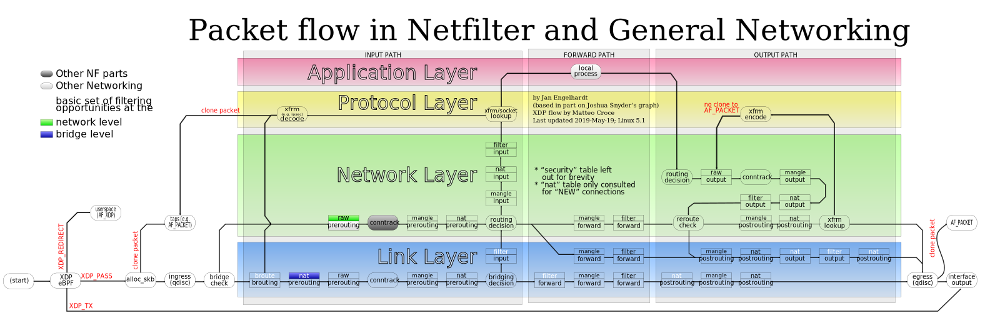

Bagi sebagian besar administrator sistem dan penggiat homelab, mengamankan server Linux dari paparan trafik liar internet sering kali diawali dengan mengetikkan perintah `iptables` atau memakai wrapper sederhana seperti UFW. Perintah warisan Netfilter tersebut sudah menemani ekosistem Linux selama lebih dari dua dekade. Namun, jika ente memeriksa distribusi Linux modern beberapa tahun belakangan ini, mulai dari Debian, Ubuntu, Red Hat Enterprise Linux, hingga Arch Linux, fondasi penyaringan paket di level kernel sebenarnya sudah beralih total.

Perubahan mendasar ini sering memicu tanda tanya besar di kalangan teknisi jaringan, terutama bagi yang baru menyelami pengelolaan server tingkat lanjut: sebenarnya **what is nftables in linux**, mengapa tim pengembang kernel Linux dan Netfilter memutuskan merombak tatanan lama, dan apa keuntungan nyata yang kita dapatkan saat beralih ke teknologi modern ini?

Kebutuhan akan performa tinggi, efisiensi pemrosesan paket, serta kemudahan administrasi tumpukan ganda IPv4 dan IPv6 menjadi pendorong utama lahirnya nftables. Kali ini, ane ingin membedah tuntas seluk-beluk arsitektur nftables, perbandingannya dengan iptables lawas, serta panduan praktis membangun firewall mandiri yang tangguh dan siap produksi langsung dari terminal.

## Memahami What Is Nftables In Linux dan Alasan Menggantikan Iptables

Secara teknis, jawaban paling lugas untuk pertanyaan **what is nftables in linux** adalah bahwa nftables merupakan subsistem penyaringan paket (packet filtering) dan klasifikasi jaringan modern yang berjalan langsung di dalam kernel Linux sejak versi 3.13. Proyek ini dikembangkan oleh tim Netfilter resmi sebagai pengganti menyeluruh untuk ekosistem lawas yang terpecah, yaitu `iptables` (IPv4), `ip6tables` (IPv6), `arptables` (ARP), dan `ebtables` (Ethernet Bridge).

Di masa kejayaan iptables, ada beberapa kelemahan arsitektural mendasar yang mulai membebani sistem Linux modern:

1. **Fragmentasi Perangkat Alat:** Di masa lalu, jika ente ingin mengamankan server yang menjalankan dual-stack IPv4 dan IPv6, ente terpaksa menulis dua berkas aturan terpisah menggunakan dua utilitas biner berbeda (`iptables` dan `ip6tables`). Logika penyaringan terduplikasi, rawan salah ketik, dan menyita waktu perawatan.
2. **Kinerja dan Pembaruan Monolitik:** Setiap kali ada satu baris aturan iptables yang ditambahkan atau dihapus, keseluruhan tabel penyaringan di ruang kernel harus diekspor, dimodifikasi dalam bentuk blob biner besar, lalu disuntikkan kembali secara utuh. Pada server dengan ribuan aturan penyaringan, proses ini menyebabkan lonjakan latensi (latency spikes) dan tidak efisien.
3. **Pencocokan Aturan yang Kaku:** Logika pencocokan paket pada iptables terpaku pada modul-modul kode C terpisah yang ditanam di kernel. Setiap opsi protokol membutuhkan modul kernel tersendiri.

nftables mengatasi semua permasalahan tersebut dengan pendekatan arsitektur yang sangat elegan. Alih-alih menaruh logika protokol yang kaku di kernel, kernel Linux menyediakan mesin virtual (pseudo-virtual machine) berkecepatan tinggi yang hanya mengeksekusi instruksi bytecode sederhana. Perangkat baris perintah di ruang pengguna, yaitu utilitas biner `nft`, bertindak layaknya sebuah compiler. Perintah teks yang ente ketikkan diterjemahkan oleh `nft` menjadi serangkaian bytecode instruksi register, lalu dikirimkan ke kernel melalui soket Netlink secara atomik.

Pembaruan aturan di nftables bersifat transaksional berbasis linked list. Ente dapat menambahkan, mengubah, atau menghapus ratusan aturan sekaligus dalam satu commit atomik tanpa pernah mengganggu aliran paket data yang sedang aktif.


*Sumber: [Wikimedia Commons / Netfilter Project](https://commons.wikimedia.org/wiki/File:Netfilter-packet-flow.svg)*

## Memahami Hubungan Hook Netfilter dengan Address Family

Meskipun nftables memperkenalkan mesin virtual baru, subsistem ini tetap memanfaatkan infrastruktur inti Netfilter yang sudah teruji, seperti mekanisme pelacakan koneksi (conntrack), mesin Network Address Translation (NAT), dan titik kait paket (Netfilter hooks).

Paket data yang melintasi tumpukan jaringan Linux akan melewati lima titik kait utama:

- **Prerouting:** Titik evaluasi pertama begitu paket diterima oleh antarmuka jaringan sebelum proses routing internal menentukan tujuan paket.
- **Input:** Titik evaluasi untuk paket data yang tujuannya memang ditujukan ke proses lokal atau soket aplikasi di server itu sendiri.
- **Forward:** Titik evaluasi untuk paket data yang hanya melintas di server Linux, misalnya saat server difungsikan sebagai router atau gateway.
- **Output:** Titik evaluasi untuk paket data baru yang dibuat oleh proses lokal di dalam server sebelum dikirim ke luar.
- **Postrouting:** Titik evaluasi akhir setelah keputusan rute diambil dan paket siap ditembakkan keluar melalui antarmuka fisik.

Satu kelebihan utama nftables adalah hadirnya address family bernama `inet`. Dengan tabel bertipe `inet`, satu rantai aturan input dapat secara otomatis menyaring lalu lintas IPv4 dan IPv6 sekaligus. Ente tidak perlu lagi menduplikasi aturan port SSH atau proteksi DoS untuk kedua protokol alamat IP tersebut.

## Struktur Hierarki Tabel Chain dan Ruleset nftables

Perbedaan paling mencolok antara iptables dan nftables yang kerap membuat bingung sysadmin pemula adalah ketiadaan tabel atau rantai bawaan (default tables and chains).

Pada iptables lawas, kernel secara otomatis menyediakan tabel statis bernama `filter`, `nat`, `mangle`, dan `raw` lengkap dengan rantai `INPUT`, `FORWARD`, dan `OUTPUT`. Rantai-rantai ini akan tetap terdaftar dan memakan siklus evaluasi kernel meskipun ente tidak memasukkan satu pun aturan di dalamnya.

Sebaliknya, pada nftables lembaran konfigurasi benar-benar bersih sejak awal. Jika ente baru memasang nftables dan belum membuat aturan, ruang kernel tidak memiliki tabel apa pun. Ente memegang kendali penuh atas:

- **Tables:** Wadah logis (namespace) untuk mengelompokkan rantai aturan berdasarkan address family (`ip`, `ip6`, `inet`, `arp`, `bridge`, atau `netdev`).
- **Base Chains:** Rantai aturan yang didaftarkan langsung ke salah satu hook Netfilter kernel dengan nilai prioritas dan kebijakan standar (default policy seperti `accept` atau `drop`).
- **Regular Chains:** Rantai pembantu yang tidak terikat langsung ke hook kernel, melainkan digunakan sebagai target lompatan (jump target) untuk merapikan alur logika penyaringan.
- **Sets dan Dictionaries:** Struktur data canggih di nftables yang memungkinkan pengelompokan alamat IP, subnet, atau nomor port dalam satu baris aturan dengan pencarian berkecepatan tinggi O(1) berbasis hash atau red-black tree.

## Langkah Instalasi dan Persiapan nftables di Linux

Sebelum mulai mengonfigurasi aturan, mari siapkan paket nftables pada sistem operasi Linux ente. Sebagian besar distribusi modern sudah menyertakan nftables di repositori resmi.

### 1. Instalasi Paket pada Berbagai Distro

Untuk keluarga Debian atau Ubuntu:
```bash
sudo apt update
sudo apt install -y nftables
```

Untuk keluarga RHEL, Rocky Linux, AlmaLinux, atau Fedora:
```bash
sudo dnf install -y nftables
```

Untuk Arch Linux:
```bash
sudo pacman -S --noconfirm nftables
```

### 2. Mematikan Firewall Konvensional

Jika sistem Linux ente sebelumnya mengaktifkan wrapper seperti UFW atau firewalld, nonaktifkan layanan tersebut agar tidak menimbulkan benturan aturan di level kernel:

```bash
sudo ufw disable
```

Atau jika menggunakan distribusi berbasis RHEL dengan firewalld:
```bash
sudo systemctl disable firewalld
```

### 3. Memverifikasi Dukungan Modul Kernel

Pastikan modul kernel `nf_tables` sudah dimuat dengan benar di sistem Linux:

```bash
lsmod | grep nf_tables
```

Bila modul sudah muncul pada output terminal, sistem Linux ente siap menerima konfigurasi nftables.

## Panduan Konfigurasi Firewall Praktis Langkah demi Langkah

Mari kita bangun sebuah konfigurasi firewall server yang aman dengan menerapkan prinsip whitelisting, yaitu memblokir seluruh paket masuk secara default dan hanya mengizinkan trafik yang benar-benar kita perlukan.

### 1. Bersihkan Ruleset yang Sedang Aktif

Langkah pertama adalah membersihkan seluruh tabel dan aturan lama agar konfigurasi dimulai dari keadaan kosong:

```bash
sudo nft flush ruleset
```

### 2. Buat Tabel Terpadu IPv4 dan IPv6

Kita gunakan family `inet` dengan nama tabel `filter`:

```bash
sudo nft add table inet filter
```

### 3. Daftarkan Base Chain dengan Default Policy

Selanjutnya, buat rantai `input`, `forward`, dan `output`. Kita tetapkan kebijakan standar `drop` untuk rantai input dan forward guna mencegah akses liar, sedangkan rantai output diizinkan (`accept`) agar server dapat leluasa mengunduh paket update ke luar:

```bash
sudo nft add chain inet filter input { type filter hook input priority 0 \; policy drop \; }
sudo nft add chain inet filter forward { type filter hook forward priority 0 \; policy drop \; }
sudo nft add chain inet filter output { type filter hook output priority 0 \; policy accept \; }
```

### 4. Izinkan Trafik Loopback dan Koneksi Aktif

Server Linux membutuhkan antarmuka lokal `lo` untuk komunikasi internal antar layanan, seperti koneksi database lokal atau worker queue. Selain itu, kita wajib mengizinkan paket balasan dari koneksi yang sudah terjalin sebelumnya:

```bash
sudo nft add rule inet filter input iif "lo" accept
sudo nft add rule inet filter input ct state established,related accept
sudo nft add rule inet filter input ct state invalid drop
```

Aturan `ct state invalid drop` sangat efektif menangkis paket-paket rusak atau manipulasi TCP flag scanning.

### 5. Izinkan Protokol Diagnostik ICMP

Agar server tetap bisa dipantau kesehatannya melalui utilitas ping tanpa membuka celah berbahaya, izinkan paket ICMP echo-request untuk IPv4 dan IPv6:

```bash
sudo nft add rule inet filter input ip protocol icmp icmp type echo-request accept
sudo nft add rule inet filter input ip6 nexthdr ipv6-icmp icmpv6 type echo-request accept
```

### 6. Buka Port Layanan Menggunakan Set Sintaks Ringkas

Di sinilah keunggulan sintaks nftables bersinar terang. Di iptables, untuk membuka port 22 (SSH), port 80 (HTTP), dan port 443 (HTTPS), ente harus menulis tiga baris perintah terpisah. Di nftables, kita cukup memanfaatkan konstruksi himpunan kurung kurawal `{ ... }`:

```bash
sudo nft add rule inet filter input tcp dport { 22, 80, 443 } accept
```

Jika server ente menjalankan WireGuard VPN pada port UDP 51820, tambahkan baris sederhana berikut:

```bash
sudo nft add rule inet filter input udp dport 51820 accept
```

## Menyimpan Konfigurasi Permanen dan Otomatisasi Systemd

Perintah baris `nft` yang kita jalankan di terminal di atas langsung diterapkan ke memori kernel, namun aturan tersebut akan hilang jika server di-reboot. Kita perlu menyimpan ruleset tersebut ke dalam berkas konfigurasi permanen distribusi Linux, umumnya berlokasi di `/etc/nftables.conf`.

Ekspor aturan aktif saat ini ke berkas konfigurasi:

```bash
sudo nft list ruleset | sudo tee /etc/nftables.conf
```

Jika kita periksa isi berkas `/etc/nftables.conf`, strukturnya tersusun rapi dalam blok hierarkis yang sangat nyaman dibaca manusia:

```text
#!/usr/sbin/nft -f

flush ruleset

table inet filter {
	chain input {
		type filter hook input priority filter; policy drop;
		iif "lo" accept
		ct state established,related accept
		ct state invalid drop
		ip protocol icmp icmp type echo-request accept
		ip6 nexthdr ipv6-icmp icmpv6 type echo-request accept
		tcp dport { 22, 80, 443 } accept
		udp dport 51820 accept
	}

	chain forward {
		type filter hook forward priority filter; policy drop;
	}

	chain output {
		type filter hook output priority filter; policy accept;
	}
}
```

Setelah berkas konfigurasi tersimpan, aktifkan layanan systemd nftables agar aturan dimuat otomatis setiap kali sistem menyala:

```bash
sudo systemctl enable nftables
sudo systemctl start nftables
```

## Pengujian dan Cara Verifikasi Aturan Firewall

Untuk memastikan konfigurasi berjalan sesuai rancangan, berikut beberapa perintah verifikasi yang wajib dikuasai sysadmin:

### 1. Menampilkan Ruleset Lengkap dengan Handle

Setiap aturan di nftables memiliki identifikasi angka unik bernama handle. Handle ini digunakan saat kita ingin menghapus satu aturan tertentu tanpa merusak aturan lainnya:

```bash
sudo nft -a list table inet filter
```

Jika ente ingin menghapus aturan tertentu, gunakan nomor handle yang tertera:

```bash
sudo nft delete rule inet filter input handle 5
```

### 2. Memeriksa Counter Paket dan Pengujian Sintaks

Ente bisa menambahkan parameter `counter` pada aturan untuk memantau berapa banyak paket data dan total byte yang cocok dengan aturan tersebut.

Sebelum menerapkan perubahan manual pada berkas `/etc/nftables.conf`, selalu uji sintaksnya terlebih dahulu dengan flag dry-run `-c`:

```bash
sudo nft -c -f /etc/nftables.conf
```

Jika tidak ada pesan kesalahan yang muncul, berarti struktur berkas valid dan aman untuk di-reload menggunakan perintah:

```bash
sudo nft -f /etc/nftables.conf
```

## Solusi Kendala Umum (Troubleshooting)

Saat mengelola nftables di lingkungan produksi, ada beberapa kendala teknis yang kerap dijumpai:

### 1. Sesi Remote SSH Terputus Seketika

- **Penyebab:** Urutan pengetikan perintah yang keliru, misalnya menetapkan kebijakan `policy drop` pada rantai input sebelum aturan SSH atau `established,related` dimasukkan ke tabel.
- **Solusi:** Selalu buat seluruh aturan perizinan terlebih dahulu, atau gabungkan seluruh definisi rantai dalam satu berkas skrip lalu eksekusi sekaligus via `nft -f`. Jangan pernah menetapkan default policy drop di sesi SSH interaktif tanpa memastikan port 22 sudah terdaftar.

### 2. Bentrok dengan Container Docker

- **Penyebab:** Docker secara default mengelola aturan port forwarding dan NAT menggunakan iptables legacy, yang terkadang membingungkan sysadmin saat memeriksa tabel nftables.
- **Solusi:** Pastikan paket `iptables-nft` terpasang di sistem Linux. Paket ini menyediakan shim penerjemah sehingga perintah iptables yang dipanggil oleh daemon Docker otomatis dikonversi menjadi objek native di kernel nf_tables tanpa benturan arsitektur.

### 3. Masalah Blokir Trafik IPv6 yang Tidak Disengaja

- **Penyebab:** Menulis aturan dengan asumsi hanya IPv4, padahal penyedia hosting atau VPS menyediakan alamat IPv6 publik. Akibatnya, paket Neighbor Discovery Protocol (NDP) terblokir dan koneksi IPv6 mati total.
- **Solusi:** Saat menyusun tabel `inet`, pastikan paket ICMPv6 penting tidak diblokir. Selain `echo-request`, izinkan pula tipe paket NDP jika server berada di lingkungan jaringan IPv6 dinamis.

Beralih dari iptables ke nftables bukan sekadar mengikuti tren pembaruan software, melainkan langkah penting untuk membangun infrastruktur server Linux yang lebih tangkas, terpadu, dan hemat konsumsi memori kernel.

Sumber: [Netfilter nftables Documentation](https://wiki.nftables.org/wiki-nftables/index.php/Main_Page)
