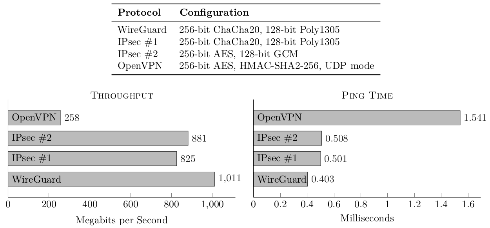

Menghubungkan mesin Linux ke jaringan privat virtual (VPN) sering kali menghadapi tantangan teknis saat mengandalkan protokol warisan seperti OpenVPN atau IPsec. Protokol generasi lama tersebut menuntut manajemen Certificate Authority (CA) yang kompleks, proses handshaking yang lambat, serta dependensi daemon user space yang memicu beban CPU dan konsumsi daya tinggi. WireGuard merevolusi arsitektur jaringan privat dengan beroperasi langsung di dalam kernel space Linux (in-tree sejak kernel Linux 5.6). Pendekatan ini menghasilkan terowongan komunikasi terenkripsi yang ramping, memiliki latensi amat rendah, dan throughput mendekati batas fisik antarmuka jaringan.

Menerapkan **wireguard linux client setup** langsung melalui antarmuka baris perintah (CLI) memberikan keandalan maksimal bagi administrator sistem, pengelola server edge, maupun pengguna workstation. Tanpa ketergantungan pada modul grafis desktop environment atau NetworkManager yang kerap inkonsisten antar distro, utilitas `wg-quick` menyajikan otomasi konfigurasi rute, penetapan antarmuka jaringan virtual `wg0`, serta pengelolaan DNS resolver secara deklaratif dalam satu file konfigurasi bersih.

Panduan ini mengupas tuntas proses setup WireGuard client pada sistem operasi Linux, mulai dari pembuatan pasangan kunci kriptografi mandiri, pembedahan parameter konfigurasi file `wg0.conf`, integrasi daemon otomatis dengan systemd, hingga verifikasi status transfer dan penanganan kendala rute jaringan.
## Prasyarat Lingkungan Sistem

Sebelum memulai konfigurasi di terminal, pastikan stasiun kerja atau server klien Anda telah memenuhi beberapa persyaratan teknis berikut:

- Sistem operasi Linux modern dengan kernel 5.6 ke atas (Debian 11/12, Ubuntu 20.04/22.04/24.04, Fedora 38+, Arch Linux, atau CentOS Stream).
- Hak akses root atau akun pengguna dengan hak administratif sudo.
- Utilitas jaringan dasar `iproute2` dan resolver DNS seperti `resolvconf` atau `systemd-resolved`.
- Kredensial dan data koneksi dari sisi server WireGuard yang mencakup Public Key server, IP Publik atau domain endpoint beserta port UDP listening (contoh `203.0.113.10:51820`), serta alokasi subnet IP internal untuk klien (contoh `10.8.0.2/24`).
## Langkah 1: Instalasi Paket WireGuard dan Tools Pendukung

WireGuard telah menjadi bagian integral dari kernel Linux resmi. Oleh karena itu, Anda hanya perlu memasang perkakas manajemen antarmuka pengguna (`wireguard-tools`) dan paket resolusi nama domain.

Jalankan perintah instalasi yang sesuai dengan distribusi Linux yang Anda gunakan di bawah ini:

Untuk Debian, Ubuntu, dan distro turunannya:

```bash
apt update
apt install -y wireguard wireguard-tools resolvconf
```

Untuk Fedora, Red Hat Enterprise Linux (RHEL), atau Rocky Linux:

```bash
dnf install -y wireguard-tools
```

Untuk Arch Linux dan Manjaro:

```bash
pacman -S --needed wireguard-tools
```

Setelah instalasi selesai, verifikasi bahwa modul kernel WireGuard telah tersedia dan termuat dengan benar ke dalam memori sistem:

```bash
modprobe wireguard
lsmod | grep wireguard
```

Jika output menampilkan modul `wireguard`, sistem kernel Anda telah siap sepenuhnya menangani enkapsulasi paket UDP secara native.
## Langkah 2: Generate Pasangan Kunci Kriptografi Klien

Prinsip keamanan WireGuard berpijak pada kriptografi kurva eliptis Curve25519 melalui konsep Cryptokey Routing. Setiap node jaringan diidentifikasi secara unik oleh pasangan kunci publik (Public Key) dan kunci privat (Private Key).

Kunci privat klien harus tetap tersimpan rahasia di dalam mesin lokal dan tidak boleh dibagikan kepada pihak mana pun. Kunci publik adalah nilai yang diserahkan kepada administrator server WireGuard agar dapat didaftarkan pada konfigurasi server tujuan.

Buat direktori konfigurasi WireGuard dengan hak akses yang terisolasi ketat, lalu hasilkan pasangan kunci kriptografi menggunakan perintah bawaan `wg`:

```bash
mkdir -p /etc/wireguard
cd /etc/wireguard
umask 077
wg genkey > client_private.key
chmod 600 client_private.key
wg pubkey < client_private.key > client_public.key
```

Perintah `umask 077` dan `chmod 600` di atas memastikan bahwa berkas kunci privat yang baru dibuat hanya memiliki izin baca dan tulis untuk akun root demi mencegah akses tidak sah oleh akun pengguna lain di sistem.

Untuk melihat nilai kunci publik yang perlu Anda daftarkan ke server VPN, jalankan:

```bash
cat /etc/wireguard/client_public.key
```

Salin deretan karakter base64 tersebut dan daftarkan ke blok `[Peer]` pada server WireGuard dengan alokasi IP internal yang telah disepakati (misalnya `10.8.0.2/32`).
## Langkah 3: Susun File Konfigurasi wg0.conf

Utilitas `wg-quick` membaca pengaturan antarmuka dan peer dari sebuah file konfigurasi teks. Nama file tersebut akan secara otomatis digunakan sebagai nama antarmuka jaringan virtual di Linux (misalnya file `wg0.conf` akan membentuk antarmuka `wg0`).

Buat atau sunting file konfigurasi `/etc/wireguard/wg0.conf`:

```bash
nano /etc/wireguard/wg0.conf
```

Masukkan struktur konfigurasi standar klien berikut ini:

```ini
[Interface]
# Masukkan isi dari berkas client_private.key
PrivateKey = aAAAABBBBCCCCDDDDEEEEFFFFGGGGHHHHIIIIJJJ=
Address = 10.8.0.2/24
DNS = 1.1.1.1, 1.0.0.1
MTU = 1420

[Peer]
# Masukkan Public Key milik WireGuard Server
PublicKey = sSSSSBBBBCCCCDDDDEEEEFFFFGGGGHHHHIIIIJJJ=
Endpoint = 203.0.113.10:51820
AllowedIPs = 0.0.0.0/0, ::/0
PersistentKeepalive = 25
```

Pahami peran krusial dari setiap parameter di dalam file konfigurasi:

- **PrivateKey**: Nilai kunci rahasia milik klien yang berada di `client_private.key`.
- **Address**: Alamat IP lokal internal yang diberikan kepada antarmuka virtual klien beserta prefix subnetnya (misal `10.8.0.2/24`). Anda juga dapat menambahkan alamat IPv6 seperti `fd42:42:42::2/64`.
- **DNS**: Menentukan alamat DNS resolver yang disuntikkan oleh `resolvconf` atau `systemd-resolved` saat tunnel aktif. Seluruh query DNS sistem akan diarahkan ke server ini untuk mencegah kebocoran informasi (DNS leak).
- **MTU**: Menentukan Maximum Transmission Unit. Standar ethernet adalah 1500 byte, namun WireGuard membutuhkan ruang overhead enkapsulasi header IP dan UDP sebesar 60 hingga 80 byte. Angka `1420` merupakan nilai standar yang sangat aman untuk menghindari fragmentasi paket.
- **PublicKey**: Nilai kunci publik milik server tujuan.
- **Endpoint**: Alamat IP publik atau domain Fully Qualified Domain Name (FQDN) milik server WireGuard beserta port UDP yang digunakan (bawaan: 51820).
- **AllowedIPs**: Menentukan rentang IP yang akan dirutekan ke dalam terowongan VPN. Nilai `0.0.0.0/0, ::/0` mewakili rute default atau Full Tunneling, di mana seluruh trafik jaringan keluar dialihkan melalui VPN. Jika Anda hanya menginginkan akses ke jaringan internal kantor tanpa mengubah jalur internet publik (Split Tunneling), batasi nilainya ke subnet internal, contohnya `10.8.0.0/24, 192.168.1.0/24`.
- **PersistentKeepalive**: Interval pengiriman paket verifikasi kecil (dalam detik). Parameter bernilai `25` ini wajib dicantumkan jika klien berada di balik firewall NAT perumahan atau koneksi seluler CGNAT agar status koneksi pada tabel stateful firewall tetap terbuka.


*Sumber: [WireGuard Official Documentation](https://www.wireguard.com/performance/)*

Karakteristik efisiensi WireGuard di atas didukung oleh mekanisme Cryptokey Routing serta enkripsi simetris ChaCha20Poly1305 berkecepatan tinggi. Berbeda dari protokol VPN konvensional yang kerap mengalami context switching antara ruang kernel dan aplikasi pengguna, arsitektur kernel WireGuard mampu mempertahankan throughput tinggi dengan latensi pemrosesan paket yang minimal.
## Langkah 4: Aktifkan Antarmuka Tunnel dan Service Systemd

Setelah berkas konfigurasi tersimpan, Anda dapat menguji keabsahan pengaturan menggunakan perintah `wg-quick`.

Nyalakan antarmuka WireGuard:

```bash
wg-quick up wg0
```

Perintah di atas secara otomatis membuat perangkat antarmuka virtual `wg0`, menyematkan alamat IP internal, menyuntikkan DNS upstream ke resolver lokal, dan menambahkan rute pada tabel routing kernel.

Untuk mematikan koneksi secara manual sewaktu-waktu, gunakan perintah:

```bash
wg-quick down wg0
```

Agar klien WireGuard selalu menyala otomatis setiap kali sistem operasi Linux di-reboot (misalnya pada server remote atau komputer kerja harian), manfaatkan template unit systemd bawaan paket:

```bash
systemctl enable wg-quick@wg0.service
systemctl start wg-quick@wg0.service
```

Periksa status layanan systemd untuk memastikan daemon berjalan normal tanpa galat:

```bash
systemctl status wg-quick@wg0.service
```
## Langkah 5: Verifikasi Status Handshake dan Rute Jaringan

Langkah pembuktian keberhasilan koneksi WireGuard dilakukan melalui pemeriksaan handshake kriptografi dan pengujian perutean paket.

Periksa status terowongan dengan utilitas `wg`:

```bash
wg show
```

Output terminal yang menandakan koneksi sehat akan tampak seperti berikut:

```text
interface: wg0
  public key: aAAAABBBBCCCCDDDDEEEEFFFFGGGGHHHHIIIIJJJ=
  private key: (hidden)
  listening port: 48921

peer: sSSSSBBBBCCCCDDDDEEEEFFFFGGGGHHHHIIIIJJJ=
  endpoint: 203.0.113.10:51820
  allowed ips: 0.0.0.0/0, ::/0
  latest handshake: 12 seconds ago
  transfer: 1.45 MiB received, 420.10 KiB sent
```

Titik fokus verifikasi terletak pada baris `latest handshake` dan `transfer`. Jika `latest handshake` menunjukkan waktu dalam hitungan detik atau menit yang lalu, pertukaran kunci Noise_IK antara klien dan server telah berhasil dilakukan.

Lakukan pengujian ping ke gateway internal VPN:

```bash
ping -c 4 10.8.0.1
```

Jika Anda menggunakan konfigurasi full tunneling (`AllowedIPs = 0.0.0.0/0`), verifikasi alamat IP publik eksternal mesin Anda dengan mengeksekusi:

```bash
curl -s https://ifconfig.me
```

Alamat IP yang keluar pada respon terminal harus mencerminkan alamat IP publik server WireGuard, bukan alamat IP ISP lokal klien.
## Solusi Kendala Umum (Troubleshooting)

Jika koneksi tidak berjalan sesuai harapan, lakukan diagnosis berdasarkan gejala teknis berikut:

### 1. Baris latest handshake Tidak Muncul

Jika output `wg show` hanya menampilkan antarmuka dan peer tanpa adanya informasi `latest handshake`, paket handshake UDP tidak berhasil mencapai server atau ditolak oleh server.

- **Kunci Publik Tidak Cocok**: Pastikan kunci publik klien sudah terdaftar secara tepat pada blok `[Peer]` di file konfigurasi server. Perbedaan satu karakter base64 akan membuat server mengabaikan paket handshake secara diam-diam demi alasan keamanan.
- **Port UDP Terblokir**: WireGuard menggunakan protokol UDP. Pastikan port 51820 UDP diizinkan pada firewall server (ufw, firewalld, atau aturan cloud security group).
- **Endpoint Salah**: Periksa kembali apakah domain atau IP publik server pada parameter `Endpoint` dapat dijangkau dari jaringan klien.

### 2. Handshake Berhasil Namun Internet Terputus

Jika `latest handshake` aktif namun klien tidak dapat membuka halaman web atau melakukan ping ke internet publik:

- **IP Forwarding Server Mati**: Masuk ke server WireGuard dan pastikan nilai `net.ipv4.ip_forward = 1` telah diaktifkan di sysctl kernel (/etc/sysctl.conf).
- **Aturan Masquerade NAT Server Belum Aktif**: Server harus memiliki aturan iptables atau nftables NAT postrouting untuk meneruskan paket klien ke interface WAN publik (misalnya aturan masquerade iptables).

### 3. Koneksi Terasa Lambat atau Web Tertentu Mengalami Timeout (MTU Mismatch)

Jika aplikasi obrolan bekerja namun unduhan file besar atau penjelajahan situs web tertentu mengalami macet (hanging), penyebab utamanya hampir selalu adalah fragmentasi paket akibat nilai MTU yang terlalu tinggi.

Ubah nilai MTU pada blok `[Interface]` di file `wg0.conf` menjadi lebih kecil, misalnya:

```ini
MTU = 1360
```

Setelah itu, muat ulang konfigurasi koneksi:

```bash
wg-quick down wg0 && wg-quick up wg0
```

### 4. Gagal Menyetel DNS Saat Menjalankan wg-quick up

Jika muncul pesan kesalahan berupa `resolvconf: command not found` saat menjalankan perintah:

Sistem Linux Anda belum memiliki utilitas pengubah konfigurasi DNS resolver. Anda dapat mengatasinya dengan memasang paket `resolvconf` secara manual melalui package manager distribusi atau menyesuaikan integrasi daemon `systemd-resolved` jika menggunakan distro modern.

Dengan arsitektur yang ramping dan integrasi modul langsung di tingkat kernel, WireGuard client setup menyajikan konektivitas VPN berkinerja tinggi, stabil untuk kebutuhan mobilitas harian, serta mudah dipelihara secara otomatis di lingkungan Linux modern.

> **Baca Juga:**
> - [Panduan Lengkap Tailscale VPN Download](/panduan-lengkap-tailscale-vpn-download/)
> - [Cara Setup WireGuard VPN Server Sendiri di Ubuntu](/cara-setup-wireguard-vpn-server-sendiri-di-ubuntu/)

Sumber: [WireGuard Quick Start Documentation](https://www.wireguard.com/quickstart/)
