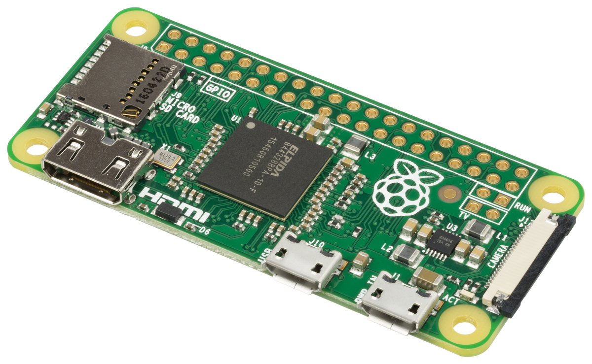

Kalau ente gemar ngoprek papan komputer mini seukuran dua jari, ada kabar sangat menarik yang baru saja bocor dari dapur pengembangan perangkat lunak resmi Raspberry Pi. Pohon kode kernel Linux Raspberry Pi tiba-tiba kedatangan berkas konfigurasi perangkat keras anyar yang sudah dinanti bertahun-tahun oleh komunitas open source dan para maker.

Generasi penerus dari lini legendaris berukuran saku, yaitu Raspberry Pi Zero 3 W, resmi menampakkan wujudnya di dalam repositori kode kernel. Tidak sendirian, di dalam rangkaian patch yang sama juga muncul kejutan lain berupa varian hemat daya Raspberry Pi 4 Model A. Kemunculan dua perangkat ini terkonfirmasi langsung lewat penarikan kode (*pull request*) yang telah digabungkan (*merged*) ke dalam cabang kernel pohon resmi Raspberry Pi.

## Bocoran Tak Terduga di Balik Pohon Device Tree Kernel

Bagi pengguna yang biasa berurusan dengan sistem embedded Linux, istilah Device Tree tentu sudah tidak asing lagi. Di arsitektur ARM, kernel Linux tidak memiliki mekanisme pendeteksian perangkat keras otomatis seperti halnya ACPI di komputer x86 konvensional. Oleh karena itu, kernel membutuhkan berkas teks khusus berekstensi DTS (*Device Tree Source*) yang mendeskripsikan secara presisi alamat memori, nomor interupsi GPIO, hingga jalur bus komunikasi periferal di atas papan sirkuit.

Insinyur perangkat keras Raspberry Pi, Marta Momotko, baru saja mengajukan penarikan kode bernomor 7711 ke repositori git resmi kernel Raspberry Pi. Patch tersebut langsung ditinjau dan ditarik ke cabang utama oleh Phil Elwell selaku pengelola subsistem kernel Raspberry Pi.

Di dalam patch tersebut, terselip dua berkas utama yang sangat gamblang menyebut identitas perangkat keras baru, yaitu `arch/arm/boot/dts/broadcom/bcm2711-rpi-zero-3-w.dts` dan `arch/arm/boot/dts/broadcom/bcm2711-rpi-4-a.dts`. Keberadaan baris kode ini sekaligus menyudahi spekulasi panjang di forum pengembang mengenai masa depan lini Zero setelah hampir lima tahun tidak mendapatkan penyegaran silikon.

## Lompatan Silikon dari Cortex A53 Menuju BCM2711

Hal paling mengejutkan dari bocoran ini terletak pada pemilihan System-on-Chip (SoC) utamanya. Berkas Device Tree tersebut secara tegas mendeklarasikan kompatibilitas perangkat keras dengan string `raspberrypi,model-zero-3-w` dan `brcm,bcm2711`. Artinya, Raspberry Pi Zero 3 W bakal diotaki oleh silikon Broadcom BCM2711, yaitu prosesor quad-core ARM Cortex-A72 64-bit yang selama ini menjadi dapur pacu utama Raspberry Pi 4 Model B.

Sebagai perbandingan, Raspberry Pi Zero 2 W yang meluncur pada akhir 2021 masih mengandalkan chip RP3A0 berisi silikon lawas Broadcom BCM2837 dengan empat core Cortex-A53 berkecepatan 1 GHz. Lompatan dari mikroarsitektur Cortex-A53 (*in-order execution*) ke Cortex-A72 (*out-of-order execution*) menjanjikan lonjakan instruksi per clock (IPC) yang masif untuk beban komputasi nyata.

*Sumber: [Raspberry Pi](https://www.raspberrypi.com/products/raspberry-pi-zero-2-w/)*

Peningkatan ini bukan sekadar urusan angka benchmark di atas kertas, om. Arsitektur BCM2711 membawa kontroler memori LPDDR4 yang jauh lebih gesit dibanding LPDDR2 di Zero 2 W, serta unit pengolah grafis VideoCore VI yang mendukung akselerasi video lebih modern. Bagi mereka yang menjalankan distro headless Linux, container Docker skala kecil, atau proxy lokal, peningkatan efisiensi IPC ini akan terasa sangat signifikan saat memproses tumpukan paket jaringan.

## Bedah Konfigurasi Jalur PCIe dan Tombol Daya di Berkas DTS

Menelaah lembar deklarasi DTS bcm2711-rpi-zero-3-w.dts memberikan banyak petunjuk teknis mengenai tata letak port dan fitur baru yang bakal dibawa oleh Zero 3 W.

Pertama, pada sektor antarmuka visual, patch kernel ini mengaktifkan port tampilan pertama `&hdmi0` dan secara permanen menonaktifkan jalur kedua `&hdmi1`. Keputusan ini sangat masuk akal mengingat dimensi fisik papan Zero yang terlampau ramping untuk dijejali konektor layar ganda.

Kedua, konfigurasi penyimpanan kartu memori pada simpul `&emmc2` kini mendukung lebar bus 8-bit dengan regulator voltase ganda 1,8 volt dan 3,3 volt. Peningkatan jalur bus ini berpotensi mendongkrak kecepatan baca dan tulis kartu microSD hingga mode transfer SDR50 atau DDR50, memangkas waktu *booting* distro Linux secara drastis.

Ketiga, ada hal menarik pada pin kendali sistem, yaitu kehadiran blok deklarasi `pwr_button` yang terhubung langsung ke jalur GPIO 46 dengan kode Linux `KEY_POWER`. Hadirnya tombol daya terintegrasi ini menjadi kabar gembira bagi para praktisi sistem tertanam (*embedded system*). Pengguna tidak perlu lagi merakit sirkuit tombol fisik tambahan atau mencabut colokan adaptor secara paksa hanya untuk mematikan perangkat dengan aman.

Menariknya lagi, berkas DTS tersebut juga masih menyertakan simpul kontroler antarmuka cepat `&pcie0`. Belum diketahui secara pasti apakah pabrikan bakal mengekspos pin jalur PCIe generasi kedua ini ke bantalan solder di balik papan sirkuit, atau hanya sekadar dipertahankan untuk kebutuhan interkoneksi internal nirkabel Wi-Fi dan Bluetooth melalui jalur SDIO terdedikasi.

## Kejutan Raspberry Pi 4 Model A untuk Komputasi Murah

Selain kehebohan Zero 3 W, penambahan berkas Device Tree untuk Raspberry Pi 4 Model A juga menyita perhatian tersendiri. Sepanjang sejarahnya, varian Model A selalu diposisikan sebagai alternatif ekonomis dari Model B dengan mengorbankan sebagian periferal berat seperti port Ethernet fisik dan separuh deretan soket USB.

Di tengah lonjakan harga komponen PC dan kelangkaan suplai semikonduktor belakangan ini, melahirkan kembali Raspberry Pi 4 Model A merupakan langkah taktis yang sangat rasional bagi yayasan Raspberry Pi. Model 4A diperkirakan bakal mengusung footprint fisik lebih ramping, konsumsi daya diam (*idle power*) yang lebih rendah, serta banderol harga yang jauh lebih bersahabat bagi institusi pendidikan maupun industri skala rumahan.

Papan 4A ini juga mewarisi SoC BCM2711 yang sama, namun dengan pemangkasan komponen keras yang tidak esensial. Bagi proyek IoT, perangkat penampil digital (*digital signage*), atau robotika yang murni bergantung pada koneksi nirkabel Wi-Fi dan satu port USB, kehadiran 4 Model A memberikan opsi komputasi bertenaga tanpa harus membayar mahal untuk fitur port yang tidak terpakai.

## Harapan Baru untuk Komunitas Maker dan Server Mini Rumahan

Langkah tim pengembang Raspberry Pi yang telah memasukkan kode sumber ini ke ranting utama kernel Linux mengindikasikan bahwa tahap perancangan perangkat keras dan pengujian pra-produksi kemungkinan besar sudah rampung.

Jika Raspberry Pi Zero 3 W berhasil mempertahankan rentang harga ramah kantong dengan ketersediaan stok yang stabil, papan sekecil korek api ini bakal kembali merajai ekosistem komputasi mikro. Mulai dari klaster mini Kubernetes hemat listrik, gateway VPN WireGuard portabel, hingga perangkat otomasi rumah berbasis Home Assistant, lonjakan performa BCM2711 di faktor bentuk Zero adalah kombinasi yang sangat menjanjikan untuk diobrak-abrik di meja kerja.

Sumber: [Raspberry Pi Linux Kernel Pull Request #7711](https://github.com/raspberrypi/linux/pull/7711)
