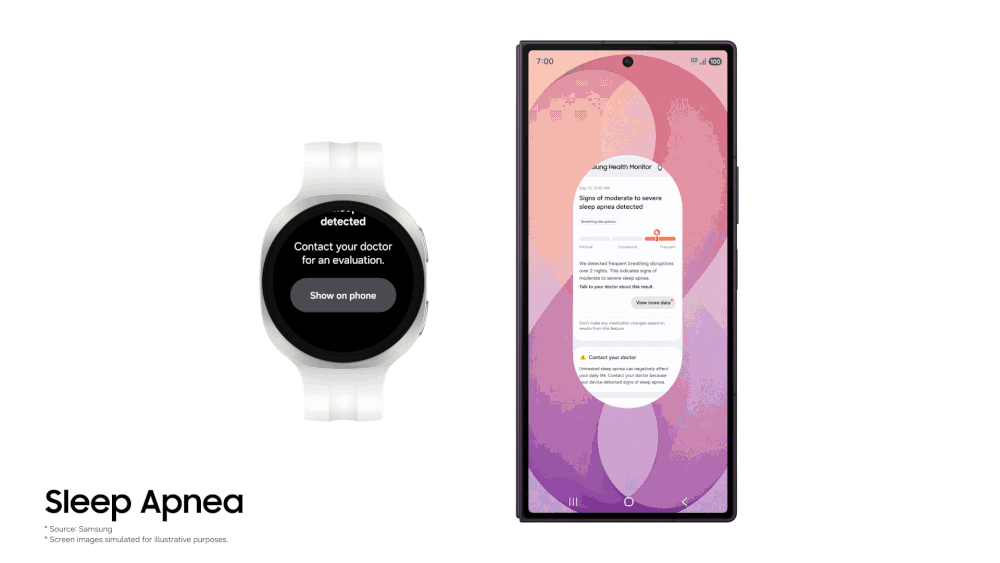

Samsung resmi memperluas fitur pemantau gangguan pernapasan saat tidur atau sleep apnea ke perangkat cincin pintar Galaxy Ring. Pembaruan ini menjadikan Galaxy Ring sebagai smart ring pertama di dunia yang mengantongi izin medis resmi untuk memantau tanda sleep apnea tingkat sedang hingga parah, menyusul persetujuan dari otoritas FDA Amerika Serikat dan MFDS Korea Selatan.

Kabar ini tentu menarik perhatian para pengguna perangkat wearable, terutama bagi mereka yang memprioritaskan kenyamanan saat tidur malam. Selama ini, fitur pemantauan sleep apnea milik Samsung hanya bisa dinikmati oleh pemilik jam tangan pintar seperti seri Galaxy Watch 9. Namun bagi sebagian orang, mengenakan jam tangan berlayar lebar dengan bobot puluhan gram ke tempat tidur terasa merepotkan dan mengganjal pergelangan tangan.

## Cincin Pintar Pertama dengan Sertifikasi Medis Gangguan Napas

Sleep apnea obstruktif merupakan kondisi medis kronis saat saluran pernapasan seseorang mengalami penyumbatan berulang kali ketika tidur. Penderitanya sering kali berhenti bernapas selama beberapa detik tanpa sadar, lalu terbangun sekejap untuk mengambil oksigen. Gejala umum yang kerap diabaikan antara lain mendengkur keras, terbangun dengan mulut kering, sakit kepala di pagi hari, serta rasa kantuk yang luar biasa di siang hari.

Banyak orang tidak pernah menyadari bahwa mereka menderita sleep apnea sampai ada pasangan tidur yang mengeluhkan suara dengkuran yang tidak wajar. Di sinilah peran perangkat pemantau pasif menjadi krusial sebagai deteksi awal.

Samsung mengambil langkah strategis dengan menghadirkan kemampuan klinis ini ke dalam bentuk cincin. Dengan bobot hanya berkisar antara 2,3 gram hingga 3 gram tergantung ukuran lingkar jari, Galaxy Ring bisa dipakai terus-menerus tanpa membebani jari tangan. Daya tahan baterainya yang mampu mencapai hingga tujuh hari juga meniadakan keharusan mengisi daya setiap malam, sebuah masalah yang selama ini menjadi kompromi terbesar pada smartwatch.

## Cara Kerja Algoritma Pemantau Sleep Apnea di Galaxy Ring

Bagaimana sebuah cincin mungil tanpa layar dan tanpa mikrofon bisa mengetahui seseorang sedang mengalami henti napas saat tertidur lelap?

Awalnya saya menduga fitur ini akan memanfaatkan mikrofon ponsel untuk mendengarkan pola dengkuran, mirip seperti aplikasi pemantau tidur pihak ketiga pada umumnya. Kalau membaca dokumentasi resmi Samsung, ternyata mekanisme yang dipakai murni berbasis sensor biometrik optik fotopletismografi (PPG) dan sensor gerak akselerometer yang terpasang di bagian dalam cincin.

Sensor PPG inframerah memancarkan cahaya ke jaringan kapiler darah di jari untuk membaca fluktuasi saturasi oksigen darah (SpO2) serta variabilitas detak jantung secara berkala. Ketika terjadi henti napas, kadar oksigen dalam darah akan merosot tajam secara mendadak. Pada saat yang sama, otak akan memicu respons stres mikro yang membuat denyut jantung berdegup lebih kencang demi memaksa saluran napas terbuka kembali.

*Sumber: [Samsung Newsroom](https://news.samsung.com/global/upgraded-sleep-apnea-feature-now-available-on-galaxy-ring-following-regulatory-approvals-from-us-fda-and-korea-mfds)*

Algoritma pemrosesan Samsung Health Monitor kemudian memetakan frekuensi penurunan oksigen relatif tersebut. Dari data fluktuasi yang terkumpul, sistem menghitung perkiraan indeks gangguan pernapasan dan menyimpulkan apakah pengguna menunjukkan tanda-tanda sleep apnea obstruktif tingkat sedang hingga parah.

## Syarat Penggunaan dan Kebutuhan Data Dua Malam

Salah satu aspek praktis dari fitur baru ini adalah kebutuhan datanya yang tidak menuntut komitmen panjang. Pengguna tidak diwajibkan memakai cincin selama berminggu-minggu berturut-turut hanya untuk mendapatkan pembacaan awal status pernapasan.

Berikut adalah beberapa ketentuan teknis pengoperasian fitur sleep apnea pada Galaxy Ring:

- Memerlukan data tidur valid minimal selama 2 malam dalam jangka waktu 10 hari pemakaian.
- Dua malam pengukuran tidak harus berurutan, sehingga pengguna tetap bisa mendapatkan analisis meski sempat melepas cincin pada hari tertentu.
- Wajib dipasangkan dengan ponsel pintar Samsung Galaxy yang menjalankan aplikasi Samsung Health Monitor versi terbaru.
- Ditujukan untuk orang dewasa berusia 18 tahun ke atas yang belum pernah didiagnosis memiliki sleep apnea oleh dokter.
- Berstatus perangkat lunak medis tanpa resep atau over the counter (OTC) yang berfungsi sebagai alat skrining mandiri, bukan pengganti pemeriksaan laboratorium polysomnography formal di rumah sakit.

## Perbandingan Pelacakan Tidur Smart Ring dan Smartwatch

Kehadiran fitur ini mempertegas perbedaan peran antara jam tangan pintar dan cincin pintar dalam ekosistem Samsung. Keduanya memiliki kelebihan dan kekurangan tersendiri ketika digunakan sebagai alat pemantau tidur harian:

- Kenyamanan fisik: Galaxy Ring unggul mutlak karena bentuknya yang ringkas tanpa layar sentuh, tidak mengeluarkan kilatan cahaya layar di kamar tidur yang gelap, dan tidak tersangkut pada sprei atau bantal.
- Manajemen baterai: Galaxy Ring hanya perlu diisi daya sekali dalam rentang 5 hingga 7 hari, sementara smartwatch modern umumnya memerlukan pengisian daya harian atau dua hari sekali yang sering berbenturan dengan waktu tidur.
- Umpan balik langsung: Smartwatch dapat memberikan getaran alarm haptic di pergelangan tangan untuk membangunkan pengguna secara tenang, sedangkan Galaxy Ring tidak memiliki motor getar mandiri dan murni berfungsi sebagai sensor pencatat data pasif.
- Interaksi pengguna: Galaxy Ring mengandalkan layar ponsel seutuhnya untuk membaca grafik riwayat kesehatan, sedangkan smartwatch memungkinkan pengguna memeriksa skor tidur langsung dari pergelangan tangan begitu membuka mata.

Kombinasi kedua perangkat ini sebenarnya saling melengkapi. Bagi mereka yang merasa risih tidur mengenakan jam tangan, Galaxy Ring kini memberikan fungsi pemantauan kesehatan setara perangkat medis tanpa kompromi kenyamanan.

## Tantangan Izin Regulasi dan Ketersediaan Wilayah

Membawa fitur berbasis algoritma medis ke perangkat konsumen membutuhkan perjalanan birokrasi yang panjang dan ketat. Samsung sebelumnya memperoleh otorisasi De Novo dari Food and Drug Administration (FDA) Amerika Serikat pada Februari 2024 untuk lini Galaxy Watch.

Izin tersebut kemudian diperbarui oleh FDA pada Juli 2026 menyusul peningkatan akurasi algoritma dan perluasan dukungan ke perangkat pintar cincin. Otoritas Korea Selatan melalui Ministry of Food and Drug Safety (MFDS) turut mengesahkan izin serupa pada Oktober 2026, yang kini menjadi landasan rilis resmi pembaruan ini di negara asalnya serta pasar Amerika Serikat.

Karena fitur ini menyandang klasifikasi perangkat lunak medis, Samsung tidak bisa menggulirkannya serentak di seluruh dunia melalui pembaruan aplikasi biasa. Setiap otoritas kesehatan nasional, termasuk di kawasan Asia Tenggara seperti Indonesia dan Malaysia, memiliki regulasi pengujian klinis mandiri sebelum fitur serupa diizinkan aktif untuk konsumen lokal. Pada catatan rilisnya, Samsung menyatakan bahwa ketersediaan di negara lain akan dibuka bertahap seiring terbitnya lisensi kesehatan setempat.

## Menghubungkan Data Pemantauan Mandiri ke Tindakan Klinis

Kehadiran fitur pemantau sleep apnea di cincin pintar membuka peluang besar bagi masyarakat umum untuk lebih peduli terhadap kualitas istirahat malam. Selama ini, rasa lelah saat bangun pagi atau penurunan konsentrasi di siang hari sering dianggap sekadar akibat kurang tidur atau beban kerja menumpuk, padahal bisa jadi dipicu oleh saluran napas yang tercekik berulang kali di malam hari.

Gangguan sleep apnea yang dibiarkan bertahun-tahun tanpa penanganan medis diketahui dapat meningkatkan risiko komplikasi serius, mulai dari hipertensi, gangguan irama jantung, hingga stroke.

Dengan adanya laporan data berkala yang disajikan rapi dalam format PDF di aplikasi Samsung Health Monitor, pengguna memiliki bukti awal yang konkret untuk didiskusikan bersama dokter spesialis paru atau dokter spesialis THT. Langkah kecil mengenakan cincin saat tidur kini bisa menjadi jembatan awal yang sangat bernilai menuju pemeriksaan medis lanjutan sebelum masalah kesehatan berkembang lebih jauh.

Sumber: [Samsung Newsroom](https://news.samsung.com/global/upgraded-sleep-apnea-feature-now-available-on-galaxy-ring-following-regulatory-approvals-from-us-fda-and-korea-mfds)