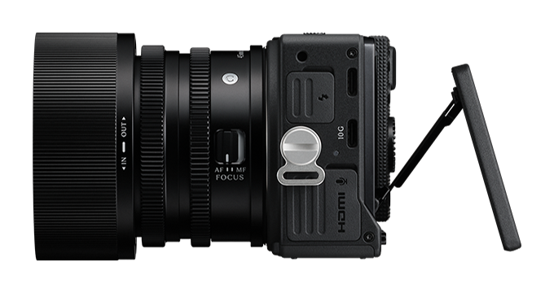

Tujuh tahun yang lalu, Sigma membuat langkah unik di industri fotografi saat memperkenalkan Sigma fp. Kamera tersebut langsung menyabet predikat sebagai kamera mirrorless full frame terkecil dan teringan di dunia. Bentuknya kotak minimalis menyerupai balok bata tanpa tonjolan handgrip maupun jendela bidik bawaan, yang sukses memikat para fotografer jalanan dan videografer independen. Hari ini, pabrikan asal Kanagawa, Jepang tersebut resmi mengumumkan sang penerus generasi kedua yang diberi nama Sigma FP2.

Kamera saku bersensor penuh ini dijadwalkan mulai meluncur ke pasaran global pada Rabu, 11 November 2026, dengan banderol mulai 2.199 dolar AS untuk bodi kamera saja.

## Layar Lipat Miring dan Rahasia Sirkulasi Panas

Awalnya saya menduga Sigma hanya akan menyegarkan sektor dapur pacu internal tanpa merombak bentuk bodi luarnya. Maklum, menjaga bodi kamera agar tetap seringkas mungkin biasanya menuntut banyak kompromi mekanis. Namun saat melihat detail fisiknya, ada satu perubahan yang langsung mencuri perhatian, yaitu layar belakangnya yang kini bisa dilipat miring (tilting LCD).

Layar sentuh berukuran 3,2 inci dengan resolusi 2,1 juta titik tersebut kini dapat ditekuk ke atas hingga 90 derajat dan ke bawah hingga 45 derajat. Bagi pengguna yang sering membidik dari sudut rendah (low angle), sudut tinggi di atas kepala kerumunan, atau sekadar memantau rekaman di atas tripod dada, ketiadaan layar lipat pada model lawas memang menjadi salah satu ganjalan terbesar.

Yang membuat penasaran justru mekanisme pergerakan engsel layarnya. Saat ditarik keluar, layar ini tidak sekadar berputar di tempat, melainkan sedikit menjauh dari bodi utama kamera. Desain renggang ini ternyata berfungsi ganda membuka jalur pembuangan panas (airflow) pasif. Udara segar bisa bersirkulasi di sela-sela belakang panel layar, membantu mendinginkan sensor dan prosesor saat dipakai merekam video berdurasi panjang tanpa memerlukan kipas pendingin aktif yang bising.

Hebatnya, penambahan engsel fleksibel ini hanya menambah bobot kamera sekitar 6 gram dibanding model pendahulunya. Dengan total bobot bodi sekitar 376 gram, Sigma masih mantap mempertahankan reputasinya sebagai pembuat kamera mirrorless full frame teringkas di dunia.

*Sumber: [Sigma Corporation](https://www.sigma-global.com/en/cameras/fp2/)*

## Sensor Cepat untuk Memangkas Efek Rolling Shutter

Beralih ke sektor penangkap gambar, Sigma FP2 mengusung sensor full frame baru beresolusi 24,5 megapiksel dengan arsitektur partially stacked back-side illuminated (BSI) CMOS. Kalau hanya melihat angka resolusinya, besaran ini bahkan turun tipis dibandingkan sensor 24,6 megapiksel pada Sigma fp generasi awal.

Namun setelah membaca lembar spesifikasi teknisnya lebih jauh, kunci peningkatan kali ini bukan terletak pada adu jumlah megapiksel, melainkan kecepatan pembacaan sinyal sensor (readout speed).

Lini kamera fp sedari awal memang mengambil langkah radikal dengan meniadakan unit rana mekanis (mechanical shutter) secara total, sehingga mengandalkan 100 persen rana elektronik (electronic shutter). Pendekatan ini membuat bodi kamera tetap tipis dan operasionalnya senyap tanpa getaran cermin, tetapi rawan memicu distorsi garis miring atau efek jello (rolling shutter) saat merekam obyek bergerak kencang.

Berkat sensor partially stacked berkecepatan tinggi, waktu pemindaian tiap baris piksel menjadi jauh lebih kilat, sehingga distorsi rolling shutter pada foto maupun video dapat ditekan secara drastis. Berkat sensor kencang ini pula, Sigma FP2 sanggup memotret beruntun hingga 20 frame per detik (fps) dengan kapasitas buffer mencapai 200 frame sekali tekan.

Sistem autofokusnya pun mendapatkan lompatan besar. Jika sebelumnya pelacakan fokus hanya mengenali wajah manusia dan tubuh hewan peliharaan, kini algoritma pengenalannya sudah diperluas untuk mendeteksi burung secara otomatis dengan penguncian subjek yang jauh lebih presisi.

## Tombol Khusus Sinema dan Audio 32-bit Float

Bagi kalangan pembuat film independen, daya pikat utama seri fp terletak pada identitas gandanya. Sigma tidak menyatukan menu foto dan video menjadi satu tumpukan yang membingungkan. Di bagian atas bodi kamera, terdapat satu sakelar fisik khusus untuk berpindah seketika antara mode STILL dan mode CINE.

Begitu sakelar digeser ke mode sinema, seluruh tata letak antarmuka layar dan tombol kontrol langsung berganti menampilkan parameter khas produksi film profesional. Pengguna disajikan sudut rana (shutter angle) alih-alih shutter speed, monitor bentuk gelombang (waveform), hingga garis batas rasio aspek layar lebar.

Untuk perekaman video, kamera mungil ini sudah mendukung format 6K OpenGate pada 60 fps dan 4K hingga 120 fps dalam mode crop sensor. Kemampuan 6K OpenGate menjadi fitur yang sangat berguna bagi alur kerja konten multiplatform. Editor video bisa merekam keseluruhan bidang sensor secara utuh, lalu leluasa memotong komposisi bingkai menjadi video horizontal 16:9 untuk YouTube maupun video vertikal 9:16 untuk format Reels atau Shorts tanpa mengorbankan ketajaman gambar.

Rentang dinamisnya tercatat mencapai 14,1 stop dengan headroom highlight yang lapang, lengkap dengan dukungan perekaman ProRes RAW serta profil warna Leica L-Log untuk kebutuhan koreksi warna lanjutan.

Satu fitur lain yang menurut saya sangat menarik adalah hadirnya perekaman audio 32-bit float langsung dari sirkuit internal kamera. Format 32-bit float memiliki rentang dinamis audio yang sangat lebar, sehingga para videografer solo tidak perlu khawatir suara rekaman bakal pecah (clipping) saat ada suara keras tiba-tiba, atau tenggelam tak terdengar saat narasumber berbisik pelan.

Tidak ketinggalan, Sigma menyematkan fungsi Director's Viewfinder yang sanggup menyimulasikan sudut pandang dan ukuran sensor kamera sinema papan atas industri, mulai dari ARRI ALEXA 35 hingga jajaran Sony VENICE 2 dan BURANO.

## Memori Internal 70 GB dan Ekosistem Aksesori Modular

Masalah klasik yang kerap dihadapi kreator video saat merekam format resolusi tinggi adalah kartu memori yang mendadak penuh atau kecepatan kartu yang drop di tengah syuting. Menjawab kendala ini, Sigma melengkapi FP2 dengan memori internal berkecepatan tinggi sebesar 70 GB di samping slot kartu SD UHS-II konvensional. Memori internal ini bertindak sebagai ruang cadangan otomatis, memastikan proses pengambilan gambar tidak terpotong saat kartu memori eksternal mendadak habis ruang.

Daya tahan baterainya juga ikut meningkat sekitar 30 persen dibanding generasi sebelumnya. Berkat manajemen daya yang lebih efisien, baterai ini sanggup bertahan untuk mengambil sekitar 370 jepretan foto atau 130 menit perekaman video secara berkesinambungan.

Bagi pengguna yang membutuhkan fleksibilitas lebih, konsep modularitas kamera tetap dipertahankan lewat deretan lubang baut standar tripod di sekeliling bodi. Jika merasa kesulitan membidik lewat layar di bawah terik matahari terbuka, pengguna bisa memasang modul jendela bidik elektronik eksternal EVF-21. Aksesori ini mengusung panel OLED 5,76 juta titik yang dapat ditekuk 90 derajat ke atas dan terhubung praktis melalui port USB-C samping.

Selain varian bodi standar seharga 2.199 dolar AS, Sigma juga menawarkan paket penjualan seharga 2.749 dolar AS yang menyertakan modul viewfinder EVF-21 atau pilihan lensa kit I-series 50mm F2 DG.

Melihat seluruh peningkatan yang dibawanya, Sigma FP2 tampak berhasil menjawab kompromi terbesar pada generasi sebelumnya tanpa menanggalkan identitasnya sebagai kamera full frame paling praktis. Hadirnya layar lipat bersirkulasi udara, sensor kencang minim rolling shutter, dan memori internal 70 GB menjadikannya perangkat yang sangat fungsional bagi fotografer maupun videografer jalanan yang mengutamakan portabilitas tinggi.

Sumber: [Sigma Corporation](https://www.sigma-global.com/en/news/2026/10/23/012378/)
