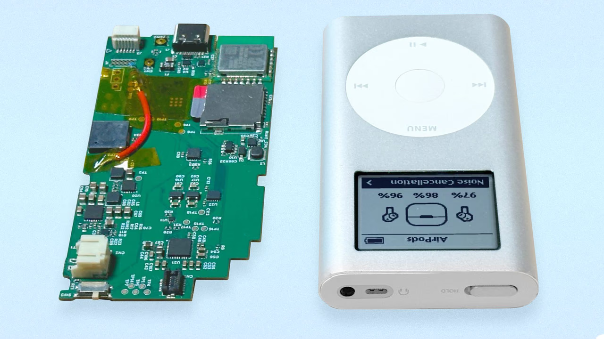

Bagi sebagian besar penggemar gawai lawas, Apple iPod klasik sering kali berakhir tersimpan rapi di dalam laci meja kerja. Penyebabnya cukup klasik, mulai dari baterai bawaan yang sudah kembung, piringan hard disk mekanis yang mulai macet, hingga ketergantungan pada konektor kuno 30 pin serta sinkronisasi kabel ke komputer. Keinginan bernostalgia sering kali terbentur repotnya mencari suku cadang lama atau rumitnya proses modifikasi manual yang menuntut keahlian solder tingkat tinggi.

Kini sebuah proyek perangkat keras sumber terbuka bernama Sprout hadir menawarkan pendekatan segar untuk menyelamatkan gawai musik legendaris tersebut. Dikembangkan oleh Certain Things, sebuah studio kreatif asal London, Sprout merupakan motherboard pengganti siap pasang yang dirancang untuk menggantikan seluruh papan sirkuit utama iPod klasik tanpa perlu merusak bodi orisinalnya. Yang membuat penasaran, motherboard modern ini ditenagai langsung oleh arsitektur mikroprosesor buatan Raspberry Pi.

## Jawaban Ringkas Fitur dan Keunggulan Motherboard Sprout

Sprout adalah motherboard pengganti sumber terbuka untuk iPod generasi ketiga, keempat, dan mini yang ditenagai chip Raspberry Pi. Papan sirkuit ini menambahkan Bluetooth untuk AirPods, Wi-Fi, DAC Hi-Fi Cirrus Logic, penyimpanan microSD hingga 2 TB, dan pengisian daya USB-C tanpa memerlukan solder serta mempertahankan layar maupun roda putar orisinal.

Dengan rancangan modular ini, pengguna dapat mempertahankan keunikan bentuk fisik dan sensasi navigasi sentuhan roda putar legendaris sembari menikmati kenyamanan ekosistem audio nirkabel modern saat beraktivitas harian.

## Dua Pilihan Varian Otak Raspberry Pi dan Kemampuan Streaming

Awalnya saya mengira proyek retrofit semacam ini hanya sekadar papan konverter kartu memori biasa seperti yang marak beredar di forum penggemar audio retro. Namun setelah membaca dokumentasi teknisnya lebih jauh, Sprout ternyata merupakan komputer mini utuh yang dirancang dalam dua pilihan konfigurasi perangkat keras yang sangat berbeda peruntukannya.

Varian pertama dinamai Sprout Pico, mengandalkan mikrokontroler Raspberry Pi RP2350 sebagai inti pemrosesan utama. Model ini ditujukan bagi pencinta audio yang mengutamakan kecepatan dan efisiensi daya maksimal. Gawai dapat menyala seketika dalam hitungan detik, memutar berkas audio lokal dari kartu memori secara mandiri, mengunduh siniar lewat Wi-Fi, serta mengalirkan suara ke headphone nirkabel via Bluetooth.

Varian kedua yang diberi nama Sprout Pi membawa peningkatan kapabilitas komputasi jauh lebih tinggi. Papan ini memadukan mikrokontroler RP2350 dengan modul komputasi Raspberry Pi Compute Module Zero. Berkat arsitektur tersebut, iPod yang dipasangi Sprout Pi sejatinya bertransformasi menjadi komputer mini bersistem operasi Linux mandiri. Pengguna tidak hanya bisa memutar berkas lokal, melainkan juga melakukan streaming musik langsung dari layanan Spotify dan Apple Music secara daring. Ekosistem ini mengingatkan kita pada fleksibilitas perangkat keras modular seperti pada [modul layar komersial Raspberry Pi](/raspberry-pi-smart-display-module-intel-sdm/) yang mampu memadukan komputasi ringkas ke dalam panel khusus.

*Sumber: [Certain Things](https://certainthings.studio/sprout/)*

## Peningkatan Kualitas Audio dan Kemudahan Konektivitas USB-C

Satu hal yang kerap menjadi kekhawatiran para penikmat musik saat memodifikasi perangkat audio lama adalah penurunan kualitas suara. Pihak Certain Things mengatasi hal ini dengan menyematkan cip DAC Hi-Fi Cirrus Logic CS43131 pada papan Sprout. Komponen audio kelas atas tersebut mengalirkan sinyal suara beresolusi tinggi langsung melalui lubang colokan headphone 3,5 mm orisinal milik iPod.

Dukungan format suaranya terbilang sangat lengkap untuk standar pemutar musik modern. Sprout mampu memutar berkas tanpa kompresi maupun kompresi tinggi mulai dari MP3, AAC, ALAC, FLAC, hingga format Opus. Selain itu, koneksi nirkabel Bluetooth yang tertanam mendukung pemasangan instan ke beragam perangkat audio nirkabel, termasuk Apple AirPods lengkap dengan menu khusus untuk pengaturan fiturnya.

Bagi mereka yang gemar mendengarkan musik lewat kabel atau perangkat DAC eksternal portabel seperti pada [earbud kabel USB-C](/razer-hammerhead-v3-chroma-earbud-kabel-usb-c/), Sprout juga menyediakan port USB-C modern di bagian bawah bodi gawai. Port serbaguna ini menggantikan konektor lama 30 pin atau FireWire, sehingga transfer lagu kini semudah menyalin data ke flashdisk biasa lewat metode drag and drop tanpa kewajiban membuka aplikasi iTunes.

Kapasitas ruang simpannya juga melonjak drastis berkat slot kartu microSD terintegrasi yang sanggup menampung kapasitas memori hingga 2 TB. Di atas kertas, kapasitas sebesar itu mampu memuat lebih dari 500 ribu judul lagu berkualitas tinggi dalam satu genggaman saku. Urusan daya tahan pun tak ketinggalan diperhatikan, dengan target pemutaran musik berkelanjutan hingga 40 jam memakai baterai 2.500 mAh pada iPod generasi ketiga dan keempat.

## Pemasangan Tanpa Solder yang Menghargai Bodi Orisinal

Hal lain yang patut diapresiasi dari perancangan Sprout adalah keramahannya terhadap pengguna awam. Banyak proyek modifikasi perangkat retro gagal diadopsi secara luas karena mewajibkan keahlian menyolder jalur tembaga yang sangat rumit dan rawan merusak komponen sensitif.

Sprout dirancang murni sebagai penggantian komponen langsung (*drop-in replacement*). Pengguna hanya memerlukan obeng presisi kecil serta alat pencungkil berbahan plastik untuk membuka cangkang iPod, mencabut papan sirkuit lama, lalu memasang papan Sprout ke soket yang sudah tersedia. Seluruh kabel fleksibel untuk layar monokrom orisinal, roda navigasi putar, dan tombol kendali langsung terhubung pas tanpa modifikasi fisik permanen.

Menariknya lagi, proses ini bersifat sepenuhnya dapat dikembalikan seperti semula (*fully reversible*). Jika suatu saat pemilik ingin mengembalikan iPod ke kondisi standar pabrikan demi alasan koleksi barang antik, papan sirkuit orisinal bawaan pabrik bisa dipasang kembali dengan mudah tanpa meninggalkan bekas modifikasi.

## Antarmuka Nostalgia Roda Putar Berbasis Sumber Terbuka

Dari sisi perangkat lunak, Certain Things membangun antarmuka pengguna khusus dari nol yang meniru persis estetika visual perangkat lunak iPod klasik. Fitur navigasi ikonik seperti Cover Flow, pencarian judul lagu, menu siniar, hingga permainan mini klasik dihadirkan kembali dengan responsivitas tinggi di layar monokrom bawaan.

Seluruh cetak biru perangkat keras Sprout, mulai dari skema rangkaian hingga tata letak papan sirkuit PCB, dilisensikan secara terbuka di bawah lisensi CERN-OHL-S v2. Sementara itu kode sumber sistem operasi dan runtime Sprout dilisensikan melalui skema MPL-2.0. Proyek ini dijadwalkan meluncurkan kampanye pendanaan publik melalui platform Crowd Supply, dengan repositori kode yang akan dibuka untuk umum di GitHub agar komunitas modder global dapat ikut berkontribusi menyempurnakan fiturnya.

> **Baca Juga:**
> - [Razer Hammerhead V3 Chroma Bawa ANC ke Earbud Kabel USB-C](/razer-hammerhead-v3-chroma-earbud-kabel-usb-c/)
> - [ArmSoM Sige7s Bawa Chip RK3588S Seukuran Raspberry Pi](/armsom-sige7s-bawa-chip-rk3588s-seukuran-raspberry-pi/)

Sumber: [Certain Things](https://certainthings.studio/sprout/)
