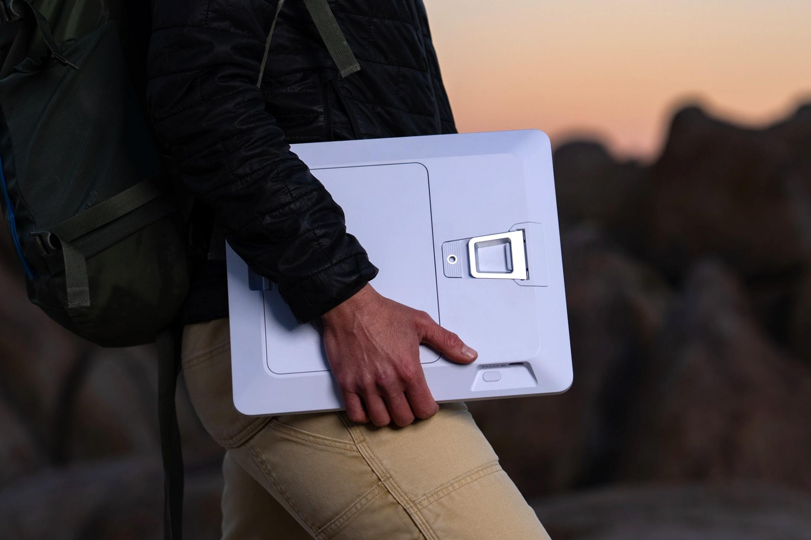

Kehadiran antena parabola mini portabel sempat mengubah cara para pekerja jarak jauh dan petualang luar ruangan mengakses internet dari area tanpa sinyal seluler. Saat Starlink Mini generasi pertama dirilis, bentuknya yang seringkas laptop di dalam ransel memang sangat memikat. Namun dalam praktiknya, pengguna masih direpotkan oleh urusan daya. Kita tetap harus menenteng kabel adaptor khusus DC atau menyambungkannya ke stasiun pengisian daya portabel yang cukup berat agar piringan antena bisa menyala.

Kini SpaceX resmi menjawab keluhan tersebut melalui pengumuman Starlink Mini 2. Gawai penerima sinyal internet satelit generasi kedua ini membawa pembaruan perangkat keras yang paling dinantikan, yakni modul baterai klip lepas pasang mandiri yang terpasang rapi di punggung perangkat. Tidak hanya bebas dari ketergantungan colokan listrik statis, terminal satelit ini juga mengadopsi standar pengisian daya universal USB-C dan lompatan teknologi jaringan lokal yang jauh lebih kencang.

## Jawaban Ringkas Fitur Baru Starlink Mini 2

Starlink Mini 2 adalah terminal internet satelit portabel generasi kedua buatan SpaceX yang dibekali baterai lepas pasang 71 Wh dengan ketahanan hingga 4,5 jam pemakaian mandiri. Perangkat ini beralih ke port daya USB-C 60W, mengusung standar Wi-Fi 6 dengan jangkauan lebih luas, serta memiliki bodi 23,1 mm yang lebih tipis dibandingkan pendahulunya.

Penyempurnaan perangkat keras ini menjadikan terminal satelit makin praktis dimasukkan ke dalam tas ransel harian tanpa kewajiban membawa kabel daya khusus milik pabrikan.

## Desain Baterai Lepas Pasang dan Fleksibilitas Pengisian Daya USB C

Awalnya saya mengira SpaceX hanya akan menyematkan baterai internal tanam seperti pada gawai tablet atau laptop biasa. Yang membuat penasaran justru mekanisme fisiknya, di mana SpaceX memilih modul baterai klip lepas pasang (*quick-release*) berkapasitas 71 Wh. Baterai seberat 490 gram ini dapat dilepas maupun dipasang kembali tanpa memerlukan alat bantu obeng sama sekali.

Jika kapasitas daya habis setelah 4,5 jam pemakaian, pengguna cukup mencopot baterai kosong dan menggantinya dengan unit cadangan. Menariknya lagi, modul baterai tersebut dibekali port USB-C mandiri serta deretan lampu indikator LED penunjuk persentase daya. Artinya, kita bisa mengisi ulang daya baterai cadangan secara terpisah menggunakan pengisi daya ponsel cerdas atau power bank berdaya tinggi saat antena utama tetap bekerja.

Langkah maju lain yang patut diacungi jempol adalah keputusan SpaceX memensiunkan colokan kabel barel DC proprietary. Sebagai gantinya, bodi Starlink Mini 2 kini langsung terintegrasi dengan port USB-C bersertifikasi Power Delivery 60W. Dalam paket penjualannya, SpaceX menyertakan kepala charger dinding 60W serta kabel USB-C fleksibel sepanjang 3 meter. Jika baterai sedang dilepas demi menghemat bobot ransel, antena tetap bisa menyala normal langsung lewat pasokan listrik kabel USB-C.

*Sumber: [The Verge](https://platform.theverge.com/wp-content/uploads/sites/2/2026/11/starlinkmini2.jpg)*

## Bodi Lebih Tipis dan Peningkatan Jangkauan Wi Fi 6

Kalau diperhatikan dari segi dimensi, SpaceX berhasil memangkas ketebalan cangkang Starlink Mini 2 secara signifikan. Antena generasi terbaru ini memiliki ketebalan fisik 23,1 mm, jauh lebih pipih jika dibandingkan dengan pendahulunya yang mencapai 38,5 mm. Meski bobot totalnya bertambah menjadi sekitar 1,6 kg saat baterai terpasang, bentuk fisiknya terasa jauh lebih ringkas saat diselipkan ke saku laptop pada tas punggung.

Ketahanan fisiknya tetap dirancang tangguh untuk medan berat berkat sertifikasi IP67 yang kedap debu dan sanggup bertahan dari guyuran hujan lebat. Di sisi belakang, terdapat kaki penyangga lipat (*kickstand*) serta lubang ulir tripod standar industri, memudahkan penempatan piringan di atas kap mobil, meja kayu perkemahan, atau tanah terbuka demi mendapatkan sudut pandang langit yang bersih dari halangan.

Sektor transmisi data nirkabel lokal juga mengalami perombakan penting:
- **Standar Wi-Fi Modern:** Naik kelas dari Wi-Fi 5 pada model terdahulu menjadi Wi-Fi 6 dual-band terintegrasi.
- **Cakupan Sinyal Lebih Luas:** Jangkauan pancaran sinyal Wi-Fi melonjak dari 112 meter persegi menjadi sekitar 167 meter persegi, sanggup melayani koneksi banyak perangkat sekaligus tanpa penurunan performa drastis.
- **Tombol Daya Fisik:** Kehadiran tombol fisik on/off yang memudahkan pengguna mematikan perangkat saat tidak dipakai, mengakhiri sistem colok-cabut kabel yang merepotkan pada varian awal.
- **Kecepatan Konfigurasi:** Mampu mengunci sinyal konstelasi satelit orbit rendah dalam waktu sekitar 60 detik begitu diarahkan ke langit terbuka.

Koneksi internet tanpa hambatan di mana saja tentu sangat membantu mobilitas kerja modern. Namun agar konsumsi data kuota satelit tidak terkuras secara sia-sia oleh proses latar belakang sistem operasi ponsel, pengguna tetap disarankan menerapkan [panduan hemat kuota di hp](/cara-hemat-kuota-di-hp/) saat menyambungkan gawai harian ke jaringan ini. Selain itu, bagi yang sering memindahkan dokumen kerja berukuran besar dari lapangan ke laptop, metode [kirim file nirkabel lokal](/cara-kirim-file-android-ke-pc-tanpa-kabel-pakai-quick-share/) bisa menjadi solusi praktis tanpa membebani lalu lintas satelit.

## Skema Harga dan Ketersediaan Pasar

SpaceX mulai membuka pemesanan Starlink Mini 2 melalui sistem undangan khusus bagi pelanggan di Amerika Serikat sebelum memperluas distribusi ke negara lain. Untuk tahap awal, gawai ini ditawarkan dalam paket bundel seharga $999 yang sudah mencakup langganan layanan internet portabel Roam Unlimited selama satu tahun penuh.

Bagi pengguna yang menginginkan unit perangkat keras saja, bocoran katalog sistem Starlink mencantumkan banderol terminal terpisah sekitar $249, sementara modul baterai klip tambahan dijual seharga $50 per unit. Dengan kombinasi baterai fleksibel, port daya USB-C terstandarisasi, dan antena yang makin tipis, Starlink Mini 2 menetapkan standar baru bagi perangkat internet satelit konsumer yang benar-benar siap diajak menjelajah.

> **Baca Juga:**
> - [Sprout Sulap iPod Lawas Jadi Modern Pakai Raspberry Pi](/sprout-ipod-lawas-raspberry-pi/)
> - [ArmSoM Sige7s Bawa Chip RK3588S Seukuran Raspberry Pi](/armsom-sige7s-bawa-chip-rk3588s-seukuran-raspberry-pi/)

Sumber: [SpaceX Starlink](https://starlink.com/mini-2)
