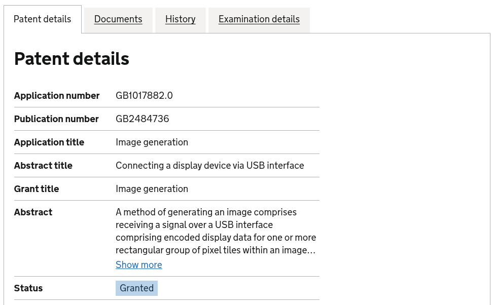

Perusahaan semikonduktor Synaptics melayangkan surat somasi hukum berupa *cease-and-desist* kepada Mike Lothian, pengembang independen proyek driver Vino. Vino merupakan modul driver grafis kernel Linux sumber terbuka berbasis bahasa Rust yang dibangun dengan bantuan agen AI Claude Code guna menggantikan tumpukan perangkat lunak tertutup DisplayLink pada stasiun dok monitor USB.

Kalau ente pernah menyambungkan laptop Linux ke *docking station* USB multipantau berbasis chip DisplayLink, ente pasti paham rasa frustrasinya. Selama bertahun-tahun, dukungan perangkat keras DisplayLink di lingkungan kernel Linux Linux selalu bergantung pada tumpukan piranti lunak hibrida yang kaku. Kita dipaksa memasang modul kernel sumber terbuka bernama EVDI yang dipadukan dengan daemon *user-space* berformat biner tertutup (*proprietary blob*). Setiap kali distro merilis pembaruan kernel atau ketika beralih ke sesi Wayland, tampilan monitor eksternal kerap mengalami *flickering*, latensi kursor yang mengganggu, bahkan gagal mendeteksi layar sama sekali.

Kondisi tersebut mendorong Mike Lothian, pengembang independen yang dikenal dengan nama alias FireBurn di komunitas sumber terbuka, untuk merombak total pendekatan lawas tersebut lewat proyek eksperimental bernama Vino.

## Kelahiran Proyek Vino dan Sentuhan AI Claude Code

Alih-alih terus menambal tumpukan kode EVDI yang rapuh, Mike memilih jalur yang jauh lebih ambisius. Beliau merancang driver DRM (*Direct Rendering Manager*) asli di ruang kernel Linux menggunakan bahasa pemrograman Rust. Langkah ini sejalan dengan tren modern di komunitas pengembang hulu, sebagaimana terlihat pada akselerasi [adopsi bahasa Rust pada modul kernel Linux](/linux-7-4-hapus-driver-c-binder-resmikan-rust/) untuk subsistem perangkat keras generasi baru.

Dalam proses pengembangannya, Mike memanfaatkan perkakas *large language model* Claude Code untuk membantu menganalisis tangkapan lalu lintas paket data USB serta membedah alur instruksi program bawaan vendor. Pola kerja berbantuan asisten koding ini mengingatkan kita pada [eksperimen Linus Torvalds memakai Claude Code](/linus-torvalds-claude-code-kernel-linux/) dalam merapikan struktur kode kernel. Melalui pendekatan rekayasa balik ruang bersih (*clean-room reverse engineering*), Mike berhasil menyusun logika komunikasi langsung antara kernel Linux dan perangkat keras stasiun dok.

Hasil awalnya sangat menjanjikan. Versi awal Vino yang dikirimkan ke milis kernel pada Juni 2026 mampu menjalin komunikasi dua arah dengan perangkat DisplayLink. Bahkan pada iterasi ketiga (Vino v3), driver ini telah berhasil mengendalikan fungsi keluaran grafis pada tiga generasi *docking station* DisplayLink berbasis USB 3.0 tanpa membutuhkan daemon biner tertutup di sisi ruang pengguna.

## Ancaman Biaya Puluhan Ribu Dolar dan Klaim Paten Synaptics

Harapan komunitas Linux untuk menikmati stasiun dok monitor USB secara bebas seketika terbentur tembok hukum. Synaptics, korporasi pemilik teknologi DisplayLink, mengambil langkah agresif dengan mengirimkan surat peringatan hukum (*cease-and-desist*) melalui tim kuasa hukumnya pada 17 Agustus 2026.

Surat somasi pertama tersebut menuntut Mike menghentikan seluruh aktivitas pengembangan Vino, mencabut patch yang telah dikirimkan ke pengelola kernel, serta menghapus seluruh repositori publik dengan tenggat waktu akhir Agustus. Dalam lampiran surat tersebut, Synaptics mendaftar lebih dari 125 portofolio paten mereka tanpa merinci pasal mana saja yang dianggap dilanggar oleh kode Vino.

Menanggapi somasi tersebut, Mike tetap bersikap terbuka. Beliau mengirimkan patch Vino versi 3 ke milis resmi pengembang grafis kernel (dri-devel) seraya menanyakan bagian kode mana yang secara spesifik menabrak hak kekayaan intelektual Synaptics. Jawaban datang pada awal Oktober 2026 dalam bentuk tabel pemetaan klaim paten (*claim charts*). Synaptics menuding kode Vino melanggar dua paten terdaftar di Inggris, yakni GB2484736 dan GB2485613, yang mencakup mekanisme pengompresan data piksel serta protokol transmisi citra melalui antarmuka USB.

*Sumber: [Intellectual Property Office UK](https://www.search-for-intellectual-property.service.gov.uk/GB1017882.0)*

Tidak berhenti di situ, tekanan hukum yang dilancarkan Synaptics kian menekan sang pengembang independen. Dalam surat bertanggal 5 Oktober 2026, pihak Synaptics menuntut penggantian biaya penyusunan dokumen klaim sebesar 25.000 dolar AS. Apabila tenggat waktu 11 Oktober tidak dipenuhi, beban biaya tersebut diancam akan berlipat ganda secara kumulatif sebesar 25.000 dolar AS setiap pekan.

Meskipun Mike telah menawarkan iktikad baik untuk membekukan pengembangan modul pengkodean gambar dan mengajukan permohonan lisensi nonkomersial, pihak Synaptics menolak mentah-mentah. Korporasi tersebut menegaskan tidak akan memberikan toleransi maupun janji untuk tidak menuntut di meja hijau, hingga akhirnya menetapkan batas waktu mutlak pada 18 Oktober 2026.

## Batas Tipis Antara Clean Room Engineering dan Jeratan Paten

Kasus somasi driver Vino menyingkap realitas pelik dalam dunia rekayasa balik perangkat keras untuk sistem operasi bebas. Secara hukum hak cipta (*copyright*), teknik *clean-room design* kerap menjadi perisai efektif. Pengembang tidak menyalin baris kode biner vendor secara langsung, melainkan mempelajari perilaku sinyal di kabel USB lalu menulis ulang implementasinya dari nol.

Namun, perlindungan rekayasa balik tersebut sering kali tidak berdaya saat berhadapan dengan hukum paten (*software patent*). Hak paten tidak mempermasalahkan apakah kode ditulis ulang sendiri atau dibantu oleh model AI. Selama alur logika atau algoritma transmisi data yang dijalankan memproses kompresi gambar dengan metode yang telah dipatenkan oleh pemegang hak, implementasi independen tersebut tetap dapat dituduh melakukan pelanggaran paten.

Bagi seorang pengembang independen perorangan, menghadapi ancaman litigasi bernilai puluhan ribu dolar dari korporasi publik berskala global adalah pertempuran yang mustahil dimenangkan sendirian. Menghadapi risiko finansial yang berpotensi menghancurkan kehidupan pribadi, Mike akhirnya memutuskan untuk menghapus repositori publik Vino dari GitHub.

## Nasib Ekosistem Periferal Layar USB di Linux

Tindakan represif Synaptics terhadap proyek Vino mengirimkan sinyal dingin bagi masa depan dukungan *docking station* USB di Linux. Sikap keras pemegang paten mempertegas bahwa pengembang independen tidak akan leluasa menghadirkan driver alternatif hulu yang terintegrasi langsung di repositori utama kernel Linux.

Bagi pengguna Linux yang membutuhkan konfigurasi banyak monitor eksternal, ketergantungan pada periferal berbasis teknologi tertutup DisplayLink kini semakin patut dipertimbangkan kembali. Standar industri terbuka seperti USB-C DisplayPort Alternate Mode (DP Alt-Mode) dan Thunderbolt menawarkan transmisi sinyal video murni langsung dari unit grafis laptop tanpa memerlukan manipulasi paket data terkompresi atau daemon perangkat lunak pihak ketiga.

Proyek Vino kini memang harus terhenti di bawah bayang-bayang tuntutan hukum. Namun, jejak diskusi teknis dan patch yang sempat diajukan di milis publik telah membuktikan bahwa komunitas dengan dukungan perkakas modern sanggup menembus kerumitan protokol tertutup, kendati tembok regulasi paten masih berdiri kokoh menghalangi kebebasan perangkat keras.

> **Baca Juga:**
> - [Banjir Patch AI, Lorenzo Stoakes Mundur Jadi Reviewer Linux](/banjir-patch-ai-lorenzo-stoakes-mundur-reviewer-linux/)
> - [Kernel Linux 7.4 Hapus Driver C Binder demi Rust](/linux-7-4-hapus-driver-c-binder-resmikan-rust/)

Sumber: [Linux Kernel Mailing List](https://lore.kernel.org/dri-devel/20260826163913.7052-1-mike@fireburn.co.uk/)
