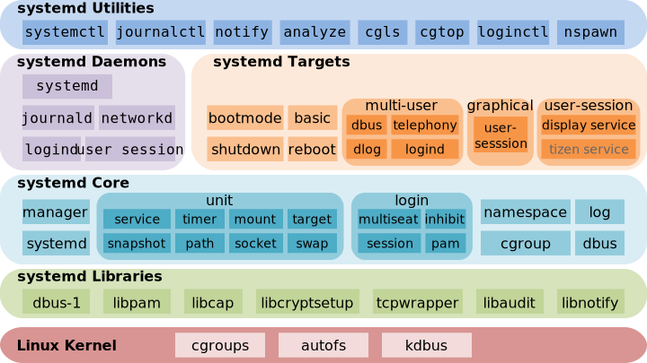

Perdebatan seputar adopsi bahasa pemrograman Rust di ekosistem inti Linux akhirnya menyentuh salah satu proyek paling krusial di ruang pengguna (userspace). Proyek systemd secara resmi telah menggabungkan (merge) fondasi infrastruktur untuk mendukung penulisan program menggunakan bahasa Rust. Perubahan bersejarah ini mendarat di cabang utama repositori git systemd melalui *pull request* yang diajukan oleh salah satu pengembang inti sekaligus maintainer kernel Linux, Christian Brauner, dan dijadwalkan hadir penuh pada rilis systemd 263 mendatang.

Kabar ini tentu langsung memicu perhatian komunitas sysadmin dan developer Linux. Namun, alih-alih merombak total kode C yang sudah teruji bertahun-tahun, tim pengembang systemd menerapkan batasan teknis yang sangat ketat dan terukur agar tidak menimbulkan kekacauan pada siklus kompilasi distribusi Linux.

## Kesepakatan Berlin Hackfest dan Batasan Ketat untuk Rust

Langkah adopsi ini bukan keputusan impulsif. Desain integrasi Rust ini disepakati oleh para maintainer inti dalam pertemuan Berlin Hackfest. Prinsip utamanya adalah menjaga stabilitas pustaka inti sembari memberikan ruang bagi modernisasi utilitas baru yang membutuhkan keamanan memori tingkat tinggi.

Ada rambu-rambu tegas yang diterapkan dalam keputusan tersebut:

- Rust hanya diizinkan untuk komponen daun (*leaf components*), yaitu perkakas baris perintah mandiri atau utilitas terluar yang tidak menjadi dependensi bagi komponen systemd lainnya.
- Kode C yang sudah ada tidak akan di-porting ke Rust. Pustaka inti seperti `libsystemd-shared` tetap dipertahankan sepenuhnya dalam bahasa C.
- Hubungan tautan biner (*linkage*) tetap menggunakan standar C. Program Rust menautkan pustaka `libsystemd-shared` secara dinamis sama persis seperti program biner C lainnya, serta mendeklarasikan dependensi `dlopen()` melalui berkas `.note.dlopen`.
- Pustaka internal Rust dikompilasi secara statis ke dalam masing-masing biner berekstensi terkait sehingga tidak meninggalkan dependensi *runtime* Rust tambahan di sistem operasi.

Pendekatan ini memastikan bahwa proses *booting* dasar dan pustaka fundamental Linux tetap ramping tanpa risiko regresi arsitektur yang tidak diinginkan.

## Tanpa Cargo dan Mengadopsi Pola no_std Mirip Kernel Linux

Keputusan paling menarik yang patut diacungi jempol dari sisi rekayasa perangkat lunak adalah penolakan terhadap ekosistem manajer paket Cargo. Kita tahu bahwa di lingkungan produksi server maupun *build root* distribusi Linux, penggunaan Cargo kerap memusingkan tim pengemas paket (*packagers*) karena kecenderungannya mengunduh pustaka secara dinamis dari internet dan siklus dependensi yang rumit.

Dalam implementasi systemd, seluruh proses kompilasi dikendalikan langsung oleh Meson dan Ninja. Tidak ada berkas `Cargo.toml`, tidak ada pengunduhan *crates* eksternal dari crates.io, dan kode Rust berjalan dalam mode `no_std` yang hanya memanfaatkan *crate* internal bawaan kompilator seperti `core` dan `alloc`.

*Sumber: [Wikimedia Commons](https://commons.wikimedia.org/wiki/File:Systemd_components.svg)*

Bahkan, pengelolaan alokasi memori dibuat identik dengan pendekatan Rust di Kernel Linux. Standar `alloc` bawaan Rust biasanya akan memicu *panic* atau penghentian paksa (*abort*) seketika jika sistem kehabisan memori (*out of memory*). Perilaku seperti itu sangat tabu bagi manajer sistem sekelas systemd. Oleh karena itu, modul `systemd_shared` menyediakan implementasi custom `Box` dan `Vec` sendiri. Setiap kali program Rust melakukan alokasi memori, sistem mewajibkan penanganan galat (*error handling*) eksplisit tanpa adanya alokator global yang berjalan di luar kendali.

Efisiensi ukuran berkas juga dijaga sangat ketat. Berkat optimasi LTO (*Link Time Optimization*) dan ketiadaan *standard library*, berkas biner uji coba `test-cli-rust` yang sudah di-*strip* hanya berukuran sekitar 32 KB, selisih tipis dari padanan binernya dalam bahasa C yang berukuran 20 KB.

## systemd-keyring-setup Menjadi Utilitas Rust Perdana

Utilitas pertama yang disiapkan untuk menguji ketangguhan arsitektur baru ini adalah `systemd-keyring-setup`. Perkakas ini bertugas mengelola penyediaan *keyring* pada kernel Linux serta mendaftarkan sertifikat X.509 ke dalam *keyring* integritas `dm-verity`, `fs-verity`, hingga subsistem BPF saat proses *boot* awal berlangsung, lalu menyegelnya agar tidak dapat dimodifikasi kembali.

Penanganan kunci kriptografi dan verifikasi integritas sistem memang menjadi ladang yang sangat ideal bagi keunggulan Rust. Untuk mencegah kebocoran data sensitif di memori, pengembang memperkenalkan tipe data khusus `Vec<u8, Erasing>`. Tipe ini memastikan bahwa alokasi memori untuk kunci rahasia akan langsung dibersihkan dan ditimpa nol (*zeroed out*) saat variabel keluar dari cakupan (*scope*), sehingga proteksi keamanan dijamin langsung pada level tipe data kompilator alih-alih mengandalkan ingatan programmer C untuk memanggil fungsi pembersih.

Keseragaman antarmuka juga diuji sangat ketat. Melalui skrip pengujian `test-cli-parity.sh`, luaran teks dari opsi bantuan `--help` hingga penanganan opsi baris perintah pada program Rust dipastikan identik bita demi bita (*byte-for-byte*) dengan perilaku program C aslinya.

## Syarat Toolchain dan Dampak bagi Distribusi Linux

Bagi para pengelola distro dan sysadmin yang gemar mengompilasi sistem sendiri, integrasi Rust pada systemd 263 membutuhkan *toolchain* modern. Sistem memerlukan kompilator `rustc` minimal versi 1.85, perkakas `bindgen` minimal versi 0.71.1, serta sistem pembangun `meson` versi 1.4.0 ke atas. Spesifikasi ini sejalan dengan paket pustaka yang akan menjadi standar bawaan pada rilis Debian 13 Trixie mendatang.

Meski demikian, para maintainer tetap menyematkan opsi fleksibilitas tinggi. Pilihan kompilasi dikontrol melalui parameter `-Drust=` pada Meson. Opsi ini disetel secara otomatis (*auto*) secara bawaan, namun lingkungan *bootstrap* minimal atau sistem berbasis arsitektur lawas yang belum memiliki pustaka Rust dapat dengan mudah mematikannya lewat parameter `-Drust=disabled` tanpa mengorbankan fungsi utama *init system*.

Langkah pengembang systemd dalam merangkul Rust secara selektif membuktikan kedewasaan proyek open source besar, om. Alih-alih terjebak euforia menulis ulang semua hal ke bahasa baru, mereka memilih jalan kompromi teknik yang sangat disiplin dengan menolak Cargo, menolak alokasi liar, dan membatasi Rust murni pada utilitas ujung yang benar-benar membutuhkan jaminan keamanan memori.

Sumber: [GitHub systemd](https://github.com/systemd/systemd/pull/44324)
