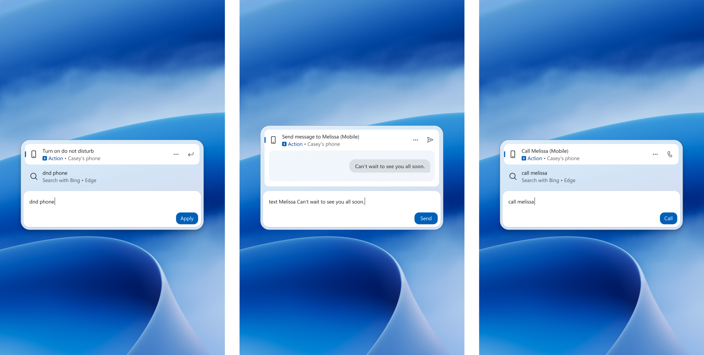

Microsoft resmi menggulirkan pembaruan besar untuk fitur pencarian Windows 11 di kanal Insider Preview. Kotak pencarian kini berubah fungsi menjadi pusat kendali interaktif yang memungkinkan pengguna mengubah volume, mengatur kecerahan layar, membaca informasi dokumen, serta mengirim pesan teks dan melakukan panggilan telepon langsung melalui ponsel pintar yang terhubung.

Awalnya saya kira fitur pencarian di bilah tugas Windows cuma bakal dapat polesan antarmuka minor seperti biasanya. Tapi setelah membaca catatan rilis resmi yang dibagikan tim pengembang Windows, perubahannya ternyata jauh lebih praktis dan menyentuh rutinitas sehari-hari di depan komputer.

## Dari Sekadar Mencari Berkas Menjadi Pusat Aksi Cepat

Konsep pencarian yang selama ini kita kenal di sistem operasi desktop biasanya pasif, pengguna mengetik nama berkas atau aplikasi lalu mengekliknya untuk membuka program terkait. Di pembaruan Windows 11 Build 26340.9843 kanal Experimental dan Build 26220.9836 kanal Beta, Microsoft mengubah pendekatan itu dengan menghadirkan apa yang mereka sebut sebagai tindakan langsung (inline actions).

Ketika kita mengetik kata kunci seperti volume atau kecerahan layar di kotak pencarian, Windows Search tidak lagi hanya menyodorkan pintasan ke menu pengaturan. Sistem langsung menampilkan bilah geser (slider) interaktif di dalam jendela hasil pencarian. Pengguna bisa langsung menggeser tingkat kenyaringan suara, meredupkan layar laptop, atau mengganti ukuran kursor mouse tanpa perlu berpindah aplikasi atau membuka panel kontrol.

Kotak pencarian ini juga dirancang melayang rapi di bagian tengah bawah layar, tepat di atas bilah tugas. Penempatan ini membuat akses pengaturan terasa jauh lebih gesit, terutama bagi mereka yang terbiasa mengandalkan papan ketik untuk menavigasi sistem.

## Integrasi Phone Link untuk Panggilan dan Pesan Teks

Bagian yang paling mencuri perhatian saya justru ada pada konektivitas perangkat seluler. Berkat integrasi mendalam dengan aplikasi Phone Link yang sudah terpasang di komputer, kolom pencarian Windows kini bisa mengendalikan fungsi ponsel pintar dari jarak jauh.

Pengguna cukup mengetik nama kontak di kotak pencarian untuk langsung memulai panggilan suara atau mengirim pesan teks singkat (SMS). Selain itu, perintah cepat seperti menyalakan mode Jangan Ganggu (Do Not Disturb) di ponsel pintar juga bisa dieksekusi langsung dari papan ketik komputer.

*Sumber: [Microsoft Windows Insider Blog](https://blogs.windows.com/windows-insider/2026/10/30/announcing-new-builds-for-30-october-2026/)*

Untuk saat ini, kemampuan panggilan dan pesan teks ini sudah berfungsi penuh untuk perangkat berbasis Android. Pengguna ekosistem Apple yang menggunakan iPhone dijadwalkan menyusul pada awal tahun depan setelah sinkronisasi protokol perpesanan selesai digulirkan.

## Pratinjau Dokumen Lebih Detail dan Kendali Privasi

Selain fungsi kendali cepat, Microsoft juga memperkaya informasi yang muncul pada kartu pratinjau berkas. Saat mencari dokumen kerja, pengguna kini dapat melihat detail penting seperti tanggal modifikasi terakhir, lokasi penyimpanan berkas, hingga nama penulis dokumen tanpa harus membuka berkas tersebut terlebih dahulu.

Kolom pencarian juga dilengkapi tab penyaring khusus di bagian atas, seperti Berkas dan Folder, Pengaturan, serta Aksi Cepat. Pemisahan kategori ini sangat membantu saat kita sedang mencari berkas tertentu di tengah ribuan dokumen kerja yang menumpuk.

Berikut rangkuman fitur utama yang dihadirkan Microsoft pada pembaruan Windows Search kali ini.

| Fitur Baru | Fungsi Utama | Ketersediaan Sistem |
| :--- | :--- | :--- |
| Inline Sliders | Atur volume, kecerahan layar, dan kursor langsung di kotak cari | Insider Build 26340.9843 |
| Phone Actions | Panggilan telepon, SMS, dan mode hening via Phone Link | Android (tersedia), iOS (awal 2027) |
| Rich File Preview | Tampilkan penulis dokumen, tanggal ubah, dan jalur folder | Beta dan Experimental Channel |
| Search Filter Tabs | Menyaring hasil berdasarkan berkas, pengaturan, dan aksi | Otomatis di Windows Search baru |
| Quick Settings Xbox | Akses WiFi, Bluetooth, dan daya di Task View game | Mode Layar Penuh Xbox |

Bagi pengguna yang memprioritaskan privasi dan kebersihan antarmuka, Microsoft tetap menyematkan tombol kendali penuh. Rekomendasi aplikasi dari Microsoft Store maupun hasil pencarian web bisa dinonaktifkan secara manual melalui menu Pengaturan lalu masuk ke bagian Privasi dan Keamanan serta memilih Pencarian.

Pengguna juga dapat mengeklik kanan pada riwayat pencarian untuk menghapus item yang tidak diinginkan, atau memberikan umpan balik jempol ke atas dan ke bawah agar sistem menampilkan hasil yang lebih relevan pada pencarian berikutnya.

## Akses Pengaturan Cepat di Mode Game Xbox Tanpa Repot

Pembaruan ini tidak cuma menyasar produktivitas kantor, tetapi juga para pencinta game PC. Pengguna yang sering menjalankan game dalam mode layar penuh Xbox sering kali merasa terganggu saat harus memeriksa koneksi jaringan atau baterai pengontrol, karena biasanya mereka harus menekan kombinasi tombol Alt plus Tab yang rentan memicu penurunan bingkai gambar (*framerate drop*).

Di versi terbaru ini, bilah navigasi Gaming Task View di mode Xbox sudah dilengkapi panel Pengaturan Cepat (Quick Settings) seutuhnya. Pemain game dapat langsung memeriksa status WiFi, mengatur perangkat Bluetooth seperti headset atau mikrofon nirkabel, hingga mengubah profil daya sistem tanpa perlu meninggalkan permainan yang sedang berlangsung.

Pembaruan ini menandakan langkah praktis Microsoft untuk menyatukan perangkat kerja dan telepon genggam ke dalam satu alur kerja yang semakin mulus di desktop.

Sumber: [Microsoft Windows Insider Blog](https://blogs.windows.com/windows-insider/2026/10/30/announcing-new-builds-for-30-october-2026/)
