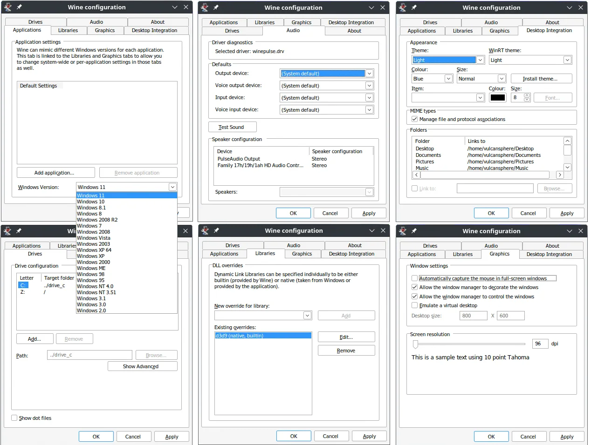

Wine 11.21 resmi meluncur sebagai rilis pengembangan dua mingguan terbaru untuk lapisan kompatibilitas Windows di Linux. Pembaruan ini mengintegrasikan ekstensi OpenGL MESA map buffer client pointer guna mendongkrak efisiensi arsitektur WoW64 32-bit, menyertakan pustaka awal Voice Capture DSP, membenahi manajemen akun pengguna, serta menambal 20 bug aplikasi lawas maupun game populer.

Bagi pengguna Linux yang gemar menjalankan game klasik atau perangkat lunak Windows warisan (*legacy*), rilis Wine 11.21 menjadi tonggak teknis yang sangat dinantikan. Tim pengembang Wine terus mematangkan pondasi sistem sebelum memasuki masa pembekuan kode (*code freeze*) untuk rilis stabil Wine 12.0 yang dijadwalkan meluncur pada awal tahun depan.

## Solusi Hambatan Kinerja OpenGL pada Subsistem WoW64

Sorotan utama pada Wine 11.21 berpusat pada penggabungan dukungan ekstensi `GL_MESA_map_buffer_client_pointer`. Inisiatif rekayasa perangkat lunak yang dimotori oleh tim CodeWeavers sejak awal tahun ini akhirnya resmi mendarat di cabang kode utama Wine setelah melewati serangkaian pengujian ketat.

Untuk memahami signifikansi pembaruan ini, kita perlu melihat tantangan arsitektur WoW64 (*Windows 32-bit on Windows 64-bit*). Di sistem operasi Linux modern 64-bit, menjalankan game Windows 32-bit yang mengandalkan API OpenGL selama ini menghadapi masalah overhead memori yang cukup berat. Aplikasi 32-bit tidak dapat secara langsung berbagi penunjuk memori (*memory pointer*) dengan pustaka sistem 64-bit milik host Linux karena perbedaan ruang alamat virtual.

Sebelum adanya ekstensi ini, Wine terpaksa membuat alokasi memori penyangga sementara di tingkat CPU. Setiap kali aplikasi memanggil fungsi pemetaan dan pelepasan buffer seperti `glUnmapBuffer`, Wine harus menyalin seluruh isi data bolak-balik antara ruang alamat 32-bit dan driver grafis 64-bit. Proses penyalinan data manual ini menyedot siklus CPU secara masif dan menimbulkan latensi mikro (*stuttering*) pada game yang sering memperbarui buffer secara dinamis.

Melalui ekstensi `MESA_map_buffer_client_pointer`, Wine kini dapat menyerahkan rentang alamat memori 32-bit langsung kepada driver OpenGL Mesa di lapisan host. Objek buffer grafis dapat langsung dipetakan ke dalam memori virtual aplikasi tanpa perlu duplikasi buffer melalui CPU (*zero-copy buffer mapping*). Hasilnya, pemrosesan grafis OpenGL untuk aplikasi 32-bit di atas Wine berjalan jauh lebih kencang, responsif, dan hemat pemakaian memori kerja.

*Sumber: [WineHQ](https://gitlab.winehq.org/wine/wine)*

## Kehadiran Pustaka DSP Tangkapan Suara dan Manajemen Pengguna

Selain akselerasi grafis, Wine 11.21 membawa peningkatan fungsionalitas audio melalui rilis perdana pustaka *Voice Capture Digital Signal Processing* (DSP). Pustaka pemrosesan sinyal digital ini menjadi komponen krusial bagi perangkat lunak komunikasi modern, aplikasi rapat daring, serta fitur obrolan suara di dalam game (*in-game voice chat*).

Pustaka DSP ini bertugas menangani peredam gema akustik (*acoustic echo cancellation*), penekanan kebisingan latar (*noise suppression*), dan kendali penguatan otomatis (*automatic gain control*) sebelum audio mikrofon dikirim ke mesin aplikasi Windows. Implementasi awal ini memastikan tangkapan suara dari mikrofon pengguna di sistem Linux dapat diproses secara jernih oleh aplikasi Windows tanpa distorsi suara atau latensi input yang mengganggu.

Di sektor subsistem inti, Wine 11.21 turut memperkokoh penanganan akun pengguna (*user accounts*). Mekanisme isolasi sesi pengguna, hak akses token keamanan Windows, dan pemetaan direktori profil pengguna kini bekerja lebih konsisten mengikuti standar lingkungan multi-pengguna Windows modern.

## Perbaikan 20 Kerusakan Sistem pada Game dan Software Populer

Siklus rilis dua mingguan ini juga menuntaskan perbaikan untuk 20 laporan kerusakan (*bug*) yang sebelumnya dilaporkan oleh komunitas pengguna di pelacak isu WineHQ. Perbaikan ini mencakup peranti lunak pengujian performa, utilitas kreatif, hingga judul-judul game populer:

1. **Cinebench 2026:** Menambal masalah crash akibat fungsi `D3D12GetInterface` pada pustaka `d3d12.dll` yang sebelumnya belum diimplementasikan secara lengkap.
2. **Skyrim dan Skyrim SE:** Mengatasi kegagalan fatal *rawinput* terkait tanda flag memori yang tidak tertangani, serta membereskan masalah assertion memori proteksi sistem `VPROT_SYSTEM`.
3. **World of Tanks:** Memperbaiki bug pada input teks di mana tombol penting seperti Enter dan Delete tidak terdaftar saat mengetik di dalam jendela obrolan (*in-game chat*).
4. **BioShock 2 Remastered:** Menuntaskan masalah crash saat pemain menerapkan setelan resolusi layar baru, akibat adanya nilai penunjuk kosong (*NULL pointer*) pada pemanggilan perintah D3D11.
5. **FL Studio:** Memperbaiki validasi tanda tangan digital pada pustaka `crypt32` yang sebelumnya salah mengurutkan atribut terotentikasi PKCS#7 sehingga mencegah aplikasi produksi musik ini terbuka.
6. **Kombinasi Tombol Pintas:** Memperbaiki penanganan tombol navigasi Shift + Ctrl + Tab yang sebelumnya tidak merespons pada berbagai jendela dialog Windows.
7. **Pustaka Jaringan WinHTTP:** Menghapus batasan pemotongan baris header HTTP sepanjang 1.459 bita yang sebelumnya merusak proses pengalihan URL *pre-signed* pada layanan cloud storage S3.

## Menatap Rilis Stabil Wine 12.0

Kalau ane perhatikan ritme pengembangannya, kehadiran Wine 11.21 menandakan bahwa cabang Wine 11.x sudah berada di fase akhir pematangan fitur. Kurang lebih dalam satu bulan ke depan, tim pengembang bakal menghentikan penambahan fitur baru untuk memulai fase pembekuan kode (*code freeze*) rilis tahunan Wine 12.0.

Peningkatan efisiensi OpenGL WoW64 ini membuktikan bahwa ekosistem gaming Linux tidak hanya memprioritaskan teknologi Vulkan atau lapisan terjemahan Direct3D seperti DXVK dan VKD3D-Proton. Kompatibilitas terhadap pustaka grafis tradisional tetap dirawat dengan standar rekayasa modern, sehingga katalog ribuan game dan aplikasi bersejarah di PC tetap dapat dinikmati di meja kerja Linux tanpa hambatan kinerja.

Sumber: [WineHQ](https://gitlab.winehq.org/wine/wine/-/releases/wine-11.21)
