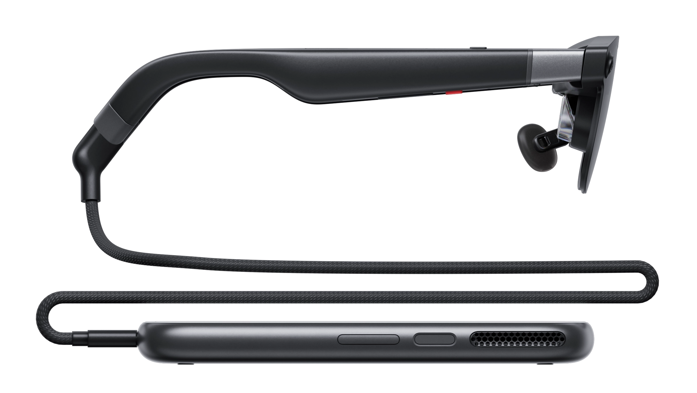

Google bersama XREAL baru saja meresmikan kehadiran perangkat komputasi spasial terbaru mereka yang bernama XREAL AURA. Kolaborasi ini menandai langkah besar bagi platform Android XR, sistem operasi khusus realitas tertambah yang dikembangkan Google untuk menyaingi headset komputasi spasial berukuran masif di pasaran. Perangkat ini tampil dalam wujud kacamata pintar tembus pandang berbobot 95 gram yang dipadukan dengan modul komputasi terpisah berbentuk cakram saku.

Awalnya saya sempat mengira perangkat Android XR perdana bakal hadir dalam bentuk headset tebal seperti Apple Vision Pro atau lini Meta Quest. Memasang baterai besar, sistem pendingin kipas, dan cip pemrosesan grafis tinggi langsung di kepala pengguna memang menjadi rute paling umum yang ditempuh sebagian besar produsen selama ini. Namun XREAL dan Google memilih pendekatan desain yang jauh lebih masuk akal untuk penggunaan harian, yaitu memindahkan beban pemrosesan berat dan baterai ke unit komputasi saku yang dihubungkan melalui satu kabel fisik tipis.

## Desain Dua Komponen dan Bobot Ringan 95 Gram

Keputusan memisahkan otak komputasi dan penampil visual membuat bingkai kacamata XREAL AURA bisa dipertahankan sangat ramping. Dengan bobot hanya sekitar 95 gram, pengguna tidak akan merasakan tekanan berlebih pada batang hidung atau kelelahan leher saat mengenakannya untuk menonton film panjang atau bekerja di depan laptop. Bentuknya menyerupai kacamata hitam biasa, bukan penutup wajah silinder yang mengintimidasi orang di sekitar.

Unit pemrosesan saku (compute puck) yang menyertainya dibekali platform Qualcomm Snapdragon Reality Elite terbaru dengan akselerator kecerdasan buatan bertenaga 48 TOPS NPU. Modul ini juga menjadi rumah bagi baterai berkapasitas 4.455 mAh (34,84 Wh) yang sanggup menopang produktivitas tanpa membebani kepala. Di bagian atas unit cakram tersebut, XREAL menyematkan sensor sidik jari untuk login biometrik dan otorisasi pembayaran aplikasi, serta permukaan sentuh kapasitif yang berfungsi layaknya trackpad navigasi.

*Sumber: [XREAL Official](https://www.xreal.com/us/aura)*

## Layar Sony Micro-OLED dan Kaca Peredam Cahaya Otomatis

Untuk urusan visual, XREAL AURA mengandalkan panel Sony Micro-OLED beresolusi 1920 x 1200 piksel per mata dengan kerapatan piksel mencapai 32 PPD. Kualitas reproduksi warnanya mencakup 100 persen cakupan warna sRGB dengan kalibrasi pabrik individual delta E di bawah 3, serta kecerahan puncak mencapai 1.050 nits dan refresh rate dinamis hingga 120Hz. Sistem optik X Prism yang dibawanya menyajikan sudut pandang diagonal (field of view) selebar 70 derajat, memberikan ruang kanvas maya yang sangat lapang.

Yang membuat penasaran justru penerapan teknologi elektrokromik pada lensa luarnya. Melalui fitur peredaman elektrokromik dengan lima tingkat transparansi, kacamata ini sanggup memblokir hingga 99,9 persen cahaya ruangan saat pengguna ingin fokus menikmati film layar lebar layaknya berada di dalam bioskop gelap. Begitu sensor mendeteksi ada orang lain yang mendekat atau mengajak berbicara, tingkat kegelapan lensa akan otomatis memudar seketika menjadi kaca tembus pandang normal, sehingga interaksi sosial di dunia nyata tetap terjaga tanpa perlu melepas kacamata.

## Integrasi Gemini dan Ekosistem Aplikasi Android XR

Keberadaan sistem operasi Android XR menjadi jiwa utama yang membedakan AURA dari sekadar kacamata display portabel biasa. Pengguna mendapatkan akses langsung ke jutaan aplikasi di Google Play Store sejak hari pertama peluncuran, ditambah lebih dari 150 aplikasi yang dioptimalkan secara khusus untuk lingkungan tiga dimensi. Layanan Google seperti YouTube, Google TV, Google Maps, dan Google Photos hadir dengan antarmuka spasial adaptif yang bisa diposisikan di berbagai sudut ruangan.

Kecerdasan buatan Google Gemini diintegrasikan secara mendalam di tingkat sistem operasi. Berbekal dua kamera pelacak 6DoF dan satu kamera visual beresolusi tinggi di bagian depan bingkai kacamata, Gemini dapat memahami apa yang sedang dilihat pengguna di dunia nyata maupun di jendela aplikasi maya. Pengguna bisa mengajak Gemini mengobrol santai lewat perintah suara untuk mengatur tata letak jendela kerja, meminta panduan arah di peta, atau menanyakan konteks objek fisik di meja tanpa perlu repot mengetik.

## Fitur Wired Mirroring untuk Ruang Kerja Virtual Laptop

Bagi kebutuhan produktivitas profesional, fitur Wired Mirroring menjadi salah satu kemampuan yang paling praktis. Pengguna cukup menghubungkan kabel USB-C dari laptop Windows, Mac, atau Chromebook langsung ke port display-in pada compute puck. Seketika itu juga layar laptop akan diproyeksikan sebagai jendela maya berukuran raksasa yang posisinya dapat digeser, diubah ukurannya, atau disandingkan berdampingan dengan aplikasi Android XR lainnya.

Sistem pencerminan kabel ini bekerja secara instan tanpa mewajibkan instalasi perangkat lunak atau driver tambahan di laptop. Karena tampilan layar hanya bisa dilihat oleh pengguna melalui lensa optik kacamata, pengguna dapat membuka dokumen kerja rahasia saat berada di kedai kopi atau di dalam kabin pesawat tanpa khawatir terkena intipan orang di sebelah. Pengguna juga dapat memasangkan keyboard dan mouse nirkabel melalui koneksi Bluetooth untuk membangun stasiun kerja lengkap di mana saja.

## Rangkuman Spesifikasi dan Harga Peluncuran Perangkat

Bagi yang ingin mengetahui rincian teknis lengkap serta paket penjualannya, berikut rangkuman spesifikasi utama dari XREAL AURA:

- Bobot Kacamata: 95 gram dengan distribusi beban seimbang pada bingkai
- Panel Layar: Dual Sony Micro-OLED beresolusi 1920 x 1200 piksel per mata, kerapatan 32 PPD, 100% sRGB, kalibrasi delta E < 3
- Kecerahan dan Refresh Rate: Kecerahan puncak hingga 1.050 nits dan refresh rate responsif hingga 120Hz
- Sistem Optik: Lensa optik tembus pandang X Prism dengan sudut pandang pandang selebar 70 derajat
- Lensa Elektrokromik: Pengatur peredaman otomatis dan manual dengan 5 tingkat kegelapan, meredam hingga 99,9% cahaya luar
- Pemrosesan Kacamata: XREAL X1S Spatial Coprocessor dengan latensi gerak-ke-foton 3 milidetik
- Modul Komputasi: Qualcomm Snapdragon Reality Elite dengan kemampuan AI 48 TOPS NPU
- Konfigurasi Memori: Opsi RAM 12GB dengan penyimpanan 256GB atau RAM 16GB dengan penyimpanan 512GB (UFS 4.0)
- Kapasitas Baterai: 4.455 mAh (34,84 Wh) terintegrasi pada compute puck dengan pengisian daya cepat 57W Max via USB-C
- Sistem Sensor: 2 kamera pelacak sudut lebar untuk 6DoF dan gestur tangan, serta 1 kamera visual AI berindikator privasi LED
- Tata Suara: Speaker terintegrasi dengan penalaan Bose EQ, audio spasial Android XR, dan susunan 4 mikrofon peredam bising
- Sensor Biometrik: Pemindai sidik jari fisik pada tombol daya modul komputasi
- Konektivitas Nirkabel: Wi-Fi 6/6E, Bluetooth 5.3, serta navigasi GPS, GLONASS, dan Galileo
- Harga Peluncuran: Mulai dari 1.099 dollar AS untuk varian 12GB/256GB hingga akhir tahun, dan 1.299 dollar AS untuk varian 16GB/512GB

Penetapan harga peluncuran sebesar 1.099 dollar AS menjadi kejutan tersendiri di pasar gawai, mengingat XREAL sempat mematok harga prapemesanan di kisaran 1.279 dollar AS beberapa pekan sebelumnya. Pengurangan harga resmi ini membuat ekosistem Android XR tampak jauh lebih agresif dalam membuka akses komputasi spasial bagi pengguna harian. Dengan desain kacamata yang tidak melelahkan kepala serta dukungan ekosistem aplikasi Google yang matang, XREAL AURA menghadirkan gambaran nyata tentang bagaimana perangkat kerja dan hiburan portabel akan digunakan pada masa mendatang.

Sumber: [Google Blog](https://blog.google/products-and-platforms/platforms/android/xreal-aura/)
