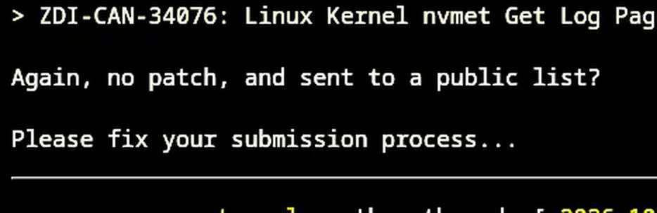

Dunia keamanan siber open source baru saja dihebohkan oleh sebuah blunder operasional yang cukup fatal. Lembaga riset kerentanan ternama di bawah naungan Trend Micro, Zero Day Initiative (ZDI), secara tidak sengaja mengirimkan sejumlah laporan celah keamanan tingkat tinggi ke milis publik kernel Linux (LKML). Padahal, celah-celah tersebut berstatus zero-day alias belum memiliki patch resmi di cabang utama (mainline) Linux.

Kalau biasanya penemuan celah kernel dilaporkan secara tertutup lewat jalur privat `security@kernel.org` agar pengembang punya waktu menyiapkan perbaikan, kali ini laporan teknis lengkap justru mendarat di hadapan ribuan pelanggan milis publik. Insiden ini langsung memicu kepanikan kecil sekaligus teguran keras dari para pengelola inti kernel Linux.

## Ketika Jalur Rahasia Berubah Jadi Panggung Terbuka

Bagi kita yang mengelola server atau sekadar hobi ngoprek distro Linux, alur pelaporan celah keamanan terkoordinasi (Coordinated Vulnerability Disclosure) adalah pilar utama yang menjaga sistem tetap aman. Konsepnya sederhana, peneliti menemukan kelemahan, mengirimkan detailnya secara rahasia ke tim keamanan kernel, tim menguji patch secara tertutup di bawah embargo, lalu merilisnya bersamaan ke publik saat pembaruan siap dipasang.

Namun alur standar itu mendadak buyar semalam. Entah karena salah klik daftar distribusi email atau ada skrip otomasi internal yang keliru membaca alamat tujuan, ZDI justru menyebarkan sedikitnya enam laporan kerentanan langsung ke `linux-kernel@vger.kernel.org` serta beberapa milis subsistem seperti driver grafis dan NVMe.

Parahnya lagi, sebagian celah yang terumbar menyandang skor keparahan CVSS hingga 9,0 dari skala 10. Angka setinggi itu menandakan adanya potensi eksekusi kode jarak jauh (Remote Code Execution) yang bisa dieksploitasi tanpa perlu otentikasi rumit.

*Sumber: [Linux Kernel Mailing List](https://lore.kernel.org/all/2026102226-duly-imprison-a2c1@gregkh/)*

## Daftar Celah Kritis yang Sempat Terpapar Bebas

Laporan yang terkirim ke publik mencakup beberapa komponen vital di dalam kernel Linux, mulai dari tumpukan jaringan, subsistem penyimpanan, hingga implementasi server berkas lokal. Sebagian dari kerentanan tersebut bahkan belum memiliki draf patch yang diuji di cabang pengujian.

Berikut ringkasan beberapa celah yang sempat tersiar tanpa proteksi embargo:

| ID Laporan ZDI | Komponen Terdampak | Tingkat Keparahan | Dampak Potensial Eksploitasi |
|---|---|---|---|
| ZDI-CAN-33549 | SMB Direct | CVSS 9,0 | Remote Code Execution akibat integer underflow |
| ZDI-CAN-33774 | Modul Server KSMBD | CVSS 9,0 | Remote Code Execution akibat kondisi race condition |
| ZDI-CAN-33367 | Jaringan (skbuff zerocopy) | Tinggi | Local Privilege Escalation (eskalasi hak akses lokal) |
| ZDI-CAN-34068 | Driver Grafis VMWGFX | Menengah ke Atas | Out-of-bounds write pada mesin virtual VMware |
| ZDI-CAN-34076 | NVMe Target (NVMET) | Menengah | Information disclosure lewat uninitialized resource |
| ZDI-CAN-32005 | Query TCP Search-Domain | Tinggi | Stack buffer overflow berujung hak akses root |

Dua celah teratas, yaitu pada modul SMB Direct dan server berkas KSMBD, menjadi sorotan paling tajam. KSMBD merupakan modul server SMB bawaan kernel yang dirancang untuk performa transfer data berkecepatan tinggi di jaringan lokal. Kerentanan bertipe race condition pada modul ini membuka peluang bagi penyerang di jaringan yang sama untuk menyuntikkan kode berbahaya langsung ke ruang memori kernel.

Sementara itu, untuk celah `skb_zerocopy` pada subsistem jaringan, pengembang kernel sebenarnya sudah menerima laporan serupa dari peneliti independen lain sepekan sebelumnya dan perbaikannya sedang diantrekan di cabang `-next`. Namun bagi celah lain seperti NVMET dan SMB Direct, pengungkapan mendadak ini benar-benar memaksa pengembang bekerja dalam mode darurat.

## Mengapa Insiden Ini Bikin Pengembang Pusing

Mungkin ente bertanya-tanya, apa ruginya kalau celah diumumkan secara terbuka? Bukankah dunia open source memang menganut prinsip transparansi?

Masalahnya terletak pada keseimbangan waktu antara pembuat patch dan pembuat eksploit. Ketika laporan bug teknis dibeberkan ke milis publik tanpa disertai patch perbaikan, para pelaku kejahatan siber yang memantau LKML mendapatkan instruksi gratis mengenai letak kelemahan sistem operasi sebelum para sysadmin sempat memperbarui server mereka.

Dalam kondisi normal di bawah embargo, pengembang kernel memiliki waktu beberapa minggu untuk berdiskusi dengan tenang, menulis kode perbaikan yang rapi, memastikan patch tidak merusak fungsi subsistem lain (tidak memicu regresi performa), serta mendistribusikan kode tersebut ke pengelola distro besar seperti Debian, Red Hat, dan Canonical.

Begitu laporan terlanjur bocor ke milis umum, masa embargo otomatis hangus seketika. Pengembang dipaksa merilis patch terburu-buru demi menutup celah secepat mungkin, situasi yang sering kali berisiko memunculkan bug baru akibat pengujian yang kurang matang.

## Reaksi Greg Kroah-Hartman dan Langkah Mitigasi Pengguna

Blunder dari organisasi sebesar Trend Micro ZDI ini sontak memancing reaksi langsung dari orang kedua di hierarki kernel Linux, Greg Kroah-Hartman. Pengelola cabang kernel stabil yang terkenal tegas ini membalas satu per satu email laporan tersebut dengan nada jengkel di ruang publik.

Dalam salah satu balasannya terkait laporan celah NVMET, Greg menuliskan pesan singkat yang menohok, mempertanyakan mengapa laporan dikirimkan ke milis umum tanpa menyertakan patch sama sekali, serta meminta pihak ZDI segera membereskan prosedur pengiriman laporan mereka.

Bagi kita para pengguna harian Linux maupun sysadmin yang bertanggung jawab atas server produksi, tidak perlu panik berlebihan. Berikut langkah mitigasi praktis yang bisa diambil sembari menunggu patch resmi masuk ke kernel stable:

1. **Nonaktifkan KSMBD Jika Tidak Dipakai:** Jika server ente menjalankan pembagian berkas lokal dan hanya butuh protokol Samba biasa, pastikan modul `ksmbd` di kernel tidak dimuat aktif. Cukup gunakan daemon Samba user-space (`smbd`) yang lebih matang dan terisolasi dari ruang kernel.
2. **Batasi Akses Jaringan SMB:** Jangan pernah membuka port SMB (port 445 dan 139) ke jaringan internet publik. Batasi akses berkas hanya melalui jaringan lokal tepercaya atau lewat terowongan VPN terenkripsi seperti WireGuard.
3. **Pantau Pembaruan Kernel Distro:** Tim pengembang kernel Linux saat ini sedang mempercepat integrasi patch untuk cabang stabil (seperti Linux 6.12 LTS, Linux 6.6 LTS, hingga rilis baru Linux 7.3). Begitu vendor distro ente merilis paket pembaruan kernel beberapa hari ke depan, segera jadwalkan proses pembaruan sistem dan reboot berkala.

Kelalaian ini menjadi pengingat berharga bagi komunitas teknologi bahwa rantai keamanan siber tidak hanya ditentukan oleh kehebatan kode program, melainkan juga kedisiplinan manusia dalam menjalankan prosedur komunikasi.

Sumber: [Linux Kernel Mailing List](https://lore.kernel.org/all/2026102226-duly-imprison-a2c1@gregkh/)
